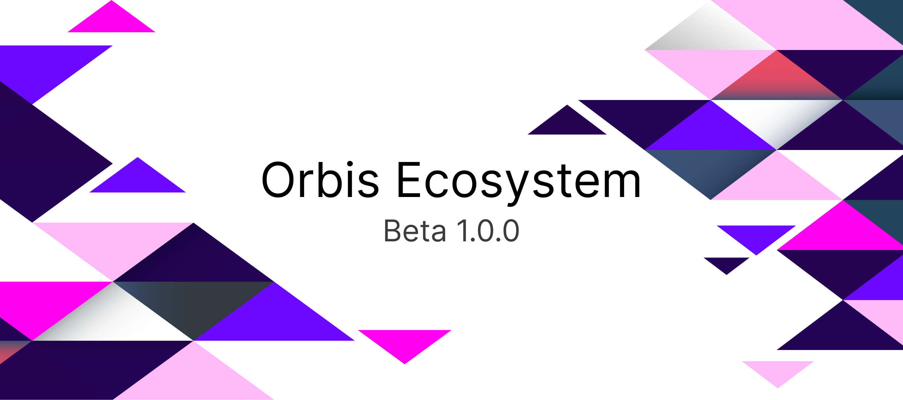

  

  <h1>Orbis Enterprise</h1>

  

    <strong>A next-generation, on-premise educational management ecosystem.</strong> 
    Built for data sovereignty, local-first operations, and institutions with one or many campuses.
  

  

    <a href="https://orbis.mulverse.com">Website</a>
    ·
    <a href="mailto:mulverseco@gmail.com">Contact Mulverse</a>
    ·
    <a href="https://github.com/MxHabob/Orbis/releases">Releases</a>
  

  

    <a href="#features"><strong>Features</strong></a>
    ·
    <a href="#deployment"><strong>Deployment</strong></a>
    ·
    <a href="#translations"><strong>Translations</strong></a>
    ·
    <a href="#contributors"><strong>Contributors</strong></a>
  

> [!IMPORTANT]
> License terms are maintained in [`LICENSE`](LICENSE). Review them and contact Mulverse for licensing, deployment, or partnership inquiries.

---

## Overview

**Orbis** is an on-premise educational management ecosystem for universities, school networks, vocational institutes, and academies. It brings academic operations, examinations, attendance, timetabling, and financial management together for institutions operating one or multiple campuses.

Orbis is designed to run on an institution's own infrastructure, with a native desktop client and local-first workflows. It supports centralized administration alongside branch-level operations and policy overrides.

  
  Orbis ecosystem artwork. Application UI screenshots are not currently included in this repository.

## Features

  <table>
    <tr>
      <td width="50%" valign="top">

#### Organization & Identity
- Model headquarters, campuses, faculties, and departments in a hierarchy
- Separate person records from user accounts for students, staff, and guardians
- Manage branch-level operations with inherited institutional policies

      </td>
      <td width="50%" valign="top">

#### Academics & Student Lifecycle
- Configure semesters, trimesters, academic years, or modular periods
- Support cohort-based and credit-hour academic structures
- Promote students through staged transitions with rollback support

      </td>
    </tr>
    <tr>
      <td width="50%" valign="top">

#### Exams & Assessment
- Coordinate exam cycles, halls, and proctor schedules
- Generate seating numbers and protected secret numbers
- Manage academic assessment workflows

      </td>
      <td width="50%" valign="top">

#### Attendance & Timetabling
- Record lesson-level and daily attendance
- Route medical absence excuses through a review workflow
- Detect teacher and room conflicts with constraint-based scheduling

      </td>
    </tr>
    <tr>
      <td width="50%" valign="top">

#### Finance
- Maintain a unified double-entry chart of accounts
- Organize branch sub-treasuries and point-of-sale cash registers
- Configure tuition, fees, discounts, installments, and multi-currency receipts

      </td>
      <td width="50%" valign="top">

#### Documents & Operations
- Design certificates, transcripts, reports, and ID cards with DocForge
- Store documents on local or private on-premise storage
- Support role-based document access, audit logs, and background routines

      </td>
    </tr>
  </table>

## Architecture

Orbis is organized as a monorepo containing the applications and services that make up the ecosystem:

| Component | Role |
| --- | --- |
| Desktop | Tauri and Svelte desktop client |
| API | Rust server and application services |
| Mobile | Mobile application |
| CLI | Command-line utilities |
| Solver service | Scheduling and constraint-solving support |
| Shared packages | UI, schemas, SDK, document generation, and integrations |

## Deployment

Orbis is designed for private institutional infrastructure:

- **Dedicated server:** deploy services on institution-managed hardware, including PostgreSQL-backed deployments.
- **Desktop client:** native Tauri application; the current project description targets Windows and macOS.
- **Private network:** core institutional operations can be hosted on a local network without a mandatory third-party cloud dependency.
- **Multi-campus operations:** central administration can manage multiple branches with scoped operational policies.

For deployment and licensing inquiries, [contact Mulverse](mailto:mulverseco@gmail.com).

## Translations

The desktop application's supported locales and base locale are maintained in the project configuration. The message files are the source of truth for translated text:

- [Locale configuration](apps/desktop/project.inlang/settings.json)
- [Desktop translation messages](apps/desktop/messages/)
- [Mobile translation dictionaries](apps/mobile/src/lib/i18n/dictionaries/)

To report a translation issue or ask about contributing a translation, [contact Mulverse](mailto:mulverseco@gmail.com).

## Contributors

Orbis is developed and maintained by [Mulverse](https://github.com/mulverseco). The contributor gallery below is generated from this repository's GitHub contribution history and includes the project contributors as GitHub associates them.

  

For licensing, collaboration, or contribution inquiries, please [contact the team](mailto:mulverseco@gmail.com).

## License

See [`LICENSE`](LICENSE) for the current license terms.

  Orbis is a product of Mulverse Inc.

