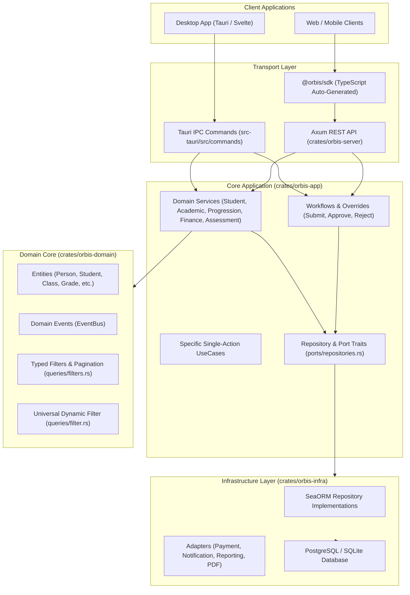

# Orbis Backend Architecture & Developer Guide

> **Authoritative Guide for Engineers & AI Agents**  
> Covers: Architecture Layers, Services vs. Workflows, Desktop (Tauri) vs. Web (Axum/SDK), Query Filters, and Decision Matrices.

---

## 1. High-Level Architectural Layers



---

## 2. Query Filters: `filter.rs` vs `filters.rs`

| Aspect | `queries/filters.rs` (Typed Domain Filters) | `queries/filter.rs` (Universal Filter) |
| :--- | :--- | :--- |
| **Primary Purpose** | **The Standard for all Domain Repositories, Services, APIs, and SDKs** | **Dynamic Query Engine for Reports, Custom Grids, & Ad-hoc Builder** |
| **Key Structs** | `StudentFilter`, `EnrollmentFilter`, `GradeFilter`, `PaymentFilter`, `SubjectFilter`, `ClassFilter`, `PaginationParams`, `PaginatedList<T>` | `UniversalFilter`, `FilterCondition`, `FilterOperator`, `FilterLogic` |
| **Type Safety** | **100% Compile-time checked** with exact field types (`Uuid`, `NaiveDate`, Enums). | Runtime-parsed JSON values (`serde_json::Value`). |
| **When to use?** | **Always use this** for standard CRUD, list views, pagination, filtering students/grades/fees. | Use only when building arbitrary user-defined query builders or reporting filter builders. |

---

## 3. Decision Matrix: When to Use What?

### A. Standard Operations vs. Workflow Overrides

```
                             [ User Action ]
                                    |
                    Is it a restricted/abnormal action?
               (e.g., Grade change after closure, Pre-req bypass,
                Discount beyond authority, Late enrollment)
                                   / \
                                 /     \
                              YES       NO (Normal Operation)
                              /           \
                             v             v
                [ Workflow / Override ]     [ Domain Service Call ]
                - SubmitOverrideRequest     - StudentService::*
                - Approval Chain Steps       - AcademicService::*
                - Role-based Decision        - AssessmentService::*
                - Execute on Approval        - FinanceService::*
                                            - ProgressionService::*
```

### Detailed Mapping:

| Task / Scenario | Recommended Mechanism | Location |
| :--- | :--- | :--- |
| **Register a new student** | Direct Domain Service: `StudentService::register_student` | `orbis-app::services::student_service` |
| **Enroll student in class** | Direct Domain Service: `StudentService::enroll_student` | `orbis-app::services::student_service` |
| **Record or update grade (regular)** | Direct Domain Service: `AssessmentService::record_grade` | `orbis-app::services::assessment_service` |
| **Change grade after final closure** | **Override Request**: `SubmitOverrideRequestUseCase` with `OverrideType::GradeChange` | `orbis-app::usecases::workflow::override_request` |
| **Bypass course prerequisite** | **Override Request**: `SubmitOverrideRequestUseCase` with `OverrideType::PrerequisiteBypass` | `orbis-app::usecases::workflow::override_request` |
| **Exceed maximum class capacity** | **Override Request**: `SubmitOverrideRequestUseCase` with `OverrideType::CapacityOverride` | `orbis-app::usecases::workflow::override_request` |
| **Grant exceptional fee discount** | **Override Request**: `SubmitOverrideRequestUseCase` with `OverrideType::DiscountOverride` | `orbis-app::usecases::workflow::override_request` |
| **Cohort promotion to next year** | Direct Domain Service: `ProgressionService::promote_cohort` | `orbis-app::services::progression_service` |
| **Process student payment** | Direct Domain Service: `FinanceService::process_payment` | `orbis-app::services::finance_service` |

---

## 4. Desktop (Tauri) vs. Web/Remote (Axum & SDK)

### For Desktop (`apps/desktop/src-tauri`):
- **What to use**:
  - Expose IPC commands in `apps/desktop/src-tauri/src/commands/`.
  - Commands must call either the **Consolidated Domain Services** (`AppState.student_service`, etc.) or specific UseCases.
  - Commands must return uniform `ApiResponse<T>` with proper error handling.
  - Multi-tenancy context must always be passed via `make_ctx(&state)`.
- **What NOT to do**:
  - **NEVER** write ad-hoc raw SQL queries inside Tauri command handlers.
  - **NEVER** bypass domain validation rules or permissions check.
  - **NEVER** duplicate business logic across different command files.

### For Web & Mobile (`packages/sdk` & REST API):
- **What to use**:
  - Backend routes in `crates/orbis-server/src/api/` annotate handlers with `utoipa::path`.
  - Run `bun run generate` to export `openapi.json` and rebuild `@orbis/sdk`.
  - Web & Mobile apps import typed functions and models directly from `@orbis/sdk`.

---

## 5. Summary of Domain Services Available in `AppState`

All centralized services are instantiated and injected into `AppState` in both `orbis-server` and `desktop`:

1. **`student_service` (`StudentService`)**:
   - `register_student(ctx, org_id, input)`
   - `enroll_student(ctx, org_id, input)`
   - `update_student_status(ctx, student_id, new_status, reason)`
   - `change_study_mode(ctx, enrollment_id, new_mode, reason)`
   - `assign_guardian(ctx, student_id, guardian_id, relationship, is_primary)`
   - `get_student(id)` / `get_student_guardians(ctx, student_id)` / `list_students(org_id, filter)`

2. **`academic_service` (`AcademicService`)**:
   - `create_subject(ctx, org_id, input)` / `create_class(ctx, org_id, input)` / `assign_class_subject(ctx, org_id, input)`
   - `check_prerequisites(ctx, student_id, subject_id)`
   - `list_subjects(org_id, filter)` / `list_classes(org_id, filter)`

3. **`assessment_service` (`AssessmentService`)**:
   - `record_grade(ctx, input)` / `calculate_grades(ctx, ...)`
   - `mark_attendance(ctx, input)`
   - `create_scheme(ctx, org_id, input)` / `calculate_gpa(ctx, student_id, period_id)`

4. **`progression_service` (`ProgressionService`)**:
   - `promote_cohort(ctx, org_id, source_period_id, target_period_id, promotions)`
   - `evaluate_student_progression(ctx, student_id, period_id)`

5. **`finance_service` (`FinanceService`)**:
   - `create_fee_template(ctx, org_id, input)` / `generate_student_fee(ctx, org_id, input)`
   - `process_payment(ctx, org_id, ...)` / `create_account(ctx, org_id, input)`
