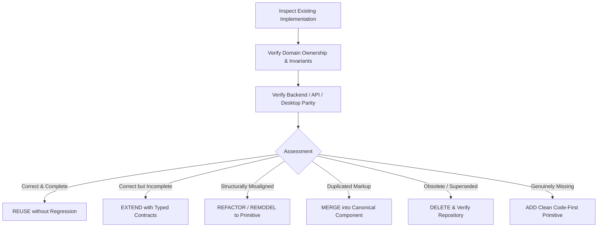
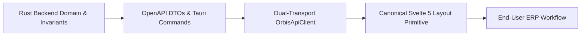

# Orbis ERP Transformation Execution Plan & Architecture Blueprint

> **Document Version:** 1.0.0-PROD  
> **Status:** Canonical Planning Specification Complete (`ANALYSIS_COMPLETE`)  
> **Target System:** Orbis Enterprise Educational Operating System  
> **Core Architecture:** Rust Clean Architecture Backend + Svelte 5 (Runes) Frontend + Tauri 2.0 Native IPC + SQLite / PostgreSQL Dual-Transport Parity  
> **Author:** Principal Software Architect, Lead Systems Engineer & Enterprise UX Researcher  

---

## 1. Executive Summary & The Governing Strategy

### 1.1 The Transformation Objective
The goal of this execution plan is **NOT** to append a collection of disconnected features onto the existing Orbis codebase. Rather, the objective is to **consolidate, clean, standardize, and evolve** the existing Orbis system into a cohesive, production-grade Education ERP where backend invariants, API contracts, desktop ergonomics, and user workflows operate in complete harmony.

### 1.2 The Cardinal Law: Consolidation Before Addition
Every engineering decision across all 11 implementation phases must strictly follow the canonical decision sequence:



$$\text{Existing} \longrightarrow \text{Verify Ownership} \longrightarrow \text{Verify Parity} \longrightarrow \text{Reuse} \longrightarrow \text{Extend} \longrightarrow \text{Refactor} \longrightarrow \text{Merge} \longrightarrow \text{Replace} \longrightarrow \text{Delete Legacy} \longrightarrow \text{Add}$$

---

## 2. The Section Completion Contract & Legacy Removal Rule

### 2.1 The 18-Point Section Completion Contract
A desktop section or vertical slice is **NEVER** complete merely because its UI route opens without crashing. A section is declared complete **ONLY** when all 18 criteria are strictly met:

1. **Backend Capability Verified:** Invariant rules in `orbis-domain` and use cases in `orbis-app` execute correctly with zero mock data.
2. **Dual-Transport Parity Verified:** Both `LocalClient` (Tauri IPC / SQLite) and `RemoteClient` (Axum HTTP / `@orbis/sdk` / PostgreSQL) yield identical behavior and DTO contracts.
3. **No Legacy `as any` Casts:** Strong TypeScript typing across all components, stores, and API adapters.
4. **Canonical UI Primitives Reused:** Page layout is constructed from the 8 canonical layout shells (`SimpleFormView`, `AdvancedTransactionView`, `EntityWorkspace360`, `ReportViewerShell`, `BatchEntryGridView`, `CascadingSettingsShell`, `PermissionMatrixView`, `MasterDetailCatalog`).
5. **Universal `<FormActionBar>` Integrated:** Mode state transitions (`browse`, `create`, `edit`, `transacting`, `readonly`) and keyboard shortcuts (`Ctrl+N`, `Ctrl+S`, `Esc`, `F7`, `F6`) are operational.
6. **Explicit Loading & Skeleton States:** Skeleton screens are displayed during query execution; zero layout shift.
7. **Explicit Empty States:** Standard `<TableEmptyState>` or `<AiEmptyState>` rendered when datasets are empty.
8. **Explicit Error Boundaries:** Contextual error banners and recovery options; zero swallowed exceptions or silent failures.
9. **Unsaved-Change Protection:** `unsavedGuardStore` intercepts navigation and close events when forms are dirty.
10. **Authoritative Backend Security:** Server-side `PermissionCheckerPort` and `AuthContext` enforce role and tenant isolation; client `<PermissionGate>` used for UX.
11. **Materialized OrgUnit Scope:** Query filters respect branch/faculty tree boundaries (`/1/4/12/`).
12. **Settings Stored $\rightarrow$ Read $\rightarrow$ Enforced:** Configuration settings are actively consumed by business workflows.
13. **User Personalization Persisted:** Grid column widths, visibility, ordering, and filter presets persist via `usePersonalization` with 0ms cold-start latency.
14. **DocForge Reporting & Printing:** Printable documents and receipts render via `docforge-engine` with HarfBuzz RTL Arabic text shaping.
15. **Compile-Time Paraglide i18n & RTL:** 100% of labels use Paraglide messages; formatting uses `orgContext.formatDate()` and `orgContext.formatCurrency()`.
16. **High-Performance Large Dataset Handling:** Tables with 10k+ rows use `OrbisGrid` virtualized canvas/DOM rendering.
17. **Legacy Code Completely Removed:** Superseded components, old routes, and duplicated dialogs are deleted from disk.
18. **Automated Tests Passing:** `cargo check`, `cargo test`, and `bun x tsc --noEmit` pass with zero errors and zero warnings.

---

### 2.2 The Mandatory Legacy Removal Pass
After completing each vertical section, a dedicated **Legacy Removal Pass** must be executed:
1. Grep the codebase for all references to deprecated components or obsolete routes.
2. Verify that all consumers have been successfully migrated to the canonical implementation.
3. Delete the deprecated files completely.
4. Run `bun x tsc --noEmit` to verify TypeScript integrity.
5. Run `cargo check --workspace` to verify backend integrity.
6. Run full test suites (`cargo test --workspace`).

---

## 3. The 12-Phase Implementation Roadmap

```mermaid
gantt
    title Orbis ERP Transformation Phased Roadmap
    dateFormat  YYYY-MM-DD
    section Foundation & Standards
    Phase 0: Repo & Architecture Audit       :done,    p0, 2026-10-01, 3d
    Phase 1: Canonical UI Primitives & State  :active,  p1, after p0, 5d
    section The Golden Reference
    Phase 2: Settings (The Golden Pattern)   :         p2, after p1, 7d
    section Core Operational Slices
    Phase 3: IAM, Users & Permission Matrix   :         p3, after p2, 5d
    Phase 4: Academic Structure & Calendar   :         p4, after p3, 6d
    Phase 5: Student Lifecycle & 360 Dossier :         p5, after p4, 7d
    Phase 6: Batch Attendance & Grade Control:         p6, after p5, 6d
    Phase 7: Examination Engine & Proctors   :         p7, after p6, 5d
    Phase 8: Financial GL, Vouchers & Fees   :         p8, after p7, 8d
    Phase 9: DocForge Reporting & Statements :         p9, after p8, 6d
    section System Hardening
    Phase 10: Desktop Shell, Command Palette :         p10, after p9, 5d
    Phase 11: Final Legacy Purge & Sign-Off  :         p11, after p10, 4d
```

---

### Phase 0: Repository & Architecture Verification
- **Objective:** Establish baseline code health and lock down transport contracts.
- **Scope:** Full workspace verification (`apps/api-rust`, `apps/desktop`, `packages/*`).
- **Existing Code to Inspect:** `ARCHITECTURE_HANDOFF.md`, `apps/desktop/src/lib/api/types.ts`, `apps/desktop/src/lib/api/client.ts`.
- **Backend Work:** Verify `cargo check --workspace` and `cargo test --workspace` (63/63 tests passing).
- **API / SDK Work:** Verify canonical OpenAPI export (`export_openapi`) and `@orbis/sdk` compilation.
- **Desktop Work:** Verify `bun x tsc --noEmit` clean build.
- **Exit Criteria:** Zero compilation errors across all packages; OpenAPI schema and SDK in sync.
- **Next Dependency:** Phase 1.

---

### Phase 1: Canonical Architecture & UI Foundation
- **Objective:** Build the 8 reusable layout primitives and the `usePersonalization` rune before touching individual business routes.
- **Scope:** `packages/ui`, `packages/svelte-grid`, `apps/desktop/src/lib/shell`, `apps/desktop/src/lib/core`.
- **Existing Code to Inspect:** `packages/svelte-grid/src/OrbisGrid.svelte`, `apps/desktop/src/lib/tables/core/data-table.svelte`.
- **Existing Code to Reuse:** `OrbisGrid.svelte`, `DataTable.svelte`, `MainViewport.svelte`, `SidebarNav.svelte`.
- **New Code Genuinely Required:**
  1. `<FormActionBar>` component in `@orbis/ui` (supporting `browse`, `create`, `edit`, `transacting`, `readonly` modes).
  2. `usePersonalization` reactive Svelte 5 rune (`$lib/core/personalization/use-personalization.svelte.ts`).
  3. Standardized Layout Primitives in `$lib/shared/layouts/`:
     - `SimpleFormView.svelte`
     - `AdvancedTransactionView.svelte`
     - `EntityWorkspace360.svelte`
     - `ReportViewerShell.svelte`
     - `BatchEntryGridView.svelte`
     - `CascadingSettingsShell.svelte`
     - `PermissionMatrixView.svelte`
     - `MasterDetailCatalog.svelte`
- **Tests & Verification:** Unit tests for `usePersonalization` local caching, debounce sync, and `FormActionBar` keyboard event handling.
- **Exit Criteria:** All 8 primitives compile with strict TypeScript props and demo cleanly.
- **Next Dependency:** Phase 2.

---

### Phase 2: Settings as the Golden Implementation (Reference Pattern)
- **Objective:** Rebuild the entire Settings subsystem as the **GOLDEN REFERENCE PATTERN** for the desktop application.
- **Scope:** `apps/desktop/src/routes/(app)/[orgId]/settings/` and `apps/desktop/src/lib/features/settings/`.
- **Existing Code to Inspect:** 18 isolated sub-routes in `settings/*`, 24 manager components in `features/settings/`.
- **Existing Code to Merge & Refactor:**
  - Consolidate 18 fragmented sub-routes into `CascadingSettingsShell` with domain category tabs.
  - Standardize `rooms-manager.svelte`, `fee-templates-manager.svelte`, `discount-templates-manager.svelte`, and `subjects-manager.svelte` onto `SimpleFormView`.
  - Wire visual inheritance badges (🔵 `Institution Default` vs 🟢 `Branch Override`).
  - Standardize `currencies-manager.svelte` with exchange rate history grid.
  - Wire all formatting to `orgContext.formatDate()` and `orgContext.formatCurrency()`.
- **Legacy Code to Delete:** Deprecated ad-hoc buttons, duplicate delete dialogs, and unused card components.
- **Tests & Verification:** Complete settings lifecycle verification ($\text{STORED} \rightarrow \text{READ} \rightarrow \text{APPLIED} \rightarrow \text{ENFORCED} \rightarrow \text{TESTED}$).
- **Exit Criteria:** Settings route operates seamlessly, adheres to all 18 points of the Completion Contract, and serves as the documented architectural gold standard.
- **Next Dependency:** Phase 3.

---

### Phase 3: Identity, Access Management & Permission Matrix
- **Objective:** Modernize user administration and security governance with a visual 2D Screen $\times$ Action permission matrix.
- **Scope:** `settings/users/`, `settings/permissions/`, `lib/features/settings/roles-permissions-manager.svelte`.
- **Backend Work:** Verify `UserRepository`, `RoleRepository`, `PermissionCheckerPort` with branch scoping.
- **Desktop Work:** Rebuild `settings/permissions/` using `PermissionMatrixView` (mapping users/roles against View, Create, Edit, Delete, Search, Print).
- **Security Invariant:** Ensure every Tauri IPC command in `src-tauri/src/commands/` enforces `RequestContext` permissions.
- **Legacy Code to Delete:** Legacy permission toggle lists.
- **Exit Criteria:** 2D permission matrix accurately reflects and persists role permissions; backend rejects unauthorized IPC calls.
- **Next Dependency:** Phase 4.

---

### Phase 4: Academic Calendar, Curricula & Timetable Structure
- **Objective:** Consolidate academic governance, course definitions, and timetable grid management.
- **Scope:** `academics/classes/`, `settings/periods/`, `settings/subjects/`, `academics/schedule/`.
- **Backend Work:** Verify `AcademicYear`, `AcademicPeriod`, `Subject`, `Class`, `ClassSubject`, `TimeSlot`, `Room`.
- **Desktop Work:**
  - Academic periods and years consolidated into `CascadingSettingsShell`.
  - Curricula and teaching assignments (`ClassSubject`) managed in `MasterDetailCatalog`.
  - Timetable scheduling grid refactored to support visual conflict detection and solver integration.
- **Legacy Code to Delete:** Hardcoded academic year selectors and bespoke subject tables.
- **Exit Criteria:** Timetable conflicts accurately detected; teaching assignments bind instructors with weekly credit hours.
- **Next Dependency:** Phase 5.

---

### Phase 5: Student Lifecycle, Registration & 360 Dossier
- **Objective:** Consolidate the 7 fragmented student sub-routes into a unified split-panel `EntityWorkspace360` workspace.
- **Scope:** `routes/(app)/[orgId]/students/`, `lib/features/students/`.
- **Existing Code to Merge:** Merge `students/[id]/attendance`, `behavior`, `documents`, `fees`, `grades`, and `guardians` into `EntityWorkspace360` tabs.
- **Desktop Work:**
  - Build `EntityWorkspace360` for students with left enrollment tree (`Ctrl+T`), top action ribbon, and multi-tab dossier.
  - Build Excel template import/export wizard for bulk student admission.
- **Legacy Code to Delete:** 7 isolated sub-routes in `students/[studentId]/*` replaced by tabbed workspace.
- **Exit Criteria:** Student profile, guardian links, fee balances, and grades load in a single cohesive workspace without full-page navigation.
- **Next Dependency:** Phase 6.

---

### Phase 6: High-Speed Batch Entry (Attendance & Grade Control)
- **Objective:** Replace slow, bespoke HTML tables with virtualized `BatchEntryGridView` for daily attendance and marks entry.
- **Scope:** `academics/attendance/`, `academics/classes/[id]/curriculum/[id]/term-results/`.
- **Desktop Work:**
  - Implement `BatchEntryGridView` with keyboard traversal (`Enter`/`Down Arrow` moves to next student).
  - Excel clipboard copy-paste support for fast semester score importing.
  - Row-level Save (✔) and Undo (↩) actions with batch commit.
- **Legacy Code to Delete:** Bespoke HTML table markup in `class-subject-results.svelte` and `attendance/+page.svelte`.
- **Exit Criteria:** 1,000+ student marks or attendance entries scroll at 60 FPS and commit reliably in batch.
- **Next Dependency:** Phase 7.

---

### Phase 7: Examination Operations, Seating & Secrets
- **Objective:** Connect the complete Rust examination domain to high-performance desktop control workflows.
- **Scope:** `academics/exams/`, `lib/features/academics/components/exams/`.
- **Backend Work:** Verify `ExamSession`, `ExamSchedule`, `SeatingNumber`, `SecretNumber`, `ExamProctor`.
- **Desktop Work:**
  - Connect seating and anonymous secret generation wizards to DocForge `batch_print` engine.
  - Implement exam timetable schedule view and proctor allocation roster.
- **Legacy Code to Delete:** Placeholder exam status cards.
- **Exit Criteria:** Seating badges and calling sheets generate with correct RTL Arabic formatting and cut lines.
- **Next Dependency:** Phase 8.

---

### Phase 8: Financial General Ledger, Vouchers & Billing
- **Objective:** Elevate Orbis finance into a full double-entry General Ledger using `AdvancedTransactionView`.
- **Scope:** `finance/accounts/`, `finance/payments/`, `finance/journal-entries/`, `finance/statement/`.
- **Backend Work:** Verify `Account`, `JournalEntry`, `FeeTemplate`, `StudentFee`, `Payment`, multi-currency exchange rates.
- **Desktop Work:**
  - Rebuild Chart of Accounts with hierarchical tree explorer and subsidiary account creation.
  - Implement `AdvancedTransactionView` for Payment Vouchers (`F7`), Receipt Vouchers (`F6`), and Journal Entries with `Draft` $\rightarrow$ `Posted` $\rightarrow$ `Unposted` state machine.
  - Cashier POS tuition receipt view with instant thermal receipt generation.
- **Legacy Code to Delete:** Bespoke financial card lists and unposted transaction tables.
- **Exit Criteria:** Double-entry journal entries enforce $\sum Dr = \sum Cr$; posting directly updates General Ledger balances.
- **Next Dependency:** Phase 9.

---

### Phase 9: DocForge Reporting, Statements & Printing
- **Objective:** Unify all institutional reporting under `ReportViewerShell` powered by the DocForge vector engine.
- **Scope:** `reports/`, `finance/reports/`, `academics/reports/`.
- **Desktop Work:**
  - Implement `ReportViewerShell` with collapsible filter drawer, date presets (`Today`, `Month`, `Period`), active filter chips, and saved views.
  - Connect Financial Statements (Trial Balance, Balance Sheet, Income Statement, Account Statement) and Academic Ledgers directly to DocForge live PDF viewer.
- **Legacy Code to Delete:** Static PDF iframe wrappers and disconnected report pages.
- **Exit Criteria:** High-definition PDF preview renders instantly with Arabic HarfBuzz shaping; CSV/Excel exports operational.
- **Next Dependency:** Phase 10.

---

### Phase 10: Desktop Shell, Command Palette & Keyboard Productivity
- **Objective:** Integrate native desktop capabilities via Tauri 2.0 and provide global keyboard ergonomics.
- **Scope:** `apps/desktop/src/lib/shell/`, `apps/desktop/src-tauri/`.
- **Desktop Work:**
  - Global Command Palette (`Ctrl+K`) for instant entity lookup, screen navigation, and action execution.
  - Function key shortcuts (`F3` Search, `F7` Payment Voucher, `F6` Receipt, `Ctrl+T` Student Workspace).
  - Unsaved-change window close interception via Tauri window event listener.
- **Exit Criteria:** Operators can navigate the entire ERP without touching the mouse.
- **Next Dependency:** Phase 11.

---

### Phase 11: Final Legacy Purge, System Hardening & ERP Sign-Off
- **Objective:** Full repository audit, complete legacy deletion pass, typecheck, lint, and end-to-end verification.
- **Scope:** Full repository.
- **Verification Commands:**
  ```bash
  cargo check --workspace
  cargo test --workspace
  bun run --cwd packages/sdk generate
  bun run --cwd packages/sdk build
  bun x tsc --noEmit --project apps/desktop/tsconfig.json
  ```
- **Exit Criteria:** Zero compilation errors, zero warnings, zero dead code, 100% compliance with Governing Architecture Rules.

---

## 4. Master Capability Matrix

| Capability | Domain | Backend Status | API / Command | Local (SQLite) | Remote (PG) | Desktop Status | Canonical Desktop Section | Canonical UI Primitive | Scope Enforced | Permissions Enforced | Personalization | Tests / Evidence | Action | Phase |
|---|---|---|---|---|---|---|---|---|---|---|---|---|---|---|
| **Org & Branch Setup** | System | COMPLETE | `/api/v1/organizations/*` | COMPLETE | COMPLETE | COMPLETE | Settings $\rightarrow$ Units | `CascadingSettingsShell` | `tenant_id` + Path | `org:write` | None | Domain & API tests | **REMODEL** | Phase 2 |
| **System Settings** | Settings | COMPLETE | `/api/v1/organizations/settings` | COMPLETE | COMPLETE | PARTIAL | Settings $\rightarrow$ General | `CascadingSettingsShell` | `tenant_id` | `settings:write` | None | API tests | **REMODEL** | Phase 2 |
| **User Directory** | IAM | COMPLETE | `/api/v1/iam/users/*` | COMPLETE | COMPLETE | COMPLETE | Settings $\rightarrow$ Users | `SimpleFormView` | `tenant_id` | `iam:user:write` | Filter preset | IAM tests | **REMODEL** | Phase 3 |
| **Permission Matrix** | Security | COMPLETE | `/api/v1/auth/permissions` | COMPLETE | COMPLETE | PARTIAL | Settings $\rightarrow$ Permissions| `PermissionMatrixView` | `tenant_id` + Branch | `iam:perm:write` | None | Security tests | **REMODEL** | Phase 3 |
| **Academic Calendar** | Calendar | COMPLETE | `/api/v1/academic-years/*` | COMPLETE | COMPLETE | COMPLETE | Settings $\rightarrow$ Periods | `CascadingSettingsShell` | `tenant_id` | `calendar:write` | Active Period | Domain tests | **REMODEL** | Phase 4 |
| **Subjects Catalog** | Academic | COMPLETE | `/api/v1/subjects/*` | COMPLETE | COMPLETE | COMPLETE | Settings $\rightarrow$ Subjects | `SimpleFormView` | `tenant_id` | `subject:write` | Column widths | API tests | **REMODEL** | Phase 4 |
| **Classes & Sections** | Academic | COMPLETE | `/api/v1/classes/*` | COMPLETE | COMPLETE | COMPLETE | Academics $\rightarrow$ Classes | `MasterDetailCatalog` | `org_unit_id` | `class:write` | Tree state | Domain tests | **REMODEL** | Phase 4 |
| **Teaching Assignment**| Academic | COMPLETE | `/api/v1/class-subjects/*` | COMPLETE | COMPLETE | COMPLETE | Academics $\rightarrow$ Classes | `MasterDetailCatalog` | `class_id` | `class:write` | None | Invariant tests | **REMODEL** | Phase 4 |
| **Student 360 Dossier**| Students | COMPLETE | `/api/v1/enrollments/*` | COMPLETE | COMPLETE | FRAGMENTED | Students $\rightarrow$ Workspace | `EntityWorkspace360` | `org_unit_id` | `student:read` | Last student | Domain tests | **CONSOLIDATE**| Phase 5 |
| **Student Admission** | Students | COMPLETE | `/api/v1/enrollments/register`| COMPLETE | COMPLETE | COMPLETE | Students $\rightarrow$ New | `SimpleFormView` + Import | `org_unit_id` | `student:create`| Form memory | Invariant tests | **EXTEND** | Phase 5 |
| **Batch Attendance** | Assessment| COMPLETE | `/api/v1/attendance/*` | COMPLETE | COMPLETE | PARTIAL | Academics $\rightarrow$ Attendance| `BatchEntryGridView` | `class_id` | `attendance:write`| Grid density | Domain tests | **REMODEL** | Phase 6 |
| **Grade Recording** | Assessment| COMPLETE | `/api/v1/grades/*` | COMPLETE | COMPLETE | PARTIAL | Academics $\rightarrow$ Control | `BatchEntryGridView` | `class_subject_id` | `grade:write` | Column sort | Calculation tests | **REMODEL** | Phase 6 |
| **Exam Seating & Sec** | Exams | COMPLETE | `/api/v1/exam-seating/*` | COMPLETE | COMPLETE | COMPLETE | Academics $\rightarrow$ Exams | `MasterDetailCatalog` + DocForge | `session_id` | `exam:write` | None | Exam tests | **EXTEND** | Phase 7 |
| **Chart of Accounts** | Finance | COMPLETE | `/api/v1/accounts/*` | COMPLETE | COMPLETE | PARTIAL | Finance $\rightarrow$ Accounts | `EntityWorkspace360` (Tree) | `tenant_id` | `finance:acct:write`| Expanded nodes | GL tests | **REMODEL** | Phase 8 |
| **Payment Vouchers** | Finance | COMPLETE | `/api/v1/payments/*` | COMPLETE | COMPLETE | PARTIAL | Finance $\rightarrow$ Payments | `AdvancedTransactionView` | `org_unit_id` | `finance:pay:write` | Tab traversal | Posting tests | **REMODEL** | Phase 8 |
| **Journal Entries** | Finance | COMPLETE | `/api/v1/accounts/journal-entries`| COMPLETE | COMPLETE | PARTIAL | Finance $\rightarrow$ Journals | `AdvancedTransactionView` | `tenant_id` | `finance:gl:write` | Grid columns | Balance tests | **REMODEL** | Phase 8 |
| **Fee Schedules** | Finance | COMPLETE | `/api/v1/fee-templates/*` | COMPLETE | COMPLETE | COMPLETE | Settings $\rightarrow$ Fees | `SimpleFormView` | `tenant_id` | `finance:fee:write` | None | API tests | **REMODEL** | Phase 2 |
| **DocForge Reports** | Reporting | COMPLETE | `/api/v1/reports/*` | COMPLETE | COMPLETE | COMPLETE | Reports $\rightarrow$ Explorer | `ReportViewerShell` | `tenant_id` + Branch | `report:read` | Saved views | DocForge AST tests | **CONSOLIDATE**| Phase 9 |
| **Command Palette** | Desktop Shell| COMPLETE| Client-side & Local IPC | COMPLETE | COMPLETE | PARTIAL | Global Shell (`Ctrl+K`) | Search Modal Primitives | Global | User scope | Recent history | Desktop tests | **EXTEND** | Phase 10 |

---

## 5. Master Legacy & Deletion Register

| Deprecated / Superseded File Path | Current Purpose | Why Obsolete / Problematic | Canonical Replacement | Migration Consumers | Target Deletion Phase |
|---|---|---|---|---|---|
| `routes/(app)/[orgId]/settings/*` (18 sub-routes) | Fragmented settings sub-pages | Navigation friction, no inheritance indicator | `CascadingSettingsShell` | Settings routes | Phase 2 |
| `features/settings/rooms-manager.svelte` | Ad-hoc room CRUD table | Duplicated toolbar, modal logic | `SimpleFormView` | Settings rooms route | Phase 2 |
| `features/settings/fee-templates-manager.svelte` | Ad-hoc fee template table | Duplicated toolbar, modal logic | `SimpleFormView` | Settings fee-templates route | Phase 2 |
| `features/settings/discount-templates-manager.svelte`| Ad-hoc discount template table | Duplicated toolbar, modal logic | `SimpleFormView` | Settings discount-templates | Phase 2 |
| `features/settings/subjects-manager.svelte` | Ad-hoc subjects table | Duplicated toolbar, modal logic | `SimpleFormView` | Settings subjects route | Phase 2 |
| `routes/(app)/[orgId]/students/[studentId]/*` (7 sub-routes)| Fragmented student tabs | Full-page navigation for single dossier | `EntityWorkspace360` | Student profile links | Phase 5 |
| `features/academics/class-subject-results.svelte` | Bespoke HTML grades table | Lacks virtualization, keyboard navigation | `BatchEntryGridView` | Academic term results | Phase 6 |
| `routes/(app)/[orgId]/academics/attendance/+page.svelte`| Bespoke attendance table | Lacks virtualization, fast key entry | `BatchEntryGridView` | Academic attendance route | Phase 6 |
| Ad-hoc `<button>` CRUD toolbars across 14 feature files | Copy-pasted CRUD buttons | Inconsistent hotkeys, states, modes | `<FormActionBar>` | All operational forms | Phase 1-8 |

---

## 6. Master UI Component Register

| Canonical Component Name | Package / Location | Responsibility | Allowed Usage | Forbidden Duplications | Extension Strategy |
|---|---|---|---|---|---|
| `<FormActionBar>` | `@orbis/ui` (`packages/ui`) | Universal CRUD & transaction mode bar with hotkeys | Top/bottom action bar on all forms | No bespoke button rows | Add custom actions via `#extraActions` snippet |
| `SimpleFormView` | `$lib/shared/layouts/` | Form + ActionBar + DataTable catalog view | All standard master lookups (Rooms, Subjects, Users) | No custom catalog pages | Configure via typed `schema` and `columns` |
| `AdvancedTransactionView`| `$lib/shared/layouts/` | Header/detail voucher with posting lifecycle | Payment vouchers, receipt vouchers, journals | No unposted ad-hoc forms | Configure via line item columns & state machine |
| `EntityWorkspace360` | `$lib/shared/layouts/` | Split tree + quick actions + multi-tab dossier | Students, Employees, Chart of Accounts | No fragmented multi-route dossiers | Add dossier tabs via typed tab array |
| `BatchEntryGridView` | `$lib/shared/layouts/` | Virtualized fast keyboard matrix entry | Daily attendance, monthly marks, scores | No bespoke HTML tables | Add custom cell editors via `OrbisGrid` types |
| `CascadingSettingsShell` | `$lib/shared/layouts/` | Hierarchical settings tree with inheritance | Central settings explorer | No isolated settings sub-pages | Add setting sections via typed category tree |
| `PermissionMatrixView` | `$lib/shared/layouts/` | 2D Screen $\times$ Action permission matrix | Security settings | No flat checkbox lists | Bind to typed resource permission strings |
| `ReportViewerShell` | `$lib/shared/layouts/` | Collapsible filter drawer + DocForge live PDF | All report pages & financial statements | No static iframe wrappers | Connect via DocForge template ID & data query |
| `OrbisGrid` | `@orbis/svelte-grid` | High-performance virtualized canvas/DOM grid | All tabular data presentation | Do NOT create a second grid engine | Extend column types and cell renderers |
| `DataTable` | `$lib/tables/core/` | Search/filter/toolbar wrapper around `OrbisGrid` | Standard lists in `SimpleFormView` | Do NOT render raw tables | Configure via `OrbisColumnDef` |

---

## 7. Master Desktop Section Register

| Desktop Section | Primary Route | Backend Domain | Primary APIs | Canonical Layout Primitive | Current Status | Major Problems to Fix | Target Phase |
|---|---|---|---|---|---|---|---|
| **Settings (Golden Reference)**| `/(app)/[orgId]/settings` | System, Calendar, Fees | `/api/v1/organizations/*`, `/api/v1/fee-templates/*` | `CascadingSettingsShell`, `SimpleFormView` | PARTIAL | 18 fragmented sub-routes, duplicated toolbars | **Phase 2** |
| **Security & IAM** | `/(app)/[orgId]/settings/permissions` | IAM, Security | `/api/v1/iam/*`, `/api/v1/auth/*` | `PermissionMatrixView`, `SimpleFormView` | PARTIAL | Flat permission toggles, no 2D matrix | **Phase 3** |
| **Academic Structure** | `/(app)/[orgId]/academics/classes` | Academic, Calendar | `/api/v1/classes/*`, `/api/v1/subjects/*` | `MasterDetailCatalog`, `SimpleFormView` | COMPLETE | Timetable conflict UI needs polishing | **Phase 4** |
| **Student 360 Workspace** | `/(app)/[orgId]/students` | Student, Guardians | `/api/v1/enrollments/*`, `/api/v1/students/*` | `EntityWorkspace360` | FRAGMENTED | Fractured across 7 distinct URLs | **Phase 5** |
| **Attendance & Control** | `/(app)/[orgId]/academics/attendance`| Assessment | `/api/v1/attendance/*`, `/api/v1/grades/*` | `BatchEntryGridView` | PARTIAL | Slow bespoke HTML tables | **Phase 6** |
| **Exams & Seating** | `/(app)/[orgId]/academics/exams` | Exams | `/api/v1/exam-*` | `MasterDetailCatalog` + DocForge | COMPLETE | Connect seating generation to batch print | **Phase 7** |
| **Finance & General Ledger** | `/(app)/[orgId]/finance` | Finance | `/api/v1/accounts/*`, `/api/v1/payments/*` | `AdvancedTransactionView`, `EntityWorkspace360` | PARTIAL | Lacks double-entry voucher lifecycle UI | **Phase 8** |
| **Reports & Statements** | `/(app)/[orgId]/reports` | Reporting | `/api/v1/reports/*`, DocForge engine | `ReportViewerShell` | PARTIAL | Inconsistent parameter forms | **Phase 9** |
| **Desktop Shell & Command** | Global Shell | System | Tauri Native IPC | TitleBar, Command Palette (`Ctrl+K`) | PARTIAL | Add global shortcuts and close interception | **Phase 10** |

---

## 8. Backend $\rightarrow$ API $\rightarrow$ Desktop Surface Parity Matrix



| Backend Domain Service (`orbis-app`) | Canonical REST Route | Tauri IPC Command | Local Client Method | Remote Client Method | Appropriate Desktop Surface | Canonical UI Component |
|---|---|---|---|---|---|---|
| `GetOrgSettingsUseCase` | `GET /api/v1/organizations/settings` | `cmd_get_org_settings` | `apiClient.getOrgSettings()` | `apiClient.getOrgSettings()` | Settings $\rightarrow$ General | `CascadingSettingsShell` |
| `UpdateOrgSettingsUseCase` | `PUT /api/v1/organizations/settings` | `cmd_update_org_settings` | `apiClient.updateOrgSettings()` | `apiClient.updateOrgSettings()` | Settings $\rightarrow$ General | `CascadingSettingsShell` |
| `ListRoomsUseCase` | `GET /api/v1/rooms` | `academic_list_rooms` | `apiClient.listRooms()` | `apiClient.listRooms()` | Settings $\rightarrow$ Rooms | `SimpleFormView` |
| `CreateRoomUseCase` | `POST /api/v1/rooms` | `academic_create_room` | `apiClient.createRoom()` | `apiClient.createRoom()` | Settings $\rightarrow$ Rooms | `SimpleFormView` |
| `ListFeeTemplatesUseCase` | `GET /api/v1/fee-templates` | `finance_list_fee_templates` | `apiClient.listFeeTemplates()` | `apiClient.listFeeTemplates()` | Settings $\rightarrow$ Fees | `SimpleFormView` |
| `CreateFeeTemplateUseCase` | `POST /api/v1/fee-templates` | `finance_create_fee_template` | `apiClient.createFeeTemplate()` | `apiClient.createFeeTemplate()` | Settings $\rightarrow$ Fees | `SimpleFormView` |
| `RegisterStudentUseCase` | `POST /api/v1/enrollments/register` | `student_register` | `apiClient.registerStudent()` | `apiClient.registerStudent()` | Students $\rightarrow$ New | `SimpleFormView` |
| `GetStudentDetailUseCase` | `GET /api/v1/students/{id}` | `student_get_detail` | `apiClient.getStudentDetail()` | `apiClient.getStudentDetail()` | Students $\rightarrow$ Dossier | `EntityWorkspace360` |
| `RecordAttendanceUseCase` | `POST /api/v1/attendance` | `assessment_mark_attendance` | `apiClient.markAttendance()` | `apiClient.markAttendance()` | Academics $\rightarrow$ Attendance | `BatchEntryGridView` |
| `RecordGradeUseCase` | `POST /api/v1/grades` | `assessment_record_grade` | `apiClient.recordGrade()` | `apiClient.recordGrade()` | Academics $\rightarrow$ Control | `BatchEntryGridView` |
| `ProcessPaymentUseCase` | `POST /api/v1/payments` | `finance_process_payment` | `apiClient.processPayment()` | `apiClient.processPayment()` | Finance $\rightarrow$ Payments | `AdvancedTransactionView` |
| `CreateJournalEntryUseCase` | `POST /api/v1/accounts/journal-entries`| `finance_create_journal` | `apiClient.createJournalEntry()` | `apiClient.createJournalEntry()`| Finance $\rightarrow$ Journals | `AdvancedTransactionView` |
| `GenerateReportUseCase` | `POST /api/v1/reports/generate` | `reporting_generate` | `apiClient.generateReport()` | `apiClient.generateReport()` | Reports $\rightarrow$ Viewer | `ReportViewerShell` |

---

## 9. Exact First Implementation Task for Next Coding Session

### Task ID: `TASK-P1-01`
### Task Title: Implement Core UI Primitives & `<FormActionBar>` Foundation
- **Target Files:**
  - `packages/ui/src/components/form-action-bar.svelte`
  - `apps/desktop/src/lib/core/personalization/use-personalization.svelte.ts`
  - `apps/desktop/src/lib/shared/layouts/SimpleFormView.svelte`
  - `apps/desktop/src/lib/shared/layouts/CascadingSettingsShell.svelte`
- **Scope & Specifications:**
  1. Build `<FormActionBar>` in `@orbis/ui` supporting `browse`, `create`, `edit`, `transacting`, `readonly` modes with standard keyboard shortcuts (`Ctrl+N`, `Ctrl+S`, `Esc`, `F7`, `F6`).
  2. Implement `usePersonalization` reactive rune with instant LocalStorage hydration (0ms CLS) and debounced backend sync.
  3. Construct `SimpleFormView.svelte` and `CascadingSettingsShell.svelte` with typed props.
- **Verification & Exit Criteria:**
  - `bun x tsc --noEmit --project apps/desktop/tsconfig.json` passes with 0 errors.
  - Unit test verifying `usePersonalization` reactive state updates and persistence.
  - Zero modifications to production database or backend code during this task.

---
*Verified Canonical Execution Plan. Ready for AGENTS.md persistence updates.*
