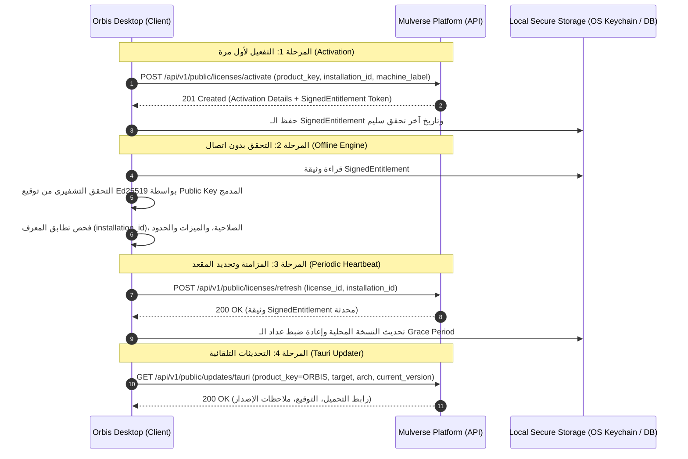

# 📑 Orbis ↔ Mulverse Platform Integration Contract
> **Document Version:** `2.0.0`  
> **Status:** `Active / Authoritative Specification`  
> **Target Audience:** Orbis Desktop Core Engineers, AI Coding Agents, Tauri / Rust Developers, CI/CD Devops.  
> **Product Identification:** `ORBIS` (Desktop School & University Management System)  
> **Platform Authority:** `Mulverse Platform` (`https://api.mulverse.com`)

---

## 1. Quick Integration Overview (ما تقدمه المنصة لـ Orbis)

لتفعيل وربط تطبيق **Orbis Desktop** بنظام التراخيص والتحديثات، يتم تزويد تطبيق Orbis بالبيانات والروابط التالية:

| المتطلب / المعيار | القيمة / المسار | الوصف |
| :--- | :--- | :--- |
| **API Base URL** | `https://api.mulverse.com` | عنوان الـ API المركزي المتاح للعموم. |
| **Product Key Prefix** | `ORBIS` | البادئة الرسمية لمفاتيح التراخيص (مثال: `ORBIS-A7B8C-9D0E1-2F3A4-5B6C7`). |
| **Canonical Product ID** | `11111111-1111-4111-8111-111111111111` | المعرّف الثابت لمنتج Orbis في الكتالوج وقاعدة البيانات. |
| **Signing Algorithm** | `Ed25519` | خوارزمية التوقيع التشفيري للتحقق من التراخيص بدون اتصال (Offline). |
| **Public Key Endpoint** | `GET /api/v1/public/keys/active` | مسار جلب المفتاح العام النشط للتحقق التشفيري. |
| **Activation Endpoint** | `POST /api/v1/public/licenses/activate` | نقطة تفعيل مقعد الجهاز وربطه بالـ `installation_id`. |
| **Refresh Endpoint** | `POST /api/v1/public/licenses/refresh` | نقطة تجديد وإرسال نبضات التفعيل دورياً (Heartbeat). |
| **Deactivate Endpoint** | `POST /api/v1/public/licenses/deactivate` | نقطة تحرير المقعد لتمكين تشغيله على جهاز آخر. |
| **Tauri Updater Endpoint** | `GET /api/v1/public/updates/tauri` | مسار التحقق من التحديثات المتوافق مباشرة مع Tauri Updater. |
| **Release Automation Token** | `MULVERSE_RELEASE_API_TOKEN` | الرمز السري المستخدم في CI/CD لرفع نسخ الـ Setup والـ Artifacts. |

---

## 2. التسلسل الإجرائي (Architecture & Lifecycle Flow)



---

## 3. مواصفات التشفير والتحقق من التراخيص (Cryptographic Engine)

### 3.1 هيكل وثيقة الترخيص الموقعة (`SignedEntitlement`)

عند نجاح التفعيل أو التجديد، يُرجع السيرفر كائن `signed_entitlement`:

```json
{
  "v": 1,
  "kid": "965b4865-f6b7-4c96-a2aa-13e067ad7e31",
  "alg": "Ed25519",
  "payload": {
    "license_id": "44444444-4444-4444-8444-444444444444",
    "product_key": "ORBIS-XXXXX-XXXXX-XXXXX-XXXXX",
    "product_id": "11111111-1111-4111-8111-111111111111",
    "organization_id": "00000000-0000-0000-0000-000000000002",
    "edition_key": "SCHOOL",
    "plan_key": "SCHOOL_PRO",
    "entitlements": [
      { "key": "students", "granted": true },
      { "key": "ai_grading", "granted": true },
      { "key": "multi_branch", "granted": true },
      { "key": "offline_sync", "granted": true },
      { "key": "parent_portal", "granted": true },
      { "key": "campus_analytics", "granted": true },
      { "key": "sso", "granted": false },
      { "key": "exam_tools", "granted": true }
    ],
    "limits": [
      { "key": "students.max", "max_value": 5000 },
      { "key": "staff.max", "max_value": 250 },
      { "key": "devices.max", "max_value": 200 },
      { "key": "branches.max", "max_value": 12 },
      { "key": "classes.max", "max_value": 120 },
      { "key": "storage_gb.max", "max_value": 50 }
    ],
    "activation_id": "66666666-6666-4666-8666-666666666666",
    "installation_id": "inst_win_8b9f71c42de34",
    "issued_at": "2026-10-09T00:00:00Z",
    "valid_from": "2026-10-01T00:00:00Z",
    "valid_until": "2027-10-01T00:00:00Z",
    "offline_allowed": true,
    "offline_grace_period_days": 30,
    "verification_interval_hours": 24
  },
  "sig": "MEQCIE/2u3s..."
}
```

---

## 4. قائمة الميزات والحدود القياسية (Entitlements & Limits Dictionary)

يجب على كود Orbis استخدام نفس المفاتيح الرسمية التالية للتحكم في الميزات والقيود:

### 4.1 الميزات (Feature Toggles / Entitlements)
| المفتاح (Key) | النوع | الوصف في Orbis |
| :--- | :--- | :--- |
| `students` | `boolean` | إدارة شؤون الطلاب والسجلات الأكاديمية (SIS). |
| `ai_grading` | `boolean` | التصحيح الآلي والتقييم الذكي للواجبات والاختبارات. |
| `multi_branch` | `boolean` | إدارة الفروع المتعددة والمجمعات التعليمية. |
| `offline_sync` | `boolean` | المزامنة المحلية عبر شبكة الـ LAN بدون إنترنت. |
| `parent_portal` | `boolean` | بوابة أولياء الأمور وتطبيق المتابعة. |
| `campus_analytics` | `boolean` | لوحات المؤشرات والتقارير الإحصائية المتقدمة. |
| `sso` | `boolean` | الدخول الموحد والربط مع هويات مايكروسوفت وجوجل. |
| `exam_tools` | `boolean` | محرك الاختبارات وبنوك الأسئلة وجداول الاختبارات. |

### 4.2 الحدود والكميات (Resource Limits / Quotas)
| المفتاح (Key) | الوحدة | الوصف |
| :--- | :--- | :--- |
| `students.max` | `students` | الحد الأقصى لعدد الطلاب المقيدين في النظام. |
| `staff.max` | `users` | الحد الأقصى لحسابات المعلمين والإداريين. |
| `devices.max` | `devices` | الحد الأقصى للأجهزة المثبت عليها التطبيق في المنظمة. |
| `branches.max` | `branches` | الحد الأقصى لعدد الفروع المسموح إنشاؤها. |
| `classes.max` | `classes` | الحد الأقصى لعدد الفصول والشُعب الدراسية. |
| `storage_gb.max` | `GB` | السعة التخزينية المخصصة للمرفقات والنسخ الاحتياطي. |

---

## 5. مواصفات الـ Endpoints العامة للتكامل

### 5.1 تفعيل الترخيص (`POST /api/v1/public/licenses/activate`)
* **Headers:** `Content-Type: application/json`
* **Request Body:**
```json
{
  "product_key": "ORBIS-ABCDE-FGHIJ-KLMNO-PQRST",
  "installation_id": "inst_win_8b9f71c42de34",
  "platform": "windows",
  "app_version": "1.0.0",
  "machine_label": "School Server 01"
}
```
* **Response `201 Created`:** كائن `activation` مع `signed_entitlement`.
* **الأخطاء الشائعة:**
  * `400`: بيانات ناقصة أو غير صالحة.
  * `404`: مفتاح الترخيص غير موجود.
  * `409`: تم استنفاد عدد المقاعد المسموح بها للمفتاح (`Seat limit exceeded`).

---

### 5.2 التحقق والتجديد الدوري (`POST /api/v1/public/licenses/refresh`)
* **Request Body:**
```json
{
  "license_id": "44444444-4444-4444-8444-444444444444",
  "installation_id": "inst_win_8b9f71c42de34",
  "app_version": "1.0.0"
}
```
* **Response `200 OK`:** كائن تفعيل محدث وتوقيع جديد.

---

### 5.3 إلغاء التفعيل (`POST /api/v1/public/licenses/deactivate`)
* **Request Body:**
```json
{
  "license_id": "44444444-4444-4444-8444-444444444444",
  "installation_id": "inst_win_8b9f71c42de34"
}
```
* **Response `200 OK`:** تحرير المقعد ليكون جاهزاً للاستخدام على جهاز آخر.

---

### 5.4 التحديثات التلقائية لـ Tauri (`GET /api/v1/public/updates/tauri`)
* **Query Parameters:**
  * `product_key=ORBIS`
  * `channel=stable` (أو `beta`)
  * `current_version=1.0.0`
  * `target=windows` (أو `darwin`, `linux`)
  * `arch=x86_64` (أو `aarch64`)
* **Response:**
  * `204 No Content`: لا توجد تحديثات جديدة (الإصدار الحالي هو الأحدث).
  * `200 OK`: ملف الـ Manifest المتوافق مع Tauri Updater:
    ```json
    {
      "version": "1.1.0",
      "notes": "Added student attendance biometrics and speed improvements.",
      "pub_date": "2026-10-15T10:00:00Z",
      "url": "https://api.mulverse.com/api/v1/public/updates/artifacts/00000000-0000-0000-0000-000000000000/download",
      "signature": "dW50cnVzdGVkIGNvbW1lbnQ6..."
    }
    ```

---

## 6. إعدادات Tauri Updater في تطبيق Orbis (`tauri.conf.json`)

في مشروع Orbis Desktop، يتم تكوين الـ updater كالتالي:

```json
{
  "plugins": {
    "updater": {
      "active": true,
      "endpoints": [
        "https://api.mulverse.com/api/v1/public/updates/tauri?product_key=ORBIS&channel=stable&current_version={{current_version}}&target={{target}}&arch={{arch}}"
      ],
      "pubkey": "YOUR_TAURI_UPDATER_PUBLIC_KEY"
    }
  }
}
```

---

## 7. نموذج كود التحقق في Orbis (Rust / Tauri Backend Example)

```rust
use ed25519_dalek::{Signature, Verifier, VerifyingKey};
use serde::{Deserialize, Serialize};

#[derive(Debug, Serialize, Deserialize)]
pub struct SignedEntitlement {
    pub v: u32,
    pub kid: String,
    pub alg: String,
    pub payload: EntitlementPayload,
    pub sig: String,
}

#[derive(Debug, Serialize, Deserialize)]
pub struct EntitlementPayload {
    pub license_id: String,
    pub product_id: String,
    pub installation_id: String,
    pub valid_from: String,
    pub valid_until: Option<String>,
    pub offline_allowed: bool,
    pub offline_grace_period_days: u32,
    pub entitlements: Vec<EntitlementItem>,
    pub limits: Vec<LimitItem>,
}

#[derive(Debug, Serialize, Deserialize)]
pub struct EntitlementItem {
    pub key: String,
    pub granted: bool,
}

#[derive(Debug, Serialize, Deserialize)]
pub struct LimitItem {
    pub key: String,
    pub max_value: i64,
}

/// يتحقق من صحة الترخيص محلياً بدون إنترنت
pub fn verify_offline_license(
    signed_doc: &SignedEntitlement,
    public_key_base64: &str,
    current_installation_id: &str,
) -> Result<bool, &'static str> {
    // 1. فحص تطابق معرف التثبيت للجهاز
    if signed_doc.payload.installation_id != current_installation_id {
        return Err("INSTALLATION_ID_MISMATCH");
    }

    // 2. التحقق من التوقيع التشفيري Ed25519
    let pub_key_bytes = base64::engine::general_purpose::STANDARD
        .decode(public_key_base64)
        .map_err(|_| "INVALID_PUBLIC_KEY_BASE64")?;

    let verifying_key = VerifyingKey::from_bytes(
        pub_key_bytes.as_slice().try_into().map_err(|_| "INVALID_KEY_LENGTH")?,
    )
    .map_err(|_| "INVALID_PUBLIC_KEY")?;

    let canonical_payload = serde_json::to_string(&signed_doc.payload)
        .map_err(|_| "SERIALIZATION_FAILED")?;

    let sig_bytes = base64::engine::general_purpose::STANDARD
        .decode(&signed_doc.sig)
        .map_err(|_| "INVALID_SIG_BASE64")?;

    let signature = Signature::from_slice(&sig_bytes)
        .map_err(|_| "INVALID_SIG_LENGTH")?;

    verifying_key
        .verify(canonical_payload.as_bytes(), &signature)
        .map_err(|_| "TAMPERED_OR_INVALID_LICENSE_SIGNATURE")?;

    Ok(true)
}
```

---

## 8. توجيهات الأمان للمطورين ووكلاء الذكاء الاصطناعي (AI Rules)

1. **معرف التثبيت المستقر (`installation_id`):** يتم توليده مرة واحدة وتخزينه في مسار مشفر محمي بالنظام (Credential Manager على Windows أو Keychain على macOS)، ولا يجوز استخدام الـ MAC address المتقلب.
2. **العمل بدون إنترنت (Offline Grace Period):** إذا انقطع الاتصال، يعمل التطبيق بكامل وظائفه المرخصة طالما لم تنتهِ مهلة الـ `offline_grace_period_days` (30 يوماً).
3. **عدم وضع أي تجاوزات برمجية (No Hardcoded Bypasses):** يجب الاعتماد الكلي على التوقيع الرقمي للمنصة.
