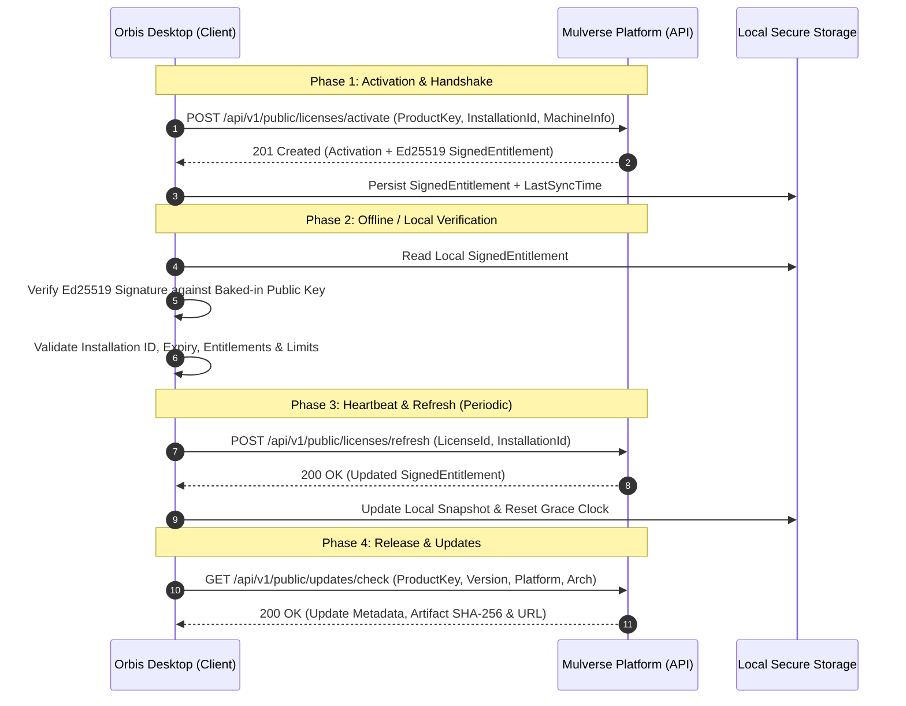

# 📑 Orbis ↔ Mulverse Platform Integration Contract
> **Document Version:** `1.0.0`  
> **Status:** `Active / Authoritative Specification`  
> **Target Audience:** AI Coding Agents, Backend Engineers, Desktop Client Developers (Tauri/Rust/TypeScript), Security & QA Engineers.  
> **Product Identification:** `ORBIS` / `ORBIS_APP` (Desktop School & University Management System)  
> **Platform Provider:** `Mulverse Platform` (Enterprise Centralized Licensing & Distribution Engine)

---

## 1. Executive Summary & Architectural Overview

This contract establishes the formal, deterministic integration specification between **Orbis Desktop Application** (Client) and the **Mulverse Platform** (Centralized Authority).



---

## 2. Core Domain Entities & Terminology

| Term | Domain Scope | Description |
| :--- | :--- | :--- |
| **`Product`** | Platform | Canonical software offering (`stable_key: "ORBIS"`, `type: "desktop_application"`). |
| **`Edition`** | Catalog | Commercial product edition (`SCHOOL` for K-12, `UNIVERSITY` for Higher Ed). |
| **`Plan`** | Catalog | Tiered commercial package (`BASIC`, `PRO`, `ENTERPRISE`). |
| **`Entitlement`** | Domain Engine | Feature capability toggle (e.g. `students`, `ai_grading`, `multi_branch`, `offline_sync`). |
| **`Limit`** | Domain Engine | Enforceable quantitative boundary (e.g. `students.max: 500`, `devices.max: 3`). |
| **`ProductKey`** | Identity | Formatted high-entropy key: `ORBIS-XXXXX-XXXXX-XXXXX-XXXXX` (Base32, 125-bit entropy). |
| **`License`** | Commercial | The central authority granting an Organization the right to run Orbis under defined terms. |
| **`Activation`** | Client Seat | An active hardware seat binding a License to a specific `installation_id`. |
| **`SignedEntitlement`**| Cryptography | Immutable, offline-verifiable document signed with Ed25519 by Mulverse Platform. |

---

## 3. Cryptographic Verification & Offline Engine

### 3.1 Asymmetric Algorithm & Keys
- **Algorithm:** `Ed25519` (RFC 8032 Edwards-curve Digital Signature Algorithm).
- **Public Key:** Base64-encoded 32-byte public key embedded in the Orbis desktop binary or cached via `/api/v1/public/keys/active`.
- **Private Key:** Stored strictly inside Mulverse Platform KMS (never exposed to clients).

### 3.2 Canonical `SignedEntitlement` Payload Schema
The signature is generated by hashing and signing the canonical JSON representation of `EntitlementPayload`.

```json
{
  "v": 1,
  "kid": "key_ed25519_2026_v1",
  "alg": "Ed25519",
  "payload": {
    "license_id": "9b1deb4d-3b7d-4bad-9bdd-2b0d7b3dcb6d",
    "product_key": "ORBIS-ABCDE-FGHIJ-KLMNO-PQRST",
    "product_id": "7a35e982-12a8-4c20-a8d0-6f02844857b2",
    "organization_id": "3c4a2b10-e55f-4a0b-99f8-7b94c5e3170a",
    "edition_key": "SCHOOL",
    "plan_key": "PRO",
    "entitlements": [
      { "key": "students", "granted": true },
      { "key": "ai_grading", "granted": true },
      { "key": "multi_branch", "granted": false }
    ],
    "limits": [
      { "key": "students.max", "max_value": 500 },
      { "key": "users.max", "max_value": 25 }
    ],
    "activation_id": "5f1b6238-d621-4824-a74e-761502476ef3",
    "installation_id": "inst_win_8b9f71c42de34",
    "issued_at": "2026-10-08T15:00:00Z",
    "valid_from": "2026-10-01T00:00:00Z",
    "valid_until": "2027-10-01T00:00:00Z",
    "offline_allowed": true,
    "offline_grace_period_days": 30,
    "verification_interval_hours": 24
  },
  "sig": "MEQCIE/2u3s..."
}
```

### 3.3 Deterministic Verification Algorithm (Agent Checklist)

When Orbis starts up or enforces a feature check:
1. **Payload Extraction:** Parse `SignedEntitlement` envelope (`v`, `kid`, `alg`, `payload`, `sig`).
2. **Signature Check:** Verify `sig` against canonical bytes of `payload` using the trusted Mulverse Ed25519 public key corresponding to `kid`.
   * *If signature check fails:* **ABORT IMMEDIATELY** with `TAMPERED_LICENSE_SIGNATURE`.
3. **Machine Identity Check:** Compare `payload.installation_id` with the host machine's persistent `installation_id`.
   * *If mismatch:* **ABORT** with `INSTALLATION_ID_MISMATCH`.
4. **Time Bounds Check:**
   * Verify: `current_utc_time >= payload.valid_from`.
   * If `payload.valid_until` is present, verify: `current_utc_time <= payload.valid_until`.
   * *If expired:* **ABORT** with `LICENSE_EXPIRED`.
5. **Offline Policy & Grace Period:**
   * If network is unreachable:
     * Check `payload.offline_allowed == true`. If `false`, **ABORT** with `OFFLINE_MODE_FORBIDDEN`.
     * Check `(current_utc_time - last_successful_online_sync) <= payload.offline_grace_period_days`.
     * If grace period exceeded, **LOCK APP** with `OFFLINE_GRACE_EXPIRED`.
6. **Feature & Quota Enforcement:**
   * **Boolean Entitlement Check:** `isFeatureEnabled(key)` returns `true` iff `entitlements.find(e => e.key === key)?.granted === true`.
   * **Quota Check:** `getLimit(key)` returns `limits.find(l => l.key === key)?.max_value`. Prevent creating resources exceeding this value.

---

## 4. API Endpoints Specification

Base URL: `https://platform.mulverse.com` (or local development: `http://localhost:8080`)

### 4.1 `POST /api/v1/public/licenses/activate`
Activates a new device seat and binds it to an `installation_id`.

- **Request Body:**
```json
{
  "product_key": "ORBIS-ABCDE-FGHIJ-KLMNO-PQRST",
  "license_id": null,
  "installation_id": "inst_win_8b9f71c42de34",
  "platform": "windows",
  "app_version": "1.0.0",
  "machine_label": "Admin Office PC 01"
}
```

- **Response `201 Created`:**
```json
{
  "activation": {
    "id": "5f1b6238-d621-4824-a74e-761502476ef3",
    "license_id": "9b1deb4d-3b7d-4bad-9bdd-2b0d7b3dcb6d",
    "product_id": "7a35e982-12a8-4c20-a8d0-6f02844857b2",
    "organization_id": "3c4a2b10-e55f-4a0b-99f8-7b94c5e3170a",
    "installation_id": "inst_win_8b9f71c42de34",
    "platform": "windows",
    "app_version": "1.0.0",
    "status": "active",
    "activated_at": "2026-10-08T15:00:00Z",
    "last_seen_at": "2026-10-08T15:00:00Z",
    "deactivated_at": null,
    "revoked_at": null,
    "machine_label": "Admin Office PC 01",
    "created_at": "2026-10-08T15:00:00Z",
    "updated_at": "2026-10-08T15:00:00Z"
  },
  "signed_entitlement": {
    "v": 1,
    "kid": "key_ed25519_2026_v1",
    "alg": "Ed25519",
    "payload": { ... },
    "sig": "..."
  }
}
```

- **Error Codes:**
  * `400 Bad Request`: `VALIDATION_ERROR` (e.g. empty `installation_id`).
  * `403 Forbidden`: `FORBIDDEN` (Key/License revoked or expired).
  * `404 Not Found`: `NOT_FOUND` (Key not found).
  * `409 Conflict`: `SEAT_LIMIT_EXCEEDED` (Maximum activations for this license reached).

---

### 4.2 `POST /api/v1/public/licenses/refresh`
Periodic seat heartbeat and entitlement renewal.

- **Request Body:**
```json
{
  "license_id": "9b1deb4d-3b7d-4bad-9bdd-2b0d7b3dcb6d",
  "installation_id": "inst_win_8b9f71c42de34",
  "app_version": "1.0.1"
}
```

- **Response `200 OK`:** Returns fresh `ActivationResponse` with updated timestamp and signature.

---

### 4.3 `POST /api/v1/public/licenses/deactivate`
Explicitly relinquishes a device seat so it can be used on another machine.

- **Request Body:**
```json
{
  "license_id": "9b1deb4d-3b7d-4bad-9bdd-2b0d7b3dcb6d",
  "installation_id": "inst_win_8b9f71c42de34"
}
```

- **Response `200 OK`:** Returns updated `Activation` with `status: "deactivated"`.

---

### 4.4 `GET /api/v1/public/updates/check`
Checks if a newer release is published for the specified channel and platform.

- **Query Parameters:**
  * `product_key`: `"ORBIS"` or `"ORBIS_APP"`
  * `channel`: `"stable"` | `"beta"`
  * `current_version`: `"1.0.0"`
  * `platform`: `"windows"` | `"macos"` | `"linux"`
  * `architecture`: `"x86_64"` | `"aarch64"`

- **Response `200 OK`:**
```json
{
  "update_available": true,
  "latest_version": "1.1.0",
  "release_notes": "Added advanced student grading engine & multi-term analytics",
  "artifact": {
    "file_name": "Orbis_Setup_1.1.0.exe",
    "storage_path": "artifacts/orbis/1.1.0/windows/x86_64/Orbis_Setup_1.1.0.exe",
    "checksum_sha256": "e3b0c44298fc1c149afbf4c8996fb92427ae41e4649b934ca495991b7852b855",
    "file_size_bytes": 45000000
  },
  "min_upgrade_version": "1.0.0"
}
```

---

### 4.5 `GET /api/v1/public/keys/active`
Retrieves the active Ed25519 public key metadata for key rotation sync.

- **Response `200 OK`:**
```json
{
  "kid": "key_ed25519_2026_v1",
  "algorithm": "Ed25519",
  "public_key_b64": "vSm2G...="
}
```

---

## 5. Orbis Standard Entitlements & Limits Dictionary

When defining catalog rules or checking features in Orbis, use these canonical keys:

### 5.1 Entitlements (Boolean Capabilities)
| Key | Type | Description |
| :--- | :--- | :--- |
| `students` | `Boolean` | Access to Student Information System (SIS) & Rosters. |
| `ai_grading` | `Boolean` | AI Automated Grading Assistant & Homework Analysis. |
| `multi_branch` | `Boolean` | Multi-campus / Multi-branch management. |
| `finance_ledger` | `Boolean` | Tuition, Billing, Invoicing & Payroll Ledger. |
| `attendance_biometric` | `Boolean` | Biometric & RFID device integration for attendance. |
| `sms_gateway` | `Boolean` | Direct SMS & WhatsApp notification alerts. |
| `offline_sync` | `Boolean` | Peer-to-peer LAN database sync for offline clusters. |

### 5.2 Limits (Quantitative Quotas)
| Key | Unit | Description |
| :--- | :--- | :--- |
| `students.max` | `students` | Maximum active enrolled students in the database. |
| `users.max` | `users` | Maximum teacher/admin staff accounts allowed. |
| `branches.max` | `branches` | Maximum physical campus branches allowed. |
| `devices.max` | `devices` | Maximum concurrent active device activations (seats). |
| `storage_gb.max` | `GB` | Cloud backup / document storage allocation cap. |

---

## 6. Client Implementation Rules (AI Agent Directives)

1. **Installation Identity Generation:**
   * Generate an installation ID on first launch: `inst_{platform}_{crypto_random_uuid}`.
   * Persist it in the platform-native secure key store (e.g., Windows Credential Manager, macOS Keychain, or encrypted local SQLite).
   * **NEVER** use hardware MAC address or CPU serial directly (these change with VM/NIC swaps).
2. **Offline Resilience:**
   * Always cache the last valid `SignedEntitlement` and timestamp of last verification.
   * If offline, permit application operation if within `offline_grace_period_days`.
   * When online, silently refresh the entitlement document every `verification_interval_hours`.
3. **Fail-Secure Principle:**
   * If a cryptographic check fails or license has expired and grace period elapsed, switch Orbis to **Read-Only** or **Locked** state.
   * Clearly present the user with the reason (`LICENSE_EXPIRED`, `SEAT_REVOKED`, etc.) and a direct button to enter a new product key or contact support (`mulverseco@gmail.com`).
4. **No Hardcoded Bypasses:**
   * Never include hardcoded developer keys or mock bypasses in production builds.

---

## 7. TypeScript / Rust SDK Code Example

### 7.1 Rust Client Verification (Tauri / Native Backend)
```rust
use ed25519_dalek::{Signature, Verifier, VerifyingKey};
use serde::{Deserialize, Serialize};

#[derive(Deserialize, Serialize)]
pub struct SignedEntitlement {
    pub v: u32,
    pub kid: String,
    pub alg: String,
    pub payload: EntitlementPayload,
    pub sig: String,
}

pub fn verify_offline_license(
    doc: &SignedEntitlement,
    public_key_bytes: &[u8; 32],
    current_installation_id: &str,
) -> Result<bool, &'static str> {
    // 1. Verify Installation ID
    if doc.payload.installation_id != current_installation_id {
        return Err("INSTALLATION_ID_MISMATCH");
    }

    // 2. Verify Cryptographic Signature
    let verifying_key = VerifyingKey::from_bytes(public_key_bytes)
        .map_err(|_| "INVALID_PUBLIC_KEY")?;
    
    let canonical_payload_json = serde_json::to_string(&doc.payload)
        .map_err(|_| "CANONICAL_SERIALIZATION_FAILED")?;
    
    let sig_bytes = base64::decode(&doc.sig)
        .map_err(|_| "INVALID_SIGNATURE_ENCODING")?;
    
    let signature = Signature::from_slice(&sig_bytes)
        .map_err(|_| "INVALID_SIGNATURE_LENGTH")?;

    verifying_key
        .verify(canonical_payload_json.as_bytes(), &signature)
        .map_err(|_| "TAMPERED_LICENSE_SIGNATURE")?;

    Ok(true)
}
```

---

## 8. Summary of Compliance & Verification Checklist

- [x] Canonical product key prefix: `ORBIS-`
- [x] Asymmetric signature algorithm: `Ed25519`
- [x] Application-level seat binding via `installation_id`
- [x] Explicit offline grace period handling (`offline_grace_period_days`)
- [x] Fine-grained feature toggle check via `entitlements` array
- [x] Quantitative resource quota checks via `limits` array
- [x] Fully synchronized with `@mulverse/sdk` and `apps/platform`
