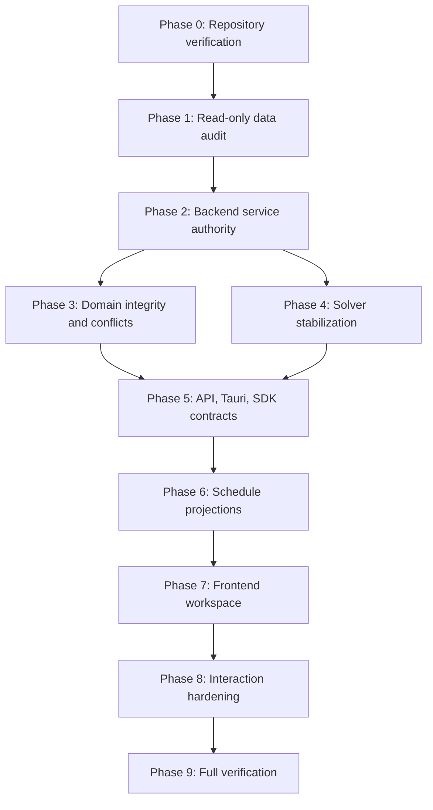

# Orbis Scheduling - Final Implementation Plan

## 1. Executive Decision

**VERIFIED FROM REPOSITORY:** Orbis has a valid period-scoped recurring timetable model:

```text
Academic Year
  -> Academic Period
    -> Class
      -> Class Subject
        -> Weekly Hours + Primary Teacher
          -> Scheduled Lessons
            -> Day of Week + Time Slot + Teacher + Room
```

The current database is sufficient for recurring timetable planning. **No database migration is required now.**

The immediate work is backend and contract stabilization, not database redesign:

1. Consolidate direct scheduling operations and `ScheduleService`.
2. Make lesson conflict enforcement authoritative.
3. Fix cancellation and active-query semantics.
4. Consolidate the two solver lifecycles.
5. Fix and verify API route contracts.
6. Generate typed Tauri and SDK contracts.
7. Add schedule projections before expanding the UI.
8. Rebuild the timetable UI on the stabilized recurring model.

**REQUIRES PRODUCT DECISION:** dated lesson occurrences, date-specific exceptions, holidays, timetable publication history, and effective-dated teaching assignments remain deferred. The screenshots alone do not justify schema changes.

## 2. Repository Findings

### Persistence

**VERIFIED FROM REPOSITORY:** The baseline schema defines `academic_years`, `academic_periods`, `classes`, `class_subjects`, `subjects`, `enrollments`, `rooms`, `time_slots`, `teacher_availability`, `scheduled_lessons`, and `solve_jobs`.

The scheduling tables are defined in:

- `apps/api-rust/crates/infra-persistence/src/schemas/schema_baseline.sql`
- `apps/api-rust/crates/infra-persistence/src/schemas/schema_baseline_pg.sql`

`scheduled_lessons` contains no calendar date. Its `day_of_week` and `time_slot_id` fields establish recurring weekly semantics.

### Academic domain

- `academic_years` owns the year timeline.
- `academic_periods` belongs to an academic year through `period_id` and supports hierarchy through `parent_id`.
- `classes` are period-scoped.
- `subjects` are organization-scoped catalog records.
- `class_subjects` joins class, subject, and period and stores weekly hours and teacher assignment.
- `enrollments` join students to classes for a period.

### Scheduling domain

`class_subjects.weekly_hours` is read by the solver to create assignment demand. A single `class_subject` can produce multiple `scheduled_lessons` rows.

`rooms`, `time_slots`, and `teacher_availability` are scheduling inputs. Availability is consumed by solver construction, but no complete administrator-facing availability workflow was verified.

### Backend paths

There are two relevant paths:

1. Direct `svc_scheduling::ops` functions used by generated Tauri commands.
2. `ScheduleService` and `TimetableSolverService`, which contain richer validation, projections, and solver coordination.

### API

The API gateway exposes REST-style schedule routes in `apps/api-rust/crates/api-gateway/src/lib.rs`. The web SDK uses different command-style `/api/scheduling/...` paths. This must be verified against all consumers before selecting the canonical route contract.

The gateway schedule handler also passes class and period values in the reverse order expected by the operation signatures.

### Tauri and SDK

Tauri scheduling handlers are generated in:

- `apps/desktop-svelte/src-tauri/src/commands/scheduling/auto.rs`
- `apps/desktop-svelte/src-tauri/src/commands/auto_register.rs`

The generator is `scripts/generate-rpc.ts`. Core scheduling commands and types are mostly `any`.

### Frontend

The current desktop route supports class and teacher views, period selection, lesson CRUD, drag/drop, empty-cell creation, and solver preview. The shared timetable uses a single lesson lookup per cell, so additional lessons in the same cell are hidden.

### Test conventions

The root `package.json` defines:

```text
bun run test
bun run build
bun run typecheck
bun run lint
bun run generate
```

The desktop package defines `check` and `build`. No dedicated frontend test directory or test runner was verified in the source tree. Rust tests should follow existing `#[cfg(test)]` and Cargo conventions where present.

## 3. Verified Current Architecture

### Source of truth

| Concept | Current source of truth |
|---|---|
| Academic year | `academic_years` |
| Academic period | `academic_periods` |
| Class | `classes` |
| Subject catalog | `subjects` |
| Curriculum offering | `class_subjects` |
| Primary teacher | `class_subjects.primary_teacher_id` |
| Weekly requirement | `class_subjects.weekly_hours` |
| Daily period structure | `time_slots` |
| Physical resources | `rooms` |
| Recurring teacher constraints | `teacher_availability` |
| Recurring timetable placement | `scheduled_lessons` |
| Solver proposal | `solve_jobs.problem_snapshot` and `best_solution` |
| Exam occurrence | `exam_schedules` |
| Attendance occurrence | `attendance.date` |

### Ownership

`class_subjects` currently owns the period-scoped relationship between a class and subject, the primary teacher, and the weekly instructional requirement. This is acceptable for the current one-primary-teacher workflow.

`scheduled_lessons` owns recurring placements, not daily occurrences. `exam_schedules` and attendance remain separate dated domains.

### Current frontend flow

```text
Svelte route
  -> TanStack queries
    -> commands.scheduling
      -> Tauri generated command
        -> svc_scheduling::ops
          -> database
```

The solver application path additionally uses `ScheduleService`.

## 4. Data Integrity Findings

The audit must be read-only and must run before strict validation is enabled.

### Required audit checks

1. Duplicate `(class_id, subject_id, period_id)` class-subject rows.
2. Orphaned `class_subject_id` lesson references.
3. Lesson `class_subject_id` versus `class_id` and `subject_id` mismatches.
4. Lesson teacher versus class-subject teacher mismatches.
5. Cross-period class, class-subject, and time-slot references.
6. Invalid time-slot ownership.
7. Invalid or inactive room references.
8. Invalid teacher availability references.
9. Teacher collisions.
10. Class collisions.
11. Room collisions.
12. Cancelled lessons returned by active queries.
13. Solver jobs using `schedule` versus `timetable`.
14. Records that would fail new service invariants.

### Findings

**VERIFIED FROM REPOSITORY:** Foreign keys exist for several scheduling relationships, but there are no demonstrated unique constraints preventing all scheduling collisions.

**VERIFIED FROM REPOSITORY:** `teacher_availability` has no SeaORM relations and its schema relationships are weaker than those of `scheduled_lessons`.

**VERIFIED FROM REPOSITORY:** `scheduled_lessons` duplicates relationship identifiers without a demonstrated invariant that keeps them consistent.

### Existing-data handling

Invalid records must be reported and classified before enforcement. Do not silently repair, delete, or rewrite data. Remediation should be a separately approved data-fix operation after the audit.

## 5. Domain Decisions

### `class_subjects`

**VERIFIED FROM REPOSITORY:** It represents a period-scoped class curriculum offering and stores `weekly_hours`, primary teacher, optional assistant/substitute fields, and curriculum/assessment references.

**PROPOSED:** Keep it as the current curriculum offering and weekly-load source. Do not split it now.

**REQUIRES PRODUCT DECISION:** Introduce a separate teaching-assignment concept only if Orbis requires multiple active teachers, effective-dated changes, team teaching, or historical assignment preservation.

### `scheduled_lessons`

**VERIFIED FROM REPOSITORY:** It is period-scoped, weekday-based, and time-slot-based. Multiple weekly placements are represented by multiple rows sharing `class_subject_id`.

**PROPOSED:** Keep it as the recurring timetable placement entity.

### `teacher_availability`

**VERIFIED FROM REPOSITORY:** It stores teacher, period, weekday, time slot, and availability and is consumed by `TimetableSolverService`.

**PROPOSED:** Keep its schema and add CRUD only if administrator configuration is a confirmed workflow.

### Cancellation and substitution

**VERIFIED FROM REPOSITORY:** Direct lesson deletion physically deletes a row. The richer schedule service uses status-based cancellation. Substitution fields exist, but direct operation payloads do not consistently expose all fields.

**PROPOSED:** Standardize recurring cancellation and substitution behavior in the authoritative service.

**REQUIRES PRODUCT DECISION:** One-date cancellation or substitution requires a concrete occurrence/exception model. Do not add it now.

### Duplicated lesson identifiers

`class_subject_id` should be the authoritative relationship. The duplicated `class_id`, `subject_id`, and `teacher_id` fields should remain for compatibility until existing data is audited.

**PROPOSED:** Validate all duplicated values against the referenced class subject during writes and use the validated relationship for projections. Do not remove or migrate the columns now.

## 6. Backend Architecture Decision

### Authority

**PROPOSED:** Use `ScheduleService` as the application-service boundary for normal lesson operations because it already contains richer placement validation, conflict handling, repository usage, and normalized room projection.

The direct `ops` functions should become thin authorized adapters or be retired after all callers are migrated.

### Required operations

The authoritative service must own:

- get lesson;
- list by period, class, teacher, subject, and room;
- create;
- update;
- move;
- cancel;
- restore, only if existing product behavior requires it;
- relationship validation;
- conflict validation;
- permissions;
- organization isolation;
- audit behavior.

### Required invariants

```text
class_subject belongs to period
class belongs to period
subject matches class_subject
class matches class_subject
teacher is allowed for class_subject
time_slot belongs to period
room belongs to organization and is active
```

No trigger is required at this stage. Service-level enforcement is appropriate while existing data is audited and the schema remains frozen.

## 7. Conflict Enforcement Decision

Conflict detection belongs in the authoritative application service, using repository queries as the data-access mechanism.

The service must reject, for the same period, day, and time slot:

- teacher collisions;
- class collisions;
- room collisions.

It must also:

- exclude the current lesson during updates;
- ignore cancelled lessons;
- reject inactive or foreign rooms;
- enforce organization isolation;
- validate period ownership;
- report teacher unavailability where the operation requires it.

The UI may perform preflight checks for responsiveness, but those checks are advisory. The server mutation is authoritative.

Database uniqueness constraints are deferred because collision rules involve status, period ownership, and update exclusions. First audit existing data and centralize service enforcement.

## 8. Solver Architecture Decision

### Current implementations

1. `svc-scheduling/src/ops/solver.rs` creates and mutates simple jobs with `job_type = "schedule"`.
2. `svc-scheduling/src/services/solver.rs` builds `TimetableProblem`, submits it to the solver, polls status, stores solutions, and uses `job_type = "timetable"`.

Tauri currently calls the direct operation path.

### Authority

**PROPOSED:** Make `TimetableSolverService` the only solver coordinator.

Do not merely rename the job type. First migrate all start, list, get, cancel, apply, and UI callers to the coordinator semantics.

### Canonical lifecycle

```text
start
  -> validate period and permissions
  -> load classes and active class subjects
  -> derive weekly-hours assignments
  -> load time slots, rooms, and unavailability
  -> load existing placements and pinned lessons
  -> persist problem snapshot
  -> submit solver problem
  -> poll solver status
  -> persist best solution
  -> preview result
  -> apply validated solution
```

### Apply requirements

- Use one job type.
- Reject apply unless the job is completed and has a valid solution.
- Preserve full/incremental semantics.
- Make full replacement atomic.
- Prevent partial insertion.
- Guard repeated apply.
- Preserve solver provenance in generated lesson metadata where the existing model permits it.

The existing `solve_jobs` table can store lifecycle state and snapshots. A separate timetable-version table is not required now.

## 9. API / IPC / SDK Contract Decision

### Canonical boundary

```text
Rust application service
  -> API handler or Tauri adapter
    -> typed DTO
      -> SDK
        -> frontend query layer
```

API and Tauri are transport adapters. They must not contain scheduling business logic.

### Required corrections

- Fix class/period and teacher/period argument ordering in `handler/schedule.rs`.
- Verify all API routes against current consumers before changing route names.
- Resolve the REST gateway versus `/api/scheduling/...` web SDK mismatch deliberately.
- Keep generated files generated.
- Change Rust source/generator inputs, then run `bun run generate`.

### Typed contracts

Replace scheduling `any` usage with typed:

- `ScheduledLesson`;
- `ScheduledLessonView`;
- create/update/move requests;
- `ScheduleQuery`;
- `ScheduleConflict`;
- `TimeSlot`;
- `Room`;
- `TeacherAvailability`;
- `SolveJob`;
- `SolveResult`.

### Query methods

Expose:

```text
listScheduleForPeriod
listScheduleByClass
listScheduleByTeacher
listScheduleBySubject
listScheduleByRoom
listTimeSlots(periodId)
```

Compatibility wrappers may preserve existing names during rollout.

## 10. Schedule Projection Decision

Use repository/service DTO projections rather than creating duplicated database read models.

The projection should contain:

- lesson identity;
- academic period;
- class;
- class subject;
- subject;
- teacher and substitute teacher;
- room and room name;
- time slot and times;
- weekday;
- status;
- substitution and cancellation metadata;
- conflict metadata when requested;
- solver provenance where available.

The same projection source must support:

- whole-period view;
- class view;
- teacher view;
- subject view;
- room view.

Frontend normalization may group records into cells, but it must not perform independent ad-hoc joins for every card.

## 11. Frontend Architecture Decision

### Existing code to reuse

- `ScheduleBoard`.
- `Timetable`.
- `TimetableCard`.
- `ScheduleFilterControls`.
- `LessonCreateSheet` and lesson form.
- `SchedulePlanWorkspace` for solver UI.
- TanStack Svelte Query.
- Existing Orbis buttons, inputs, selects, tabs, sheets, badges, skeletons, icons, and design tokens.

### Refactor

- Schedule route state and query usage.
- Filter/context controls.
- Timetable cell grouping.
- Lesson-card props and display data.
- Drag/drop mutation flow.
- Solver workspace command usage.

### Replace or retire

- Cell-level `.find(...)` lookup that hides additional lessons.
- Card-level ad-hoc relationship resolution after projections are available.
- UI-only conflict enforcement as the primary safety mechanism.

### Shared component responsibilities

- `ScheduleWorkspace`: context, filters, queries, mutations, and view state.
- `ScheduleToolbar`: period, context, search, navigation, and actions.
- `ScheduleFilterBar`: class, teacher, subject, room, status, and conflict filters.
- `ScheduleGrid`: rows, columns, scrolling, grouping, and cell state.
- `ScheduleCell`: empty, unavailable, conflict, draft, and multi-item states.
- `ScheduleLessonCard`: projection-based metadata and actions.
- `ScheduleInspectorSheet`: create/edit lesson details.
- `ScheduleMobileDayView`: narrow-screen day presentation.

The solver preparation view, exam screens, attendance screens, and curriculum planning remain domain-specific.

## 12. Database Migration Decision

**No database migration required at this stage.**

The existing schema supports the confirmed target:

- recurring weekly lessons;
- multiple placements per class subject;
- shared teachers and rooms;
- teacher availability input;
- solver snapshots and results;
- dated attendance in its own domain;
- dated exams in its own domain.

### Keep unchanged

- `schema_baseline.sql`.
- `schema_baseline_pg.sql`.
- Migration definitions.
- Existing scheduling table meanings.

### Modify only at service/contract level now

- Relationship consistency.
- Conflict enforcement.
- Cancellation semantics.
- Solver lifecycle.
- Projection contracts.

### Future migration trigger

A migration is justified only if requirements confirm one of these cannot be represented by the recurring model:

- one-date lesson cancellation;
- one-date substitution;
- school closures or ordinary holidays;
- one-off events;
- formal timetable publication history;
- effective-dated or multi-teacher assignments.

If later required, add separate occurrence/exception entities. Do not add a date directly to `scheduled_lessons`.

## 13. Implementation Phases

### Phase 0 - Repository verification

**Objective:** Confirm paths, generated ownership, active callers, route contracts, transaction conventions, permission checks, audit conventions, and test commands.

**Verified files/modules:** persistence schemas, migration system, scheduling entities/ops/services/repositories, solver modules, API handlers/routes, generator, SDKs, Tauri commands, Svelte schedule files, root/package manifests.

**Dependencies:** None.

**Required changes:** None; read-only.

**Contracts/interfaces affected:** None.

**Database impact:** None.

**Migration required:** No.

**Tests:** None; verify available commands and existing test conventions.

**Validation criteria:** Every later file and caller is confirmed; no speculative migration remains in scope.

**Risks:** None.

**Rollback:** None required.

**Completion criteria:** A signed-off implementation boundary and caller inventory exist.

### Phase 1 - Read-only data integrity audit

**Objective:** Identify records that conflict with proposed service invariants.

**Verified files/modules:** `svc-scheduling` repositories/entities, `svc-academic` class-subject operations, persistence schemas.

**Dependencies:** Phase 0.

**Required changes:** Add only read-only audit queries or tests using existing repository conventions.

**Contracts/interfaces affected:** None initially.

**Database impact:** Read-only.

**Migration required:** No.

**Tests:** Audit queries for duplicates, orphans, cross-period records, conflicts, cancellation visibility, and solver job types.

**Validation criteria:** Invalid data is reported with IDs and reasons; nothing is silently repaired.

**Risks:** Existing invalid data may block stricter writes.

**Rollback:** Remove or disable audit-only code without data changes.

**Completion criteria:** Integrity report approved and remediation decisions recorded.

### Phase 2 - Scheduling service authority

**Objective:** Route all lesson operations through one application service.

**Verified files/modules:** `ops/lesson.rs`, `services/schedule.rs`, scheduling repositories, Tauri adapter, API schedule handlers.

**Dependencies:** Phase 1.

**Required changes:** Consolidate get/list/create/update/move/cancel, permissions, organization checks, relationship validation, audit, and projection behavior.

**Contracts/interfaces affected:** Internal Rust service interfaces and lesson DTOs.

**Database impact:** None.

**Migration required:** No.

**Tests:** CRUD, permissions, organization isolation, audit, cancellation, API/Tauri parity.

**Validation criteria:** Identical inputs produce identical behavior through all transport paths.

**Risks:** Existing callers may depend on incorrect direct-op behavior.

**Rollback:** Preserve compatibility adapters and disable new routing behind a controlled rollout.

**Completion criteria:** No normal lesson mutation bypasses the authoritative service.

### Phase 3 - Conflict and domain integrity enforcement

**Objective:** Enforce placement invariants at mutation time.

**Verified files/modules:** `services/schedule.rs`, `ops/lesson.rs`, repositories, class-subject operations.

**Dependencies:** Phase 2 and approved Phase 1 remediation.

**Required changes:** Validate ownership, duplicated IDs, allowed teachers, active rooms, period-scoped slots, and teacher/class/room collisions.

**Contracts/interfaces affected:** Create/update/move requests and conflict DTOs.

**Database impact:** None initially.

**Migration required:** No.

**Tests:** All conflict types, current-lesson exclusion, cancelled lessons, cross-period isolation, relationship mismatches.

**Validation criteria:** Every backend entry point rejects invalid placements.

**Risks:** New enforcement may expose legacy invalid data.

**Rollback:** Gate enforcement for affected records only with explicit remediation, never by bypassing all validation.

**Completion criteria:** Server validation is authoritative and consistent.

### Phase 4 - Solver stabilization

**Objective:** Make solver start, poll, cancel, preview, and apply one lifecycle.

**Verified files/modules:** `ops/solver.rs`, `services/solver.rs`, `infra-scheduler`, solver client, solver workspace.

**Dependencies:** Phases 2 and 3.

**Required changes:** Consolidate job type, coordinator, status transitions, permissions, polling, cancellation, full/incremental modes, provenance, and transactional apply.

**Contracts/interfaces affected:** Solver request, job, assignment, and result DTOs.

**Database impact:** Existing `solve_jobs` table only.

**Migration required:** No.

**Tests:** Demand generation, pinned lessons, availability, rooms, job transitions, cancellation, failed apply, repeated apply, atomic full apply.

**Validation criteria:** One completed job can be previewed and applied safely.

**Risks:** Full apply can replace a period timetable.

**Rollback:** Transaction rollback on failure; retain preview-only mode until apply is proven.

**Completion criteria:** No caller uses the obsolete solver lifecycle.

### Phase 5 - API, Tauri, and SDK contracts

**Objective:** Align all transports with the authoritative backend.

**Verified files/modules:** API handlers/routes, `generate-rpc.ts`, Tauri scheduling commands, SDK core/desktop/web commands and types.

**Dependencies:** Phases 2-4.

**Required changes:** Fix argument ordering, resolve route parity, define typed contracts, regenerate outputs, and preserve compatibility wrappers where necessary.

**Contracts/interfaces affected:** API, IPC, SDK commands and DTOs.

**Database impact:** None.

**Migration required:** No.

**Tests:** API route tests, IPC serialization, generation checks, SDK type checks, organization isolation.

**Validation criteria:** Generated command signatures and runtime arguments match Rust handlers.

**Risks:** Breaking stale SDK consumers.

**Rollback:** Maintain compatibility methods until consumers migrate.

**Completion criteria:** One documented canonical contract exists.

### Phase 6 - Schedule projections

**Objective:** Provide one read model for all recurring timetable contexts.

**Verified files/modules:** Scheduling repository/service query layers, SDK types, desktop academic queries.

**Dependencies:** Phase 5.

**Required changes:** Add typed period/class/teacher/subject/room projections and period-scoped time-slot queries.

**Contracts/interfaces affected:** Projection and query DTOs.

**Database impact:** None; use joins/repository queries.

**Migration required:** No.

**Tests:** Projection consistency, filtering, metadata, cancellation visibility, multiple-item cells.

**Validation criteria:** All contexts derive from the same lesson source.

**Risks:** Existing inconsistent records become visible.

**Rollback:** Retain existing raw query wrappers while projection issues are remediated.

**Completion criteria:** Frontend no longer needs per-card ad-hoc joins.

### Phase 7 - Frontend scheduling workspace

**Objective:** Reproduce the reference timetable UX within the recurring domain.

**Verified files/modules:** Existing scheduling route, queries, filters, board, timetable, cards, forms, and solver workspace.

**Dependencies:** Phases 5 and 6.

**Required changes:** Add context views, filters, search, grouped cells, projection-based cards, empty/unavailable/conflict states, and responsive layout.

**Contracts/interfaces affected:** Frontend query and component props.

**Database impact:** None.

**Migration required:** No.

**Tests:** Route state, views, filters, search, cards, loading/error/empty states, class/teacher regression.

**Validation criteria:** Whole-period, class, teacher, subject, and room views render correctly from shared data.

**Risks:** UI scope can expand into unrelated planner/dashboard domains.

**Rollback:** Feature flag or reversible route switch.

**Completion criteria:** New workspace is usable without changing recurring domain semantics.

### Phase 8 - Interaction and UX hardening

**Objective:** Make drag/drop, conflict feedback, and responsive behavior production-safe.

**Verified files/modules:** Timetable, lesson card, lesson form/sheet, query/mutation modules, shared UI primitives.

**Dependencies:** Phases 6 and 7.

**Required changes:** Server-authoritative move flow, rollback, multi-item cells, keyboard alternative, unavailable states, and mobile day view.

**Contracts/interfaces affected:** Move and conflict contracts.

**Database impact:** None.

**Migration required:** No.

**Tests:** Drag/drop success/failure, teacher/class/room rollback, keyboard interaction, responsive behavior.

**Validation criteria:** Failed moves leave data and UI unchanged and explain the conflict.

**Risks:** Optimistic updates can race with invalidation.

**Rollback:** Disable optimistic updates and use refetch-based mutation handling.

**Completion criteria:** Interaction behavior is deterministic under success and failure.

### Phase 9 - Full verification

**Objective:** Verify the complete dependency chain and regression safety.

**Verified files/modules:** All changed modules and existing package/workspace test configurations.

**Dependencies:** Phases 1-8.

**Required changes:** None beyond test fixes directly caused by implementation.

**Contracts/interfaces affected:** Final generated and public contracts.

**Database impact:** None.

**Migration required:** No.

**Tests:** Database audits, Rust tests, API tests, IPC/SDK checks, frontend checks, interaction tests, and build/type/lint validation.

**Validation criteria:** Focused tests pass before broad workspace checks.

**Risks:** Unrelated pre-existing failures may obscure results.

**Rollback:** Separate scheduling failures from unrelated repository failures and do not alter unrelated code.

**Completion criteria:** Acceptance criteria and release checks pass.

## 14. File-by-File Change Matrix

| File/Module | Action | Current Responsibility | Required Change | Dependency | Generated? | DB Impact | Tests |
|---|---|---|---|---|---|---|---|
| `apps/api-rust/crates/svc-scheduling/src/ops/lesson.rs` | Refactor/adapter | Direct lesson CRUD and conflict preflight | Delegate to authoritative service; remove duplicated mutation logic | Phases 2-3 | No | None | CRUD/conflicts |
| `apps/api-rust/crates/svc-scheduling/src/services/schedule.rs` | Refactor | Rich schedule service and projections | Make application-service authority for validation, mutations, and reads | Phases 1-3 | No | None | Domain/integration |
| `apps/api-rust/crates/svc-scheduling/src/repository/queries.rs` | Modify | Scheduling reads and conflicts | Add validated context queries and projections | Phases 2-6 | No | None | Repository/projection |
| `apps/api-rust/crates/svc-scheduling/src/repository/commands.rs` | Modify | Scheduling persistence writes | Support consistent writes and transaction boundaries | Phases 2-4 | No | None | Persistence/transaction |
| `apps/api-rust/crates/svc-scheduling/src/ops/solver.rs` | Retire/adapter | Simple solver job operations | Delegate to `TimetableSolverService` after caller migration | Phase 4 | No | None | Solver lifecycle |
| `apps/api-rust/crates/svc-scheduling/src/services/solver.rs` | Modify | Solver coordination and apply | Make lifecycle canonical and apply atomic | Phase 4 | No | Existing table only | Solver integration |
| `apps/api-rust/crates/infra-scheduler/src/types.rs` | Modify if required | Solver problem/result DTOs | Clarify typed result/provenance fields without schema changes | Phase 4 | No | None | Solver DTO |
| `apps/api-rust/crates/api-gateway/src/handler/schedule.rs` | Modify | REST schedule handlers | Fix parameter order and call authoritative service | Phase 2/5 | No | None | API routes |
| `apps/api-rust/crates/api-gateway/src/lib.rs` | Modify if required | Gateway route registration | Align selected canonical routes with consumers | Phase 5 | No | None | API integration |
| `scripts/generate-rpc.ts` | Modify if required | Tauri/SDK generation | Support typed authoritative contracts | Phase 5 | No | None | Generation |
| `apps/desktop-svelte/src-tauri/src/commands/scheduling/auto.rs` | Regenerate | Generated Tauri scheduling handlers | Reflect authoritative operations | Phase 5 | Yes | None | IPC |
| `apps/desktop-svelte/src-tauri/src/commands/auto_register.rs` | Regenerate | Generated command registration | Register final handlers | Phase 5 | Yes | None | IPC registration |
| `packages/sdk-core/src/commands/scheduling.ts` | Regenerate | Core scheduling command types | Replace `any` with typed contracts | Phase 5 | Yes | None | SDK typecheck |
| `packages/sdk-core/src/types/scheduling.ts` | Regenerate/modify source | Core scheduling types | Add requests, projections, conflicts, and solver result types | Phase 5/6 | Yes/generated | None | SDK typecheck |
| `packages/sdk-desktop/src/commands.ts` | Regenerate/modify | Desktop transport commands | Match Tauri signatures | Phase 5 | Partially generated | None | Desktop SDK |
| `packages/sdk-web/src/commands.ts` | Modify | Web API commands | Match canonical gateway routes | Phase 5 | No | None | Web SDK/API |
| `apps/desktop-svelte/src/lib/features/academics/queries.ts` | Refactor | TanStack schedule queries | Consume typed projections and period-scoped slots | Phase 6 | No | None | Query tests |
| `apps/desktop-svelte/src/routes/(app)/[orgId]/academics/schedule/+page.svelte` | Refactor | Schedule route state and mutations | Use shared workspace contexts and canonical queries | Phase 7 | No | None | Route regression |
| `apps/desktop-svelte/src/lib/features/academics/components/schedule-filter-controls.svelte` | Refactor | Class/teacher controls | Add shared contexts, filters, and search | Phase 7 | No | None | Component tests |
| `apps/desktop-svelte/src/lib/features/academics/components/schedule-board.svelte` | Refactor | Board loading/error wrapper | Consume grouped projection-aware cells | Phase 7 | No | None | Component tests |
| `apps/desktop-svelte/src/lib/features/academics/components/lesson-form.svelte` | Modify | Lesson form and preflight | Use typed mutation and authoritative conflict feedback | Phase 3/5 | No | None | Form/conflict |
| `apps/desktop-svelte/src/lib/features/academics/components/lesson-create-sheet.svelte` | Modify | Create/edit sheet | Use canonical DTOs and mutation results | Phase 3/5 | No | None | Form/mutation |
| `apps/desktop-svelte/src/lib/features/academics/components/schedule-plan-workspace.svelte` | Refactor | Solver preparation and polling UI | Use canonical solver lifecycle and typed results | Phase 4/5 | No | Existing table only | Solver UI |
| `packages/ui-svelte/src/components/ui/timetable/timetable.svelte` | Refactor | Shared timetable grid and drag/drop | Render arrays per cell, conflict states, and responsive views | Phase 7/8 | No | None | UI/interaction |
| `packages/ui-svelte/src/components/ui/timetable/timetable-card.svelte` | Refactor | Lesson card display | Consume normalized projections and show status metadata | Phase 6/7 | No | None | Card tests |
| `apps/api-rust/crates/infra-persistence/src/schemas/schema_baseline.sql` | Leave untouched | SQLite baseline schema | No change justified now | Phase 0 | No | None | Schema regression |
| `apps/api-rust/crates/infra-persistence/src/schemas/schema_baseline_pg.sql` | Leave untouched | PostgreSQL baseline schema | No change justified now | Phase 0 | No | None | Schema regression |
| `apps/api-rust/crates/infra-persistence/src/schema_migrations.rs` | Leave untouched | Migration runner/corrections | No migration justified now | Phase 0 | No | Migration regression |
| `apps/api-rust/crates/svc-calendar/src/entities` | Leave untouched | Academic years and periods | Existing lifecycle is sufficient | Phase 0 | No | Existing calendar tests |
| `apps/api-rust/crates/svc-academic/src/entities` | Leave untouched initially | Classes, subjects, class subjects, enrollments | No split is justified now | Phase 0 | No | Academic regression |
| `apps/api-rust/crates/svc-exam` | Leave untouched | Concrete exam scheduling | Separate domain | Phase 0 | No | Existing exam tests |
| `apps/api-rust/crates/svc-assessment` | Leave untouched | Dated attendance | Separate operational domain | Phase 0 | No | Existing attendance tests |
| `packages/ui-svelte/globals.css` | Leave untouched | Orbis design tokens | Preserve existing design system | Phase 7 | None | Visual regression |

## 15. Dependency Graph



### Parallelizable work

After Phase 0:

- Read-only data audit preparation and contract inventory can proceed in parallel.
- Backend authority design and test-fixture preparation can proceed in parallel.

After Phase 2:

- Conflict enforcement and solver stabilization can proceed in parallel, provided both use the same service invariants.

After Phase 5:

- Projection implementation and frontend component preparation can proceed in parallel, but frontend data integration must wait for Phase 6.

## 16. Testing Strategy

### Exact repository commands

From the repository root:

```text
bun run generate
bun run test
bun run build
bun run typecheck
bun run lint
```

For the desktop package, the existing package scripts include:

```text
bun run --cwd apps/desktop-svelte check
bun run --cwd apps/desktop-svelte build
```

For Rust, use Cargo workspace commands supported by the repository:

```text
cargo test --manifest-path apps/api-rust/Cargo.toml -p svc-scheduling
cargo check --manifest-path apps/api-rust/Cargo.toml
```

Run package-specific tests only where the package defines them. Do not invent a frontend test runner that is not present in the repository.

### Required coverage

#### Data integrity

- Duplicate class-subject audit.
- Orphan reference audit.
- Cross-period audit.
- Duplicated lesson identifier audit.
- Availability reference audit.
- Existing teacher/class/room conflict audit.

#### Backend and domain

- Create, update, move, cancel.
- Relationship validation.
- Permissions.
- Organization isolation.
- Audit records.
- Active/cancelled filtering.

#### Conflicts

- Teacher collision.
- Class collision.
- Room collision.
- Current-lesson exclusion.
- Cross-period records.
- Inactive rooms.
- Cancelled lessons.
- Concurrent writes.

#### Solver

- Weekly-hours demand.
- Full mode.
- Incremental mode.
- Pinned lessons.
- Teacher unavailability.
- Room allocation.
- Job lifecycle.
- Cancellation.
- Failed submission.
- Transactional apply.
- Repeated apply protection.

#### API, IPC, and SDK

- Gateway argument ordering.
- API route parity.
- Tauri argument serialization.
- Generated handler parity.
- SDK type compatibility.
- Permission and organization isolation.

#### Frontend

- Whole-period, class, teacher, subject, and room contexts.
- Search and filters.
- Multiple lessons per cell.
- Empty, unavailable, and conflict states.
- Solver preview.
- Drag/drop success and rollback.
- Responsive desktop/mobile behavior.
- Existing lesson CRUD regression.

## 17. Acceptance Criteria

### Data

- Recurring lessons remain period-scoped and weekday/time-slot based.
- Five weekly hours can produce five distinct placements.
- Class, class-subject, subject, teacher, time-slot, and room relationships are validated.
- Cross-period data cannot be used in a placement.

### Backend

- Create, update, move, and cancel use one authoritative service.
- Permissions and organization isolation apply to every entry point.
- Audit behavior is consistent.
- Cancellation behavior is consistent.
- Active queries exclude cancelled lessons.

### Conflicts

- Teacher conflicts are rejected server-side.
- Class conflicts are rejected server-side.
- Room conflicts are rejected server-side.
- The current lesson is excluded during its own update.
- UI preflight cannot bypass backend enforcement.

### Solver

- One job type and lifecycle are used.
- Weekly-hours demand is represented correctly.
- Pinned lessons and teacher availability are honored.
- Full and incremental modes behave distinctly.
- Preview does not mutate the active timetable.
- Full apply is atomic.
- Failed or cancelled jobs do not modify the active timetable.
- Repeated apply is guarded or idempotent.

### Contracts

- API, Tauri, desktop SDK, web SDK, and Rust handlers agree on arguments and response shapes.
- Core scheduling contracts do not use `any` for required fields.
- Generated files are reproducible from source definitions.

### UI

- All lessons in a cell are visible.
- Whole-period, class, teacher, subject, and room views share one source.
- Filters and search operate consistently.
- Conflicts are visible and actionable.
- Drag/drop uses server validation and rollback.
- Empty, unavailable, loading, and error states are represented.
- Desktop and mobile layouts preserve usability.
- Existing class and teacher workflows continue to work.
- Existing Orbis design tokens and primitives remain in use.

### Database

- No migration is introduced unless a confirmed requirement proves the recurring schema insufficient.

## 18. Risks and Rollback

| Risk | Mitigation | Rollback |
|---|---|---|
| Existing invalid lesson data | Run read-only audit before enforcement | Keep data unchanged; remediate separately |
| Duplicate lesson identifiers | Treat `class_subject_id` as authority and validate writes | Preserve columns and compatibility reads |
| Solver full apply failure | Use one database transaction | Roll back transaction and keep preview available |
| SDK breaking changes | Add compatibility wrappers and regenerate outputs | Restore previous adapter contract while consumers migrate |
| Generated-file drift | Change generator/source definitions, run `bun run generate` | Regenerate from last known-good source |
| Route mismatch | Test all current consumers before route changes | Keep compatibility routes temporarily |
| Projection exposes bad data | Fail clearly and use audit report | Fall back to raw reads during remediation |
| Optimistic UI race | Reconcile mutation responses and query invalidation | Disable optimistic updates |
| Concurrent schedule edits | Server-side conflict checks and transaction boundaries | Reject stale mutation and refetch |
| Scope expansion into holidays/planner/dashboard | Keep separate domains and require product decision | Defer unrelated work |

## 19. Remaining Open Questions

### VERIFIED FROM REPOSITORY

- `scheduled_lessons` is recurring and weekday/time-slot based.
- `class_subjects.weekly_hours` drives solver demand.
- Teacher availability is consumed by the solver.
- Exams and attendance are separate dated domains.
- Tauri currently calls direct scheduling operations.
- A richer schedule service also exists.
- Solver lifecycle implementations disagree.
- Gateway schedule argument ordering is incorrect.
- SDK/API route definitions differ.
- The timetable renders only one lesson per cell.

### INFERRED

- `class_subjects` is intended to be the current period-scoped curriculum and teaching-load aggregate.
- Duplicated lesson identifiers are denormalized convenience fields.
- Solver preview followed by apply is the current publication-like workflow.

### REQUIRES PRODUCT DECISION

- Are one-date cancellations required?
- Are substitutions recurring or date-specific?
- Is formal timetable publication history required?
- Can one class subject have multiple active teachers?
- Should teacher availability be administrator-configurable?
- Is the term planner a real Orbis domain or only a UX reference?
- Should daily views aggregate schedule, attendance, exams, and tasks?

## 20. Final Implementation Readiness Assessment

**READY FOR IMPLEMENTATION, WITH CONDITIONS.**

The recurring timetable domain is stable enough to implement without a database migration. The implementation must begin with Phases 0-4 because the current direct operation and solver paths are not behaviorally consistent.

Frontend work is ready only after:

1. One scheduling application-service authority is selected and wired.
2. Server-side conflict enforcement is complete.
3. Solver lifecycle and full apply behavior are stable.
4. API, Tauri, and SDK contracts are aligned and typed.
5. Schedule projections are available for all required contexts.

The database should remain unchanged. New occurrence, exception, event, teaching-assignment, or timetable-version entities must remain deferred until a confirmed product requirement demonstrates that the recurring model cannot support the required workflow.
