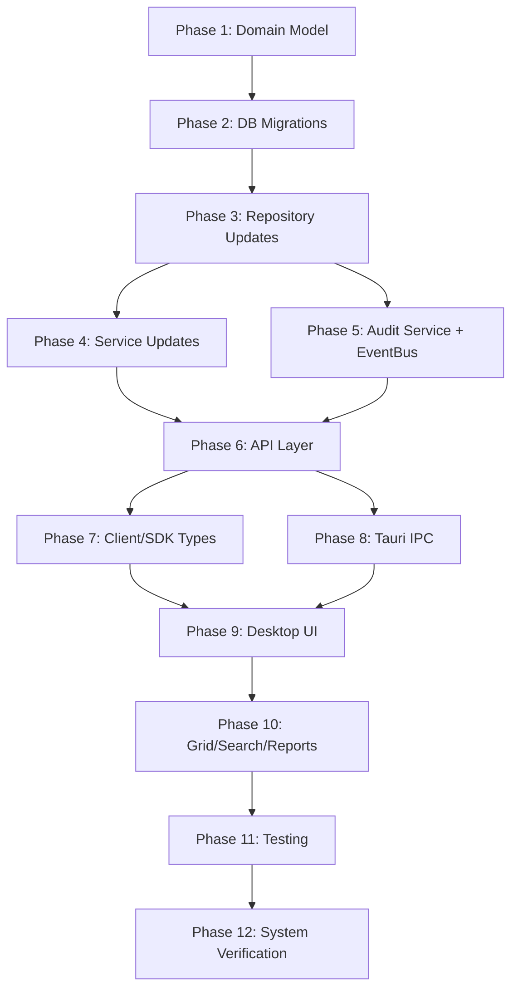

# Orbis — Audit Metadata Implementation Plan

> **Version:** 1.0.0
> **Status:** PLAN — NOT FOR EXECUTION
> **Companion:** `audit-metadata-architecture.md`

---

## Execution Order

```
Phase 0: Current Architecture Audit .......................... ✅ COMPLETE (this document)
Phase 1: Domain Model & Execution Context Enhancement
Phase 2: Database Migrations
Phase 3: Infrastructure/Repository Updates
Phase 4: Application Service Updates
Phase 5: Audit Trail Service & EventBus Integration
Phase 6: API Layer Updates
Phase 7: Client/SDK Type Updates
Phase 8: Tauri IPC Updates (where required)
Phase 9: Desktop/UI Integration
Phase 10: Grid/Search/Context Menu/Reports
Phase 11: Testing & Performance Verification
Phase 12: Full System Verification
```

---

## Phase 1: Domain Model & Execution Context Enhancement

### Goal
Enrich domain entities with audit metadata fields and enhance RequestContext.

### Scope
- `orbis-domain/src/entities/` — 14 entity files
- `orbis-app/src/context.rs` — RequestContext

### Changes

#### 1.1 RequestContext Enhancement (`orbis-app/src/context.rs`)

**Current:**
```rust
pub struct RequestContext {
    pub tenant_id: Uuid,
    pub actor: Actor,
    pub request_id: String,
}
```

**Target:**
```rust
#[derive(Debug, Clone)]
pub enum ActionSource {
    Api,
    TauriIpc,
    Autopilot,
    System,
    Integration(String),
}

impl Default for ActionSource {
    fn default() -> Self { ActionSource::Api }
}

#[derive(Debug, Clone)]
pub struct RequestContext {
    pub tenant_id: Uuid,
    pub actor: Actor,
    pub request_id: String,
    pub source: ActionSource,
    pub org_unit_path: Option<String>,
}

impl RequestContext {
    pub fn user_id(&self) -> Option<Uuid> {
        self.actor.id()
    }

    pub fn actor_type_str(&self) -> &'static str {
        match &self.actor {
            Actor::User(_) => "user",
            Actor::Agent(_) => "agent",
            Actor::Autopilot => "autopilot",
            Actor::System => "system",
        }
    }

    pub fn source_str(&self) -> &str {
        match &self.source {
            ActionSource::Api => "api",
            ActionSource::TauriIpc => "tauri_ipc",
            ActionSource::Autopilot => "autopilot",
            ActionSource::System => "system",
            ActionSource::Integration(name) => name.as_str(),
        }
    }
}
```

**Files affected:** All call sites that construct `RequestContext` (extractors.rs, Tauri state.rs, autopilot services).

**Risk:** LOW — Adding fields with defaults. Existing code passes through.

#### 1.2 Entity Updates

For each entity listed below, add the specified `Option<Uuid>` fields:

| Entity File | Add Fields | Default |
|---|---|---|
| `organization.rs` | `created_by: Option<Uuid>`, `updated_by: Option<Uuid>`, `version: i32` | `None, None, 1` |
| `org_unit.rs` | `created_by: Option<Uuid>`, `updated_by: Option<Uuid>` | `None, None` |
| `user.rs` | `created_by: Option<Uuid>`, `updated_by: Option<Uuid>` | `None, None` |
| `student.rs` | `created_by: Option<Uuid>`, `updated_by: Option<Uuid>`, `org_unit_id: Option<Uuid>` | `None, None, None` |
| `enrollment.rs` | `created_by: Option<Uuid>`, `updated_by: Option<Uuid>` | `None, None` |
| `employee.rs` | `created_by: Option<Uuid>`, `updated_by: Option<Uuid>` | `None, None` |
| `group.rs` | `created_by: Option<Uuid>`, `updated_by: Option<Uuid>` | `None, None` |
| `account.rs` | `created_by: Option<Uuid>`, `updated_by: Option<Uuid>`, `version: i32` | `None, None, 1` |
| `journal_entry.rs` | `updated_at: DateTime<Utc>`, `updated_by: Option<Uuid>`, `org_unit_id: Option<Uuid>`, `version: i32` | `now, None, None, 1` |
| `payment.rs` | `updated_at: DateTime<Utc>`, `org_unit_id: Option<Uuid>` | `now, None` |
| `student_fee.rs` | `created_by: Option<Uuid>` | `None` |
| `grade.rs` | `created_by: Option<Uuid>`, `updated_by: Option<Uuid>` | `None, None` |
| `attendance.rs` | `marked_by: Option<Uuid>` | `None` |
| `behavior_record.rs` | `recorded_by: Option<Uuid>` | `None` |
| `class.rs` | `org_unit_id: Option<Uuid>` | `None` |
| `room.rs` | `org_unit_id: Option<Uuid>` | `None` |

**Risk:** LOW — All new fields are `Option` or have defaults.

#### 1.3 New Audit Domain Entity (`orbis-domain/src/entities/audit.rs`)

```rust
#[derive(Debug, Clone, Serialize, Deserialize)]
pub struct AuditEvent {
    pub id: Uuid,
    pub org_id: Uuid,
    pub actor_id: Option<Uuid>,
    pub actor_type: String,
    pub action: String,
    pub entity_type: String,
    pub entity_id: Uuid,
    pub org_unit_id: Option<Uuid>,
    pub request_id: Option<String>,
    pub source: String,
    pub changes: Option<serde_json::Value>,
    pub metadata: Option<serde_json::Value>,
    pub created_at: DateTime<Utc>,
}
```

**Dependencies:** None.

### Tests
- Unit tests for `RequestContext::actor_type_str()` and `source_str()`.
- Verify all entity constructors compile with new fields.

### Acceptance Criteria
- [ ] `RequestContext` has `source` and `org_unit_path` fields.
- [ ] All 14 entities compile with new fields.
- [ ] `AuditEvent` entity exists in domain.
- [ ] `cargo check --workspace` passes.

---

## Phase 2: Database Migrations

### Goal
Add new columns and the `audit_events` table.

### Scope
- New migration file: `m20240105_000001_audit_metadata.rs`

### Changes

#### 2.1 Migration: Add columns to existing tables

```sql
-- Organization
ALTER TABLE organizations ADD COLUMN created_by UUID;
ALTER TABLE organizations ADD COLUMN updated_by UUID;
ALTER TABLE organizations ADD COLUMN version INTEGER NOT NULL DEFAULT 1;

-- OrgUnit
ALTER TABLE org_units ADD COLUMN created_by UUID;
ALTER TABLE org_units ADD COLUMN updated_by UUID;

-- User
ALTER TABLE users ADD COLUMN created_by UUID;
ALTER TABLE users ADD COLUMN updated_by UUID;

-- Student
ALTER TABLE students ADD COLUMN created_by UUID;
ALTER TABLE students ADD COLUMN updated_by UUID;
ALTER TABLE students ADD COLUMN org_unit_id UUID;

-- Enrollment
ALTER TABLE enrollments ADD COLUMN created_by UUID;
ALTER TABLE enrollments ADD COLUMN updated_by UUID;

-- Employee
ALTER TABLE employees ADD COLUMN created_by UUID;
ALTER TABLE employees ADD COLUMN updated_by UUID;

-- Group
ALTER TABLE groups ADD COLUMN created_by UUID;
ALTER TABLE groups ADD COLUMN updated_by UUID;

-- Account
ALTER TABLE accounts ADD COLUMN created_by UUID;
ALTER TABLE accounts ADD COLUMN updated_by UUID;
ALTER TABLE accounts ADD COLUMN version INTEGER NOT NULL DEFAULT 1;

-- JournalEntry
ALTER TABLE journal_entries ADD COLUMN updated_at TIMESTAMPTZ;
ALTER TABLE journal_entries ADD COLUMN updated_by UUID;
ALTER TABLE journal_entries ADD COLUMN org_unit_id UUID;
ALTER TABLE journal_entries ADD COLUMN version INTEGER NOT NULL DEFAULT 1;

-- Payment
ALTER TABLE payments ADD COLUMN updated_at TIMESTAMPTZ;
ALTER TABLE payments ADD COLUMN org_unit_id UUID;

-- StudentFee
ALTER TABLE student_fees ADD COLUMN created_by UUID;

-- Grade
ALTER TABLE grades ADD COLUMN created_by UUID;
ALTER TABLE grades ADD COLUMN updated_by UUID;

-- Attendance
ALTER TABLE attendances ADD COLUMN marked_by UUID;

-- BehaviorRecord
ALTER TABLE behavior_records ADD COLUMN recorded_by UUID;

-- Class
ALTER TABLE classes ADD COLUMN org_unit_id UUID;

-- Room
ALTER TABLE rooms ADD COLUMN org_unit_id UUID;

-- Employee (extend soft delete)
ALTER TABLE employees ADD COLUMN deleted_at TIMESTAMPTZ;
```

#### 2.2 Migration: Create `audit_events` table

```sql
CREATE TABLE audit_events (
    id              UUID PRIMARY KEY,
    org_id          UUID NOT NULL,
    actor_id        UUID,
    actor_type      TEXT NOT NULL,
    action          TEXT NOT NULL,
    entity_type     TEXT NOT NULL,
    entity_id       UUID NOT NULL,
    org_unit_id     UUID,
    request_id      TEXT,
    source          TEXT NOT NULL DEFAULT 'api',
    changes         JSONB,
    metadata        JSONB,
    created_at      TIMESTAMPTZ NOT NULL DEFAULT NOW(),
    CONSTRAINT fk_audit_org FOREIGN KEY (org_id) REFERENCES organizations(id)
);

CREATE INDEX idx_audit_org_created ON audit_events(org_id, created_at DESC);
CREATE INDEX idx_audit_entity ON audit_events(entity_type, entity_id, created_at DESC);
CREATE INDEX idx_audit_actor ON audit_events(actor_id, created_at DESC) WHERE actor_id IS NOT NULL;
```

#### 2.3 Migration: Migrate `report_audit_log` data

```sql
INSERT INTO audit_events (id, org_id, actor_id, actor_type, action, entity_type, entity_id, source, metadata, created_at)
SELECT id, org_id, actor_id, 'user', action, entity_type, entity_id, 'api', details, created_at
FROM report_audit_log;
```

#### 2.4 Backfill Strategy

| Column | Existing Records | Backfill Value |
|---|---|---|
| `created_by` | All existing records | `NULL` (unknown creator) |
| `updated_by` | All existing records | `NULL` |
| `org_unit_id` | All existing records | `NULL` (not yet assigned to branch) |
| `version` | All existing records | `1` (via DEFAULT) |
| `updated_at` (JournalEntry) | Existing entries | `created_at` (mirror creation time) |
| `updated_at` (Payment) | Existing payments | `created_at` |
| `deleted_at` (Employee) | Where `is_deleted = true` | `updated_at` (approximate) |

**Note:** `NULL` for `created_by` is semantically correct — it means "created before audit tracking was added." The UI should display "System" or "—" for NULL values.

### Risk
- MEDIUM — Schema changes on production tables. All new columns are nullable or have defaults → no data loss.
- Rollback: `ALTER TABLE ... DROP COLUMN` for each added column, `DROP TABLE audit_events`.

### Tests
- Verify migration runs forward and backward.
- Verify existing queries still work (all new columns are nullable/defaulted).

### Acceptance Criteria
- [ ] Migration runs cleanly on fresh DB.
- [ ] Migration runs cleanly on existing DB with data.
- [ ] Rollback works.
- [ ] All existing unit tests pass.

---

## Phase 3: Infrastructure/Repository Updates

### Goal
Update SeaORM models and repository implementations to handle new columns.

### Scope
- `orbis-infra/src/models/` — 16 model files
- `orbis-infra/src/repositories/` — corresponding repo files

### Changes

#### 3.1 SeaORM Model Updates

For each model file, add the new columns matching domain entity changes:

| Model File | New Columns |
|---|---|
| `organization.rs` | `created_by: Option<Uuid>`, `updated_by: Option<Uuid>`, `version: i32` |
| `org_unit.rs` | `created_by: Option<Uuid>`, `updated_by: Option<Uuid>` |
| `user.rs` | `created_by: Option<Uuid>`, `updated_by: Option<Uuid>` |
| `student.rs` | `created_by: Option<Uuid>`, `updated_by: Option<Uuid>`, `org_unit_id: Option<Uuid>` |
| `enrollment.rs` | `created_by: Option<Uuid>`, `updated_by: Option<Uuid>` |
| `employee.rs` | `created_by: Option<Uuid>`, `updated_by: Option<Uuid>`, `deleted_at: Option<DateTimeUtc>` |
| `group.rs` | `created_by: Option<Uuid>`, `updated_by: Option<Uuid>` |
| `account.rs` | `created_by: Option<Uuid>`, `updated_by: Option<Uuid>`, `version: i32` |
| `journal_entry.rs` | `updated_at: Option<DateTimeUtc>`, `updated_by: Option<Uuid>`, `org_unit_id: Option<Uuid>`, `version: i32` |
| `payment.rs` | `updated_at: Option<DateTimeUtc>`, `org_unit_id: Option<Uuid>` |
| `student_fee.rs` | `created_by: Option<Uuid>` |
| `grade.rs` | `created_by: Option<Uuid>`, `updated_by: Option<Uuid>` |
| `attendance.rs` | `marked_by: Option<Uuid>` |
| `behavior_record.rs` | `recorded_by: Option<Uuid>` |
| `class.rs` | `org_unit_id: Option<Uuid>` |
| `room.rs` | `org_unit_id: Option<Uuid>` |

#### 3.2 New `audit_events` Model

```rust
// orbis-infra/src/models/audit_event.rs
pub mod audit_event {
    use sea_orm::entity::prelude::*;

    #[derive(Clone, Debug, PartialEq, DeriveEntityModel)]
    #[sea_orm(table_name = "audit_events")]
    pub struct Model {
        #[sea_orm(primary_key, auto_increment = false)]
        pub id: Uuid,
        pub org_id: Uuid,
        pub actor_id: Option<Uuid>,
        pub actor_type: String,
        pub action: String,
        pub entity_type: String,
        pub entity_id: Uuid,
        pub org_unit_id: Option<Uuid>,
        pub request_id: Option<String>,
        pub source: String,
        pub changes: Option<Json>,
        pub metadata: Option<Json>,
        pub created_at: DateTimeWithTimeZone,
    }

    #[derive(Copy, Clone, Debug, EnumIter, DeriveRelation)]
    pub enum Relation {}
    impl ActiveModelBehavior for ActiveModel {}
}
```

#### 3.3 Repository Updates

- Each repository's `save()` method must map the new fields to/from SeaORM `ActiveModel`.
- Each repository's `find_*()` methods must map new columns from `Model` to domain entity.
- Pattern: `Set(entity.created_by)` in save, `m.created_by` in find.

#### 3.4 New AuditEventRepository

```rust
// orbis-app/src/ports/repositories.rs — add:
#[async_trait]
pub trait AuditEventRepository: Send + Sync {
    async fn save(&self, event: &AuditEvent) -> Result<(), DomainError>;
    async fn save_batch(&self, events: &[AuditEvent]) -> Result<(), DomainError>;
    async fn list(
        &self,
        org_id: Uuid,
        filter: AuditEventFilter,
    ) -> Result<PaginatedList<AuditEvent>, DomainError>;
    async fn find_by_entity(
        &self,
        entity_type: &str,
        entity_id: Uuid,
        limit: u64,
        offset: u64,
    ) -> Result<Vec<AuditEvent>, DomainError>;
}

#[derive(Debug, Clone, Default)]
pub struct AuditEventFilter {
    pub entity_type: Option<String>,
    pub entity_id: Option<Uuid>,
    pub actor_id: Option<Uuid>,
    pub action: Option<String>,
    pub org_unit_id: Option<Uuid>,
    pub from_date: Option<DateTime<Utc>>,
    pub to_date: Option<DateTime<Utc>>,
    pub limit: Option<u64>,
    pub offset: Option<u64>,
}
```

### Tests
- Repository unit tests for save/find with new columns.
- Verify NULL columns are correctly handled.

### Acceptance Criteria
- [ ] All 16 models updated with new columns.
- [ ] `audit_event` model created.
- [ ] All repositories map new fields correctly.
- [ ] `AuditEventRepository` implemented.
- [ ] `cargo check --workspace` passes.
- [ ] `cargo test --workspace` passes.

---

## Phase 4: Application Service Updates

### Goal
Update services to populate `created_by`/`updated_by` from `RequestContext`.

### Scope
- `orbis-app/src/services/` — affected service files

### Changes

For every service method that creates or updates an entity with new metadata fields:

**Create pattern:**
```rust
async fn create_student(&self, ctx: &RequestContext, input: CreateStudentInput) -> Result<Student, DomainError> {
    self.permission_checker.check(ctx, Permission::StudentCreate).await?;
    // ... existing validation ...
    let student = Student {
        // ... existing fields ...
        created_by: ctx.actor.id(),    // NEW
        updated_by: ctx.actor.id(),    // NEW — same as creator initially
        org_unit_id: input.org_unit_id, // NEW — from input if provided
        // ...
    };
    self.student_repo.save(&student).await?;
    self.event_bus.publish(ctx, &DomainEvent::StudentRegistered { ... }).await?;
    Ok(student)
}
```

**Update pattern:**
```rust
async fn update_student(&self, ctx: &RequestContext, id: Uuid, input: UpdateStudentInput) -> Result<Student, DomainError> {
    self.permission_checker.check(ctx, Permission::StudentUpdate).await?;
    let mut student = self.student_repo.find_by_id(id).await?.ok_or(NotFound)?;
    // ... apply changes ...
    student.updated_by = ctx.actor.id();    // NEW
    student.updated_at = Utc::now();        // Ensure timestamp updates
    self.student_repo.save(&student).await?;
    Ok(student)
}
```

### Services Affected

| Service | Methods to Update |
|---|---|
| `student_service.rs` | `create_student`, `update_student`, `update_status` |
| `employee_service.rs` | `create_employee`, `update_employee`, `change_status` |
| `finance_service.rs` | `create_journal_entry`, `post_journal_entry`, `process_payment`, `generate_fee` |
| `academic_service.rs` | `create_class`, `create_room` |
| `assessment_service.rs` | `record_grade`, `update_grade`, `mark_attendance`, `log_behavior` |
| `auth_service.rs` | `create_user`, `update_user` |
| `organization_service.rs` | `update_org`, `create_org_unit`, `update_org_unit` |
| `group_service.rs` | `create_group`, `update_group` |
| `onboarding_service.rs` | Various create methods |
| `identity_provisioning_service.rs` | `provision_user_account` |

### Tests
- Each service test must verify `created_by`/`updated_by` are set from context.

### Acceptance Criteria
- [ ] All create methods set `created_by` from `ctx.actor.id()`.
- [ ] All update methods set `updated_by` from `ctx.actor.id()` and `updated_at`.
- [ ] No service accepts `created_by`/`updated_by` from input DTO.
- [ ] `cargo test --workspace` passes.

---

## Phase 5: Audit Trail Service & EventBus Integration

### Goal
Create the `AuditService` and integrate it with `EventBus`.

### Scope
- New: `orbis-app/src/services/audit_service.rs`
- Modified: `orbis-infra/src/event_bus.rs`
- Modified: `orbis-server/src/state.rs` — add `audit_event_repo`

### Changes

#### 5.1 AuditService

```rust
pub struct AuditService {
    audit_repo: Arc<dyn AuditEventRepository>,
}

impl AuditService {
    pub async fn log(
        &self,
        ctx: &RequestContext,
        action: &str,
        entity_type: &str,
        entity_id: Uuid,
        changes: Option<serde_json::Value>,
        metadata: Option<serde_json::Value>,
    ) -> Result<(), DomainError> {
        let event = AuditEvent {
            id: Uuid::new_v4(),
            org_id: ctx.tenant_id,
            actor_id: ctx.actor.id(),
            actor_type: ctx.actor_type_str().to_string(),
            action: action.to_string(),
            entity_type: entity_type.to_string(),
            entity_id,
            org_unit_id: None, // resolved from context or entity
            request_id: Some(ctx.request_id.clone()),
            source: ctx.source_str().to_string(),
            changes,
            metadata,
            created_at: Utc::now(),
        };
        self.audit_repo.save(&event).await
    }
}
```

#### 5.2 EventBus Integration

```rust
pub struct MemoryEventBus {
    pub workflow_engine: Option<Arc<AutopilotEngine>>,
    pub audit_service: Option<Arc<AuditService>>,  // NEW
}

#[async_trait]
impl EventBus for MemoryEventBus {
    async fn publish(&self, ctx: &RequestContext, event: &DomainEvent) -> Result<(), DomainError> {
        // 1. Log to audit trail
        if let Some(audit) = &self.audit_service {
            let (action, entity_type, entity_id) = event.audit_fields();
            if let Some((action, entity_type, entity_id)) = Some((action, entity_type, entity_id))
                .filter(|(_, _, id)| *id != Uuid::nil()) // Skip events without meaningful entity
            {
                let _ = audit.log(ctx, &action, &entity_type, entity_id, None, None).await;
            }
        }

        // 2. Forward to workflow engine (existing behavior)
        if let Some(engine) = &self.workflow_engine {
            let _ = engine.handle_event(ctx, event).await;
        }

        Ok(())
    }
}
```

#### 5.3 DomainEvent → Audit Mapping

Add a method to `DomainEvent`:
```rust
impl DomainEvent {
    pub fn audit_fields(&self) -> (String, String, Uuid) {
        match self {
            DomainEvent::StudentRegistered { student_id, .. } => ("student.created".into(), "student".into(), *student_id),
            DomainEvent::StudentStatusChanged { student_id, .. } => ("student.status_changed".into(), "student".into(), *student_id),
            DomainEvent::JournalEntryPosted { entry_id, .. } => ("journal_entry.posted".into(), "journal_entry".into(), *entry_id),
            DomainEvent::EmployeeCreated { employee_id, .. } => ("employee.created".into(), "employee".into(), *employee_id),
            // ... map all 43 variants ...
        }
    }
}
```

### Tests
- Unit test: DomainEvent → audit field mapping for all 43 variants.
- Integration test: Publish event → verify audit_events row created.

### Acceptance Criteria
- [ ] `AuditService` created with `log()` method.
- [ ] `MemoryEventBus` writes audit events on publish.
- [ ] All 43 `DomainEvent` variants mapped to audit actions.
- [ ] `report_audit_log` data migrated to `audit_events`.
- [ ] `cargo test --workspace` passes.

---

## Phase 6: API Layer Updates

### Goal
Update API DTOs, add audit endpoints, ensure new fields appear in responses.

### Scope
- `orbis-server/src/api/` — route files
- New: `audit_routes.rs`

### Changes

#### 6.1 DTO Updates

For each API route file that returns entities with new fields:

| Route File | DTO Changes |
|---|---|
| `student_routes.rs` | Add `created_by`, `updated_by`, `org_unit_id` to `StudentDto` response |
| `employee_routes.rs` | Add `created_by`, `updated_by` to `EmployeeDto` response |
| `finance_routes.rs` | Add `updated_at`, `updated_by`, `org_unit_id`, `version` to `JournalEntryDto`; `updated_at`, `org_unit_id` to `PaymentDto` |
| `assessment_routes.rs` | Add `created_by`, `updated_by` to `GradeDto`; `marked_by` to `AttendanceDto` |
| `group_routes.rs` | Add `created_by`, `updated_by` to `GroupDto` |
| `org_routes.rs` | Add `created_by`, `updated_by`, `version` to `OrgDto` |
| `iam_routes.rs` | Add `created_by`, `updated_by` to `UserDto` |
| `academic_routes.rs` | Add `org_unit_id` to `ClassDto`, `RoomDto` |

**Create/Update request DTOs:** Do NOT add `created_by`/`updated_by`. Backend sets these.

#### 6.2 New Audit Routes (`audit_routes.rs`)

```rust
// GET /api/v1/audit/events
pub async fn list_audit_events(
    AuthContext(ctx): AuthContext,
    State(state): State<AppState>,
    Query(filter): Query<AuditEventFilterDto>,
) -> Result<Json<ApiResponse<PaginatedList<AuditEventDto>>>, ApiError> {
    state.permission_checker.check(&ctx, Permission::AuditRead).await?;
    let events = state.audit_event_repo.list(ctx.tenant_id, filter.into()).await?;
    Ok(Json(ApiResponse::ok(events)))
}

// GET /api/v1/audit/events/entity/:entity_type/:entity_id
pub async fn list_entity_audit(
    AuthContext(ctx): AuthContext,
    State(state): State<AppState>,
    Path((entity_type, entity_id)): Path<(String, Uuid)>,
    Query(pagination): Query<PaginationDto>,
) -> Result<Json<ApiResponse<Vec<AuditEventDto>>>, ApiError> {
    state.permission_checker.check(&ctx, Permission::AuditRead).await?;
    let events = state.audit_event_repo
        .find_by_entity(&entity_type, entity_id, pagination.limit(), pagination.offset())
        .await?;
    Ok(Json(ApiResponse::ok(events)))
}
```

#### 6.3 Update Router

Add audit routes to the main router in `mod.rs`:
```rust
.route("/api/v1/audit/events", get(list_audit_events))
.route("/api/v1/audit/events/entity/:entity_type/:entity_id", get(list_entity_audit))
```

### Tests
- API integration tests for new audit endpoints.
- Verify permission checking on audit endpoints.

### Acceptance Criteria
- [ ] All response DTOs include new metadata fields.
- [ ] Create/update request DTOs do NOT include `created_by`/`updated_by`.
- [ ] Audit endpoints created and protected by `AuditRead` permission.
- [ ] `cargo check --workspace` passes.

---

## Phase 7: Client/SDK Type Updates

### Goal
Update TypeScript types and client implementations.

### Scope
- `apps/desktop/src/lib/api/types.ts`
- `apps/desktop/src/lib/api/local-client.ts`
- `apps/desktop/src/lib/api/remote-client.ts`
- `packages/sdk/` (regenerate from OpenAPI)

### Changes

#### 7.1 Type Updates

Add to relevant DTO types in `types.ts`:

```typescript
// Add to StudentDto, EmployeeDto, etc.
created_by?: string | null;
updated_by?: string | null;

// Add to StudentDto, ClassDto, JournalEntryDto, PaymentDto, RoomDto
org_unit_id?: string | null;

// Add to JournalEntryDto, AccountDto, OrgDto
version?: number;

// New types
interface AuditEventDto {
  id: string;
  org_id: string;
  actor_id?: string | null;
  actor_type: string;
  action: string;
  entity_type: string;
  entity_id: string;
  org_unit_id?: string | null;
  request_id?: string | null;
  source: string;
  changes?: Record<string, { old: unknown; new: unknown }> | null;
  metadata?: Record<string, unknown> | null;
  created_at: string;
}

interface AuditEventFilter {
  entity_type?: string;
  entity_id?: string;
  actor_id?: string;
  action?: string;
  from_date?: string;
  to_date?: string;
  limit?: number;
  offset?: number;
}
```

#### 7.2 OrbisApiClient Interface

Add audit methods:
```typescript
// Audit
listAuditEvents(filter?: AuditEventFilter): Promise<PaginatedList<AuditEventDto>>;
getEntityAudit(entityType: string, entityId: string, limit?: number, offset?: number): Promise<AuditEventDto[]>;
```

#### 7.3 LocalClient & RemoteClient

Implement the new audit methods in both clients:
- `LocalClient`: calls Tauri IPC command `list_audit_events`
- `RemoteClient`: calls `GET /api/v1/audit/events`

### Tests
- TypeScript type checking: `bun x tsc --noEmit --project apps/desktop/tsconfig.json`

### Acceptance Criteria
- [ ] All DTO types updated.
- [ ] `AuditEventDto` and `AuditEventFilter` types defined.
- [ ] Both `LocalClient` and `RemoteClient` implement audit methods.
- [ ] TypeScript compiles with zero errors.

---

## Phase 8: Tauri IPC Updates

### Goal
Add Tauri commands for audit operations where needed.

### Scope
- `apps/desktop/src-tauri/src/commands/` — add audit commands
- `apps/desktop/src-tauri/src/state.rs` — register `audit_event_repo`

### Changes

#### 8.1 Tauri Commands

```rust
#[tauri::command]
pub async fn list_audit_events(
    state: tauri::State<'_, AppState>,
    filter: AuditEventFilterDto,
) -> Result<PaginatedList<AuditEventDto>, String> {
    let ctx = state.request_context(ActionSource::TauriIpc);
    // ... delegate to audit_event_repo
}

#[tauri::command]
pub async fn get_entity_audit(
    state: tauri::State<'_, AppState>,
    entity_type: String,
    entity_id: String,
    limit: Option<u64>,
    offset: Option<u64>,
) -> Result<Vec<AuditEventDto>, String> {
    // ...
}
```

#### 8.2 RequestContext Source

Update Tauri's `state.rs` to set `source: ActionSource::TauriIpc` when building `RequestContext`.

### Tests
- Verify Tauri commands compile and are registered.

### Acceptance Criteria
- [ ] Audit Tauri commands created.
- [ ] RequestContext.source = TauriIpc for all Tauri-originated requests.
- [ ] `cargo tauri dev` builds successfully.

---

## Phase 9: Desktop/UI Integration

### Goal
Display new metadata fields in existing screens and add audit timeline views.

### Scope
- `apps/desktop/src/lib/features/` — affected feature modules

### Changes

#### 9.1 Column Updates for Grids

For screens that show entity lists, add optional columns:

| Screen | New Columns | Default Visible |
|---|---|---|
| Employee Directory | `Created By`, `Updated By`, `Updated At` | Hidden (optional) |
| Student List | `Created By`, `Updated By`, `Branch`, `Updated At` | Hidden (optional) |
| Journal Entries | `Updated By`, `Branch`, `Version` | Hidden (optional) |
| Payments | `Branch` | Hidden (optional) |
| Grades | `Created By`, `Updated By` | Hidden (optional) |
| Groups | `Created By`, `Updated By` | Hidden (optional) |

**Rule:** New metadata columns are NOT visible by default. Users enable them via column picker. This preserves existing UX.

#### 9.2 Detail Panels / Sheets

For entity detail views (preview/edit modes), add an "Audit History" tab or section:

- Shows paginated list from `api.getEntityAudit(entityType, entityId)`.
- Only visible when user has `audit:read` permission.
- Uses `<PermissionGate permission="audit:read">`.

#### 9.3 User Name Resolution

- `created_by` and `updated_by` store UUIDs.
- UI needs to display names.
- **Approach:** Use a lightweight user name cache (already exists in `authStore` / `orgContext` for current user; extend with a batch user name resolver for display).

#### 9.4 "Created By" / "Updated By" Display Component

Create a reusable `<ActorBadge userId={id} />` component:
- Resolves UUID to name.
- Shows "System" for null/system actors.
- Shows avatar + name inline.

### Tests
- Visual verification of grid with new columns enabled.
- Audit timeline tab loads and displays correctly.

### Acceptance Criteria
- [ ] Metadata columns available in column picker for affected grids.
- [ ] Detail panels show audit timeline (permission-gated).
- [ ] Actor names resolved correctly (not raw UUIDs).
- [ ] RTL layout correct.
- [ ] Loading/empty/error states present.

---

## Phase 10: Grid/Search/Context Menu/Reports

### Goal
Integrate metadata into search, filtering, context menus, and reports.

### Scope
- Search/filter infrastructure
- Context menus
- Report/export templates

### Changes

#### 10.1 Filters

| Filter | Entities | Backend Support |
|---|---|---|
| "Created By" dropdown | Student, Employee, JournalEntry | Server-side filter on `created_by` |
| "Branch" dropdown | Student, Class, Employee, JournalEntry, Payment | Server-side filter on `org_unit_id` |
| "Updated After" date picker | All entities with `updated_at` | Server-side filter |

#### 10.2 Sort

New sortable columns where they appear:
- `created_by` (sort by user name — requires join or denormalization for sort)
- `updated_at` (direct sort on timestamp)
- `org_unit_id` (sort by branch name — requires join)

**Decision:** Sort by `updated_at` is direct. Sort by `created_by` / `org_unit_id` names requires backend join support — add in Phase 2 if needed.

#### 10.3 Context Menus

For entities with audit trail, add:
```
───────────────────
📋 View Audit History   (requires audit:read)
───────────────────
```

This opens the audit timeline for the selected entity.

#### 10.4 Reports / Export

If entity data is exported (CSV/Excel), include metadata columns:
- `Created By` (resolved name)
- `Updated By` (resolved name)
- `Created At` (formatted per org locale)
- `Updated At` (formatted per org locale)
- `Branch` (resolved name)

#### 10.5 Print

If entity details are printed, include:
- Created by / Created at
- Updated by / Updated at
- Branch (if applicable)

### Acceptance Criteria
- [ ] Branch filter works on Student, Employee, JournalEntry grids.
- [ ] "View Audit History" context menu item available and permission-gated.
- [ ] Export includes metadata columns.
- [ ] Print templates updated.

---

## Phase 11: Testing & Performance Verification

### Goal
Comprehensive testing and performance validation.

### Tests

| Category | Scope | Method |
|---|---|---|
| Unit tests | Domain entity constructors | `cargo test` |
| Unit tests | Service metadata population | `cargo test` |
| Unit tests | DomainEvent → audit mapping | `cargo test` |
| Integration tests | Repository save/find with new columns | `cargo test` (DB) |
| Integration tests | EventBus → audit_events persistence | `cargo test` (DB) |
| Integration tests | API DTO serialization | `cargo test` (Axum) |
| API tests | Audit endpoints authorization | HTTP tests |
| TypeScript | Type compatibility | `tsc --noEmit` |
| E2E | Create entity → verify metadata in grid | Manual/Tauri test |
| E2E | Edit entity → verify updated_by | Manual/Tauri test |
| E2E | View audit timeline | Manual/Tauri test |
| Performance | Grid query with new columns | Query timing |
| Performance | Audit event write throughput | Benchmark |
| Performance | Audit timeline pagination | Query timing |

### Performance Checks

- [ ] Student list query time unchanged (< 50ms for 1000 students).
- [ ] Adding `created_by`/`updated_by` does not cause N+1 queries.
- [ ] Audit event INSERT < 5ms.
- [ ] Audit timeline query with pagination < 100ms.
- [ ] No new indexes required on existing entity queries.

### Acceptance Criteria
- [ ] `cargo test --workspace` — all tests pass (including new ones).
- [ ] `bun x tsc --noEmit` — zero TypeScript errors.
- [ ] No performance regression on existing queries.

---

## Phase 12: Full System Verification

### Goal
End-to-end verification of the complete audit system.

### Verification Checklist

```
[ ] Database correct — all columns exist, indexes created
[ ] Migration correct — runs forward and backward cleanly
[ ] Domain correct — all entities have declared fields
[ ] Application service correct — created_by/updated_by populated from RequestContext
[ ] Authorization correct — AuditRead required for audit endpoints
[ ] Context correct — RequestContext has source and org_unit_path
[ ] Scope correct — org_unit_id set where applicable
[ ] Audit correct — events written for all DomainEvent variants
[ ] API correct — response DTOs include new fields, request DTOs exclude them
[ ] LocalClient correct — Tauri commands for audit operations
[ ] RemoteClient correct — HTTP client for audit operations
[ ] SDK correct — types regenerated from OpenAPI
[ ] Tauri correct — source = TauriIpc for desktop requests
[ ] Desktop correct — metadata columns in grids (hidden by default)
[ ] UI correct — audit timeline in detail panels
[ ] Forms correct — no created_by/updated_by inputs
[ ] Tables correct — optional metadata columns
[ ] Search correct — backend search on new fields where needed
[ ] Filters correct — branch filter, created_by filter
[ ] Context menu correct — "View Audit History" item
[ ] Reports correct — metadata in exports
[ ] Export correct — metadata columns in CSV/Excel
[ ] Print correct — metadata in print templates
[ ] Localization correct — all new labels use Paraglide messages
[ ] RTL correct — layout correct in Arabic
[ ] Loading/empty/error states correct
[ ] Tests added — unit, integration, API
[ ] Performance checked — no regression
```

### Definition of Done

The feature is complete when ALL items above are checked OR explicitly marked:
```
NOT APPLICABLE — [REASON]
```

---

## Execution Dependencies



---

## Risk Assessment

| Risk | Impact | Likelihood | Mitigation |
|---|---|---|---|
| Migration breaks existing data | HIGH | LOW | All new columns nullable/defaulted; test on copy first |
| Performance regression on large tables | MEDIUM | LOW | New columns are nullable, no index changes on existing queries |
| Audit volume overwhelms SQLite (desktop) | MEDIUM | LOW | Pagination + lazy loading; retention policy later |
| Frontend type mismatch after DTO changes | MEDIUM | MEDIUM | TypeScript strict mode catches at compile time |
| Concurrency control (version) breaks existing flows | MEDIUM | MEDIUM | Only apply version check where explicitly needed (finance) |
| OrgUnit scoping breaks existing queries | HIGH | LOW | org_unit_id is optional; existing queries unchanged |
