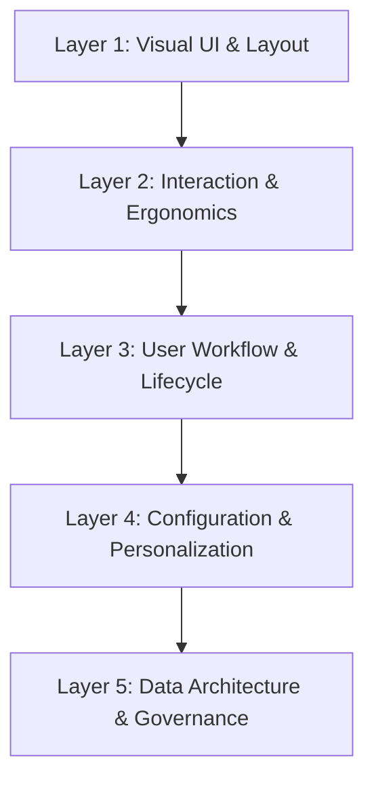
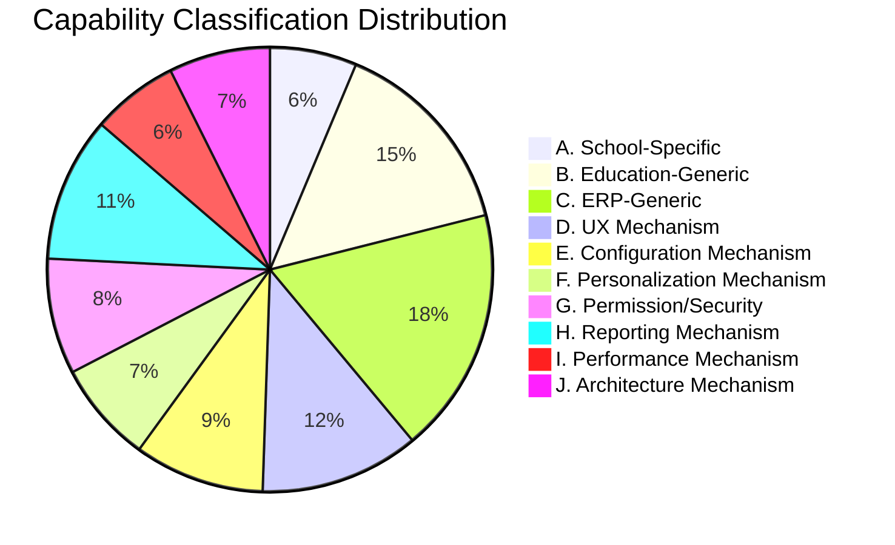

# Competitor Behavior Deep Analysis & Education ERP Generalization

> **Document Type:** Reverse-Engineering, Behavioral Analysis & Architectural Generalization  
> **Status:** Verified Analysis Complete (`ANALYSIS_COMPLETE`)  
> **Scope:** Full 12-Module Competitor ERP vs. Orbis Enterprise Education Platform  
> **Author:** Senior ERP Architect, Enterprise UX Researcher & Desktop Systems Architect  
> **Primary Sources:** `docs/competitor_visual_ux_analysis.md`, `docs/comp_content.txt`, `ARCHITECTURE_HANDOFF.md`, Orbis Workspace Codebase  

---

## 1. Executive Synthesis: The Architectural Duality

When comparing the competitor desktop system (*Ebda'a Soft Schools System*) with the current implementation of Orbis, an essential product question arises:

> **Core Research Question:**  
> *Why does the competitor feel like a mature, cohesive, and deeply configurable ERP system, while Orbis currently feels like a collection of polished but overly hard-coded individual application screens?*

The fundamental answer is not that the competitor possesses superior visual aesthetics or a more modern technology stack—in fact, the competitor utilizes a legacy C#/.NET Windows Forms desktop architecture with Microsoft SQL Server. Rather, the competitor achieves high operational productivity through **five systemic behavioral mechanisms**:

1. **Pervasive Structural Consistency:** Every single window belongs to one of four well-defined interaction archetypes (*Service Dialog*, *Simple CRUD Form + Grid*, *Advanced Header-Detail Transaction*, *Report Viewer*), with identical action button hierarchies, keyboard shortcuts, and status paradigms.
2. **Multi-Tiered Hierarchical Configuration:** System behavior, business rules, printing layouts, and validation constraints are not hardcoded into screens; they are resolved through a cascading hierarchy (*Global System → Institution / Organization → Branch / OrgUnit → Academic Year/Period → Role / User Group → User*).
3. **Pervasive User Personalization:** The desktop client continuously remembers the operator's operational state—including field tab traversal orders, grid column configurations, filter presets, recent records, active branches, and tree expansion states.
4. **Unified Operational State Machines:** Financial and administrative transactions follow strict, explicit lifecycle states (*Draft / Unposted → Validated → Posted → Closed / Unposted*) with built-in audit trails (`عرض سجلات المستخدم`) visible on every form.
5. **Contextual 360-Degree Entity Workspaces:** Complex operational domains (such as Students, Accounts, and Staff) are not fractured across disconnected CRUD screens; they are presented through unified split-panel tree workspaces with contextual action bars and multi-tab dossiers.

Orbis possesses a vastly superior modern technological foundation: **Rust Clean Architecture backend, Svelte 5 Runes, Tauri 2.0 native IPC, dual-transport (SQLite / PostgreSQL) parity, DocForge vector reporting engine, and Paraglide compile-time i18n**. 

The goal of this analysis is **NOT** to copy the competitor's school-specific legacy UI, but to extract its **generalized ERP mechanisms**, eliminate hardcoded frontend duplication in Orbis, and build a strongly-typed, reusable layout and personalization architecture capable of supporting **Schools, Institutes, Colleges, Universities, and Multi-Campus Educational Groups**.

---

## 2. Five-Layer Behavioral Analysis Framework

To evaluate the competitor accurately, every subsystem must be analyzed across five simultaneous architectural layers:

### Layer 1 — Visual UI & Layout
- **Observed Competitor Behavior:** Strict adherence to four window models. Compact visual density (22px row heights, 2-4px padding), high screen real estate utilization, explicit Arabic RTL label positioning (labels to the right of input fields).
- **Orbis Translation:** Create 8 strongly-typed Svelte 5 layout primitives (`SimpleFormView`, `AdvancedTransactionView`, `EntityWorkspace360`, `ReportViewerShell`, `BatchEntryGridView`, `CascadingSettingsShell`, `PermissionMatrixView`, `MasterDetailCatalog`) replacing bespoke page layouts while retaining modern glassmorphic styling and 8px base grid breathing room.

### Layer 2 — Interaction Behavior & Ergonomics
- **Observed Competitor Behavior:** Universal keyboard navigation (`Tab` traversal customization per window, `F3` search, `F7` payment voucher, `F6` receipt, `F8` journal, `Ctrl+T` student tree). Consistent CRUD action toolbar `[Add][Edit][Delete][Refresh][Search][Print][Exit]` on every single window with mode-dependent button states (`Browse`, `Add`, `Edit`).
- **Orbis Translation:** Standardized keyboard command system (`Ctrl+K` command palette + contextual function key hotkeys), unified `FormActionBar` with explicit state machines, and native focus management.

### Layer 3 — User Workflow & Document Lifecycle
- **Observed Competitor Behavior:** Strict double-entry accounting and administrative workflow states. Documents cannot be silently mutated once posted; they must undergo explicit `Post` (`ترحيل`) or `Unpost` (`إلغاء الترحيل`) operations with permission validation.
- **Orbis Translation:** Replace direct database CRUD writes with formal domain transaction state machines across financial vouchers, grade recording, attendance locking, and student enrollment changes.

### Layer 4 — Configuration & Personalization
- **Observed Competitor Behavior:** 3-level cascading settings (General / Role / Branch / User). Persistent UI preferences (customizable tab navigation order, saved report filters, column visibility, active branch selection).
- **Orbis Translation:** Dual-layer personalization architecture: Server-synced user preferences (`UserPreference` entity) + Local Tauri desktop state (window geometry, column widths, filter presets) with zero schema drift.

### Layer 5 — Data Architecture & Governance
- **Observed Competitor Behavior:** Multi-branch tenant scoping (`الفرع`), hierarchical Chart of Accounts (4 levels), materialized path grade progression (`دليل تدرج الصفوف`), multi-currency with daily exchange variance tracking, and pervasive audit logging per record (`المستخدم`, `وقت الإدخال`, `الفرع`).
- **Orbis Translation:** Leverage existing `orbis-domain` entity invariants and `OrgUnit` tree hierarchy, exposing comprehensive branch-scoped filtering and audit timelines to the desktop client.

---

## 3. Product Generalization: School-Specific vs. Universal Education ERP

The competitor is branded as a *Schools System* (*نظام المدارس*), embedding several school-specific assumptions directly into its data structures and screen names. Orbis must generalize these concepts into a polymorphic **Education Operations Platform** supporting diverse institutional topologies:

| Competitor Concept (School-Specific) | Competitor Implementation | Generalized Education ERP Mechanism | Target Orbis Domain Model | Supported Institutional Models |
|---|---|---|---|---|
| **School Stages & Grades** (`المراحل والصفوف`) | Hardcoded Primary, Preparatory, Secondary | Materialized Hierarchical Academic Levels & Programs | `OrgUnit` (Type: Faculty/Stage) + `Class` (Level/Cohort) | K-12 Schools, Universities (Faculties/Years), Vocational Institutes |
| **Class Sections** (`الشعب الدراسية`) | Simple letter/number sections (أ, ب, ج) | Cohort / Section / Division with Capacity Governance | `Class` + `Capacity` + `HomeroomAdvisor` | School Sections, University Lecture Groups, Lab Cohorts |
| **School Calendar & Periods** (`التقويم والحصص`) | Fixed daily periods (1-7 periods) | Generalized Multi-Pattern Timetable Grid & Shift Model | `AcademicYear` + `AcademicPeriod` + `TimeSlot` + `ScheduledLesson` | Regular Day Schools, Evening Universities, Weekend Executive Training |
| **Teacher Subject Assignment** (`إسناد المواد للمدرسين`) | 1 Teacher : 1 Subject : 1 Class | Multi-Instructor Pedagogical Assignment & Credit Hours | `ClassSubject` (`primary_teacher`, `credit_hours`, `weekly_hours`) | School Teachers, University Professors & TAs, Corporate Trainers |
| **Student Grading & Control** (`الكنترول وترصيد الدرجات`) | Monthly grades + Midterm + Final exam committee | Flexible Assessment Schemes & Anonymous Examination Engine | `AssessmentScheme` (Weighted components) + `ExamSession` + `SecretNumber` | School Term Grades, University GPA / Credit Hours, Certification Exams |
| **Tuition Fee Receipts** (`سند قبض الرسوم الدراسية`) | Fixed tuition fees per grade | Dynamic Fee Schedules, Scholarships & Installment Plans | `FeeTemplate` + `StudentFee` + `Payment` + Multi-Currency Ledger | School Tuition, University Credit-Hour Billing, Course-Based Training Fees |
| **Student Activities & Buses** (`الأنشطة والمواصلات`) | School bus routes and student clubs | Ancillary Services & Transportation Logistics Engine | `ServiceSubscription` / `RouteSchedule` (Future Plugin) | School Bus Fleets, Campus Shuttle Services, University Extracurriculars |
| **School Inventory / Stores** (`مخازن المدرسة`) | Basic book and uniform store | Institutional Asset & Consumable Inventory Subsystem | `AssetInventory` (Future Service Domain) | School Uniforms/Books, University Lab Equipment, Corporate Assets |

---

## 4. Ten-Category Capability Taxonomy & Action Blueprint

Every capability identified across the competitor's 12 modules is systematically classified into one of 10 architectural categories and assigned a strategic architectural action:

### Strategic Action Definitions:
- **KEEP:** Existing Orbis implementation is robust, correct, and architecturally superior. Preserve without regression.
- **ADAPT:** Capability exists in Orbis backend/domain but requires UI modernization, workflow exposure, or client integration.
- **GENERALIZE:** Competitor feature is school-specific; abstract into a universal educational model in Orbis.
- **REMODEL:** Redesign the interaction or data model to eliminate hardcoded page logic in favor of reusable typed primitives.
- **REPLACE:** Supersede legacy competitor paradigm (e.g., modal-only alerts, fixed window sizes) with modern enterprise patterns (toast notifications, command palette, reactive drawers).
- **CONSOLIDATE:** Merge multiple fragmented screens or duplicate components into a unified workspace.
- **DEFER:** Secondary ancillary feature (e.g., Bus Transportation, School Inventory) to be scheduled for post-core phases.
- **NOT APPLICABLE:** Legacy C#/Windows Forms technical artifact with no relevance to modern web/desktop architecture.

---

### Category Breakdown & Action Matrix

| Category Code | Category Name | Core Competitor Pattern | Target Orbis Architectural Response | Strategic Action |
|---|---|---|---|---|
| **A** | **School-Specific** | Rigid Grade 1-12 progression, daily bell schedules, bus stops | Abstract into polymorphic academic structures with configurable hierarchy depth | **GENERALIZE** |
| **B** | **Education-Generic** | Student dossiers, guardian relationships, attendance, curriculum binding, exam control | Implement unified `EntityWorkspace360` for Students/Staff and `BatchEntryGridView` for attendance and grades | **REMODEL & ADAPT** |
| **C** | **ERP-Generic** | Hierarchical COA, Double-entry journals, vouchers, check tracking, bank reconciliation | Standardize `AdvancedTransactionView` with lifecycle state machine (`Draft` → `Posted` → `Unposted`) | **ADAPT & KEEP** |
| **D** | **UX Mechanism** | 4 Window Archetypes, universal CRUD toolbar, keyboard shortcuts, record navigator | Build 8 standardized Svelte 5 layout primitives + `FormActionBar` + Global Command Palette | **REPLACE & REMODEL** |
| **E** | **Configuration Mechanism** | 3-Level cascading settings (Global → Branch → User), academic policies, fee schedules | Unified Hierarchical Configuration Engine (`CascadingSettingsShell`) with visual inheritance & override indicators | **REMODEL** |
| **F** | **Personalization Mechanism** | Tab order customization, saved report templates, column preferences, last branch | Multi-tier personalization store (`usePersonalization` rune, local SQLite/file + server sync) | **ADAPT & EXTEND** |
| **G** | **Permission / Security** | Screen × Action matrix (View, Add, Edit, Del, Search, Print) scoped by branch, operation locks | Fine-grained RBAC + Materialized OrgUnit Scoping + Server-Authoritative `PermissionCheckerPort` | **ADAPT & ENFORCE** |
| **H** | **Reporting Mechanism** | Standalone report windows with date/tree filters, instant print, batch card generation | Unified `ReportViewerShell` powered by DocForge 18-node vector engine with RTL HarfBuzz shaping | **KEEP & INTEGRATE** |
| **I** | **Performance Mechanism** | Windows native fast grids, SQL Server query optimization, indexed branch scopes | `OrbisGrid` virtualized DOM/canvas rendering, TanStack Query server caching, zero-copy Rust DTOs | **KEEP & EXTEND** |
| **J** | **Architecture Mechanism** | Client-Server / Single-PC standalone deployment with SQL Server `.bak` backups | Deterministic Dual-Transport Parity (`LocalClient` Tauri SQLite IPC vs `RemoteClient` HTTP PostgreSQL) | **KEEP (CORE STRENGTH)** |

---

## 5. Architectural Recommendations for Orbis

To transition Orbis from a collection of hardcoded pages to a premier Education ERP platform without falling into the trap of an untyped dynamic metadata engine:

1. **Code-First Typed Layout Primitives:** Replace custom markup in `apps/desktop/src/routes` with the 8 standard layout shells. All form schemas, column definitions, and filter contracts must remain strictly typed in TypeScript (`OrbisColumnDef`, `FormFieldSchema<T>`).
2. **Standardized Action State Machine:** Adopt a universal `FormActionBar` across all operational views with explicit mode transitions (`Browse`, `Create`, `Edit`, `Transacting`, `Readonly`).
3. **Pervasive Desktop Personalization:** Implement the `usePersonalization` reactive store to persist grid column configurations, filter presets, recent entity history, and active scope across application restarts.
4. **Unified Multi-Tier Configuration Shell:** Consolidate isolated settings tabs into a hierarchical settings explorer with clear inheritance badges (showing whether a value is inherited from Global, Institution, Branch, or User).
5. **Integrated DocForge Reporting Workflow:** Bind report parameter forms directly to DocForge vector template execution, providing instantaneous in-app PDF preview, multi-up badge generation, and Excel/CSV export.

---
*Verified against competitor documentation and Orbis codebase. Transitioning to Screen Inventory analysis.*
