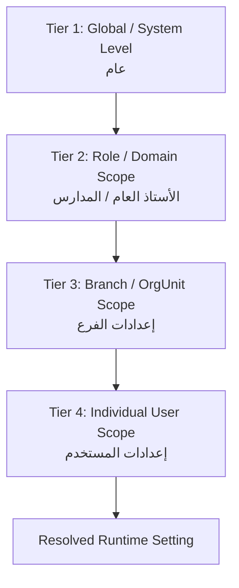
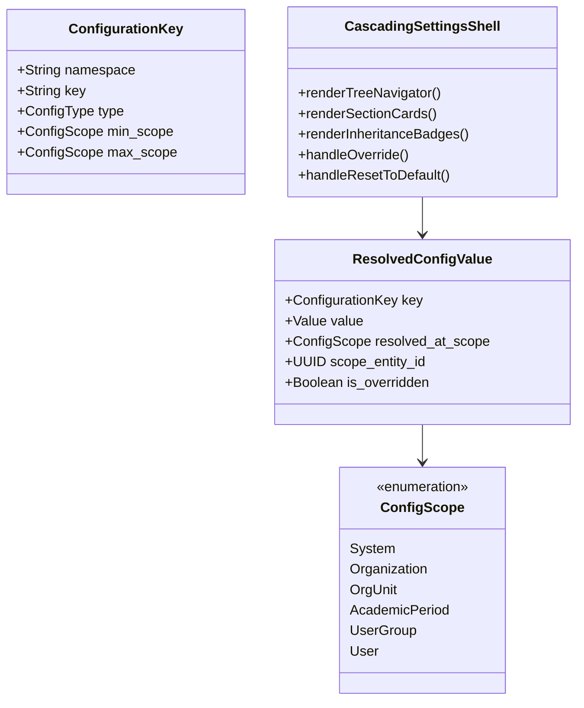

# Competitor Configuration Architecture & Multi-Tier Settings Analysis

> **Document Type:** Configuration Hierarchy, Scoping & Governance Analysis  
> **Status:** Verified Analysis Complete (`ANALYSIS_COMPLETE`)  
> **Source Material:** `docs/competitor_visual_ux_analysis.md` (p.36-37), `docs/comp_content.txt`, `ARCHITECTURE_HANDOFF.md`  
> **Target System:** Orbis Enterprise Educational Platform  

---

## 1. Executive Summary: The Configuration Dilemma

In enterprise ERP systems, the boundary between **System Settings**, **Institutional Configuration**, **Branch Policies**, and **User Preferences** determines whether an application feels agile and configurable or rigid and hardcoded.

The competitor implements a sophisticated **3-Tier Cascading Settings Engine** (documented on p.36 of the System Guide). Every setting resolves dynamically down a priority hierarchy:

### The 5-Stage Setting Lifecycle Rule:
To prevent configuration drift (where settings exist in the database but are never actually enforced at runtime), every setting must strictly satisfy:
$$\text{STORED} \longrightarrow \text{READ} \longrightarrow \text{APPLIED} \longrightarrow \text{ENFORCED} \longrightarrow \text{TESTED}$$

---

## 2. Competitor Configuration Taxonomy & Scopes

From the competitor documentation (p.36, 124-152), settings are distributed across four distinct functional categories and resolved at multiple scopes:

### 2.1 Academic Governance Settings (`إعدادات الشؤون الأكاديمية`)
- **Minimum Students per Section (`الحد الأدنى لعدد الطلاب`):** Branch/Class scope. Governs section splitting and capacity warnings during student distribution (`SCR-081`).
- **Academic Working Days (`أيام الدراسة`):** Branch scope. Controls timetable generation grids and daily attendance logging.
- **Absence Warning Threshold (`فترة احتساب الغياب`):** Institution/Branch scope. Triggers automated parent alerts and administrative warning letters when student absence exceeds $N$ days.
- **Attendance Grid Background Color (`لون خلفية شبكة التحضير`):** User preference scope. Allows operators to customize visual contrast in high-volume batch entry screens.
- **Default Student Birth Date (`تاريخ الميلاد الافتراضي`):** Global/Branch scope. Accelerates new student admission by pre-populating birth year based on the target admission grade.
- **Top Students Honors Count (`عدد أوائل الطلبة`):** Institution/Academic Year scope. Defines the number of top-ranking students ($N=3, 5, 10$) included in official honor roll reports (`SCR-218`).

### 2.2 Document & Print Settings (`إعدادات الطباعة والوثائق`)
- **Print Full Certificate (`طباعة الشهادة كاملة`):** Branch scope. Boolean flag determining whether term report cards print with pre-rendered graphical borders or formatted for pre-printed institutional letterhead.
- **Institution Header & Logo (`ترويسة وشعار المؤسسة`):** Branch scope. Determines whether document headers render the central group identity or branch-specific contact info.
- **Signatory Authority Blocks (`تذييل التواقيع والاعتمادات`):** Branch scope. Configures automated signature labels (Homeroom Teacher, Control Head, Principal, Financial Director).

### 2.3 Financial & Accounting Settings (`إعدادات الحسابات`)
- **Parent General Ledger Account ID (`رقم الحساب الأب للعملاء`):** Institution scope. Binds newly created student sub-accounts automatically into Accounts Receivable (`1201`).
- **Default Cashbox / Till Binding (`الصندوق الافتراضي للمستخدم`):** User/Branch scope. Automatically populates the cashbox field on receipt vouchers based on the logged-in cashier.
- **Auto-Posting on Voucher Save (`الترحيل التلقائي للسندات`):** Role/Branch scope. Configures whether cashier receipts post immediately to the General Ledger or require end-of-day accountant review.
- **Exchange Variance Threshold (`سماحية فوارق الصرف`):** Institution scope. Governs acceptable multi-currency rounding variances before requiring adjustment journal entries.

### 2.4 System & Security Settings (`إعدادات النظام والأمان`)
- **Active Branch Locking (`تثبيت الفرع النشط`):** User scope. Governs whether a multi-branch user stays locked to one branch or switches per transaction.
- **Password Expiry & Complexity (`صلاحية وكلمات المرور`):** System scope. Enforces regular credential updates and MFA enrollment.
- **Operation Locking Date (`تاريخ إقفال العمليات`):** Branch/Period scope. Freezes all financial and grade modifications prior to a specified cutoff date.

---

## 3. Scoping Matrix: Competitor vs. Target Orbis Architecture

| Configuration Item | Competitor Scope | Competitor Stored Location | Target Orbis Scope | Target Orbis Persistence & Resolution |
|---|---|---|---|---|
| **Institution Profile & Branding** | Branch / Global | SQL Server `SchoolInfo` | `Organization` / `OrgUnit` | `OrganizationSettings` in PostgreSQL/SQLite |
| **Academic Calendar & Year Lifecycle** | Branch | SQL Server `AcademicCal` | `AcademicYear` / `AcademicPeriod` | `orbis-domain::calendar` with state machine |
| **Grading Scales & GPA Rules** | Global / School | SQL Server `GradeScale` | `AssessmentScheme` | Typed calculation formulas in `orbis-domain` |
| **Chart of Accounts Hierarchy** | Global | SQL Server `Accounts` | `Organization` | `Account` entity with tenant isolation |
| **Fee Schedules & Discount Rules** | Branch / Grade | SQL Server `FeeTemplates` | `OrgUnit` / `FeeTemplate` | `FeeTemplate` with localized currency support |
| **Print & Template Bindings** | Branch | SQL Server `PrintSettings` | `OrgUnit` / `Template` | DocForge AST Template Engine (`packages/docforge`) |
| **Grid Column & Filter Preferences** | User / Local Windows | Windows Registry / Local DB | `User` / `DesktopLocal` | Svelte 5 `usePersonalization` + SQLite/LocalStore |
| **Daily Cashier Default Till** | User / Branch | SQL Server `UserSettings` | `User` @ `OrgUnit` | `UserPreference.default_cashbox_id` |

---

## 4. Current Orbis Configuration Audit: Strengths & Weaknesses

### 4.1 Identified Strengths in Orbis
1. **Clean Separation of Tenant & Org Units:** Orbis models `Organization` (root tenant) and `OrgUnit` (hierarchical branches, faculties, schools) with materialized paths (e.g., `/1/4/12/`).
2. **Context Stores in Svelte 5:** Desktop frontend features `orgContext` (locale, currency, timezone), `academicContext` (active year/period), and `effectiveContext` (role, permissions, branch scope).
3. **Paraglide i18n:** Compile-time type-safe localization without runtime lookup performance penalties.

### 4.2 Critical Gaps & Architectural Weaknesses in Orbis
1. **Hardcoded UI Defaults:** Many routes (such as `apps/desktop/src/routes/(app)/[orgId]/finance/accounts/+page.svelte`) contain hardcoded default currency formatting and date formatting rather than resolving from `orgContext`.
2. **Disconnected Settings Tabs:** Settings screens in `apps/desktop/src/routes/(app)/[orgId]/settings/` operate as isolated CRUD forms without a unified inheritance model.
3. **No Visual Inheritance Indicator:** The user cannot tell whether an academic policy or fee structure is inherited from the parent institution or overridden at the branch level.
4. **Unconsumed Configuration Fields:** Certain fields stored in `OrganizationSettings` are not bound to corresponding validation rules in transaction forms.

---

## 5. Target Orbis Unified Configuration Architecture

To achieve the competitor's depth of configurability while preserving clean architecture and type safety:

### Key Architectural Principles for Orbis:
1. **Strongly-Typed Configuration Schemas:** Define configuration namespaces in Rust and TypeScript (`AcademicPolicyConfig`, `FinancePolicyConfig`, `PrintLayoutConfig`). No untyped `Record<string, any>`.
2. **Visual Inheritance in UI (`CascadingSettingsShell`):** Every setting displays an inheritance badge:
   - 🔵 `Inherited from Institution (Global)`
   - 🟢 `Overridden for Branch (Al-Amal Campus)`
   - 🟡 `User Preference Override`
3. **One-Click Reset to Default:** Operators can instantly revert an overridden branch setting back to the institutional default.
4. **Reactive Resolution Pipeline:** Settings are cached in TanStack Query and invalidated automatically when an administrator updates parent policies.

---
*Verified against competitor documentation and Orbis codebase. Transitioning to User Personalization analysis.*
