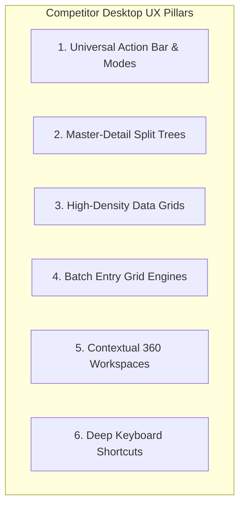
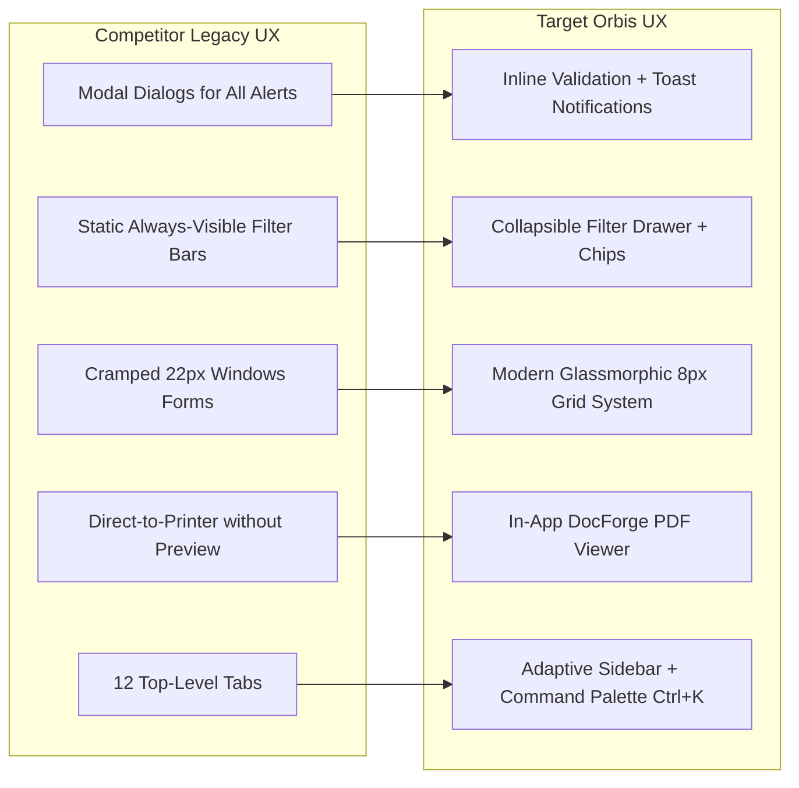

# Competitor Desktop ERP UX & Interaction Architecture Analysis

> **Document Type:** Desktop ERP Interaction Design, Ergonomics & UX Architecture  
> **Status:** Verified Analysis Complete (`ANALYSIS_COMPLETE`)  
> **Source Material:** `docs/competitor_visual_ux_analysis.md`, `docs/comp_content.txt`  
> **Target System:** Orbis Enterprise Educational Platform  

---

## 1. Executive Summary: The Anatomy of Enterprise Desktop Ergonomics

Desktop ERP users spend 6–10 hours daily performing repetitive data entry, verification, and reporting tasks. In this environment, visual novelty takes a backseat to **speed, visual clarity, predictable keyboard navigation, high information density, and low latency**.

The competitor's user experience succeeds through **strict predictability**: once an operator masters one screen, they have intuitively mastered all 104 screens in the system.

---

## 2. Interaction Design & Layout Primitives Analysis

### 2.1 Navigation Model: Horizontal Tab Bar vs. Adaptive Modern Shell
- **Competitor Legacy Pattern (p.10, 48-67):** Full-width horizontal icon tab bar hosting 12 top-level modules. Clicking a tab opens a left-side cascading menu with inline keyboard shortcuts (`F7`, `Ctrl+T`).
- **Critical Evaluation:**
  - *Strength:* Very easy for novice users to locate modules; all major areas are visible.
  - *Weakness:* 12 tabs do not scale well on smaller laptop screens (1366×768 or 1080p); cascading flyout menus can be finicky to navigate with mouse cursors.
- **Orbis Modernized Architecture:** Group modules into **6 primary workspaces** (Academics, Students, Staff, Control/Exams, Finance, Governance/Settings) within a collapsible icon/text sidebar, supplemented by a global **Command Palette (`Ctrl+K`)** allowing instant keyword search and direct execution of any action.

### 2.2 The Universal CRUD Action Bar & Mode Lifecycle — [p.13, 318-340]
- **Competitor Pattern:** A single, consistent button row placed between the form and the data table:
  $$\texttt{[إضافة (Add)] [تعديل (Edit)] [حذف (Delete)] [تحديث (Refresh)] [بحث (Search)] [طباعة (Print)] [خروج (Exit)]}$$
- **Button Availability by Operational Mode:**

| Action Button | Browse Mode (استعراض) | Add Mode (إضافة جديد) | Edit Mode (تعديل) | Transacting Mode (سندات) |
|---|---|---|---|---|
| **Add / New** | ✅ Enabled | ❌ Disabled | ❌ Disabled | ❌ Disabled |
| **Save / Commit** | ❌ Hidden | ✅ Enabled (Green) | ✅ Enabled (Green) | ✅ Enabled (Save Draft) |
| **Cancel / Undo** | ❌ Hidden | ✅ Enabled (Cancel) | ✅ Enabled (Revert) | ✅ Enabled (Discard) |
| **Edit** | ✅ Enabled | ❌ Disabled | ❌ Disabled | ❌ Disabled |
| **Delete** | ✅ Enabled (Destructive)| ❌ Disabled | ❌ Disabled | ❌ Disabled |
| **Post (`ترحيل`)** | ❌ Disabled | ❌ Disabled | ❌ Disabled | ✅ Enabled (If Draft) |
| **Search / Filter**| ✅ Enabled (`F3`) | ❌ Disabled | ❌ Disabled | ✅ Enabled |
| **Print** | ✅ Enabled | ❌ Disabled | ❌ Disabled | ✅ Enabled (`F7`/`F6`) |

- **Orbis Target Implementation:** Formalize this into a reusable `<FormActionBar>` component that consumes an explicit UI state machine (`state: 'browse' | 'create' | 'edit' | 'transacting'`), eliminating manual button disabling logic across pages.

---

### 2.3 Master-Detail Split-Panel Tree Workspaces — [p.51, 159]
- **Competitor Pattern:** The interface splits into two interactive halves:
  - **Side 1 (Tree):** Displays the hierarchical structure (Chart of Accounts, Grade Levels, Student Enrollment History).
  - **Side 2 (Detail Content):** Displays the rich entity dossier, associated sub-tables, or operational forms.
- **Key Behavioral Nuances:**
  - Selecting a tree node instantly updates the detail view without reloading the entire page.
  - Right-clicking tree nodes opens context menus (*Add Child, Rename, Freeze, Delete*).
  - Searching within the tree highlights matching nodes and auto-expands parent branches.
- **Orbis Target Implementation:** Build `EntityWorkspace360` and `MasterDetailCatalog` Svelte 5 layout components.

---

### 2.4 High-Performance Data Grid Interaction Model — [p.13, 14, 99]
- **Competitor Capabilities:**
  1. Instant sorting on header click (`asc` / `desc`).
  2. Drag-and-drop column reordering and resizing.
  3. Column visibility toggling via context menu.
  4. Pinned left/right columns for keys and action buttons.
  5. Multi-selection via checkboxes and Shift/Ctrl row click.
  6. Right-aligned numeric formatting with decimal alignment.
  7. Automated footer aggregate rows ($\sum \text{Totals}$, $\bar{x} \text{Averages}$, $\text{Count}$).
- **Orbis Grid Engine (`packages/svelte-grid`):** `OrbisGrid` already provides virtualized rendering and column configuration. It must be standardly wrapped in `DataTable` across all Orbis views.

---

### 2.5 Batch Entry Grid Engines (Attendance & Control Marks) — [p.165, 174]
- **Unique Competitor Pattern:** For daily student attendance (`SCR-083`) and monthly marks entry (`SCR-091`), the grid switches from a read-only table into an **interactive matrix**:
  - Each cell acts as an inline input (number input or radio-button group for *Present / Absent / Late / Excused*).
  - Keyboard navigation allows operators to move down columns using the `Enter` or `Down Arrow` key, rapidly logging scores without mouse interaction.
  - Row-level `Save` (✔) and `Undo` (↩) action buttons allow granular error correction before full batch commit.
- **Orbis Target Implementation:** Build `BatchEntryGridView` with virtualized keyboard navigation, cell-level validation errors, and clipboard (Excel) paste support.

---

### 2.6 Report Parameterization & Generation Drawer — [p.15, 20, 99]
- **Competitor Pattern:** Every report window features a standardized upper filter panel with:
  - Date preset dropdowns: `اليوم` (Today), `هذا الشهر` (This Month), `خلال الفترة` (Custom Range).
  - Multi-entity selectors (Branch checkboxes, Account tree selector, Class dropdown).
  - Report type toggles: `إجمالي` (Summary) vs. `تفصيلي` (Detailed).
  - Direct actions: `عرض` (View Grid), `طباعة` (Print Report), `حفظ القالب` (Save Filter Preset).
- **Orbis Modernized Pattern:** Build `ReportViewerShell` with a collapsible filter drawer, active filter chips bar, and integrated DocForge live PDF viewer.

---

### 2.7 Audit Logging on Every Screen (`عرض سجلات المستخدم`) — [p.13, 671-678]
- **Competitor Pattern:** Every simple and advanced window includes a checkbox on the bottom status bar: `عرض سجلات المستخدم` (View User Logs). When checked, a nested table displays the exact mutation history:
  $$\texttt{[المستخدم (User)] [الفرع (Branch)] [وقت وتاريخ الإدخال (Timestamp)] [نوع العملية (Action)]}$$
- **Orbis Modernized Pattern:** Implement a slide-out `<ActivityTimeline>` panel accessible via a clock icon in every page header, displaying visual diffs of record changes.

---

## 3. UI/UX Transformation Taxonomy: Competitor vs. Target Orbis

---

## 4. The 8 Standardized Orbis Layout Primitives

To eliminate custom markup duplication across `apps/desktop/src/routes`, Orbis will establish 8 reusable layout shells:

1. **`SimpleFormView`:** Form fields + `FormActionBar` + `DataTable` + Audit footer.
2. **`AdvancedTransactionView`:** Document header + Tabbed panels + Editable line items grid + Document state machine (`Draft` $\rightarrow$ `Posted` $\rightarrow$ `Unposted`).
3. **`EntityWorkspace360`:** Left hierarchy tree + Top quick actions + Multi-tab dossier + Contextual details.
4. **`ReportViewerShell`:** Collapsible filter drawer + Active filter chips + DocForge report viewer.
5. **`BatchEntryGridView`:** Virtualized fast-entry matrix with column keyboard traversal and Excel paste.
6. **`CascadingSettingsShell`:** Settings tree navigator + Key-value section cards + Inheritance badges.
7. **`PermissionMatrixView`:** User/Group tree + 2D Screen $\times$ Action checkbox matrix.
8. **`MasterDetailCatalog`:** Side card/list selector + Full detail workspace with inline edits.

---
*Verified against competitor documentation and Orbis codebase. Transitioning to Orbis UI Flexibility Audit.*
