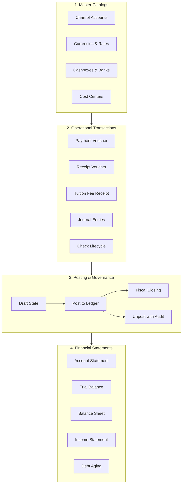

# Competitor Finance & General Ledger Behavior Deep Analysis

> **Document Type:** Financial Operations, Workflow Lifecycle & Double-Entry Accounting Analysis  
> **Status:** Verified Analysis Complete (`ANALYSIS_COMPLETE`)  
> **Source Material:** `docs/competitor_visual_ux_analysis.md` (p.50-123, 200), `docs/comp_content.txt`, `ARCHITECTURE_HANDOFF.md`  
> **Target System:** Orbis Enterprise Educational Platform  

---

## 1. Executive Summary: The Financial Core of Educational ERP

An educational institution operates as a specialized financial enterprise handling tuition billing, multi-tier discounts, scholarships, transport fees, cashier collections, vendor payables, bank check clearances, staff payroll advances, and fiscal year-end closings.

The competitor's accounting module is not a superficial billing screen; it is a **complete, double-entry General Ledger system** spanning 26 screens (p.50-123).

---

## 2. Complete Financial Operations Lifecycle Framework

For every financial transaction in the competitor system, the operational pipeline executes across 10 deterministic steps:

$$\text{INPUT} \longrightarrow \text{VALIDATION} \longrightarrow \text{PERMISSION} \longrightarrow \text{TRANSACTION} \longrightarrow \text{RELATED ENTITIES} \longrightarrow \text{POSTING} \longrightarrow \text{GL EFFECT} \longrightarrow \text{AUDIT} \longrightarrow \text{REPORTING} \longrightarrow \text{PRINT/EXPORT}$$

### Step-by-Step Behavioral Specification:
1. **Input:** Header data (Date, Cashbox/Bank, Currency, Exchange Rate, Cost Center) + Detail Line Items (Debit Account, Credit Account, Amount, Description).
2. **Validation:** Invariant checks:
   - Debit total must strictly equal Credit total ($\sum \text{Debit} = \sum \text{Credit}$).
   - Accounts must be active and not frozen (`SCR-035`).
   - Transaction date must be within an open fiscal period and beyond the operation lock date (`SCR-008`).
   - Account debit ceiling (`SCR-028`) must not be exceeded without override authorization.
3. **User Permission:** Checks if the operator has `finance:voucher:create` or `finance:voucher:post` within the active branch.
4. **Transaction Record Creation:** Creates immutable header and line-item rows in the transactional database.
5. **Related Records Update:** If linked to a student tuition fee invoice (`StudentFee`), marks the fee installment as partially or fully settled.
6. **Posting (`الترحيل`):** Transitions document state from `Draft` (`غير مرحل`) to `Posted` (`مرحل`).
7. **Accounting General Ledger Effect:** Immediately updates account balances in the General Ledger and subsidiary ledger tables.
8. **Audit Logging:** Inserts an immutable row in the audit log capturing operator ID, timestamp, branch ID, and IP address.
9. **Reporting Effect:** Account statements, cashbox journals, and trial balances reflect the updated balances in real time.
10. **Print & Export:** Automatically generates formatted official receipts with Arabic number-to-words spelling (*Tafqeet* - `فقط وقدره...`).

---

## 3. Deep Analysis of Core Financial Subsystems

### 3.1 Chart of Accounts & Hierarchy (`دليل الحسابات`) — [p.50-51]
- **Structure:** 4-Tier hierarchical tree:
  - **Level 1 (Major Class):** 1-Assets (`الأصول`), 2-Liabilities (`الخصوم`), 3-Expenses (`المصروفات`), 4-Revenues (`الإيرادات`).
  - **Level 2 (Main Group):** 11-Fixed Assets, 12-Current Assets, etc.
  - **Level 3 (Subsidiary):** 1201-Accounts Receivable, 1202-Cash & Banks.
  - **Level 4 (Transactional Leaf):** 1201001-Student Sub-Accounts, 1202001-Main Cashbox Till.
- **Rules:** Transactions can only be posted to **Leaf Accounts** (Level 4). Parent group nodes represent aggregate rollups.
- **Opening Balances:** Supports recording opening debit/credit balances during initial system deployment.

### 3.2 Currencies & Daily Exchange Variances (`العملات وفوارق الصرف`) — [p.52-53, 109]
- **Multi-Currency Ledger:** Transactions record both the transaction currency (e.g., USD, SAR) and the institutional base currency (e.g., YER).
- **Exchange Variance Accounting:** Daily exchange rates generate automatic variance entries (`تقرير فوارق صرف العملة`) when clearing foreign currency checks or receivables.

### 3.3 Cashboxes, Banks & Tills (`الصناديق والبنوك`) — [p.54, 74, 86-88]
- **Operator Cashbox Binding:** Cashiers are tied to specific physical cashbox accounts.
- **Cashbox Daily Audit (`جرد الصندوق` - p.74):** Cashiers perform end-of-day cash counts by denomination (e.g., $100 \times 20$, $50 \times 15$). The system automatically computes the variance between physical cash and ledger balance.

### 3.4 Check Lifecycle Management (`إدارة الشيكات`) — [p.89-98]
- **Incoming Checks (`تحصيل الشيكات الواردة` - p.89):** Tracks check lifecycle:
  $$\text{Received} \longrightarrow \text{Under Collection} \longrightarrow \text{Collected / Deposited} \lor \text{Endorsed (مجير)} \lor \text{Bounced (مرتجع)}$$
- **Outgoing Checks (`استحقاق الشيكات الصادرة` - p.94):** Tracks issued vendor checks until presentation and bank clearance.

### 3.5 Tuition Fee Invoicing & Receipts (`رسوم وسند قبض الطلاب`) — [p.152, 158, 200]
- **Fee Schedules:** Configured per grade level with breakdown (Tuition, Registration, Uniforms, Books, Transportation).
- **Tuition Receipt Voucher (`SCR-103`):** Cashier selects student $\rightarrow$ system displays outstanding fee invoices $\rightarrow$ cashier applies payment $\rightarrow$ system generates double-entry voucher ($Dr\text{ Cashbox}, Cr\text{ Student Receivable}$) and prints thermal receipt.

### 3.6 Financial Reports & Statements (`القوائم المالية والتقارير`) — [p.99-123]
- **Account Statement (`كشف الحساب` - p.99):** Multi-filter ledger statement with date ranges, unposted preview, and currency normalization.
- **Trial Balance (`ميزان المراجعة` - p.119):** Multi-level balance report with Opening, Period Movement, and Closing Balances.
- **Balance Sheet (`قائمة المركز المالي` - p.121) & Income Statement (`قائمة الدخل` - p.122):** Formal GAAP/IFRS financial reports generated directly from the Chart of Accounts tree.
- **Debt Aging Report (`أعمار الديون` - p.110):** Aging buckets (0-30 days, 31-60 days, 61-90 days, 90+ days) for overdue student tuition fees.

---

## 4. Architectural Comparison: Competitor vs. Orbis Finance Subsystem

| Financial Domain | Competitor Legacy Implementation | Current Orbis Backend (`orbis-domain` & `app`) | Current Orbis Frontend UI | Gap & Required Target Design |
|---|---|---|---|---|
| **Chart of Accounts** | 4-level Tree in SQL Server | `Account` entity with parent/child links & currency | `finance/accounts/+page.svelte` | Expose tree navigator + inline subsidiary creator |
| **Double-Entry Journal** | Simple & Compound Journal forms | `JournalEntry` with balancing invariants | `finance/journal-entries/+page.svelte` | Standardize `AdvancedTransactionView` + balanced grid |
| **Voucher Lifecycle** | Draft $\rightarrow$ Posted $\rightarrow$ Unposted state | Domain state machine & event publishing | Static table view | Implement explicit `Post` / `Unpost` action bar |
| **Fee Templates & Rules**| Grade fee catalog | `FeeTemplate` with localized currency | `settings/fee-templates/+page.svelte` | Connect to installment schedules & automated discounts |
| **Student Fee Billing** | Manual student fee assignment | `StudentFee` invoice generator | `students/[id]/fees/+page.svelte` | Add batch tuition invoice generation wizard |
| **Payment Processing** | Payment Voucher & Fee Receipt | `Payment` entity with multi-channel support | `finance/payments/+page.svelte` | POS Cashier receipting view with instant DocForge print |
| **Financial Statements**| Standalone SQL Server reports | `GetTrialBalance`, `GetBalanceSheet` queries | Basic report pages | Connect to DocForge high-definition reporting engine |
| **Check Management** | Complete Check lifecycle module | Not modeled as discrete entity | Missing | Model `Check` entity or map to `PaymentMethod::Check` |

---

## 5. Architectural Verification & Conclusion

### Critical Architectural Finding:
> **Orbis already possesses the core domain and repository invariants for full double-entry accounting** in `apps/api-rust/crates/orbis-domain/src/finance/` and `crates/orbis-app/src/usecases/finance/`.  
> What Orbis currently lacks is **NOT** backend domain logic, but **the cohesive transactional desktop UI** (`AdvancedTransactionView`, `FormActionBar`, and DocForge financial statement templates).

By implementing the target `AdvancedTransactionView` and connecting it to Orbis's existing financial use cases, Orbis will achieve complete functional parity with the competitor while offering vastly superior performance and modern usability.

---
*Verified against competitor documentation and Orbis codebase. Transitioning to ERP UX Architecture analysis.*
