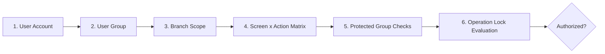
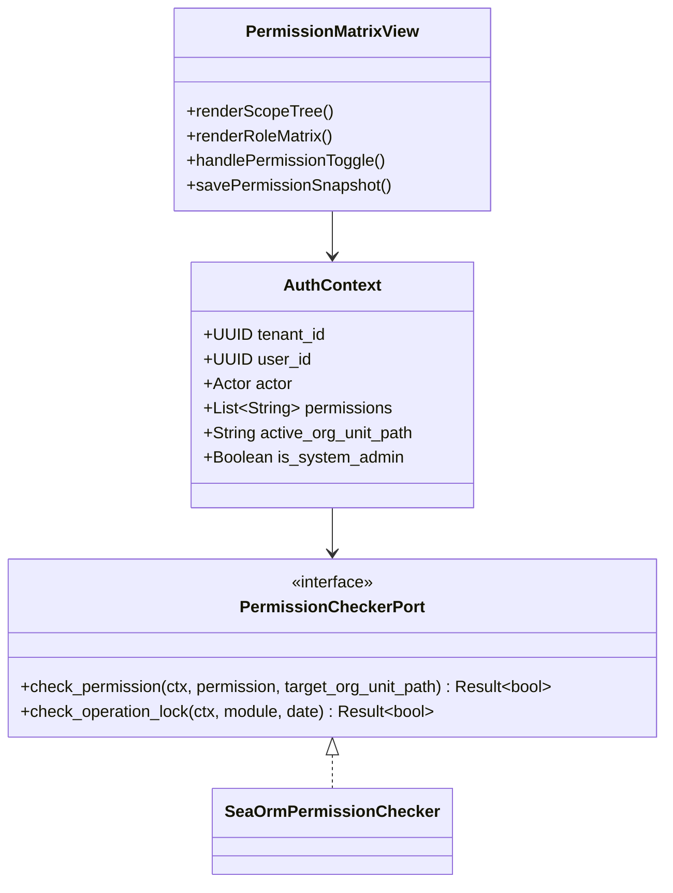

# Competitor Permissions, Groups & Security Architecture Analysis

> **Document Type:** Security, Access Control & Authorization Model Analysis  
> **Status:** Verified Analysis Complete (`ANALYSIS_COMPLETE`)  
> **Source Material:** `docs/competitor_visual_ux_analysis.md` (p.28-35), `docs/comp_content.txt`, `ARCHITECTURE_HANDOFF.md`  
> **Target System:** Orbis Enterprise Educational Platform  

---

## 1. Executive Summary: The Security Governance Model

Enterprise educational ERPs handle highly sensitive data, including student financial records, examination secret numbers, staff salaries, and grade evaluations. A failure in security governance can lead to unauthorized financial posting, grade tampering, or data leakage across organizational branches.

The competitor implements a multi-layered security model based on a **6-Stage Governance Pipeline**:

$$\text{User} \longrightarrow \text{Group} \longrightarrow \text{Branch Scope} \longrightarrow \text{Permission Matrix} \longrightarrow \text{Protected Group} \longrightarrow \text{Operation Lock}$$

---

## 2. Reverse-Engineered Competitor Security Subsystems

### 2.1 User Groups Catalog (`دليل مجموعات المستخدمين`) — [p.28]
- **Structure:** Code, Group Name (e.g., *"Senior Accountants"*, *"Control Officers"*, *"Branch Registrars"*), Branch Affiliation, Description.
- **Function:** Serves as the primary template for bundling permission rules. Users assigned to a group inherit all baseline permissions granted to that group.

### 2.2 User Directory & Branch Access Scoping (`دليل المستخدمين`) — [p.10, 30]
- **Structure:** User ID, Username, Full Name, Associated Group, Active Status, Allowed Branches Checklist.
- **Critical Behavioral Rule (p.10):** Only users with explicit System Administrator permissions can log in through the *General Administration Branch* (`فرع الإدارة`). Standard branch users are restricted exclusively to their assigned operational branches.

### 2.3 Operation Locking Subsystem (`قفل العمليات`) — [p.31]
- **Structure:** Module Selector (Accounts, Control, Registration, Attendance), Locking Effective Date, Lock Reason, Status.
- **Behavior:** Once an operation lock is activated for a branch and module prior to date $T$, the system hard-blocks any `Add`, `Edit`, `Delete`, or `Post` action on transactions dated on or before $T$, even if the user otherwise possesses full editing permissions.

### 2.4 Protected Groups & Administrative Safety (`المجموعات المحمية`) — [p.32]
- **Structure:** System-defined immutable groups (e.g., *Super Administrators*, *Database Masters*).
- **Behavior:** Prevents accidental privilege revocation or deletion of core system administrator roles by lower-level administrative users.

### 2.5 Screen × Action Permission Matrix (`صلاحيات المستخدمين`) — [p.34]
- **Visual Structure:** Split-panel interface:
  - **Left Panel:** User / Group Tree with branch filtering.
  - **Right Panel:** Dense 2D Grid mapping every individual screen (rows) against 6 discrete operational action columns:
    1. `عرض` (View / Open Screen)
    2. `إضافة` (Create / Add New Record)
    3. `تعديل` (Edit / Modify Existing Record)
    4. `حذف` (Delete Record)
    5. `بحث` (Execute Query & Lookup)
    6. `طباعة` (Print & Export)
- **Granularity:** Allows an administrator to grant a registrar permission to *View* and *Add* students, while denying *Delete* and *Print*.

---

## 3. Operational Authorization Matrix: Action Lifecycle

For every operational capability in the system, authorization is evaluated across the complete transaction lifecycle:

$$\text{WHO} \longrightarrow \text{SEE} \longrightarrow \text{CREATE} \longrightarrow \text{EDIT} \longrightarrow \text{DELETE} \longrightarrow \text{POST} \longrightarrow \text{APPROVE} \longrightarrow \text{PRINT} \longrightarrow \text{EXPORT} \longrightarrow \text{SCOPE}$$

| Role / Group | Can See | Can Create | Can Edit | Can Delete | Can Post / Unpost | Can Approve | Can Print / Export | Data Scope |
|---|---|---|---|---|---|---|---|---|
| **SuperAdmin** | All Modules | All Entities | All Entities | All Entities | Yes / Yes | All Workflows | Yes / Yes | Global (All Tenants/Branches) |
| **Branch Admin** | Branch Modules | Master & Tx | Master & Tx | Restricted | Yes / No | Branch Workflows | Yes / Yes | Branch / OrgUnit Hierarchy |
| **Accountant** | Finance & Billing | Vouchers & Bills | Draft Only | Draft Only | Post Only (No Unpost) | No | Yes / Yes | Branch Accounts |
| **Registrar** | Student Affairs | Applications | Profiles | No | N/A | Admission App | Yes / Yes | Branch Students |
| **Teacher** | Classes & Control | Grades, Attnd | Open Periods | No | N/A | No | Class Rosters | Assigned Classes (`ClassSubject`) |
| **Student / Parent** | Portal Dossier | Inquiries | Personal Profile | No | No | No | Own Statements | Individual Record Self |

---

## 4. Security Model Comparison: Competitor vs. Orbis Architecture

| Security Dimension | Competitor Legacy Implementation | Current Orbis Implementation | Target Enhanced Orbis Design |
|---|---|---|---|
| **Identity & Authentication** | Local DB Username/Password | Bcrypt + Signed JWT + TOTP MFA + Google OIDC | Multi-factor, multi-device session management |
| **Role & Group Abstraction** | Group $\rightarrow$ Role equivalence | Fixed Enum Roles (`SuperAdmin`, `Admin`, `Teacher`, etc.) | Custom Roles + Dynamic Permission Sets |
| **Action Granularity** | Screen $\times$ 6 Actions (View, Add, Edit, Del, Search, Print) | Resource Action Strings (e.g., `academic:class:write`) | Hierarchical Permission Tuples (`domain.entity.action`) |
| **Tenant & Branch Isolation** | Branch ID column in queries | Materialized Path `OrgUnit` (`/1/4/12/`) + Tenant ID | Authoritative `AuthContext` + Scoped Repository Filters |
| **Period & Operation Locking**| Manual Date Cutoff per Module | `usePeriodGate` + Autopilot Policy Engine | Automated Period Advancement & Lock Verification |
| **Enforcement Authority** | Client Forms disable buttons + DB Triggers | `PermissionCheckerPort` in Rust use cases | 100% Server Invariant Authority + Client `<PermissionGate>` |

---

## 5. Architectural Gap Analysis & Critical Warnings

### 5.1 The Danger of Frontend-Only Permission Gating
In the current Orbis desktop codebase, certain routes utilize `<PermissionGate>` or `effectiveContext.hasPermission()` to hide buttons in the UI. 
> **Architectural Rule:**  
> *Frontend permission gates improve UX by preventing invalid user actions; they NEVER constitute security.*  
> Every single Tauri IPC command in `apps/desktop/src-tauri` and Axum route in `orbis-server` MUST evaluate `RequestContext` against `PermissionCheckerPort` independently.

### 5.2 Materialized OrgUnit Scope Governance
The competitor relies on simple flat branch IDs. Orbis's tree hierarchy (`OrgUnit`) is architecturally superior because permissions granted at a Faculty / Stage level automatically cascade to child Departments and Classes via path prefix matching:
$$\text{User Branch Path: } \texttt{/1/4/} \implies \text{Grants access to } \texttt{/1/4/12/} \text{ and } \texttt{/1/4/15/}$$

---

## 6. Target Orbis Permission Architecture Recommendations

1. **Implement `PermissionMatrixView` in Orbis Settings:** Provide administrators with a visual matrix matching the competitor's 2D grid, mapped directly to Orbis resource-action permission strings.
2. **Standardize Operation & Period Locking:** Move period locking rules into `orbis-domain::calendar`, guaranteeing that once an academic period is marked `Closed`, grade mutations and attendance updates are strictly rejected at the repository level.
3. **Audit Logging per Operation:** Ensure every mutating domain event logs the operator's `user_id`, `org_unit_id`, `timestamp`, and `client_ip` for complete compliance.

---
*Verified against competitor documentation and Orbis codebase. Transitioning to Finance Behavior analysis.*
