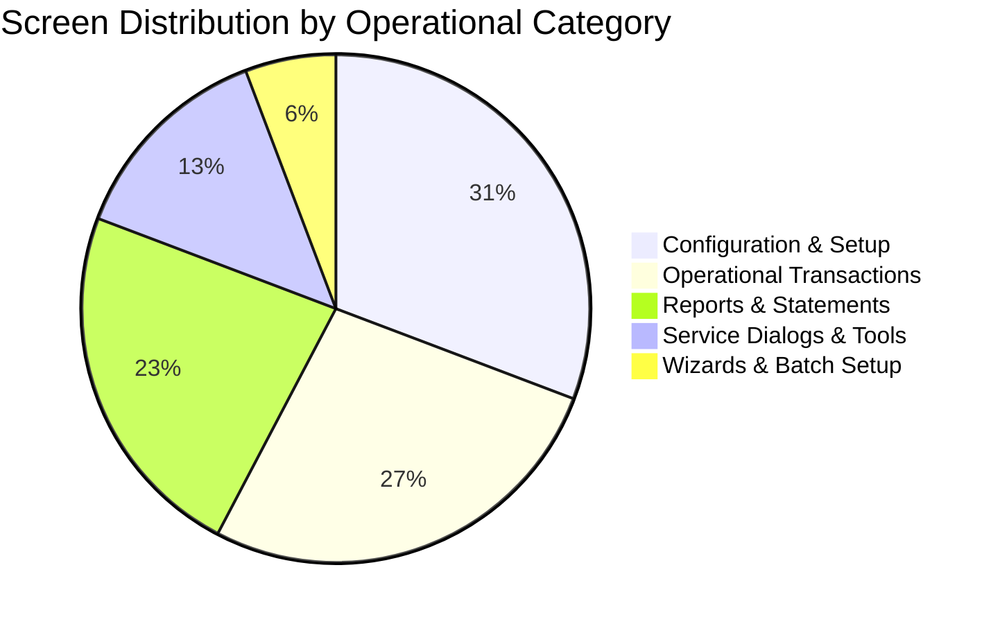
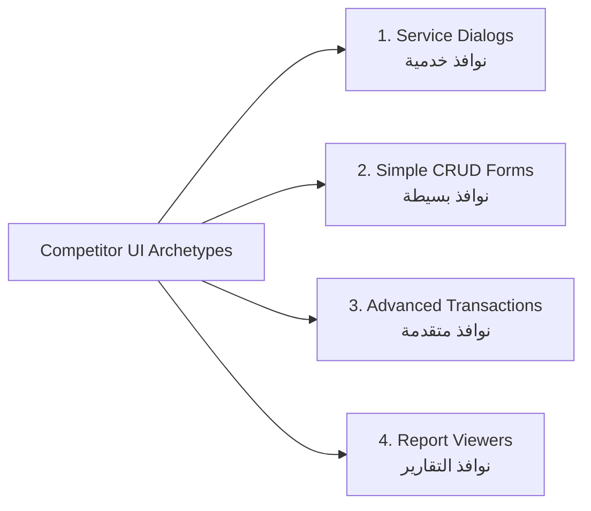
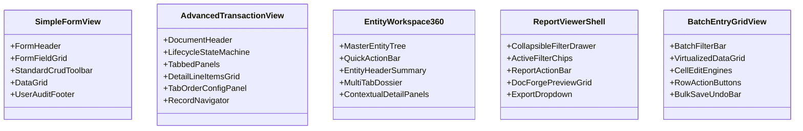

# Competitor Complete Screen Inventory & Archetype Taxonomy

> **Document Type:** Mathematical Screen Inventory & UI Archetype Catalog  
> **Status:** Verified Analysis Complete (`ANALYSIS_COMPLETE`)  
> **Source Material:** `docs/competitor_visual_ux_analysis.md`, `docs/comp_content.txt` (Ebda'a Soft Schools System)  
> **Total Documented Screens & Windows:** 104 Unique Interfaces  

---

## 1. Executive Summary & Mathematical Metrics

The competitor system comprises **104 distinct user interfaces** distributed across 12 operational modules and administrative tools. Every interface is constructed from four fundamental desktop UI archetypes.

### Verified Mathematical Metrics Summary:
- **A. Total Screens / Interfaces:** 104
- **B. Total Configuration Screens:** 32
- **C. Total Operational / Transactional Screens:** 28
- **D. Total Report Views:** 24
- **E. Total Service Dialogs & Utilities:** 14
- **F. Total Wizards & Batch Operations:** 6
- **G. Total Setup / Master Definition Screens:** 28
- **H. Total Permission & Security Screens:** 6
- **I. Total Personalization & Customization Tools:** 5
- **J. Total Finance & Accounting Screens:** 26
- **K. Total Academic, Control & Timetable Screens:** 24
- **L. Total Student Lifecycle Screens:** 14
- **M. Total Administration & System Utility Screens:** 11

---

## 2. Four Universal UI Archetypes Taxonomy

The competitor system strictly categorizes all interactive interfaces into four structural archetypes:

### Archetype 1: Service Dialogs (`نوافذ خدمية وصناديق الحوار`) — [p.12-13]
- **Structural Purpose:** Contextual dialogs invoked from parent screens for auxiliary actions, lookups, search filters, document assignments, photo capture, or tab order configuration.
- **Key Visual Elements:** Floating window, modal backdrop, compact form controls, direct confirmation (`موافق`) and cancellation (`إلغاء`).
- **Interaction Behavior:** Non-navigational, returns execution focus and selected values directly to the invoking parent window.

### Archetype 2: Simple CRUD Form + Grid (`نوافذ بسيطة`) — [p.13, 28, 136]
- **Structural Purpose:** Master record catalogs, lookups, and standard entity definitions.
- **Key Visual Elements:** 
  1. Top window title & record counter
  2. Upper Form Panel (2-column field grid with text, dropdowns, date pickers)
  3. Universal CRUD Toolbar `[إضافة][تعديل][حذف][تحديث][بحث][طباعة][خروج]`
  4. Lower Data Grid with auto-increment row numbers and alternating row zebra striping
  5. Bottom Status Bar with user audit toggle (`عرض سجلات المستخدم`)
- **Interaction Behavior:** Selecting a row in the lower grid populates the upper form. Clicking Add/Edit toggles button availability and unlocks form fields.

### Archetype 3: Advanced Header-Detail Transaction (`نوافذ متقدمة`) — [p.14, 63, 200]
- **Structural Purpose:** Double-entry accounting vouchers, fee receipts, invoices, and complex multi-tab dossiers.
- **Key Visual Elements:**
  1. Top Document Header (Voucher #, Date, Currency, Exchange Rate, Posting Status `حالة السند غير مرحل`)
  2. Tabbed Metadata Sections (Personal, Academic, Financial, Logistics)
  3. Editable Detail Line-Items Grid (Inline cell editing, row-level delete/save buttons, automated column sum totals)
  4. Mode-Aware Toolbar (Save, Cancel, Post `ترحيل`, Unpost `إلغاء الترحيل`, Print Voucher `طباعة السند`)
  5. Left-side Tab Order Customization Panel (`ترتيب تنقل التاب`)
  6. Bottom Record Navigator (`[◄] سجل 1 من 1 [►]`)

### Archetype 4: Report Viewer (`نوافذ التقارير`) — [p.15, 20, 99, 119]
- **Structural Purpose:** Tabular reporting, balance statements, grade summaries, and exportable ledgers.
- **Key Visual Elements:**
  1. Top Filter Panel (Date range selector: `خلال يوم`, `خلال شهر`, `من...إلى`, Branch selector, Account/Class hierarchy tree)
  2. Report Action Bar (`[عرض][طباعة][طباعة المحدد][حفظ القالب][خروج]`)
  3. Center Data Table (Multi-column tabular layout with right-aligned numeric data and credit/debit balances)
  4. Summary Aggregate Footer (Total Debit, Total Credit, Net Balance, Row Counts)

---

## 3. Complete Master Screen Inventory (104 Interfaces)

### Module 1: System Management & Administration (`إدارة النظام`) — 11 Screens

| Screen ID | Code | Screen Name (Arabic / English) | Archetype | Visual & Functional Elements | Actions & Shortcuts | Evidence Page | Confidence |
|---|---|---|---|---|---|---|---|
| **SCR-001** | `1.1.2.1` | إنشاء قاعدة البيانات (Create Database) | Service Dialog | Path selector, storage drive selector, progress bar | Browse, Create, Cancel | p.21 | OBSERVED |
| **SCR-002** | `1.1.2.2` | فتح قاعدة البيانات (Open Database) | Service Dialog | Database list, file picker, connection status | Open, Refresh, Exit | p.22 | OBSERVED |
| **SCR-003** | `1.1.2.3` | نسخ احتياطي (Database Backup) | Service Dialog | Destination path, auto-generated timestamp file `.bak` | Backup, Cancel | p.24 | OBSERVED |
| **SCR-004** | `1.1.2.4` | استعادة قاعدة بيانات (Database Restore) | Service Dialog | Backup file browser, verification modal, progress bar | Restore, Verify, Cancel | p.26 | OBSERVED |
| **SCR-005** | `1.1.2.5` | إعدادات قاعدة البيانات (Database Settings) | Service Dialog | Server name, Auth mode (SQL / Windows), Credentials | Test Connection, Save | p.27 | OBSERVED |
| **SCR-006** | `1.1.3.1` | دليل مجموعات المستخدمين (User Groups) | Simple Form | Group code, name, branch scope, CRUD grid | CRUD Toolbar, Search | p.28 | OBSERVED |
| **SCR-007** | `1.1.3.2` | دليل المستخدمين (User Directory) | Simple Form | User identity, group link, branch permissions, status | CRUD Toolbar, Branch Select | p.30 | OBSERVED |
| **SCR-008** | `1.1.3.3` | قفل العمليات (Operation Locking) | Simple Form | Module lock, period lock date, lock reason, grid | Lock, Unlock, Save | p.31 | OBSERVED |
| **SCR-009** | `1.1.3.4` | المجموعات المحمية (Protected Groups) | Simple Form | System-protected roles, administrative security | View, Toggle Protect | p.32 | OBSERVED |
| **SCR-010** | `1.1.3.5` | صلاحيات المستخدمين (User Permissions) | Advanced Form | Left tree (Users/Groups) + Right Screen×Action checkbox matrix | Grant All, Revoke, Save | p.34 | OBSERVED |
| **SCR-011** | `1.1.3.6` | تغيير كلمة المرور (Change Password) | Service Dialog | Old password, new password, confirmation fields | Save, Cancel | p.35 | OBSERVED |

---

### Module 2: System Settings & Utilities (`إعدادات النظام والخدمات`) — 8 Screens

| Screen ID | Code | Screen Name (Arabic / English) | Archetype | Visual & Functional Elements | Actions & Shortcuts | Evidence Page | Confidence |
|---|---|---|---|---|---|---|---|
| **SCR-012** | `1.1.4.1` | إعدادات النظام (System Settings Hierarchy) | Advanced Form | 3-tier tree (Global/Role/Branch) + Collapsible Key-Value cards | Save, Reset to Default | p.36 | OBSERVED |
| **SCR-013** | `1.1.5.1` | قاموس الترجمة (Translation Dictionary) | Simple Form | UI Label, Arabic string, English string, custom override | CRUD Toolbar, Search | p.38 | OBSERVED |
| **SCR-014** | `1.1.5.2` | الأرشيف الإلكتروني (Document Archive) | Simple Form | Entity link, attachment preview, file category, scan button | Scan, Upload, Open | p.39 | OBSERVED |
| **SCR-015** | `1.1.5.3` | المفاتيح الساخنة (Hotkeys Directory) | Service Dialog | Screen action, key combination table, customization | Assign Key, Reset | p.40 | OBSERVED |
| **SCR-016** | `1.1.5.4` | معلومات شخصية (Personal Contacts Notebook) | Simple Form | Person metadata, phone notebook, photo & signature card | Photo Capture, Signature | p.40-41 | OBSERVED |
| **SCR-017** | `1.1.5.5` | المحفوظات (Saved Queries / Bookmarks) | Simple Form | Bookmark title, screen route, filter parameters | Open, Delete | p.42 | OBSERVED |
| **SCR-018** | `1.1.5.6` | التنبيهات الإدارية (System Alerts & Ticker) | Simple Form | Alert text, target branch, priority, start/end dates | Publish, Archive | p.43, 229 | OBSERVED |
| **SCR-019** | `1.1.8.1` | ترحيل المستندات (Batch Document Posting) | Advanced Form | Voucher type filter, unposted vouchers grid, batch post | Batch Post, Select All | p.46-49 | OBSERVED |

---

### Module 3: Accounts & Financial General Ledger (`إدارة الحسابات`) — 26 Screens

| Screen ID | Code | Screen Name (Arabic / English) | Archetype | Visual & Functional Elements | Actions & Shortcuts | Evidence Page | Confidence |
|---|---|---|---|---|---|---|---|
| **SCR-020** | `1.2.1.1` | دليل الحسابات (Chart of Accounts) | Advanced Form | Split panel: 4-level Tree (Right) + Account Form (Left) | Add Sub-Account, Save | p.50-51 | OBSERVED |
| **SCR-021** | `1.2.1.2` | دليل العملات (Currencies Directory) | Simple Form | Currency code, name, symbol, decimal precision | CRUD Toolbar, Search | p.52 | OBSERVED |
| **SCR-022** | `1.2.1.3` | أسعار العملات (Exchange Rates) | Simple Form | Currency pair, date, buy rate, sell rate, grid | Add Rate, Refresh | p.53 | OBSERVED |
| **SCR-023** | `1.2.1.4` | دليل الصناديق (Cashboxes / Tills) | Simple Form | Cashbox code, name, linked account, branch, keeper | CRUD Toolbar | p.54 | OBSERVED |
| **SCR-024** | `1.2.1.5` | دليل المجموعات المحاسبية (Account Groups) | Simple Form | Group code, category (Assets/Liab), reporting flag | CRUD Toolbar | p.55 | OBSERVED |
| **SCR-025** | `1.2.1.6` | دليل الموظفين المحاسبي (Staff Accounts) | Simple Form | Staff name, employee account linkage, branch | CRUD Toolbar | p.57 | OBSERVED |
| **SCR-026** | `1.2.1.7` | دليل الحسابات الثانوية (Subsidiary Accounts) | Simple Form | Sub-account code, parent account, debit/credit limit | CRUD Toolbar | p.59 | OBSERVED |
| **SCR-027** | `1.2.1.8` | دليل مراكز التكلفة (Cost Centers Tree) | Advanced Form | Tree hierarchy + Cost center form + budget allocation | Add Child, Save | p.60-61 | OBSERVED |
| **SCR-028** | `1.2.1.9` | تسقيف الحسابات (Account Credit Ceilings) | Simple Form | Account selector, max debit limit, alert behavior | Save, Update | p.62 | OBSERVED |
| **SCR-029** | `1.2.2.1` | سند صرف (Payment Voucher) | Advanced Form | Header fields, payment method, detail line items grid | Post, Unpost, Print (`F7`) | p.63-65 | OBSERVED |
| **SCR-030** | `1.2.2.2` | سند القبض (Receipt Voucher) | Advanced Form | Header fields, receipt source, cashbox/bank, detail grid | Post, Unpost, Print (`F6`) | p.66 | OBSERVED |
| **SCR-031** | `1.2.2.3` | سند القيد البسيط (Simple Journal Entry) | Advanced Form | From Account, To Account, Amount, Currency, Description | Post, Print (`F8`) | p.67 | OBSERVED |
| **SCR-032** | `1.2.2.4` | القيود المزدوجة (Compound Journal Entry) | Advanced Form | Header + Multi-row Debit/Credit balancing grid | Auto-Balance, Post | p.68-69 | OBSERVED |
| **SCR-033** | `1.2.2.5` | القيود اليومية (Daily Journal Entries) | Report Viewer | Date range filter, journal ledger grid with entry links | View, Post, Print (`Ctrl+F8`) | p.70 | OBSERVED |
| **SCR-034** | `1.2.2.6` | ترحيل القيود (Post Journal Entries) | Advanced Form | Unposted journal entries checklist, batch posting | Post Selected, Select All | p.71 | OBSERVED |
| **SCR-035** | `1.2.2.7` | توقيف الحسابات (Freeze Accounts) | Simple Form | Account selector, freeze status toggle, reason | Freeze, Unfreeze | p.72-73 | OBSERVED |
| **SCR-036** | `1.2.2.8` | جرد الصندوق (Cashbox Audit & Count) | Advanced Form | Denomination count, calculated total, system variance | Audit, Reconcile (`F4`) | p.74 | OBSERVED |
| **SCR-037** | `1.2.2.9` | الإقفالات السنوية (Fiscal Year Closing) | Wizard | Year-end closing steps, profit/loss transfer, carry forward | Execute Closing, Verify | p.75-78 | OBSERVED |
| **SCR-038** | `1.2.2.10`| إقفال الحسابات الثانوية (Sub-Accounts Closing)| Wizard | Subsidiary balances consolidation, reconciliation | Close Sub-Accounts | p.79-85 | OBSERVED |
| **SCR-039** | `1.2.3.1` | دليل البنوك (Banks Directory) | Simple Form | Bank code, name, swift/branch code, contact info | CRUD Toolbar | p.86 | OBSERVED |
| **SCR-040** | `1.2.3.2` | دليل الحسابات البنكية (Bank Accounts) | Simple Form | Bank selector, account number, IBAN, currency, ledger | CRUD Toolbar | p.87-88 | OBSERVED |
| **SCR-041** | `1.2.3.3` | تحصيل الشيكات الواردة (Incoming Checks) | Advanced Form | Check #, Drawer, Bank, Due Date, Status (Collected/Endorsed/Bounced)| Collect, Endorse (`تجيير`)| p.89-93 | OBSERVED |
| **SCR-042** | `1.2.3.4` | استحقاق الشيكات الصادرة (Outgoing Checks)| Advanced Form | Check #, Payee, Bank Account, Due Date, Clearance status | Clear, Void, Post | p.94-98 | OBSERVED |
| **SCR-043** | `1.2.4.1` | كشف الحساب (Account Statement) | Report Viewer | Account tree filter, date range, currency convert toggle | View, Print (`F9`), Balance Letter| p.99-104 | OBSERVED |
| **SCR-044** | `1.2.5.1` | ميزان المراجعة (Trial Balance) | Report Viewer | Multi-level account balance, Debit/Credit period & cumulative | View, Print, Export | p.119-120 | OBSERVED |
| **SCR-045** | `1.2.5.2` | قائمة المركز المالي (Balance Sheet) | Report Viewer | Assets vs Liabilities & Equity comparative statement | View, Print, Export | p.121 | OBSERVED |

---

### Module 4: Institution & Academic Structure Setup (`تهيئة النظام`) — 16 Screens

| Screen ID | Code | Screen Name (Arabic / English) | Archetype | Visual & Functional Elements | Actions & Shortcuts | Evidence Page | Confidence |
|---|---|---|---|---|---|---|---|
| **SCR-046** | `1.3.1.1` | معلومات المدرسة (School Profile & Info) | Simple Form | Institution name, license, address, contact, logo upload | Save, Browse Logo (`Ctrl+H`)| p.124 | OBSERVED |
| **SCR-047** | `1.3.1.2` | دليل السنوات الدراسية (Academic Years) | Simple Form | Year title, start date, end date, active flag | CRUD Toolbar, Set Active | p.125 | OBSERVED |
| **SCR-048** | `1.3.1.3` | دليل الأقسام (Academic Departments) | Simple Form | Department code, name, head of department, branch | CRUD Toolbar | p.126 | OBSERVED |
| **SCR-049** | `1.3.1.4` | دليل المراحل الدراسية (Academic Stages) | Simple Form | Stage code (Primary/Secondary), sort order, age limit | CRUD Toolbar | p.127 | OBSERVED |
| **SCR-050** | `1.3.1.5` | الحصص الدراسية (Class Lesson Periods) | Simple Form | Period index, start time, end time, shift (Morning/Evening)| CRUD Toolbar | p.128-129 | OBSERVED |
| **SCR-051** | `1.3.1.6` | دليل أنواع الوثائق (Document Types) | Simple Form | Document type code, name, mandatory flag, expiry flag | CRUD Toolbar | p.130 | OBSERVED |
| **SCR-052** | `1.3.1.7` | دليل الجنسيات (Nationalities Directory) | Simple Form | Nationality (M/F), localized Arabic/English terms | CRUD Toolbar | p.131 | OBSERVED |
| **SCR-053** | `1.3.1.8` | دليل المخالفات (Behavioral Infractions) | Simple Form | Infraction code, severity level, penalty points, description | CRUD Toolbar | p.132 | OBSERVED |
| **SCR-054** | `1.3.1.9` | سجل الزوار (Visitors Log) | Simple Form | Visitor name, ID, purpose, host person, check-in/out | Check-In, Check-Out | p.133 | OBSERVED |
| **SCR-055** | `1.3.2.1` | التقويم المدرسي (Academic Calendar) | Advanced Form | Master calendar grid, semester dates, exam periods | Save Calendar, Print | p.135 | OBSERVED |
| **SCR-056** | `1.3.2.2` | دليل أيام الدراسة (School Working Days) | Simple Form | Day of week checkbox list, weekend definition, daily hours | Save, Toggle Weekend | p.135-136 | OBSERVED |
| **SCR-057** | `1.3.2.3` | دليل الأشهر الدراسية (Academic Months) | Simple Form | Month index, title, start date, end date, period link | CRUD Toolbar | p.137 | OBSERVED |
| **SCR-058** | `1.3.2.4` | دليل الإجازات والعطل (Holidays & Vacations)| Simple Form | Holiday title, start date, end date, recurring flag | CRUD Toolbar | p.138 | OBSERVED |
| **SCR-059** | `1.3.3.1` | دليل القاعات الدراسية (Classrooms / Halls) | Simple Form | Room code, room name, capacity, room type (Lab/Hall) | CRUD Toolbar | p.139 | OBSERVED |
| **SCR-060** | `1.3.3.2` | دليل الصفوف (Grade Levels / Classes) | Simple Form | Class code, grade name, stage link, sequence index | CRUD Toolbar | p.140 | OBSERVED |
| **SCR-061** | `1.3.3.3` | دليل تدرج الصفوف (Progression Ladder) | Simple Form | Source grade level, target promotion grade, pass criteria | Save Hierarchy | p.141 | OBSERVED |

---

### Module 5: Subjects, Curricula & Fees Configuration (`تهيئة المواد والرسوم`) — 9 Screens

| Screen ID | Code | Screen Name (Arabic / English) | Archetype | Visual & Functional Elements | Actions & Shortcuts | Evidence Page | Confidence |
|---|---|---|---|---|---|---|---|
| **SCR-062** | `1.3.3.4` | دليل رموز الشعب (Section Code Templates) | Simple Form | Section symbol (أ, ب, ج, 1, 2), description | CRUD Toolbar | p.142 | OBSERVED |
| **SCR-063** | `1.3.3.5` | دليل الشعب (Class Sections Catalog) | Simple Form | Grade level selector, section symbol, max capacity, room | CRUD Toolbar | p.143 | OBSERVED |
| **SCR-064** | `1.3.3.6` | إسناد وثائق الصفوف (Class Document Rules) | Advanced Form | Class selector, mandatory documents checklist | Save Document Rules | p.144 | OBSERVED |
| **SCR-065** | `1.3.4.1` | دليل المواد (Subjects Catalog) | Simple Form | Subject code, name, Arabic title, core/elective flag | CRUD Toolbar | p.145 | OBSERVED |
| **SCR-066** | `1.3.4.2` | توزيع المواد على الصفوف (Curriculum Binding)| Advanced Form | Class selector, subjects checklist, weekly hours, max marks | Save Curriculum Binding | p.146 | OBSERVED |
| **SCR-067** | `1.3.4.4` | دليل أنواع الدرجات (Grade Component Types) | Simple Form | Component name (Coursework, Midterm, Final, Practical) | CRUD Toolbar | p.147 | OBSERVED |
| **SCR-068** | `1.3.4.5` | دليل التقديرات (Grade Scale / Appraisal) | Simple Form | Grade symbol (A+, A, B), min score %, max score %, GPA | CRUD Toolbar | p.148 | OBSERVED |
| **SCR-069** | `1.3.5.1` | فئات الرسوم (Fee Categories & Items) | Simple Form | Fee item name, revenue account, currency, recurring flag | CRUD Toolbar | p.149 | OBSERVED |
| **SCR-070** | `1.3.5.2` | فئات الخصم (Discount Templates) | Simple Form | Discount name, percentage / fixed amount, reason | CRUD Toolbar | p.150 | OBSERVED |

---

### Module 6: Student Lifecycle & Follow-up (`شؤون الطلاب`) — 14 Screens

| Screen ID | Code | Screen Name (Arabic / English) | Archetype | Visual & Functional Elements | Actions & Shortcuts | Evidence Page | Confidence |
|---|---|---|---|---|---|---|---|
| **SCR-071** | `1.3.5.3` | فئات الأقساط (Installment Schedules) | Simple Form | Installment name, due date rule, percentage distribution | CRUD Toolbar | p.151 | OBSERVED |
| **SCR-072** | `1.3.5.4` | دليل رسوم الصفوف (Class Fee Schedules) | Advanced Form | Grade selector, fee category line items, default amounts | Save Fee Schedule | p.152 | OBSERVED |
| **SCR-073** | `1.4.1.1` | استمارة تسجيل فارغة (Blank Application Form)| Service Dialog | Printable blank registration application template | Print Application | p.153 | OBSERVED |
| **SCR-074** | `1.4.1.2` | تسجيل طالب جديد (New Student Registration) | Advanced Form | Multi-tab dossier (Personal, Guardian, Academic, Finance, Bus, Photo)| Save, Import Excel | p.154-156 | OBSERVED |
| **SCR-075** | `1.4.1.3` | شاشة التسجيل (Enrollment Management) | Advanced Form | Student lookup, academic year, class/section assignment | Enroll, Transfer, Save | p.157 | OBSERVED |
| **SCR-076** | `1.4.1.4` | إدخال رسوم طالب (Student Fee Assignment) | Advanced Form | Student selector, applied fee schedule, custom discounts | Generate Invoices, Save | p.158 | OBSERVED |
| **SCR-077** | `1.4.2.1` | شجرة بيانات الطلاب (Student Data 360 Workspace)| Advanced Form | Left Tree (Enrollment history) + Top Action Bar + Multi-tab dossier| Quick Actions (`Ctrl+T`)| p.159 | OBSERVED |
| **SCR-078** | `1.4.2.2` | دليل الطلاب (Student Directory) | Simple Form | Advanced student search filters + data grid + quick edit | Search (`Ctrl+S`), Export | p.160 | OBSERVED |
| **SCR-079** | `1.4.2.3` | دليل أولياء الأمور (Guardian Directory) | Simple Form | Guardian personal info, contact numbers, linked students | CRUD Toolbar, Call Log | p.161 | OBSERVED |
| **SCR-080** | `1.4.2.4` | وثائق الطالب (Student Document Manager) | Advanced Form | Student selector, mandatory document scan status, previews | Scan, Upload (`Ctrl+D`)| p.162 | OBSERVED |
| **SCR-081** | `1.4.2.5` | توزيع الطلاب على الشعب (Section Distribution)| Wizard | Class filter, unassigned students list, section capacity balancer| Auto-Distribute, Save | p.163 | OBSERVED |
| **SCR-082** | `1.4.2.6` | الطلاب غير المستمرين (Withdrawn Students) | Simple Form | Discontinued student list, withdrawal reason, status | Reactivate, Archive | p.164 | OBSERVED |
| **SCR-083** | `1.4.3.1` | التحضير اليومي للطلاب (Daily Attendance Grid)| Advanced Form | Date/Class selector + Batch grid (Present/Absent/Late/Excused)| Row-Level Save / Undo | p.165 | OBSERVED |
| **SCR-084** | `1.4.3.2` | سلوكيات الطلاب (Student Behavior Log) | Simple Form | Student selector, infraction type, penalty action, date | CRUD Toolbar | p.166 | OBSERVED |

---

### Module 7: Staff Affairs (`شؤون الموظفين`) — 6 Screens

| Screen ID | Code | Screen Name (Arabic / English) | Archetype | Visual & Functional Elements | Actions & Shortcuts | Evidence Page | Confidence |
|---|---|---|---|---|---|---|---|
| **SCR-085** | `1.4.3.3` | ملاحظات رائد الفصل (Homeroom Teacher Notes)| Simple Form | Class section, periodic teacher evaluations, comments | CRUD Toolbar | p.167 | OBSERVED |
| **SCR-086** | `1.5.1.1` | دليل الموظفين (Staff / Employee Directory) | Simple Form | Employee profile, job title, qualifications, branch link | CRUD Toolbar, Search | p.168 | OBSERVED |
| **SCR-087** | `1.5.1.2` | دليل الضمناء (Staff Guarantors Directory) | Simple Form | Guarantor personal info, legal liability, phone, address | CRUD Toolbar | p.169 | OBSERVED |
| **SCR-088** | `1.5.1.3` | إسناد المواد للمدرسين (Teacher Subject Assign)| Advanced Form | Teacher selector, class subjects checklist, weekly lecture quota| Save Teaching Assignment | p.170 | OBSERVED |
| **SCR-089** | `1.5.1.4` | حضور وغياب الموظفين (Staff Attendance Grid)| Advanced Form | Monthly attendance grid per staff member, leave deductions | Batch Save, Reconcile | p.171 | OBSERVED |
| **SCR-090** | `1.5.1.5` | دليل إشعارات الموظفين (Staff Notices) | Simple Form | Official circulars, warning letters, commendations | Publish Notice, Print | p.172-173 | OBSERVED |

---

### Module 8: Control, Grading, Timetables & Promotion (`الكنترول`) — 10 Screens

| Screen ID | Code | Screen Name (Arabic / English) | Archetype | Visual & Functional Elements | Actions & Shortcuts | Evidence Page | Confidence |
|---|---|---|---|---|---|---|---|
| **SCR-091** | `1.6.1.1` | الدرجات الشهرية (Monthly Grades Entry Grid) | Advanced Form | Class/Subject selector + Batch score entry grid with validation| Batch Save, Auto-Sum | p.174 | OBSERVED |
| **SCR-092** | `1.6.1.2` | إدخال محصلة طالب (Student Grade Totals) | Advanced Form | Single student multi-subject grade summary & adjustments | Save, Recalculate | p.175 | OBSERVED |
| **SCR-093** | `1.6.1.3` | الدرجات الفصلية (Semester Grades Ledger) | Report Viewer | Class term score consolidation, pass/fail status, ranking | View, Lock Grades, Print | p.176 | OBSERVED |
| **SCR-094** | `1.6.2.1` | دليل أماكن اللجان (Exam Venues / Rooms) | Simple Form | Venue name, hall capacity, max seating rows | CRUD Toolbar | p.179 | OBSERVED |
| **SCR-095** | `1.6.2.2` | أرقام الجلوس والأرقام السرية (Seating & Secrets)| Wizard | Class filter, seating number generator, anonymous secret codes | Generate Codes, Export | p.180 | OBSERVED |
| **SCR-096** | `1.6.2.3` | توزيع اللجان (Exam Proctor Assignment) | Advanced Form | Exam session, room proctors, chief proctor designation | Save Proctor Schedule | p.181 | OBSERVED |
| **SCR-097** | `1.6.2.4` | جدول الامتحانات (Exam Timetable Schedule) | Advanced Form | Exam dates, subject timings, room assignments | Save Exam Schedule | p.182 | OBSERVED |
| **SCR-098** | `1.6.3.1` | جداول الصفوف (Class Weekly Timetable) | Advanced Form | Timetable weekly grid (Days × Periods), subject/teacher assign | Conflict Check, Save | p.185 | OBSERVED |
| **SCR-099** | `1.6.3.2` | جداول المدرسين (Teacher Timetable Matrix) | Report Viewer | Teacher weekly schedule matrix, free period analysis | View, Print Schedule | p.186 | OBSERVED |
| **SCR-100** | `1.6.4.1` | ترفيع الطلاب (Year-End Student Promotion) | Wizard | Class progression criteria, passed/failed student lists, promotion| Execute Promotion | p.188 | OBSERVED |

---

### Modules 9–12 & Administrative Utilities (`الأنشطة، المواصلات، المالية، المخازن، الرسائل`) — 4 Screens

| Screen ID | Code | Screen Name (Arabic / English) | Archetype | Visual & Functional Elements | Actions & Shortcuts | Evidence Page | Confidence |
|---|---|---|---|---|---|---|---|
| **SCR-101** | `1.7.4` | اشتراك الأنشطة الطلابية (Activity Enrollments)| Simple Form | Activity selector, participating students, supervisor link | Enroll, Print List | p.194 | OBSERVED |
| **SCR-102** | `1.8.3` | اشتراك المواصلات (Bus Transportation Sub) | Simple Form | Bus route selector, student stop, bus fee linkage | Subscribe, Print Roster | p.198 | OBSERVED |
| **SCR-103** | `1.9.1` | سند قبض الرسوم الدراسية (Tuition Fee Receipt)| Advanced Form | Student lookup, outstanding fee invoices, payment lines, cashbox | Post Receipt, Print | p.200 | OBSERVED |
| **SCR-104** | `1.11.2` | إرسال الرسائل القصيرة (SMS Dispatch Center) | Advanced Form | Target group (Guardians/Staff), message template, live counter | Send SMS, View Logs | p.210 | OBSERVED |

---

## 4. Inventory Synthesis & Archetype Breakdown

This 104-screen inventory forms the exact structural foundation against which Orbis's frontend architecture and gap matrix are evaluated.

---
*Verified against competitor documentation. Transitioning to Configuration Hierarchy analysis.*
