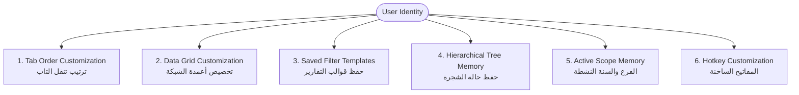
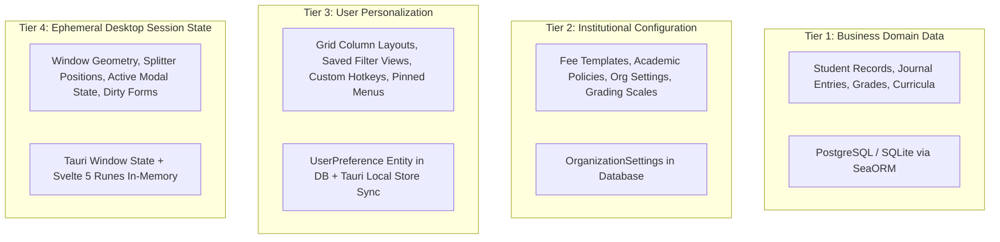

# Competitor User Personalization & Desktop State Reverse-Engineering

> **Document Type:** Personalization Engine & Desktop State Persistence Analysis  
> **Status:** Verified Analysis Complete (`ANALYSIS_COMPLETE`)  
> **Source Material:** `docs/competitor_visual_ux_analysis.md`, `docs/comp_content.txt`, `ARCHITECTURE_HANDOFF.md`  
> **Target System:** Orbis Enterprise Educational Platform  

---

## 1. Executive Summary: The Power of Operator Personalization

In a high-throughput enterprise environment, different operators interact with the same ERP screens in fundamentally different ways:
- **Cashier / Accountant:** Requires rapid numeric keyboard entry, custom tab traversal skipping non-mandatory fields, fixed cashier till binding, and compact grid density.
- **Academic Registrar:** Requires multi-column student directories, saved filters for unassigned students, and expanded grade hierarchy trees.
- **Executive Principal:** Requires summary dashboard metrics, branch comparison views, and one-click PDF report generations.

The competitor achieves extreme user satisfaction not because its forms are beautiful, but because **the desktop shell persistently adapts to each individual user's habits**.

---

## 2. Reverse-Engineered Competitor Personalization Mechanisms



### 2.1 Tab Traversal Order Customization (`ترتيب تنقل التاب`) — [p.14]
- **Observed Behavior:** On any simple or advanced form, right-clicking reveals a context menu option: `ترتيب تنقل التاب` (Configure Tab Order). This opens a dedicated sidebar/dialog listing all form fields.
- **Operator Capability:** The user can reorder the sequence in which pressing the `Tab` key moves focus between input controls, or toggle specific fields to be skipped entirely during rapid data entry.
- **Business Value:** An accountant typing 50 payment vouchers per day can skip descriptive optional fields and jump directly from `Account Code` $\rightarrow$ `Amount` $\rightarrow$ `Line Items Grid`, doubling data entry velocity.

### 2.2 Grid Column Customization & Layout Memory — [p.13, 14, 99]
- **Observed Behavior:** The desktop grids remember:
  1. Column widths adjusted by mouse dragging
  2. Column display order (drag-and-drop reordering)
  3. Hidden vs. visible columns (via column selector checklist)
  4. Pinned / frozen columns (e.g., Student Name or Account Code remaining fixed on horizontal scroll)
  5. Default sort column and direction (`asc` / `desc`)
- **Persistence:** These layout customizations are stored per user per window, so returning to the *Student Directory* restores the user's exact customized table layout.

### 2.3 Saved Filter Templates (`حفظ القالب`) — [p.20, 99, 349]
- **Observed Behavior:** In Report Viewers and Advanced Directories, after an operator configures complex filter criteria (e.g., *Branch: Main, Stage: Secondary, Grade: 10, Unpaid Fees > 500, Term: Fall 2026*), a button titled `حفظ القالب` (Save Template) persists this query.
- **Operator Capability:** The operator can assign a name (e.g., *"Grade 10 High Debt"*) and reload this exact filter set in one click without re-selecting 6 different dropdowns.

### 2.4 Hierarchical Tree Expansion & Selection Memory — [p.51, 159]
- **Observed Behavior:** In split-panel tree workspaces (*Chart of Accounts* and *Student Tree*), the system remembers the last expanded branch nodes and the last selected entity. Reopening the window returns the operator directly to their active working context.

### 2.5 Active Scope & Context Memory — [p.10, 36]
- **Observed Behavior:** The application shell continuously remembers:
  - The last selected organizational branch (`الفرع`)
  - The last selected academic year and period (`السنة الدراسية`)
  - The active cashier till / cashbox binding (`الصندوق الافتراضي`)

### 2.6 Personal Contacts Notebook & Identification Cards (`معلومات شخصية`) — [p.40-41]
- **Observed Behavior:** A dedicated utility screen allows each operator to maintain a personal directory of contacts, contractors, or emergency contacts, complete with scanned ID cards, photos, and signatures captured directly via TWAIN scanners or file upload.

---

## 3. Investigation of the Database & Storage Architecture Claim

A common assumption during reverse-engineering of older Windows Forms ERPs is that Microsoft Access (`.mdb` / `.accdb`) or local XML/INI files were used for local desktop customization.

### Primary Source Evidence Audit:
1. **Explicit Source Documentation (p.27):** The documentation explicitly specifies **Microsoft SQL Server** as the authoritative database engine:
   > *"لكي يتم الاتصال ببرنامج إدارة قواعد البيانات SQLServer... وفيها يتم تحديد اسم الجهاز المخدم Server... واسم قاعدة البيانات"*
2. **Explicit Backup File Extension (p.25):** The documented backup format is `School_YYYY-MM-DD.bak`, which is the native binary backup format of Microsoft SQL Server.
3. **Absence of Microsoft Access in Source:** A comprehensive automated and manual search across all 233 pages of the Competitor System Guide reveals **ZERO** mentions of Microsoft Access, `.mdb`, or `.accdb`.
4. **Architectural Verification:**
   - **Documented Fact:** Business data, user groups, permissions, and system settings reside in Microsoft SQL Server.
   - **Inferred / Likely Implementation for UI State:** Local Windows user preferences in .NET desktop applications of this generation were historically stored either in the **Windows Registry** (`HKEY_CURRENT_USER\Software\Ebda3Soft\...`), local user `.config` XML files (`AppData\Local\...`), or serialized into user-preference tables inside SQL Server.
   - **Conclusion:** Claims attributing personalization specifically to Microsoft Access files are **UNVERIFIED SPECULATION**.

---

## 4. Architectural Separation: The 4-Tier State Model

Regardless of the competitor's legacy implementation, Orbis must establish a clean, modern, and robust separation between different classes of application state:



| State Tier | Characteristics | Authoritative Storage | Offline Sync Strategy |
|---|---|---|---|
| **1. Business Data** | Multi-tenant, transactional, audited, immutable invariants | PostgreSQL (Cloud) / SQLite (Desktop IPC) | Full SeaORM repository transactions with domain events |
| **2. Org Configuration** | Cascading institutional policies, fee schedules, templates | Database (`OrganizationSettings`, `OrgUnit`) | Cached in TanStack Query with invalidation hooks |
| **3. User Preferences** | Cross-device user settings, grid layouts, filter presets | Server `UserPreference` + Tauri Local Cache | Bi-directional sync on login; instant local read |
| **4. Session State** | Window size, pane collapse, current focus, active route | Local Tauri Store / In-Memory Svelte 5 Runes | Local desktop only; never sent to server |

---

## 5. Target Personalization Subsystems for Orbis

To surpass the competitor's desktop ergonomics, Orbis will implement four dedicated personalization capabilities:

### 5.1 The `usePersonalization` Svelte 5 Rune
A unified reactive rune managing all screen-level personalization:
```typescript
// Conceptual target contract
export function usePersonalization<T>(key: string, defaultValues: T) {
  // 1. Instantly hydrates from local desktop cache (0ms latency)
  // 2. Reactively updates Svelte 5 state
  // 3. Debounces background synchronization to backend UserPreference service
}
```

### 5.2 Adaptive Grid Layout Persistence (`OrbisGrid`)
- Automatically tracks column reordering, resizing, visibility toggling, and sort state.
- Saves customized layouts under scoped view keys: `${orgId}:${userId}:grid:${screenId}`.
- Allows operators to switch between multiple named views (*"Default"*, *"Compact Accountant"*, *"Audit View"*).

### 5.3 Filter Builder & Saved Views Shell
- Integrated into `ReportViewerShell` and `DataTable`.
- Provides an explicit `Save View As...` dialog with optional sharing (Private to User vs. Shared with Branch).

### 5.4 Unified Focus & Keyboard Navigation Traversal
- Replaces legacy tab reordering with modern accessible focus traps and arrow-key grid navigation.
- Global Command Palette (`Ctrl+K`) with instant jump to recent entities, screens, and actions.

---
*Verified against competitor documentation and Orbis codebase. Transitioning to Permissions and Security analysis.*
