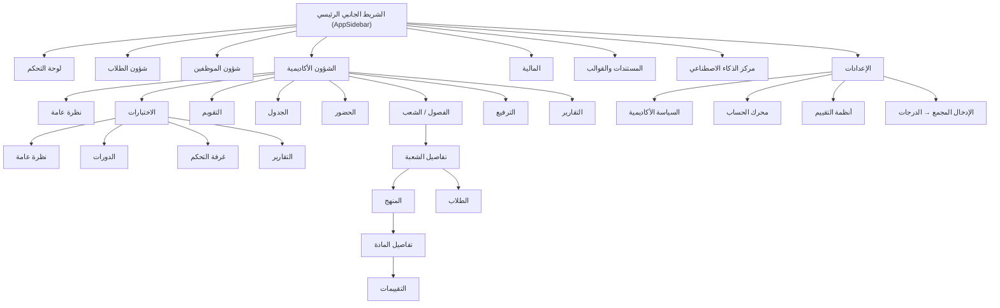
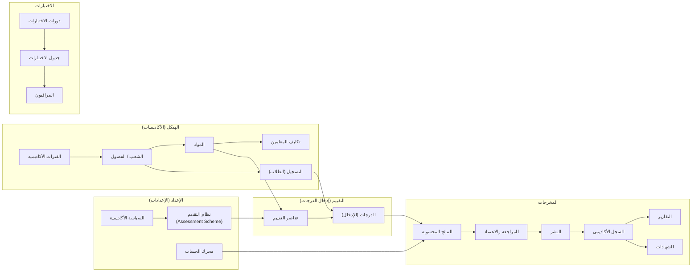
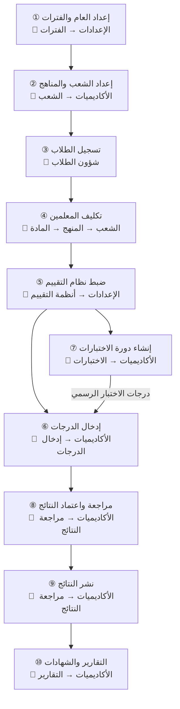
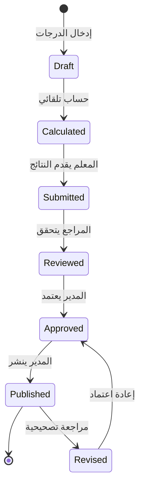
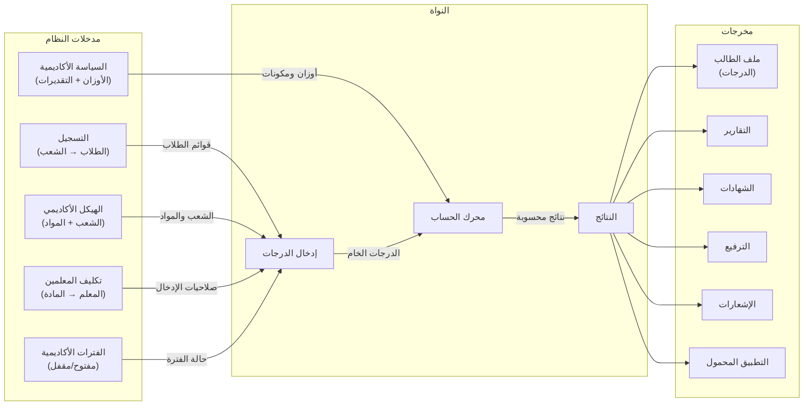

# إعادة تصميم تجربة التقييمات والدرجات — Orbis Desktop

> [!IMPORTANT]
> هذا المستند يحدد التصور الكامل لتجربة إدارة التقييمات والدرجات في Orbis Desktop، بما يشمل: خريطة التنقل، دورة العمل الأكاديمية، تصميم شاشة إدخال الدرجات، تنظيم النتائج والتقارير، ونقاط التكامل مع بقية وحدات النظام.

---

## 1. تحليل الوضع الحالي

### 1.1 هيكل التنقل الحالي في Desktop



### 1.2 المشاكل في الهيكل الحالي

| المشكلة | الوصف |
|---------|------|
| **تشتت إدخال الدرجات** | إدخال الدرجات موجود في 3 أماكن مختلفة: `exams/control` (غرفة التحكم)، `sections/[id]/curriculum/[id]/assessments` (داخل المادة)، و`settings/bulk-input/grades` (الإدخال المجمع). لا يوجد مكان واحد واضح يذهب إليه المعلم. |
| **غياب مفهوم "الدرجات" من التنقل** | لا يوجد عنصر صريح في القائمة الجانبية للأكاديميات يسمى "الدرجات" أو "إدخال الدرجات". المعلم لا يعرف أين يذهب. |
| **خلط الاختبارات بإدخال الدرجات** | شاشة "غرفة التحكم" (`exams/control`) تخلط بين إدارة الاختبارات (دورات، جداول، مراقبين) وإدخال الدرجات فعلياً. |
| **التقارير متفرقة** | تقارير الاختبارات في `exams/reports`، تقارير الأكاديميات في `academics/reports`، وتقارير عامة في `reports`. ثلاثة أماكن مختلفة. |
| **لا توجد شاشة مراجعة واعتماد** | لا يوجد مسار لعملية المراجعة والاعتماد الرسمية للنتائج. |
| **شاشة درجات الطالب مثقلة** | `student-grades.svelte` (1082 سطراً) تعمل كشاشة عرض سجل أكاديمي كامل من داخل ملف الطالب — وهذا صحيح معمارياً لكنها تحتاج ربط أفضل مع النتائج المعتمدة. |
| **grade-helpers تحتوي تقدير مكرر** | `scoreToGradeLetter` في `grade-helpers.ts` تكرر منطق التقدير المحلول سابقاً في T1 (backend). |

### 1.3 ما هو صحيح ويجب الحفاظ عليه

| القرار الحالي | التقييم |
|---------------|---------|
| **`OrbisGrid`** كمحرك جدول لإدخال الدرجات | ✅ ممتاز — يدعم تحرير الخلايا والتنقل بلوحة المفاتيح |
| **`GradeMatrixResponse`** من Backend كمصدر بيانات | ✅ نموذج بيانات مناسب — طلاب × عناصر تقييم |
| **`ControlGrid`** كمكون مشترك للجدول | ✅ جيد — يجمع اختيار الفصل والمادة مع الجدول |
| **`ExamsDashboard`** لإدارة دورات الاختبارات | ✅ صحيح معمارياً — يفصل إدارة الدورات عن إدخال الدرجات |
| **`BulkEntryStudio`** للإدخال المجمع من Excel | ✅ أداة قوية — يجب إبقاؤها كخيار إدخال بديل |
| **فصل إعدادات السياسة الأكاديمية عن العمليات اليومية** | ✅ صحيح — السياسة في الإعدادات والعمليات في الأكاديميات |

---

## 2. التنظيم الجديد للتنقل

### 2.1 الشريط الجانبي الرئيسي (بدون تغيير)

الأيقونات الرئيسية تبقى كما هي:
1. **لوحة التحكم** (`/[orgId]`)
2. **شؤون الطلاب** (`/[orgId]/students`)
3. **شؤون الموظفين** (`/[orgId]/employees`)
4. **الشؤون الأكاديمية** (`/[orgId]/academics`) ← التغييرات هنا
5. **المالية** (`/[orgId]/finance`)
6. **المستندات** (`/[orgId]/templates`)
7. **مركز AI** (`/[orgId]/ai-center`)
8. **الإعدادات** (`/[orgId]/settings`)

### 2.2 القائمة الجانبية للشؤون الأكاديمية (التصميم الجديد)

```
┌─────────────────────────────────┐
│  📚 الشؤون الأكاديمية          │
├─────────────────────────────────┤
│                                 │
│  نظرة عامة                     │  ← الصفحة الرئيسية
│  الفصول والشعب          [12]   │  ← إدارة الشعب والمناهج
│  التقويم                        │  ← التقويم الأكاديمي
│  الجدول                         │  ← الجداول والحصص
│  الحضور والغياب                 │  ← تسجيل الحضور
│                                 │
│  ─────── التقييم والدرجات ─────│
│                                 │
│  إدخال الدرجات            ★    │  ← الشاشة اليومية للمعلم
│  الاختبارات                     │  ← إدارة دورات الاختبارات
│  مراجعة النتائج                 │  ← مراجعة واعتماد ونشر
│                                 │
│  ─────── المخرجات ─────────────│
│                                 │
│  الترفيع                        │  ← الترفيع والانتقال
│  التقارير والكشوف               │  ← جميع التقارير الأكاديمية
│                                 │
└─────────────────────────────────┘
```

### 2.3 خريطة المسارات (Routes) الكاملة

| المسار | الشاشة | المسؤول | الوصف |
|--------|--------|---------|------|
| `/academics` | نظرة عامة | الجميع | لوحة ملخص أكاديمي: عدد الشعب، الفترة الحالية، حالة إدخال الدرجات |
| `/academics/sections` | دليل الشعب | مدير أكاديمي | قائمة الشعب النشطة مع عدد الطلاب |
| `/academics/sections/[id]` | تفاصيل الشعبة | مدير أكاديمي | معلومات الشعبة + تبويبات فرعية |
| `/academics/sections/[id]/curriculum` | المنهج | مدير أكاديمي | المواد المرتبطة بالشعبة |
| `/academics/sections/[id]/curriculum/[id]` | تفاصيل المادة | مدير أكاديمي / المعلم | نظرة على المادة + تقييماتها |
| `/academics/sections/[id]/curriculum/[id]/assessments` | تقييمات المادة | مدير أكاديمي | عرض درجات المادة بشكل تفصيلي |
| `/academics/sections/[id]/students` | طلاب الشعبة | مدير أكاديمي | قائمة الطلاب المسجلين |
| `/academics/calendar` | التقويم | مدير أكاديمي | التقويم الأكاديمي والأحداث |
| `/academics/schedule` | الجدول | مدير أكاديمي | جدول الحصص |
| `/academics/attendance` | الحضور | المعلم / مدير | تسجيل الحضور والغياب |
| **`/academics/grades`** | **إدخال الدرجات** | **المعلم** | **🆕 الشاشة الرئيسية لإدخال الدرجات** |
| `/academics/exams` | الاختبارات | مدير الاختبارات | لوحة إدارة دورات الاختبارات |
| `/academics/exams/sessions` | الدورات | مدير الاختبارات | إنشاء وإدارة دورات الاختبارات |
| `/academics/exams/sessions/[id]` | تفاصيل الدورة | مدير الاختبارات | جدول اختبارات الدورة + المراقبين |
| `/academics/exams/reports` | تقارير الاختبارات | مدير الاختبارات | كشوف وتقارير الاختبارات |
| **`/academics/results`** | **مراجعة النتائج** | **مدير أكاديمي / مدير** | **🆕 مراجعة واعتماد ونشر النتائج** |
| `/academics/promotion` | الترفيع | مدير أكاديمي | عمليات الترفيع والانتقال |
| `/academics/reports` | التقارير والكشوف | الجميع | جميع التقارير الأكاديمية والشهادات |

### 2.4 التغييرات المطلوبة على الهيكل الحالي

| التغيير | النوع | التفاصيل |
|---------|------|----------|
| إضافة `/academics/grades` | 🆕 مسار جديد | شاشة إدخال الدرجات — تنقل `exam-control.svelte` من `exams/control` إلى هنا مع تطويرها |
| إضافة `/academics/results` | 🆕 مسار جديد | شاشة مراجعة النتائج واعتمادها |
| حذف `/academics/exams/control` | ❌ إزالة | الوظيفة انتقلت إلى `/academics/grades` |
| تحديث `academics/+layout.svelte` | ✏️ تعديل | إضافة "إدخال الدرجات" و"مراجعة النتائج" مع فاصل مجموعة "التقييم والدرجات" |
| تحديث `exams/+layout.svelte` | ✏️ تعديل | إزالة تبويب "control" — الاختبارات تبقى: نظرة عامة، الدورات، التقارير |
| دمج التقارير | ✏️ تعديل | `academics/reports` يصبح المكان الوحيد لجميع التقارير الأكاديمية (بما فيها تقارير الاختبارات) |

---

## 3. التمييز بين المفاهيم الأكاديمية

### 3.1 السلسلة المفاهيمية



### 3.2 جدول التمييز

| المفهوم | التعريف | أين يُعرَّف | أين يُستخدم | من المسؤول |
|---------|---------|-------------|-------------|-----------|
| **السياسة الأكاديمية** | القواعد العامة للمؤسسة: أوزان المكونات، سلم التقديرات، الحد الأدنى للنجاح | الإعدادات → السياسة الأكاديمية | محرك الحساب + شاشة النتائج + التقارير | مدير النظام |
| **نظام التقييم** (Scheme) | توزيع الأوزان لكل مرحلة: أعمال فصلية 70% + نهائي 30% مثلاً | الإعدادات → أنظمة التقييم | ربط المادة بنظام التقييم → تحديد عناصر التقييم | مدير أكاديمي |
| **عنصر التقييم** (Assessment) | واجب، اختبار قصير، مشاركة، مشروع، نصفي، نهائي... | يُنشأ تلقائياً من نظام التقييم + يمكن إضافة عناصر يدوياً | شاشة إدخال الدرجات (كأعمدة) | نظام تلقائي + مدير أكاديمي |
| **الدرجة** (Grade) | القيمة العددية التي يدخلها المعلم لطالب في عنصر تقييم | شاشة إدخال الدرجات | محرك الحساب | المعلم |
| **دورة الاختبارات** (Exam Session) | فترة اختبارات رسمية: نصفي، نهائي... تشمل جدول وقاعات ومراقبين | الاختبارات → الدورات | تنظيم الاختبارات الرسمية لا إدخال الدرجات | مدير الاختبارات |
| **النتيجة** (Result) | المخرج المحسوب: مجموع الدرجات وفق الأوزان → نسبة → تقدير | يُحسب تلقائياً من `CalcEngine` | شاشة مراجعة النتائج + التقارير | النظام (تلقائي) |
| **السجل الأكاديمي** | التاريخ الرسمي المعتمد لنتائج الطالب | يُبنى من النتائج المعتمدة والمنشورة | ملف الطالب → الدرجات + التقارير والشهادات | لا يُعدَّل يدوياً |
| **التقرير / الشهادة** | مستند يعرض النتائج المعتمدة بتنسيق رسمي | يُنشأ من التقارير والكشوف | طباعة / PDF / تصدير | مدير أكاديمي |

---

## 4. دورة العمل الأكاديمية من البداية إلى النهاية

### 4.1 رسم تدفق العمل



### 4.2 تفصيل كل خطوة

#### ① إعداد العام والفترات الأكاديمية
- **المسؤول:** مدير النظام / المدير الأكاديمي
- **المكان:** `الإعدادات → الفترات` (`/settings/periods`)
- **العملية:** إنشاء العام الدراسي، تحديد الفصول (الفصل الأول، الثاني...)، تحديد مواعيد البدء والانتهاء لكل فترة
- **البيانات المطلوبة:** اسم الفترة، تاريخ البداية والنهاية، حالة الفترة (نشطة/مقفلة)، هل إدخال الدرجات مفتوح
- **المخرج:** فترات أكاديمية جاهزة يُبنى عليها كل شيء لاحقاً

#### ② إعداد الشعب والمناهج
- **المسؤول:** المدير الأكاديمي
- **المكان:** `الأكاديميات → الشعب` (`/academics/sections`)
- **العملية:** إنشاء الشعب (الصف الأول أ، الصف الثاني ب...)، ربط المواد بكل شعبة من خلال المنهج
- **البيانات المطلوبة:** اسم الشعبة، المرحلة، السعة، قائمة المواد
- **المخرج:** شعب جاهزة + مواد مرتبطة (SectionSubject)

#### ③ تسجيل الطلاب
- **المسؤول:** مسؤول التسجيل / شؤون الطلاب
- **المكان:** `شؤون الطلاب` (`/students`)
- **العملية:** تسجيل الطلاب في الشعب المناسبة
- **المخرج:** قوائم طلاب مرتبطة بالشعب ← تظهر تلقائياً عند إدخال الدرجات

#### ④ تكليف المعلمين
- **المسؤول:** المدير الأكاديمي
- **المكان:** `الشعب → المنهج → المادة` (`/academics/sections/[id]/curriculum/[id]`)
- **العملية:** تعيين المعلم المسؤول عن كل مادة في كل شعبة
- **المخرج:** كل معلم يرى فقط المواد والشعب المكلف بها

#### ⑤ ضبط نظام التقييم
- **المسؤول:** المدير الأكاديمي / مدير النظام
- **المكان:** `الإعدادات → أنظمة التقييم + السياسة الأكاديمية`
- **العملية:** تحديد مكونات التقييم وأوزانها (مثلاً: أعمال فصلية 30 + نصفي 20 + نهائي 50)
- **البيانات المطلوبة:** نوع كل مكون، الدرجة القصوى، الوزن النسبي
- **المخرج:** نظام تقييم يُطبق على المواد ← يحدد الأعمدة في شاشة إدخال الدرجات

#### ⑥ إدخال الدرجات
- **المسؤول:** المعلم (أساساً)، المدير الأكاديمي (إشراف)
- **المكان:** `الأكاديميات → إدخال الدرجات` (`/academics/grades`) 🆕
- **العملية:** يختار المعلم الفترة → الشعبة → المادة → يرى جدول الطلاب × عناصر التقييم → يدخل الدرجات
- **التفصيل:** انظر القسم 5 أدناه

#### ⑦ إنشاء دورة الاختبارات (موازي للخطوة 6)
- **المسؤول:** مدير الاختبارات / مدير أكاديمي
- **المكان:** `الأكاديميات → الاختبارات` (`/academics/exams`)
- **العملية:** إنشاء دورة اختبارات (نصفي أو نهائي)، تحديد جدول الاختبارات، تعيين المراقبين، تحديد القاعات
- **الملاحظة:** هذه الشاشة لا تتعامل مع إدخال الدرجات — فقط تنظيم الاختبارات. درجات الاختبار تُدخل من شاشة إدخال الدرجات (الخطوة 6).

#### ⑧ مراجعة واعتماد النتائج
- **المسؤول:** المدير الأكاديمي / المدير
- **المكان:** `الأكاديميات → مراجعة النتائج` (`/academics/results`) 🆕
- **العملية:**
  1. اختيار الفترة والشعبة
  2. مراجعة النتائج المحسوبة تلقائياً
  3. التحقق من اكتمال إدخال الدرجات
  4. اعتماد النتائج
- **حالات النتيجة:** `مسودة → محسوبة → مقدمة → مراجعة → معتمدة → منشورة`

#### ⑨ نشر النتائج
- **المسؤول:** المدير
- **المكان:** `الأكاديميات → مراجعة النتائج` (نفس الشاشة)
- **العملية:** بعد الاعتماد، يُنشر النتائج ← تصبح مرئية في ملفات الطلاب والتطبيق المحمول
- **القيد:** بعد النشر، لا يمكن تعديل النتائج إلا من خلال "مراجعة تصحيحية" مع سبب

#### ⑩ التقارير والشهادات
- **المسؤول:** المدير الأكاديمي / إداري
- **المكان:** `الأكاديميات → التقارير والكشوف` (`/academics/reports`)
- **العملية:** اختيار نوع التقرير → تحديد المعايير → معاينة → طباعة/تصدير
- **القيد:** جميع التقارير تُبنى من النتائج المعتمدة والمنشورة فقط

---

## 5. تصميم شاشة إدخال الدرجات

### 5.1 القرار المعماري

**شاشة واحدة موحدة** (`/academics/grades`) تعرض جميع عناصر التقييم (أعمال فصلية + نصفي + نهائي) في جدول واحد.

**الأسباب:**
1. المعلم يعمل في مكان واحد بدلاً من التنقل بين عدة شاشات
2. يرى الصورة الكاملة لكل طالب (كل عناصر التقييم + المجموع + النسبة + التقدير)
3. يستطيع إدخال أي عنصر تقييم في أي وقت (الأعمدة المقفلة تظهر read-only)
4. يتوافق مع ما يفعله `exam-control.svelte` حالياً لكن بتنظيم أفضل

### 5.2 واجهة الشاشة

```
┌─────────────────────────────────────────────────────────────────────┐
│  📝 إدخال الدرجات                                                  │
├─────────────────────────────────────────────────────────────────────┤
│                                                                     │
│  الفترة: [▼ الفصل الأول 2025]   الشعبة: [▼ الصف الثالث أ]         │
│  المادة: [▼ الرياضيات]                                              │
│                                                                     │
│  ┌─ حالة الإدخال ──────────────────────────────────────────────┐   │
│  │  ⏳ الفترة مفتوحة لإدخال الدرجات                              │   │
│  │  📊 مكتمل: 28/35 طالب | ⚠️ ناقص: 7 طلاب                     │   │
│  │  💾 آخر حفظ: منذ 5 دقائق                                     │   │
│  └───────────────────────────────────────────────────────────────┘   │
│                                                                     │
│  [💾 حفظ المسودة] [📋 لصق من Excel] [↻ تحديث] [⬇ تصدير النموذج]   │
│                                                                     │
│  ┌────┬──────────────┬─────────┬─────────┬────────┬──────┬───┬────┐ │
│  │ #  │ اسم الطالب   │ أعمال   │ نصفي    │ نهائي  │مجموع│ % │تقد │ │
│  │    │              │  (30)   │  (20)   │  (50)  │(100)│   │    │ │
│  ├────┼──────────────┼─────────┼─────────┼────────┼──────┼───┼────┤ │
│  │ 1  │ أحمد محمد    │   25    │   18    │  [  ]  │  43 │43%│    │ │
│  │ 2  │ سارة علي     │   28    │   15    │  [  ]  │  43 │43%│    │ │
│  │ 3  │ خالد عمر     │   22    │   ✗غ    │  [  ]  │  22 │22%│    │ │
│  │ 4  │ فاطمة أحمد   │   30    │   20    │  [  ]  │  50 │50%│    │ │
│  │... │ ...          │  ...    │  ...    │  ...   │ ... │...│    │ │
│  └────┴──────────────┴─────────┴─────────┴────────┴──────┴───┴────┘ │
│                                                                     │
│  التنقل: Tab/Enter للخلية التالية | Ctrl+V لصق | Esc إلغاء التعديل │
└─────────────────────────────────────────────────────────────────────┘
```

### 5.3 السلوك التفصيلي

#### اختيار السياق
1. **الفترة:** يظهر الفترة النشطة الحالية افتراضياً. يمكن تغييرها لعرض فترات سابقة (read-only إذا مقفلة).
2. **الشعبة:** تعرض فقط الشعب التي يُكلَّف بها المعلم (أو جميعها للمدير).
3. **المادة:** تعرض فقط المواد المرتبطة بالشعبة المحددة والمكلف بها المعلم.

#### الجدول
- **الصفوف:** الطلاب المسجلون في الشعبة — يأتون تلقائياً من التسجيل، لا يُنشئهم المعلم.
- **الأعمدة:** عناصر التقييم المعرفة في نظام التقييم المرتبط بالمادة. كل عمود يعرض:
  - الاسم (مثلاً: أعمال فصلية، اختبار قصير 1، نصفي، نهائي)
  - الدرجة القصوى (بين قوسين في العنوان)
- **أعمدة محسوبة (read-only):**
  - المجموع: مجموع الدرجات المدخلة
  - النسبة المئوية
  - التقدير: يُحسب من Backend وفق `PolicyGradeBand`
- **عمود الحالة (مخفي بشكل معياري):** يمكن إظهاره لعرض حالة كل صف (مكتمل/ناقص/معفى/غائب)

#### التحرير
| الإجراء | السلوك |
|---------|--------|
| **النقر على خلية** | تفعيل وضع التحرير — مؤشر نصي في الخلية |
| **Tab / Enter** | الانتقال للخلية التالية (الطالب التالي أو العمود التالي) |
| **Escape** | إلغاء التعديل الحالي |
| **Ctrl+V** | لصق بيانات من الحافظة (Excel) — يملأ عدة خلايا |
| **إدخال قيمة > الحد الأقصى** | رسالة خطأ فورية — الخلية تتلون بالأحمر |
| **إدخال قيمة سالبة** | رفض الإدخال |
| **تعليم طالب غائب** | النقر بزر الماوس الأيمن → "غائب" — الخلية تعرض `✗غ` ويُعامل الدرجة كصفر |
| **تعليم طالب معفى** | النقر بزر الماوس الأيمن → "معفى" — الخلية تعرض `—` ولا يُحتسب العنصر في المجموع |

#### الحفظ والحالة
- **الحفظ التلقائي:** كل تعديل يُحفظ كمسودة تلقائياً بعد 3 ثوانٍ من التوقف عن الكتابة (debounce).
- **حفظ يدوي:** زر "حفظ المسودة" يحفظ جميع التعديلات فوراً.
- **مؤشر الحالة:** شريط علوي يعرض:
  - الفترة مفتوحة/مقفلة
  - عدد الطلاب المكتملين / الإجمالي
  - آخر وقت حفظ
  - هل يوجد تعديلات غير محفوظة

#### لصق من Excel
عند لصق بيانات من Excel:
1. يكتشف النظام عدد الأعمدة والصفوف الملصوقة
2. يطابق الصفوف مع الطلاب (حسب الترتيب أو اسم الطالب)
3. يعرض معاينة قبل التطبيق
4. يُظهر أي قيم غير صالحة
5. المعلم يؤكد أو يلغي

#### الإدخال المجمع من ملف
- زر "تصدير النموذج" → ينشئ ملف Excel بأسماء الطلاب وأعمدة فارغة لعناصر التقييم
- المعلم يملأ الملف خارجياً
- زر "استيراد" → يقرأ الملف ويعرض المعاينة → المعلم يؤكد
- **ملاحظة:** هذا يستخدم `BulkEntryStudio` الموجود حالياً كمحرك خلفي

### 5.4 دعم النصفي والنهائي والسنوي

#### السيناريو الكامل لمؤسسة بنظام فصلين:

| المكوِّن | الدرجة القصوى | النوع | متى يُدخل |
|---------|-------------|------|----------|
| أعمال فصلية | 30 | `Coursework` | خلال الفصل باستمرار |
| اختبار نصفي | 20 | `Midterm` | في منتصف الفصل |
| اختبار نهائي | 50 | `Final` | في نهاية الفصل |
| **مجموع الفصل** | **100** | **محسوب** | **تلقائي** |

```
الفصل الأول                    الفصل الثاني
├─ أعمال (30)                  ├─ أعمال (30)
├─ نصفي (20)                   ├─ نصفي (20)
├─ نهائي (50)                  ├─ نهائي (50)
└─ مجموع الفصل (100)           └─ مجموع الفصل (100)
                 ↓                              ↓
              النتيجة السنوية = (فصل1 × وزن1 + فصل2 × وزن2)
```

**كيف يعمل:**
1. المعلم يختار الفترة (الفصل الأول مثلاً)
2. يرى جميع العناصر (أعمال + نصفي + نهائي) كأعمدة
3. يدخل ما يريد في أي وقت
4. النتيجة الفصلية تُحسب تلقائياً عند اكتمال الإدخال
5. النتيجة السنوية تُحسب تلقائياً من `CalcEngine` عند اعتماد نتائج جميع الفصول

#### المرونة:
- **نظام ثلاثة فصول:** نفس المبدأ — يُعرِّف المدير 3 فترات في الإعدادات
- **نظام بدون نصفي:** المدير يعرِّف نظام تقييم بدون مكون نصفي
- **نظام تراكمي (جامعة):** يستخدم `GPA` بدلاً من النسب المئوية — يُعرَّف في السياسة الأكاديمية

---

## 6. شاشة مراجعة النتائج واعتمادها

### 6.1 الموقع

**المسار:** `/academics/results` 🆕

### 6.2 الواجهة

```
┌───────────────────────────────────────────────────────────────────┐
│  📋 مراجعة النتائج                                                │
├───────────────────────────────────────────────────────────────────┤
│                                                                   │
│  الفترة: [▼ الفصل الأول 2025]   العرض: [▼ حسب الشعبة]           │
│                                                                   │
│  ┌─ ملخص الحالة ────────────────────────────────────────────┐    │
│  │  ✅ شعب مكتملة: 8/12  |  ⏳ قيد الإدخال: 3  |  ⚠️ ناقصة: 1  │    │
│  │  📊 إجمالي الطلاب: 420  |  معدل الإنجاز: 67%               │    │
│  └──────────────────────────────────────────────────────────────┘    │
│                                                                   │
│  ┌──────────────┬───────┬────────┬───────┬────────┬───────────┐   │
│  │ الشعبة       │ الطلاب│ مكتمل  │ ناقص  │ المعدل │ الحالة    │   │
│  ├──────────────┼───────┼────────┼───────┼────────┼───────────┤   │
│  │ الثالث أ     │  35   │  35    │  0    │ 78.5%  │ ✅ جاهز   │   │
│  │ الثالث ب     │  32   │  32    │  0    │ 72.3%  │ ✅ جاهز   │   │
│  │ الثالث ج     │  30   │  28    │  2    │ —      │ ⏳ قيد..  │   │
│  │ الرابع أ     │  28   │  28    │  0    │ 81.2%  │ 📝 معتمد  │   │
│  └──────────────┴───────┴────────┴───────┴────────┴───────────┘   │
│                                                                   │
│  [اعتماد المحدد]  [اعتماد الكل الجاهز]  [نشر المعتمد]           │
│                                                                   │
└───────────────────────────────────────────────────────────────────┘
```

### 6.3 سير العمل



---

## 7. التقارير والكشوف

### 7.1 المكان الموحد

**المسار:** `/academics/reports` — شاشة واحدة لجميع التقارير الأكاديمية.

### 7.2 تصنيف التقارير

| التصنيف | التقارير | المعايير المطلوبة |
|---------|---------|-----------------|
| **كشوف الطلاب** | كشف درجات طالب واحد، كشف درجات شعبة | الفترة + الشعبة + (الطالب) |
| **كشوف المواد** | كشف درجات مادة واحدة لشعبة، مقارنة مواد | الفترة + الشعبة + المادة |
| **كشوف الاختبارات** | كشف النصفي، كشف النهائي، أرقام الجلوس | الفترة + (دورة الاختبار) + الشعبة |
| **نتائج الفصل** | نتائج الفصل لشعبة، ترتيب الطلاب، إحصائيات | الفترة + الشعبة |
| **النتائج السنوية** | نتائج نهاية العام، التقرير السنوي | العام + الشعبة |
| **الشهادات** | الشهادة الدراسية، السجل الأكاديمي | الطالب + (العام) |
| **إحصائيات** | نسب النجاح/الرسوب، توزيع التقديرات | الفترة + (الشعبة/المادة) |

### 7.3 تجربة التقارير

```
المستخدم يختار نوع التقرير
    → يحدد المعايير (فترة، شعبة، مادة، طالب)
    → معاينة فورية في المتصفح
    → [طباعة] أو [تصدير PDF] أو [تصدير Excel]
    → طباعة مجمعة: اختيار عدة طلاب/شعب → إنشاء ملف PDF موحد
```

### 7.4 مبدأ أساسي

> [!CAUTION]
> **جميع التقارير والشهادات تُبنى من النتائج المعتمدة والمنشورة المخزنة في `ResultSnapshot`.**
> لا يحسب أي تقرير النتائج بنفسه. التقرير يعرض فقط — لا يحسب ولا يخترع.

---

## 8. التكامل مع وحدات ERP

### 8.1 خريطة تدفق البيانات



### 8.2 حدود المسؤوليات

| الوحدة | تقدم لنظام الدرجات | تستهلك من نظام الدرجات |
|--------|------------------|---------------------|
| **التسجيل** | قوائم الطلاب المسجلين في كل شعبة | — |
| **الهيكل الأكاديمي** | الشعب + المواد + SectionSubject | — |
| **إدارة المعلمين** | تكليف المعلم بالمادة والشعبة | — |
| **الفترات** | حالة الفترة (مفتوحة/مقفلة) | — |
| **الحضور** | نسب حضور الطالب (إذا مرتبطة بسياسة التقييم) | — |
| **الاختبارات** | دورات الاختبارات وجداولها (تنظيمي فقط) | — |
| **ملف الطالب** | — | يعرض الدرجات والنتائج والسجل |
| **الترفيع** | — | يستخدم النتائج المعتمدة لتحديد أهلية الترفيع |
| **التقارير** | — | يعرض النتائج المعتمدة في قوالب مختلفة |
| **الشهادات** | — | يُنشئ مستندات رسمية من النتائج المعتمدة |
| **الإشعارات** | — | يرسل إشعارات عند نشر النتائج |
| **التطبيق المحمول** | — | يعرض النتائج والتقارير |

### 8.3 القاعدة الذهبية

> لا تُنشأ بيانات مكررة. كل معلومة لها مصدر واحد:
> - الطلاب ← من التسجيل
> - المواد ← من الهيكل الأكاديمي
> - الدرجات ← من إدخال المعلم
> - النتائج ← من محرك الحساب
> - لا يكرر أي تقرير أو شاشة عملية الحساب

---

## 9. الإعدادات المرتبطة (الوضع الحالي)

هذه الإعدادات موجودة حالياً في المكان الصحيح ولا تحتاج نقل:

| الإعداد | المسار الحالي | الدور |
|---------|-------------|------|
| السياسة الأكاديمية | `/settings/academic-policy` | أوزان المكونات + سلم التقديرات + حد النجاح |
| محرك الحساب | `/settings/calculation-engine` | معادلات حساب النتائج |
| أنظمة التقييم | `/settings/assessment-schemes` | قوالب توزيع التقييم |
| الفترات | `/settings/periods` | العام الدراسي والفصول |
| الإدخال المجمع (الدرجات) | `/settings/bulk-input/grades` | استيراد درجات من ملف Excel |

---

## 10. خطة التنفيذ

### المرحلة 1: إعادة تنظيم التنقل + شاشة إدخال الدرجات (أولوية قصوى)

| المهمة | الملفات | الوصف |
|--------|---------|------|
| **T1: تحديث Sidebar الأكاديمي** | `academics/+layout.svelte` | إضافة "إدخال الدرجات" و"مراجعة النتائج" مع فواصل المجموعات |
| **T2: إنشاء مسار `/academics/grades`** | `routes/academics/grades/+page.svelte` | صفحة جديدة — تنقل وظيفة `exam-control` إلى هنا |
| **T3: تطوير شاشة إدخال الدرجات** | feature component جديد أو تطوير `exam-control.svelte` | إضافة: مؤشر الحالة، الحفظ التلقائي، دعم الغياب/الإعفاء، شريط الأخطاء |
| **T4: إزالة `exams/control`** | `exams/+layout.svelte` | حذف تبويب "control" من الاختبارات |

### المرحلة 2: شاشة مراجعة النتائج

| المهمة | الملفات | الوصف |
|--------|---------|------|
| **T5: إنشاء مسار `/academics/results`** | `routes/academics/results/+page.svelte` | صفحة مراجعة النتائج |
| **T6: بناء شاشة المراجعة** | feature component جديد | ملخص الشعب + حالة كل شعبة + أزرار الاعتماد/النشر |
| **T7: ربط الـ API** | queries + mutations | استخدام endpoints الحالية: `submit_results`, `approve_results`, `publish_results` |

### المرحلة 3: دمج التقارير

| المهمة | الملفات | الوصف |
|--------|---------|------|
| **T8: توحيد التقارير** | `academics/reports` + `exams/reports` | دمج تقارير الاختبارات ضمن تقارير الأكاديميات |
| **T9: تصنيف التقارير** | `academics-reports.svelte` | إضافة فلاتر: كشوف طلاب، كشوف مواد، كشوف اختبارات، نتائج، شهادات |

### المرحلة 4: تنظيف وتحسين

| المهمة | الملفات | الوصف |
|--------|---------|------|
| **T10: إزالة التقدير المكرر من `grade-helpers.ts`** | `grade-helpers.ts` | استخدام التقدير من Backend بدلاً من إعادة حسابه في Frontend |
| **T11: تحسين تجربة لصق Excel** | `control-grid.svelte` أو feature component جديد | معاينة قبل التطبيق + كشف الأخطاء |
| **T12: دعم RTL في الجدول** | `OrbisGrid` + CSS | التأكد من عمل الجدول بشكل مثالي في RTL |

---

> [!NOTE]
> **هذا التصور لا يُنشئ جداول أو خدمات جديدة في Backend.** جميع الـ APIs والجداول المطلوبة موجودة:
> - `api.getGradeMatrix()` لجلب بيانات الجدول
> - `api.batchRecordGrades()` لحفظ الدرجات
> - `api.calculateResults()` لحساب النتائج
> - `api.submitResults()` / `api.approveResults()` / `api.publishResults()` لدورة الاعتماد
> - `api.generateReport()` لإنشاء التقارير
>
> التغييرات كلها في **واجهة Desktop** (مسارات، مكونات، تنقل).
