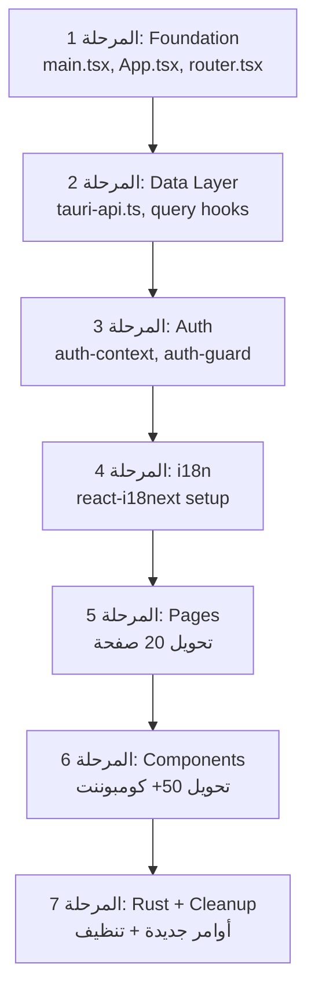

# تحويل تطبيق Desktop من Next.js إلى Tauri أصيل - الخطة النهائية

## القرارات المعتمدة

| القرار | الاختيار | السبب |
|--------|---------|-------|
| **الترجمة (i18n)** | `react-i18next` + namespace splitting | معيار الصناعة - تستخدمه Airbnb, Netflix, Uber, Shopify. أكبر ecosystem، دعم RTL ممتاز، lazy-loading |
| **URL State** | `nuqs` مع `nuqs/adapters/react-router/v6` | أفضل ممارسة 2026 - type-safe, أداء فائق, debouncing مدمج, zero bundle overhead |
| **المصادقة** | تحويل كامل لـ Tauri commands | `login` → `validate_token` → `logout` عبر IPC مباشر - صفر شبكة |
| **أوامر Rust ناقصة** | إنشاء أوامر جديدة حيث لا يوجد مقابل | مطابقة الأسماء للموجود، إنشاء جديد للناقص |
| **التصميم** | لا يتغير ملي متر واحد | نفس CSS, نفس classNames, نفس component tree |

---

## خريطة مطابقة tRPC → Tauri Commands

### ✅ أوامر موجودة (تحتاج مطابقة أسماء فقط)

| tRPC Endpoint | Tauri Command الموجود | ملاحظات |
|---------------|----------------------|---------|
| `trpc.user.me` | `validate_token` | يرجع User model |
| `trpc.user.update` | `update_user` | ✅ متطابق |
| `trpc.students.getAll` | `get_enrollments` | الطلاب = enrollments في هذا النظام |
| `trpc.students.getByClassId` | `get_enrollments` | مع `class_id` param |
| `trpc.students.getById` | `get_enrollment` | ✅ متطابق |
| `trpc.classes.getAll` | `get_classes` | ✅ متطابق |
| `trpc.classes.getById` | استخدام `get_classes` مع filter | أو إنشاء أمر جديد |
| `trpc.grades.getGridData` | `get_grades` | مع params مناسبة |
| `trpc.grades.getClassStatistics` | `get_grade_analytics` | ✅ متطابق |
| `trpc.academic.getCurrentYear` | `get_cycles` | مع `is_current: 1` |
| `trpc.academic.getYears` | `get_cycles` | ✅ متطابق |
| `trpc.reports.getSchoolMetrics` | `get_dashboard_stats` | ✅ متطابق |
| `trpc.notifications.getAll` | `get_notifications` | ✅ متطابق |
| `trpc.notifications.markRead` | `mark_notification_read` | ✅ متطابق |

### 🆕 أوامر جديدة مطلوب إنشاؤها في Rust

| tRPC Endpoint | Tauri Command جديد | Service Method المتاح |
|---------------|-------------------|----------------------|
| `trpc.subjects.getAll` | `get_subjects` | يحتاج إضافة في Service |
| `trpc.subjects.getById` | `get_subject` | يحتاج إضافة في Service |
| `trpc.subjects.create` | `create_subject` | يحتاج إضافة في Service |
| `trpc.subjects.update` | `update_subject` | يحتاج إضافة في Service |
| `trpc.subjects.delete` | `delete_subject` | يحتاج إضافة في Service |
| `trpc.academic.getTerms` | `get_terms` | يحتاج (terms = cycles بنوع فرعي أو entity مستقل) |
| `trpc.assessments.getByClass` | `get_assessments` | Entity موجود `assessment.rs` |
| `trpc.assessments.create` | `create_assessment` | يحتاج إضافة |
| `trpc.assessments.update` | `update_assessment` | يحتاج إضافة |
| `trpc.certificates.getAll` | `get_certificates` | يحتاج Service جديد |
| `trpc.certificates.getById` | `get_certificate` | يحتاج Service جديد |
| `trpc.certificates.create` | `create_certificate` | يحتاج Service جديد |
| `trpc.vault.getAll` | `get_documents` | Entity `document.rs` موجود |
| `trpc.vault.getById` | `get_document` | يحتاج أمر |
| `trpc.vault.create` | `create_document` | يحتاج أمر |
| `trpc.vault.delete` | `delete_document` | يحتاج أمر |
| `trpc.promotions.preview` | `preview_promotions` | يحتاج (يعتمد على `promote_students`) |
| `trpc.promotions.execute` | `promote_students` | ✅ موجود |
| `trpc.promotions.statistics` | `get_promotion_stats` | يحتاج إضافة |
| `trpc.widgets.getWidgetPreferences` | `get_widget_preferences` | يحتاج إضافة (يمكن تخزينه محلياً) |
| `trpc.widgets.updateWidgetPreferences` | `update_widget_preferences` | يحتاج إضافة |

> [!IMPORTANT]
> **إجمالي الأوامر الجديدة المطلوبة: ~20 أمر**  
> بعضها يمكن تنفيذه كـ local storage في Tauri (مثل widget preferences)  
> وبعضها يحتاج إضافة methods في `core-domain` Service layer

---

## مراحل التنفيذ المفصلة

### المرحلة 1: البنية التحتية (Foundation) — لا تغيير تصميم

#### [NEW] [src/main.tsx](file:///c:/Users/YZLPN3/Downloads/new/Orbis/apps/desktop/src/main.tsx)
```tsx
import React from "react";
import ReactDOM from "react-dom/client";
import { App } from "./App";
import "@/styles/globals.css";
import "@orbis/ui/globals.css";

ReactDOM.createRoot(document.getElementById("root")!).render(
  <React.StrictMode>
    <App />
  </React.StrictMode>
);
```

#### [NEW] [src/App.tsx](file:///c:/Users/YZLPN3/Downloads/new/Orbis/apps/desktop/src/App.tsx)
```tsx
import { BrowserRouter } from "react-router-dom";
import { QueryClient, QueryClientProvider } from "@tanstack/react-query";
import { NuqsAdapter } from "nuqs/adapters/react-router/v6";
import { ThemeProvider } from "@/components/theme-provider";
import { AuthProvider } from "@/contexts/auth-context";
import { I18nProvider } from "@/i18n/provider";
import { AppRouter } from "./router";
import { Toaster } from "@orbis/ui/toaster";
import { DesktopProvider } from "@/components/desktop-provider";
import { DesktopHeader } from "@/components/desktop-header";

const queryClient = new QueryClient({
  defaultOptions: {
    queries: { staleTime: 30_000, retry: 1 },
  },
});

export function App() {
  return (
    <QueryClientProvider client={queryClient}>
      <BrowserRouter>
        <NuqsAdapter>
          <I18nProvider>
            <AuthProvider>
              <ThemeProvider attribute="class" defaultTheme="system" enableSystem>
                <DesktopHeader />
                <DesktopProvider />
                <AppRouter />
                <Toaster />
              </ThemeProvider>
            </AuthProvider>
          </I18nProvider>
        </NuqsAdapter>
      </BrowserRouter>
    </QueryClientProvider>
  );
}
```

#### [NEW] [src/router.tsx](file:///c:/Users/YZLPN3/Downloads/new/Orbis/apps/desktop/src/router.tsx)
تحويل هيكل Next.js App Router إلى React Router:

```
Next.js                              →  React Router
─────────────────────────────────────────────────────
[locale]/(public)/login/page.tsx     →  /login
[locale]/(app)/(sidebar)/page.tsx    →  /
[locale]/(app)/(sidebar)/grades/     →  /grades
[locale]/(app)/(sidebar)/certificates/→  /certificates
[locale]/(app)/(sidebar)/reports/    →  /reports
[locale]/(app)/(sidebar)/reports/[Id]→  /reports/:id
[locale]/(app)/(sidebar)/vault/      →  /vault
[locale]/(app)/(sidebar)/account/    →  /account
[locale]/(app)/(sidebar)/settings/   →  /settings/*
[locale]/(app)/(editor)/certificates/→  /certificates/editor/:id
[locale]/(app)/desktop/checkout/     →  /desktop/checkout
[locale]/(app)/desktop/search/       →  /desktop/search
[locale]/export/certificate/         →  /export/certificate
```

- Next.js Layouts (`layout.tsx`) → React Router `<Outlet>` مع wrapper components
- Route Groups `(sidebar)`, `(editor)` → Nested Routes مع layout مختلف
- `[locale]` → يُحذف (اللغة تُدار بـ i18n context, ليست في URL)

---

### المرحلة 2: طبقة البيانات - Tauri Commands API

#### [NEW] [src/lib/tauri-api.ts](file:///c:/Users/YZLPN3/Downloads/new/Orbis/apps/desktop/src/lib/tauri-api.ts)

Type-safe wrapper حول كل Tauri commands:

```typescript
import { invoke } from "@tauri-apps/api/core";

// ── Typed API namespace ──────────────────────────────
export const api = {
  auth: {
    login: (email: string, password: string) =>
      invoke<LoginResponse>("login", { request: { email, password } }),
    register: (data: RegisterRequest) =>
      invoke<UserModel>("register", { request: data }),
    validateToken: (token: string) =>
      invoke<UserModel>("validate_token", { token }),
    logout: (token: string) =>
      invoke<void>("logout", { token }),
  },
  
  academics: {
    getCycles: (orgId: string, params?: CycleParams) =>
      invoke<AcademicCycle[]>("get_cycles", { orgId, params: params ?? {} }),
    getCurrentCycle: (orgId: string) =>
      invoke<AcademicCycle[]>("get_cycles", { orgId, params: { isCurrent: 1 } }),
    // ...
  },
  
  grades: {
    getGrades: (orgId: string, params: GradeParams) =>
      invoke<Grade[]>("get_grades", { orgId, params }),
    submitGrade: (orgId: string, gradedBy: string, request: CreateGradeRequest) =>
      invoke<Grade>("submit_grade", { orgId, gradedBy, request }),
    // ...
  },
  // ... باقي الأقسام
} as const;
```

#### [NEW] [src/hooks/use-tauri-query.ts](file:///c:/Users/YZLPN3/Downloads/new/Orbis/apps/desktop/src/hooks/use-tauri-query.ts)

TanStack Query wrappers للـ caching والـ optimistic updates:

```typescript
import { useQuery, useMutation, useQueryClient, useSuspenseQuery } from "@tanstack/react-query";

// ── Query Keys Factory (enterprise pattern) ──────────
export const queryKeys = {
  auth: {
    session: () => ["auth", "session"] as const,
  },
  grades: {
    all: (orgId: string) => ["grades", orgId] as const,
    grid: (params: GradeGridParams) => ["grades", "grid", params] as const,
    analytics: (orgId: string, params: any) => ["grades", "analytics", orgId, params] as const,
  },
  classes: {
    all: (orgId?: string) => ["classes", orgId] as const,
    byId: (id: string) => ["classes", "detail", id] as const,
  },
  // ... type-safe query keys per domain
} as const;
```

#### [MODIFY] [src/utils/query-invalidation.ts](file:///c:/Users/YZLPN3/Downloads/new/Orbis/apps/desktop/src/utils/query-invalidation.ts)
- استبدال `trpc.*.queryKey()` بـ `queryKeys.*` المحلي

---

### المرحلة 3: المصادقة (Auth) - Tauri Commands فقط

#### [NEW] [src/contexts/auth-context.tsx](file:///c:/Users/YZLPN3/Downloads/new/Orbis/apps/desktop/src/contexts/auth-context.tsx)

```typescript
// Enterprise-grade auth context using Tauri IPC
interface AuthState {
  user: UserModel | null;
  token: string | null;
  isLoading: boolean;
  isAuthenticated: boolean;
}

// Auto-validates token on mount via invoke("validate_token")
// Stores token in localStorage (Tauri secure storage optional)
// Provides: login(), logout(), user, isAuthenticated
```

#### [NEW] [src/hooks/use-auth.ts](file:///c:/Users/YZLPN3/Downloads/new/Orbis/apps/desktop/src/hooks/use-auth.ts)
- يستبدل كل استخدامات `authClient` من `@orbis/auth/auth-client` (~26 ملف)
- يستبدل كل استخدامات `auth.api.getSession()` من server (~3 ملفات)

#### [NEW] [src/components/auth-guard.tsx](file:///c:/Users/YZLPN3/Downloads/new/Orbis/apps/desktop/src/components/auth-guard.tsx)
- يستبدل server-side `redirect("/login")` بـ client-side guard
- يغلف الـ routes المحمية

---

### المرحلة 4: الترجمة (i18n) - react-i18next Enterprise Setup

#### [NEW] [src/i18n/index.ts](file:///c:/Users/YZLPN3/Downloads/new/Orbis/apps/desktop/src/i18n/index.ts)

```typescript
import i18n from "i18next";
import { initReactI18next } from "react-i18next";

// Lazy-loaded namespaces (enterprise pattern - Airbnb/Netflix style)
const resources = {
  ar: { translation: () => import("@/locales/ar") },
  en: { translation: () => import("@/locales/en") },
};

i18n.use(initReactI18next).init({
  lng: localStorage.getItem("locale") || "ar",
  fallbackLng: "en",
  interpolation: { escapeValue: false },
  react: { useSuspense: true },
});
```

#### [NEW] [src/i18n/provider.tsx](file:///c:/Users/YZLPN3/Downloads/new/Orbis/apps/desktop/src/i18n/provider.tsx)

#### [MODIFY] ملفات الترجمة الموجودة
- [src/locales/ar.ts](file:///c:/Users/YZLPN3/Downloads/new/Orbis/apps/desktop/src/locales/ar.ts) → `ar.json` (تحويل format)
- [src/locales/en.ts](file:///c:/Users/YZLPN3/Downloads/new/Orbis/apps/desktop/src/locales/en.ts) → `en.json` (تحويل format)

#### تحويل الاستخدام في الكومبوننتس:
```diff
- import { useI18n } from "@/locales/client";
- const t = useI18n();
+ import { useTranslation } from "react-i18next";
+ const { t } = useTranslation();
```

#### [DELETE] [src/locales/client.ts](file:///c:/Users/YZLPN3/Downloads/new/Orbis/apps/desktop/src/locales/client.ts)
#### [DELETE] [src/locales/server.ts](file:///c:/Users/YZLPN3/Downloads/new/Orbis/apps/desktop/src/locales/server.ts)

---

### المرحلة 5: تحويل الصفحات (Pages)

**القاعدة لكل صفحة:**
1. ❌ حذف `export const metadata` (Next.js SEO) → استبدال بـ `document.title = "..."` في `useEffect`
2. ❌ حذف `async function Page` → تحويل لـ React component عادي
3. ❌ حذف `HydrateClient` wrapper
4. ❌ حذف `headers()`, `cookies()`, `redirect()`, `await params`
5. ✅ إضافة `useTauriQuery()` بدل `queryClient.fetchQuery(trpc.*)`
6. ✅ نفس JSX بالضبط — لا تغيير تصميم

**مثال تحويل الصفحة الرئيسية:**

```diff
- import type { Metadata } from "next";
- import type { SearchParams } from "nuqs";
- import { getQueryClient, HydrateClient, trpc } from "@/trpc/server";
+ import { useTauriQuery } from "@/hooks/use-tauri-query";
+ import { useAuth } from "@/hooks/use-auth";

- export const metadata: Metadata = { title: "Overview | Orbis" };

- export default async function Page(props: Props) {
-   const searchParams = await props.searchParams;
-   const queryClient = getQueryClient();
-   const widgetPreferences = await queryClient.fetchQuery(
-     trpc.widgets.getWidgetPreferences.queryOptions()
-   );
+ export default function OverviewPage() {
+   const { user } = useAuth();
+   const { data: widgetPreferences } = useTauriQuery(
+     "get_widget_preferences", { userId: user.id }
+   );

    return (
-     <HydrateClient>
        <Widgets
          initialPreferences={widgetPreferences}
-         weeklyCalendar={weeklyCalendar}
+         weeklyCalendar={localStorage.getItem("weeklyCalendar") === "true"}
        />
-     </HydrateClient>
    );
  }
```

---

### المرحلة 6: تحويل الكومبوننتس

#### 6A. استبدال `useTRPC()` (~50+ كومبوننت)

كل كومبوننت يحتوي على:
```typescript
const trpc = useTRPC();
const { data } = useQuery(trpc.X.Y.queryOptions(params));
```
يتحول إلى:
```typescript
const { data } = useTauriQuery(queryKeys.X.Y(params), () => api.X.Y(params));
```

#### 6B. استبدال `useAction` من `next-safe-action` (~10 ملفات)

| ملف | الـ action الحالي | البديل |
|-----|-----------------|--------|
| [feedback-form.tsx](file:///c:/Users/YZLPN3/Downloads/new/Orbis/apps/desktop/src/components/feedback-form.tsx) | `useAction(sendFeedback)` | `useTauriMutation("submit_feedback")` |
| [tracker-calendar-type.tsx](file:///c:/Users/YZLPN3/Downloads/new/Orbis/apps/desktop/src/components/tracker-calendar-type.tsx) | `useAction(changeCalendarType)` | Local state / localStorage |
| [support-form.tsx](file:///c:/Users/YZLPN3/Downloads/new/Orbis/apps/desktop/src/components/support-form.tsx) | `useAction(sendSupport)` | `useTauriMutation("submit_support")` |
| [grade-grid-wrapper.tsx](file:///c:/Users/YZLPN3/Downloads/new/Orbis/apps/desktop/src/components/grades/grade-grid-wrapper.tsx) | `useAction(saveGrades)` | `useTauriMutation("submit_grades_bulk")` |
| [assessments-form.tsx](file:///c:/Users/YZLPN3/Downloads/new/Orbis/apps/desktop/src/components/forms/assessments-form.tsx) | `useAction(saveAssessment)` | `useTauriMutation("create_assessment")` |
| + 5 ملفات أخرى | | |

#### 6C. استبدال `authClient` (~26 ملف)

```diff
- import { authClient } from "@orbis/auth/auth-client";
- const { data: session } = authClient.useSession();
+ import { useAuth } from "@/hooks/use-auth";
+ const { user } = useAuth();
```

#### 6D. تحويل `nuqs` adapter

```diff
// في App.tsx فقط - تغيير adapter واحد
- import { NuqsAdapter } from "nuqs/adapters/next/app";
+ import { NuqsAdapter } from "nuqs/adapters/react-router/v6";
```

> [!TIP]
> جميع hooks الـ `nuqs` في [src/hooks/](file:///c:/Users/YZLPN3/Downloads/new/Orbis/apps/desktop/src/hooks) (~40+ ملف) **لا تحتاج تغيير!**
> فقط الـ adapter في الـ root يتغير. الـ `useQueryState` و `useQueryStates` تعمل بنفس الطريقة.

---

### المرحلة 7: أوامر Rust الجديدة + التنظيف

#### [NEW] Rust commands to add in `src-tauri/src/commands/`:

##### [NEW] `subjects.rs`
```rust
// get_subjects, get_subject, create_subject, update_subject, delete_subject
```

##### [NEW] `assessments.rs`  
```rust
// get_assessments, create_assessment, update_assessment, delete_assessment
```

##### [NEW] `documents.rs` (Vault)
```rust
// get_documents, get_document, create_document, delete_document, update_document
```

##### [NEW] `certificates.rs`
```rust
// get_certificates, get_certificate, create_certificate, update_certificate
```

##### [NEW] `widgets.rs` (Local Storage approach)
```rust
// get_widget_preferences, update_widget_preferences
// يخزن في ملف JSON محلي بدلاً من database
```

##### [MODIFY] [commands/mod.rs](file:///c:/Users/YZLPN3/Downloads/new/Orbis/apps/desktop/src-tauri/src/commands/mod.rs)
```diff
  pub mod error;
  pub mod auth;
  pub mod users;
  pub mod academics;
  pub mod enrollments;
  pub mod grades;
  pub mod attendance;
  pub mod finance;
  pub mod misc;
+ pub mod subjects;
+ pub mod assessments;
+ pub mod documents;
+ pub mod certificates;
+ pub mod widgets;
```

##### [MODIFY] [lib.rs](file:///c:/Users/YZLPN3/Downloads/new/Orbis/apps/desktop/src-tauri/src/lib.rs)
- إضافة الأوامر الجديدة في `invoke_handler`

#### التنظيف النهائي

##### [DELETE] الملفات:
```
src/app/global-error.tsx                    ← Next.js global error
src/app/[locale]/error.tsx                  ← Next.js error page
src/app/[locale]/not-found.tsx              ← Next.js 404
src/app/[locale]/layout.tsx                 ← Next.js root layout (يُنقل إلى App.tsx)
src/app/[locale]/providers.tsx              ← يُنقل إلى App.tsx
src/locales/client.ts                       ← next-international client
src/locales/server.ts                       ← next-international server
src/app/favicon.ico                         ← يُنقل إلى public/
```

##### [MODIFY] [package.json](file:///c:/Users/YZLPN3/Downloads/new/Orbis/apps/desktop/package.json)
```diff
  "dependencies": {
+   "i18next": "^24.x",
+   "react-i18next": "^15.x",
+   "i18next-browser-languagedetector": "^8.x",
-   "@trpc/client": "^11.8.1",
-   "@trpc/server": "^11.9.0",
-   "@trpc/tanstack-react-query": "^11.8.1",
-   "next-international": "1.3.1",
-   "@orbis/auth": "workspace:*",         ← server-side auth
    "next-themes": "^0.4.6",              ← يبقى (يعمل مع Vite بدون مشاكل)
    "nuqs": "^2.8.3",                     ← يبقى (adapter يتغير فقط)
  }
```

---

## ترتيب العمل (Execution Order)



---

## ضمان عدم تغيير التصميم

> [!CAUTION]
> **القاعدة الذهبية: الـ JSX و CSS لا يتغيران أبداً**
> 
> كل التغييرات هي في:
> 1. **الـ imports** (من أين نجلب الدوال)
> 2. **الـ data fetching** (كيف نجلب البيانات)  
> 3. **الـ function signatures** (async server → sync client component)
> 4. **الـ wrappers** (إزالة `HydrateClient`, `NuqsAdapter` adapter change)
>
> **لا يتغير:**
> - أي `className`
> - أي CSS file
> - أي JSX structure
> - أي component tree hierarchy
> - أي animation أو transition

---

## Verification Plan

### Automated Tests
```bash
# 1. بناء Frontend
cd apps/desktop && bun run build

# 2. التأكد من إزالة كل بقايا Next.js
grep -r "from \"next\"" src/ --include="*.tsx" --include="*.ts" | wc -l  # يجب = 0
grep -r "from \"next/" src/ --include="*.tsx" --include="*.ts" | wc -l   # يجب = 0
grep -r "next-international" src/ --include="*.tsx" --include="*.ts" | wc -l  # يجب = 0
grep -r "next-safe-action" src/ --include="*.tsx" --include="*.ts" | wc -l   # يجب = 0
grep -r "@/trpc" src/ --include="*.tsx" --include="*.ts" | wc -l  # يجب = 0
grep -r "@orbis/auth\"" src/ --include="*.tsx" --include="*.ts" | wc -l  # يجب = 0

# 3. بناء Tauri
cd src-tauri && cargo check
```

### Manual Verification
1. تشغيل `bun run tauri:dev`
2. فتح صفحة Login → تسجيل دخول عبر Tauri command
3. التنقل بين كل الصفحات (router يعمل)
4. تغيير اللغة ar ↔ en (i18n يعمل)
5. Dark/Light mode (theme يعمل)
6. جلب بيانات من كل الأقسام (Tauri IPC يعمل)
7. **مقارنة screenshots مع التصميم الأصلي - يجب تطابق 100%**
