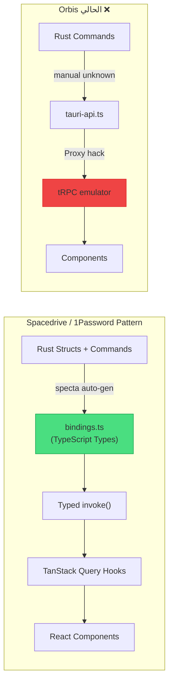

# إعادة هيكلة تطبيق Orbis Desktop — أفضل ممارسات 2026 (النسخة المُصحّحة)

## تشخيص المشاكل الحالية

بعد تحليل المشروع بالكامل + دراسة ما تفعله التطبيقات العالمية الكبيرة فعلاً (Spacedrive, 1Password, Linear, VS Code)، إليك المشاكل الجوهرية مرتبة بالأهمية:

### 🔴 مشاكل حرجة (Anti-Patterns)

| # | المشكلة | الموقع | لماذا هي anti-pattern؟ |
|---|---------|--------|----------------------|
| 1 | **خادم Axum HTTP مضمّن** يعمل بالتوازي مع IPC | [lib.rs:333-335](file:///c:/Users/YZLPN3/Downloads/new/Orbis/apps/desktop/src-tauri/src/lib.rs#L333-L335) | يفتح منفذ شبكي (3002) داخل تطبيق desktop — ثغرة أمنية + تكرار وظيفي. Tauri مُصمّم لـ IPC فقط |
| 2 | **محاكي tRPC بـ Proxy** — 235 سطر | [trpc/client.ts](file:///c:/Users/YZLPN3/Downloads/new/Orbis/apps/desktop/src/trpc/client.ts) | يبني واجهة tRPC وهمية فوق `invoke()` بدون type safety حقيقي |
| 3 | **كل أنواع IPC = `unknown`** | [tauri-api.ts](file:///c:/Users/YZLPN3/Downloads/new/Orbis/apps/desktop/src/lib/tauri-api.ts) | 358 سطر من `invoke<unknown>` — لا أمان أنواع من Rust إلى TypeScript |
| 4 | **`"use client"` في ~295 ملف** Vite | grep results | هذه directive لـ Next.js RSC. في Vite+Tauri لا معنى لها |

### 🟡 مشاكل معمارية

| # | المشكلة | التفاصيل |
|---|---------|----------|
| 5 | **Layer-based structure** (145 component + 75 hook في مجلدات عملاقة) | الشركات الكبيرة تستخدم Feature-based modules |
| 6 | **10 فحوصات `typeof window === "undefined"`** | أنماط SSR لا معنى لها في Tauri |
| 7 | **`AuthContext` كـ Provider** | يمكن استبدالها بـ Zustand store بدون provider |
| 8 | **`next-international` كـ dependency** | مكتبة Next.js، المستخدم فعلاً هو `react-i18next` |

---

## ماذا تفعل التطبيقات العالمية الكبيرة فعلاً؟



### المبادئ المعمارية من Spacedrive / 1Password / Linear:

1. **`specta` / `tauri-specta`** — توليد أنواع TypeScript تلقائياً من Rust structs. **ليس أنواع يدوية**.
2. **IPC فقط** — بدون خادم HTTP مضمّن. Tauri IPC أسرع وأأمن.
3. **Feature-based modules** — ليس `components/` بـ 145 ملف، بل `features/grades/`, `features/certificates/`...
4. **Tauri v2 Events** — اتصال ثنائي الاتجاه (Backend → Frontend) للإشعارات والمزامنة.
5. **CQRS-lite** — فصل واضح: Queries (useQuery) vs Mutations (useMutation).
6. **Minimal Provider tree** — لكن ليس "provider واحد" (كما قلت خطأً). الحد الأدنى الصحيح هو 3.

---

## التصحيحات على الخطة الأولى

> [!WARNING]
> ### تصحيح 1: لا يمكن اختزال Providers إلى واحد
> قلت سابقاً "QueryClientProvider فقط" — هذا **خطأ**. الحد الأدنى الضروري:
> - `QueryClientProvider` — مطلوب من TanStack Query
> - `BrowserRouter` — مطلوب من react-router-dom
> - `I18nextProvider` — مطلوب من react-i18next
>
> **ما يُحذف فعلاً**: `AuthProvider` (→ Zustand)، `NuqsAdapter`، `ThemeProvider` context (→ Zustand)

> [!WARNING]
> ### تصحيح 2: `nuqs` ليس مخصصاً لـ Next.js فقط
> `nuqs` يدعم React Router v6/v7 رسمياً عبر adapters. التطبيق يستخدمه في **~40 hook** لإدارة URL params. **الإبقاء عليه أفضل** من إعادة كتابة 40 hook بـ `useSearchParams`.

> [!IMPORTANT]
> ### إضافة مهمة: `tauri-specta` لتوليد الأنواع تلقائياً
> هذا هو **الفرق الأكبر** بين خطتي الأولى والممارسات الفعلية. بدل كتابة `ipc/types.ts` يدوياً، نستخدم `specta` لتوليد `bindings.ts` تلقائياً من Rust — كما يفعل Spacedrive.

> [!IMPORTANT]
> ### إضافة مهمة: حذف خادم Axum HTTP المضمّن
> هذا anti-pattern لم أذكره في الخطة الأولى. التطبيق يشغّل خادم HTTP كامل على port 3002 بالتوازي مع IPC — وهذا تكرار وظيفي وثغرة أمنية.

---

## الخطة المُحدّثة

### المرحلة 1: `tauri-specta` — Type Safety من Rust إلى TypeScript ⭐

> هذا هو التغيير الأهم. بدله **كل شيء يتغير**.

#### [MODIFY] [Cargo.toml](file:///c:/Users/YZLPN3/Downloads/new/Orbis/apps/desktop/src-tauri/Cargo.toml)
إضافة `specta` و `tauri-specta`:
```toml
[dependencies]
specta = { version = "=2.0.0-rc.25", features = ["derive", "function"] }
tauri-specta = { version = "=2.0.0-rc.25", features = ["typescript"] }
```

#### [MODIFY] جميع Rust structs في `src-tauri/src/commands/`
إضافة `#[derive(specta::Type)]` و `#[specta::specta]`:

```rust
// قبل
#[tauri::command]
fn get_classes(state: State<Arc<AppState>>, org_id: String) -> Result<Vec<serde_json::Value>, String> {
    // ...
}

// بعد
#[derive(Serialize, Deserialize, specta::Type)]
pub struct Class {
    pub id: String,
    pub name: String,
    pub level: String,
    // ...
}

#[tauri::command]
#[specta::specta]
fn get_classes(state: State<Arc<AppState>>, org_id: String) -> Result<Vec<Class>, String> {
    // ...
}
```

#### [MODIFY] [lib.rs](file:///c:/Users/YZLPN3/Downloads/new/Orbis/apps/desktop/src-tauri/src/lib.rs)
إضافة توليد bindings تلقائي:
```rust
#[cfg(debug_assertions)]
{
    tauri_specta::ts::builder()
        .commands(tauri_specta::collect_commands![
            // جميع الأوامر...
        ])
        .path("../src/bindings.ts")
        .export_consts()
        .build()
        .expect("Failed to generate TypeScript bindings");
}
```

#### [AUTO-GENERATED] `apps/desktop/src/bindings.ts`
يُولّد تلقائياً عند كل `cargo build` في debug mode. يحتوي:
- أنواع TypeScript مطابقة 1:1 لـ Rust structs
- دوال `invoke` مكتوبة بالأنواع الكاملة
- لا `unknown` أبداً

**الملفات المتأثرة في Rust**: 15 ملف في `src-tauri/src/commands/`

---

### المرحلة 2: حذف خادم Axum HTTP المضمّن

#### [MODIFY] [lib.rs](file:///c:/Users/YZLPN3/Downloads/new/Orbis/apps/desktop/src-tauri/src/lib.rs)
حذف الأسطر 331-335:
```rust
// حذف هذا ❌
let db_url_clone = database_url.clone();
tauri::async_runtime::spawn(async move {
    let _ = api_gateway::start_server(&db_url_clone, 3002).await;
});
```

#### [MODIFY] [Cargo.toml](file:///c:/Users/YZLPN3/Downloads/new/Orbis/apps/desktop/src-tauri/Cargo.toml)
حذف dependency:
```diff
-api-gateway = { package = "api-gateway", path = "../../api-rust/crates/api-gateway" }
```

#### [MODIFY] [tauri.conf.json](file:///c:/Users/YZLPN3/Downloads/new/Orbis/apps/desktop/src-tauri/tauri.conf.json) و capabilities
حذف remote URLs التي كانت تشير لخادم HTTP المحلي (`localhost:3002`)

#### [MODIFY] [auth-client.ts](file:///c:/Users/YZLPN3/Downloads/new/Orbis/apps/desktop/src/lib/auth-client.ts)
تبسيط — لم يعد هناك حاجة لـ HTTP fallback. كل شيء عبر IPC.

---

### المرحلة 3: حذف محاكي tRPC واستبداله بـ bindings مولّدة

#### [DELETE] `apps/desktop/src/trpc/` (المجلد بالكامل)
محاكي tRPC بـ 235 سطر — يُستبدل بـ `bindings.ts` المولّد تلقائياً.

#### [DELETE] `apps/desktop/src/lib/tauri-api.ts`
طبقة `invoke<unknown>` بـ 358 سطر — يُستبدل بالـ bindings.

#### [NEW] `apps/desktop/src/ipc/index.ts`
تصدير مركزي لـ bindings + query hooks:
```typescript
// Re-export typed commands from auto-generated bindings
export { commands } from '@/bindings';
export type { Class, Enrollment, Grade, ... } from '@/bindings';
```

#### [NEW] `apps/desktop/src/ipc/query-keys.ts`
Query key factory (نفس المحتوى الجيد الحالي، مُعاد تنظيمه).

#### تحديث ~130 ملف يستخدم `useTRPC()` أو `api.*`
```typescript
// قبل ❌
const trpc = useTRPC();
const { data } = useQuery(trpc.classes.getAll.queryOptions());

// بعد ✅ (مع specta bindings)
import { commands } from '@/bindings';
const { data } = useQuery({
    queryKey: queryKeys.classes.all(orgId),
    queryFn: () => commands.getClasses(orgId),
});
```

---

### المرحلة 4: تنظيم Feature-Based (اختياري لكن مُوصى به بشدة)

> [!IMPORTANT]
> هذا تغيير هيكلي كبير. يمكن تأجيله للمرحلة التالية إذا أردت تقليل حجم التغيير.

#### الهيكل الحالي (Layer-based) ❌:
```
src/
  components/    → 145 ملف مسطّح!
  hooks/         → 75 ملف مسطّح!
  pages/
  store/
  lib/
```

#### الهيكل المقترح (Feature-based) ✅:
```
src/
  features/
    grades/
      components/     → grade-grid, grade-actions, ...
      hooks/          → use-grades, use-grade-filter-params
      queries.ts      → useGrades(), useGradeAnalytics()
      mutations.ts    → useSubmitGrade(), useSubmitGradesBulk()
      store.ts        → grades zustand store
    attendance/
      components/
      hooks/
      queries.ts
      mutations.ts
    certificates/
      ...
    vault/
      ...
    finance/
      ...
    settings/
      ...
  shared/
    components/       → error-boundary, portal, load-more
    hooks/            → use-debounce, use-local-storage
    utils/
  app/
    router.tsx
    providers.tsx
    App.tsx
  ipc/
    bindings.ts       → auto-generated
    query-keys.ts
    index.ts
  store/
    auth.ts           → Zustand
    theme.ts          → Zustand
```

---

### المرحلة 5: تبسيط Providers

#### [MODIFY] [App.tsx](file:///c:/Users/YZLPN3/Downloads/new/Orbis/apps/desktop/src/App.tsx)

```tsx
// قبل — 6 providers متداخلة ❌
<QueryClientProvider>
  <BrowserRouter>
    <NuqsAdapter>
      <I18nProvider>
        <AuthProvider>          // ← حذف (→ Zustand)
          <ThemeProvider>       // ← حذف (→ Zustand)
            <DesktopHeader />
            <DesktopProvider />
            <AppRouter />
            <Toaster />
          </ThemeProvider>
        </AuthProvider>
      </I18nProvider>
    </NuqsAdapter>
  </BrowserRouter>
</QueryClientProvider>

// بعد — 4 providers (الحد الأدنى الضروري) ✅
<QueryClientProvider client={queryClient}>
  <BrowserRouter>
    <NuqsAdapter>
      <I18nProvider>
        <DesktopShell />       // ← يحتوي header + provider + router + toaster
      </I18nProvider>
    </NuqsAdapter>
  </BrowserRouter>
</QueryClientProvider>
```

#### [DELETE] `apps/desktop/src/contexts/auth-context.tsx`
#### [NEW] `apps/desktop/src/store/auth.ts` — Zustand store
```typescript
import { create } from 'zustand';
import { commands } from '@/bindings';

interface AuthState {
  user: User | null;
  isLoading: boolean;
  isAuthenticated: boolean;
  login: (email: string, password: string) => Promise<void>;
  logout: () => Promise<void>;
  validateSession: () => Promise<void>;
}

export const useAuthStore = create<AuthState>((set) => ({
  // ... direct IPC calls, no context needed
}));
```

#### [DELETE] `apps/desktop/src/components/theme-provider.tsx` (Context)
#### [NEW] `apps/desktop/src/store/theme.ts` — Zustand store
Theme يُطبّق على DOM عبر `subscribe` في Zustand — لا يحتاج Provider.

---

### المرحلة 6: Tauri v2 Events (اتصال ثنائي الاتجاه)

#### [NEW] `apps/desktop/src/ipc/events.ts`
```typescript
import { listen } from '@tauri-apps/api/event';

// Backend → Frontend events (typed via specta)
export function onSyncStatusChanged(handler: (status: SyncStatus) => void) {
  return listen<SyncStatus>('sync-status-changed', (event) => handler(event.payload));
}

export function onNotificationReceived(handler: (notification: Notification) => void) {
  return listen<Notification>('notification-received', (event) => handler(event.payload));
}
```

#### [MODIFY] Rust backend
إضافة `app.emit()` في المواقع المناسبة لدفع التحديثات بدل polling.

---

### المرحلة 7: تنظيف أنماط Next.js

#### إزالة `"use client"` من ~295 ملف
```bash
# عملية آلية بسيطة
```

#### إزالة `typeof window === "undefined"` من ~10 ملفات
هذه فحوصات SSR — في Tauri `window` موجود دائماً.

#### حذف dependency `next-international` من package.json
المستخدم فعلاً هو `react-i18next`.

#### إزالة `@trpc/client`, `@trpc/server`, `@trpc/tanstack-react-query`

---

## مقارنة: الخطة الأولى vs الخطة المُصحّحة

| النقطة | الخطة الأولى | المُصحّحة | السبب |
|--------|-------------|-----------|-------|
| Type Safety | كتابة `ipc/types.ts` يدوياً | **`specta` auto-generation** | الممارسة الفعلية لـ Spacedrive/1Password |
| خادم HTTP المضمّن | لم أذكره | **حذفه** | anti-pattern أمني + تكرار وظيفي |
| Providers | "واحد فقط" | **4 (الحد الأدنى)** | لا يمكن حذف BrowserRouter/I18next/QueryClient |
| nuqs | "حذفه" | **الإبقاء عليه** | يدعم React Router رسمياً، مستخدم في ~40 hook |
| هيكل الملفات | نفس Layer-based | **Feature-based** | ما تفعله الشركات الكبيرة فعلاً |
| Tauri Events | لم أذكرها | **إضافتها** | اتصال ثنائي الاتجاه — ميزة أساسية في Tauri v2 |

---

## أسئلة مفتوحة

> [!IMPORTANT]
> **1. أولوية التنفيذ**: المرحلة 4 (Feature-based organization) هي الأكبر حجماً (~300 ملف يتحرك). هل تريد:
> - **(أ)** تنفيذها ضمن هذه الهيكلة (تغيير شامل مرة واحدة)
> - **(ب)** تأجيلها وتنفيذ المراحل 1-3 + 5-7 أولاً (أصغر حجماً، أقل مخاطرة)

> [!IMPORTANT]
> **2. حذف خادم Axum المضمّن**: هل هناك سبب لوجوده غير development mode؟ إذا كان يُستخدم في production أو كـ fallback، يجب فهم السبب قبل حذفه.

> [!IMPORTANT]
> **3. Rust structs الحالية**: الـ commands الحالية تُرجع `serde_json::Value` (أي JSON عام). لاستخدام `specta`، يجب تحويلها إلى structs مكتوبة بالأنواع. هذا تغيير في Rust backend — هل هذا مقبول؟

> [!WARNING]
> **4. حزمة `@orbis/desktop-client`**: بعد هذه التغييرات ستبقى فقط `platform.ts`. هل نبقيها كحزمة منفصلة أم ننقلها إلى `apps/desktop/src/lib/`؟

---

## خطة التحقق

### اختبارات آلية
```bash
# التحقق من الأنواع (بعد specta generation)
cd apps/desktop && npx tsc --noEmit

# بناء Frontend
cd apps/desktop && bun run build

# بناء Rust + توليد bindings
cd apps/desktop/src-tauri && cargo build

# التأكد من عدم وجود tRPC imports متبقية
grep -r "useTRPC\|@trpc\|trpc/" apps/desktop/src/
```

### تحقق يدوي
- تسجيل الدخول عبر IPC (بدون HTTP)
- التنقل بين جميع الصفحات
- Deep links (`orbis://...`)
- Global shortcut (Shift+Alt+K)
- System tray
