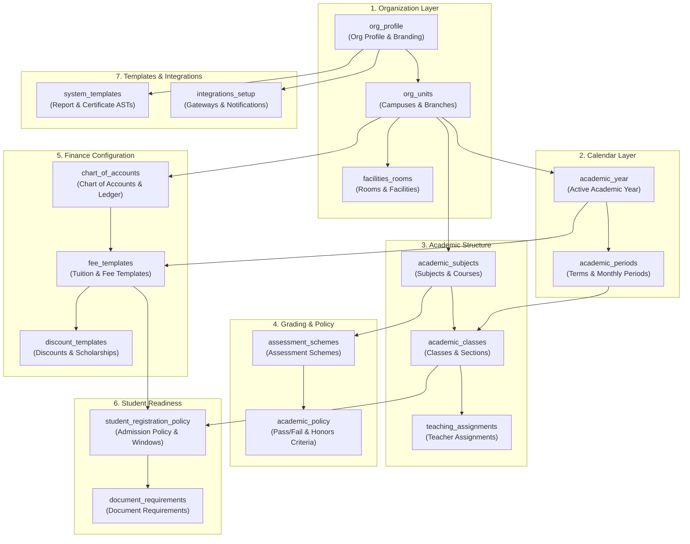

# Onboarding Dependency Graph & Evaluation Engine

**Project:** Orbis ERP / SIS  
**Document:** Onboarding Dependency Graph (`docs/onboarding_dependency_graph.md`)  
**Status:** Canonical Reference Specification  
**Date:** 2026-10-01  

---

## 1. Directed Acyclic Graph (DAG) Visualization

The Orbis onboarding task graph enforces operational dependencies so administrators cannot jump ahead into operations that lack foundational prerequisite configuration.

---

## 2. Dynamic Status Resolution Algorithm

For every task $T$ in the catalog:

1. **Check Applicability:** If $T$ is not applicable to the active `InstitutionType` / `InstitutionBlueprint`, return status `NOT_APPLICABLE`.
2. **Check Unmet Dependencies:** For each prerequisite task ID $P \in \text{dependencies}(T)$:
   - Evaluate completion of $P$.
   - If $P$ is not completed, $T$ is flagged as `BLOCKED`, and a localized `blocking_reason` is attached (e.g. *"Waiting for Academic Year to be created"*).
3. **Evaluate Backend Database Invariants:**
   - Execute precise, optimized count and predicate queries against real database tables (`academic_years`, `academic_periods`, `classes`, `subjects`, `assessment_schemes`, `fee_templates`, `accounts`, `rooms`, `documents`).
   - If the criteria are fully met, return `COMPLETED` with `progress = 100`.
   - If partial records exist (e.g. Year created but no terms), return `IN_PROGRESS` with fractional progress.
   - If no records exist and dependencies are met, return `NOT_STARTED` (or `OPTIONAL` if optional).

---

## 3. Readiness Calculation & Readiness State

An institution transitions to `READY_FOR_OPERATIONS` when:
$$\sum_{T \in \text{Required Tasks}} (\text{status}(T) == \text{COMPLETED}) = |\text{Required Tasks}|$$

Overall progress is computed authoritatively as:
$$\text{Progress} = \left\lfloor \frac{\sum_{T} \text{progress}(T)}{|\text{Applicable Tasks}|} \right\rfloor$$

$$\text{Required Progress} = \left\lfloor \frac{\sum_{T \in \text{Required}} \text{progress}(T)}{|\text{Required Tasks}|} \right\rfloor$$
