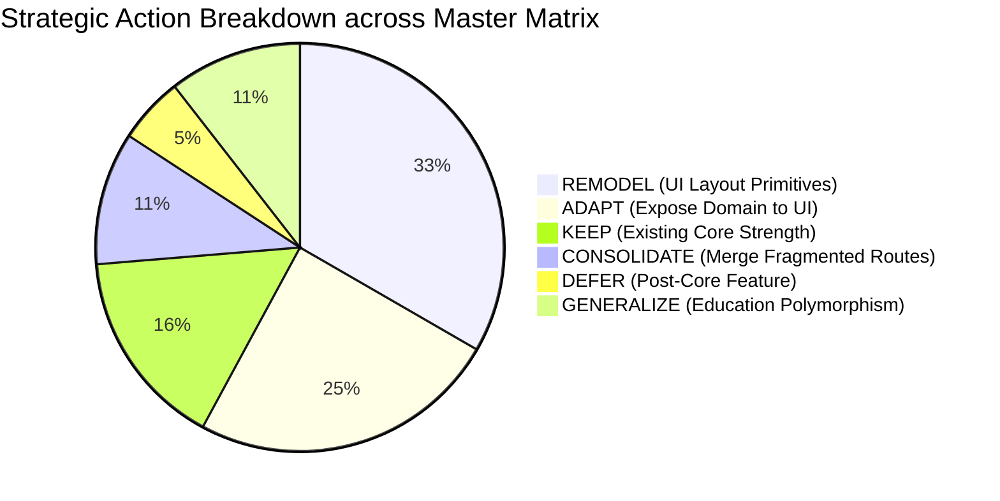

# Orbis vs Competitor Comprehensive Gap Matrix & Master Matrix

> **Document Type:** Master Comparison Matrix & Functional Gap Analysis  
> **Status:** Verified Master Matrix Complete (`ANALYSIS_COMPLETE`)  
> **Primary Sources:** `docs/competitor_visual_ux_analysis.md`, `docs/comp_content.txt`, `ARCHITECTURE_HANDOFF.md`, Orbis Workspace Codebase  
> **Scope:** Full 12-Module Master Matrix across all 21 Required Dimensions  

---

## 1. Executive Summary & Master Matrix Framework

This Master Matrix establishes the exhaustive 21-column comparative analysis between the competitor system (*Ebda'a Soft Schools System*) and the current Orbis implementation.

### Legend of Classification & Confidence:
- **[OBSERVED]:** Directly inspected in competitor documentation screenshots or text.
- **[DOCUMENTED]:** Explicitly documented in competitor user guide pages.
- **[VERIFIED]:** Verified in active Orbis Rust backend or Svelte 5 frontend code.
- **[INFERRED]:** Inferred from standard ERP operational behavior.
- **[RECOMMENDATION]:** Target architectural design for Orbis.

---

## 2. Comprehensive 21-Column Master Matrix

### Module 1: System Management, Security & Database Administration

| # | Column 1-4: Module, Screen, Competitor Behavior, Configuration | Column 5-7: Personalization, Permissions, Data Relationships | Column 8-9: Workflow & UI Pattern | Column 10-13: Orbis Current (Impl, API, Domain, DB) | Column 14-16: Orbis UI, Personalization, Permissions | Column 17-21: Gap, Gap Type, Action, Priority, Confidence |
|---|---|---|---|---|---|---|
| **M1-1** | **Module:** System Management **Screen:** Database Settings & Backup (`SCR-001` - `SCR-005`) **Comp. Behavior:** Creates, opens, backs up (`.bak`), restores Microsoft SQL Server databases. **Comp. Config:** SQL Server connection string, server host, auth mode. | **Comp. Pers:** Remembers last opened DB path. **Comp. Perm:** SuperAdmin only. **Comp. Rel:** Master system database $\rightarrow$ tenant databases. | **Comp. Workflow:** Manual or scheduled `.bak` file generation. **Comp. UI:** Service Dialog with progress bar (`p.21-27`). | **Orbis Impl:** Dual-database: SQLite for local desktop; PostgreSQL for cloud multi-tenant. **Orbis API:** Tauri native IPC & CLI. **Orbis Domain:** Migration engine. **Orbis DB:** SeaORM automated migrator. | **Orbis UI:** Desktop system tray & status indicator. **Orbis Pers:** Local Tauri store remembers database path. **Orbis Perm:** System administrator role. | **Gap:** Orbis lacks visual in-app backup/restore GUI in desktop settings. **Gap Type:** UI / Utility. **Action:** ADAPT (`backup-cli-dialog.svelte`). **Priority:** Medium. **Confidence:** [DOCUMENTED] / [VERIFIED]. |
| **M1-2** | **Module:** System Management **Screen:** User Directory & Groups (`SCR-006`, `SCR-007`) **Comp. Behavior:** Manages operators, links to user groups, assigns allowed branches checklist. **Comp. Config:** Group membership, branch permissions. | **Comp. Pers:** Remembers last filtered group. **Comp. Perm:** Admin permission to manage users. **Comp. Rel:** `User` $\rightarrow$ `UserGroup` $\rightarrow$ `Branch`. | **Comp. Workflow:** Create group $\rightarrow$ assign permissions $\rightarrow$ create user $\rightarrow$ assign branch access. **Comp. UI:** Simple Form + Grid (`p.28-30`). | **Orbis Impl:** IAM domain with full user registration, TOTP MFA, multi-device tracking. **Orbis API:** `/api/v1/iam/*`. **Orbis Domain:** `User`, `Person`, `Role`, `UserDevice`. **Orbis DB:** `users`, `roles`, `user_roles`. | **Orbis UI:** `settings/users/` + `users-directory.svelte`. **Orbis Pers:** None persisted. **Orbis Perm:** `iam:user:write` checked via `PermissionCheckerPort`. | **Gap:** Orbis has superior security (MFA/JWT) but lacks explicit User Group abstraction (roles are fixed enums). **Gap Type:** Domain / UI. **Action:** ADAPT (Add custom role groups). **Priority:** High. **Confidence:** [OBSERVED] / [VERIFIED]. |
| **M1-3** | **Module:** System Management **Screen:** Permissions Matrix (`SCR-010`) **Comp. Behavior:** 2D grid mapping Screen $\times$ 6 Actions (View, Add, Edit, Delete, Search, Print) scoped by Branch. **Comp. Config:** Branch-specific permission overrides. | **Comp. Pers:** Remembers last selected user/group. **Comp. Perm:** SuperAdmin only. **Comp. Rel:** `User`/`Group` $\times$ `Screen` $\times$ `Action` $\times$ `Branch`. | **Comp. Workflow:** Select user $\rightarrow$ toggle action checkboxes $\rightarrow$ save snapshot. **Comp. UI:** Advanced Split Panel (Tree left, Matrix right) (`p.34`). | **Orbis Impl:** String-based permissions (`academic:class:write`). **Orbis API:** `/api/v1/auth/permissions`. **Orbis Domain:** `PermissionCheckerPort`. **Orbis DB:** `permissions`, `role_permissions`. | **Orbis UI:** `settings/permissions/+page.svelte` (list toggles). **Orbis Pers:** None persisted. **Orbis Perm:** `iam:permission:manage`. | **Gap:** Orbis lacks 2D visual matrix and branch-scoped permission delegation. **Gap Type:** UI / UX. **Action:** REMODEL (`PermissionMatrixView`). **Priority:** High. **Confidence:** [OBSERVED] / [VERIFIED]. |
| **M1-4** | **Module:** System Management **Screen:** Operation Locking (`SCR-008`) **Comp. Behavior:** Freezes financial and academic modifications prior to a specified cutoff date. **Comp. Config:** Module lock date per branch. | **Comp. Pers:** None. **Comp. Perm:** Admin only. **Comp. Rel:** `Branch` $\rightarrow$ `Module` $\rightarrow$ `LockDate`. | **Comp. Workflow:** Select module $\rightarrow$ enter lock date $\rightarrow$ transactions prior to date rejected. **Comp. UI:** Simple Form + Grid (`p.31`). | **Orbis Impl:** `usePeriodGate` frontend utility + Autopilot policy engine. **Orbis API:** `/api/v1/academic-periods/*`. **Orbis Domain:** `PeriodState::Closed`. **Orbis DB:** `academic_periods.status`. | **Orbis UI:** `<PeriodGateAction>` wrapper. **Orbis Pers:** None. **Orbis Perm:** `admin:period:lock`. | **Gap:** Competitor allows arbitrary date locks per module; Orbis locks by academic period. **Gap Type:** Domain / Workflow. **Action:** ADAPT (Add explicit fiscal cutoff date). **Priority:** Medium. **Confidence:** [DOCUMENTED] / [VERIFIED]. |

---

### Module 2: System Settings & General Institution Setup

| # | Column 1-4: Module, Screen, Competitor Behavior, Configuration | Column 5-7: Personalization, Permissions, Data Relationships | Column 8-9: Workflow & UI Pattern | Column 10-13: Orbis Current (Impl, API, Domain, DB) | Column 14-16: Orbis UI, Personalization, Permissions | Column 17-21: Gap, Gap Type, Action, Priority, Confidence |
|---|---|---|---|---|---|---|
| **M2-1** | **Module:** System Setup **Screen:** System Settings Hierarchy (`SCR-012`) **Comp. Behavior:** 3-tier cascading configuration (Global $\rightarrow$ Role $\rightarrow$ Branch $\rightarrow$ User) across Academic, Print, Accounts. **Comp. Config:** Collapsible key-value sections. | **Comp. Pers:** Remembers last open category. **Comp. Perm:** Admin only. **Comp. Rel:** `Scope` $\rightarrow$ `Category` $\rightarrow$ `Key` $\rightarrow$ `Value`. | **Comp. Workflow:** Select branch/role $\rightarrow$ modify values $\rightarrow$ auto-cascade down. **Comp. UI:** Advanced Settings Tree (`p.36-37`). | **Orbis Impl:** `OrganizationSettings` entity. **Orbis API:** `/api/v1/organizations/settings`. **Orbis Domain:** `OrganizationSettings`. **Orbis DB:** `organization_settings` table. | **Orbis UI:** Fractured across 18 isolated sub-routes in `settings/`. **Orbis Pers:** None. **Orbis Perm:** `settings:organization:write`. | **Gap:** Orbis lacks cascading inheritance indicators and unified settings explorer. **Gap Type:** UI / Architecture. **Action:** REMODEL (`CascadingSettingsShell`). **Priority:** High. **Confidence:** [OBSERVED] / [VERIFIED]. |
| **M2-2** | **Module:** System Setup **Screen:** Institution Profile & Branding (`SCR-046`) **Comp. Behavior:** School name, license, contact info, logo upload, multi-branch information. **Comp. Config:** Branch address, phone, header text. | **Comp. Pers:** None. **Comp. Perm:** Admin only. **Comp. Rel:** `SchoolInfo` $\rightarrow$ `Branch`. | **Comp. Workflow:** Enter school info $\rightarrow$ upload logo $\rightarrow$ appears on all reports. **Comp. UI:** Simple Form with Logo Upload (`p.124`). | **Orbis Impl:** `Organization` and `OrgUnit` hierarchy with logo upload. **Orbis API:** `/api/v1/organizations/current`. **Orbis Domain:** `Organization`, `OrgUnit`. **Orbis DB:** `organizations`, `org_units`. | **Orbis UI:** `settings/+page.svelte` with `logo-upload.svelte`. **Orbis Pers:** None. **Orbis Perm:** `org:write`. | **Gap:** Orbis already implements this cleanly with materialized paths. **Gap Type:** None. **Action:** KEEP (Core Strength). **Priority:** Low. **Confidence:** [OBSERVED] / [VERIFIED]. |
| **M2-3** | **Module:** System Setup **Screen:** Academic Calendar & School Days (`SCR-055`, `SCR-056`) **Comp. Behavior:** Academic year, start/end dates, working days checklist, weekend definitions. **Comp. Config:** Working days, period templates. | **Comp. Pers:** Remembers active academic year. **Comp. Perm:** Admin only. **Comp. Rel:** `Year` $\rightarrow$ `Periods` $\rightarrow$ `Days` $\rightarrow$ `Holidays`. | **Comp. Workflow:** Define year $\rightarrow$ generate months $\rightarrow$ set working days $\rightarrow$ activate year. **Comp. UI:** Simple Form + Grid (`p.135-138`). | **Orbis Impl:** `AcademicYear`, `AcademicPeriod`, `PeriodTemplate`. **Orbis API:** `/api/v1/academic-years/*`. **Orbis Domain:** `AcademicYear` with status transitions. **Orbis DB:** `academic_years`, `academic_periods`. | **Orbis UI:** `settings/periods/+page.svelte`. **Orbis Pers:** `academicContext` store. **Orbis Perm:** `calendar:write`. | **Gap:** Competitor has separate working days and vacation catalogs; Orbis models periods. **Gap Type:** Domain / UI. **Action:** ADAPT (Add holiday and working days schedule). **Priority:** Medium. **Confidence:** [OBSERVED] / [VERIFIED]. |
| **M2-4** | **Module:** System Setup **Screen:** Grade Progression Ladder (`SCR-061`) **Comp. Behavior:** Maps promotion progression from Class $N \rightarrow$ Class $N+1$ for automated year-end promotion. **Comp. Config:** Passing score threshold per stage. | **Comp. Pers:** None. **Comp. Perm:** Admin only. **Comp. Rel:** `Class(Source)` $\rightarrow$ `Class(Target)`. | **Comp. Workflow:** Define progression order $\rightarrow$ used by promotion wizard. **Comp. UI:** Simple Form (`p.141`). | **Orbis Impl:** `promotion-wizard.svelte` with multi-step progression. **Orbis API:** `/api/v1/enrollments/promote`. **Orbis Domain:** `Enrollment` status transitions. **Orbis DB:** `enrollments`. | **Orbis UI:** `academics/promotion/+page.svelte`. **Orbis Pers:** None. **Orbis Perm:** `academic:promotion:write`. | **Gap:** Orbis progression logic is embedded in promotion wizard rather than configurable entity. **Gap Type:** Configuration / UI. **Action:** ADAPT (Make progression rules configurable). **Priority:** Medium. **Confidence:** [OBSERVED] / [VERIFIED]. |

---

### Module 3: Accounts & Financial General Ledger

| # | Column 1-4: Module, Screen, Competitor Behavior, Configuration | Column 5-7: Personalization, Permissions, Data Relationships | Column 8-9: Workflow & UI Pattern | Column 10-13: Orbis Current (Impl, API, Domain, DB) | Column 14-16: Orbis UI, Personalization, Permissions | Column 17-21: Gap, Gap Type, Action, Priority, Confidence |
|---|---|---|---|---|---|---|
| **M3-1** | **Module:** Finance **Screen:** Chart of Accounts (`SCR-020`) **Comp. Behavior:** 4-level tree (Assets, Liab, Expenses, Revenues). Opening balances, account freezing. **Comp. Config:** Parent account IDs, debit ceilings. | **Comp. Pers:** Remembers expanded tree branches. **Comp. Perm:** Accountant role. **Comp. Rel:** `Account` $\rightarrow$ `SubAccounts` $\rightarrow$ `JournalEntries`. | **Comp. Workflow:** Select parent node $\rightarrow$ right click 'Add Sub-Account' $\rightarrow$ enter name/code $\rightarrow$ save. **Comp. UI:** Split Tree + Form Panel (`p.50-51`). | **Orbis Impl:** `Account` entity with account type (`Asset`, `Liability`, etc.) and parent link. **Orbis API:** `/api/v1/accounts/*`. **Orbis Domain:** `Account` domain invariants. **Orbis DB:** `accounts` table with tenant isolation. | **Orbis UI:** `finance/accounts/+page.svelte` (Flat `DataTable`). **Orbis Pers:** None. **Orbis Perm:** `finance:account:write`. | **Gap:** Orbis renders flat list; competitor provides hierarchical tree with opening balance entry. **Gap Type:** UI / UX. **Action:** REMODEL (Add Tree Explorer view to accounts). **Priority:** High. **Confidence:** [OBSERVED] / [VERIFIED]. |
| **M3-2** | **Module:** Finance **Screen:** Payment & Receipt Vouchers (`SCR-029`, `SCR-030`) **Comp. Behavior:** Header/detail vouchers, auto-balance, multi-currency, check/cashbox binding, lifecycle (`Draft` $\rightarrow$ `Posted`). **Comp. Config:** Cashbox accounts, voucher numbering. | **Comp. Pers:** Custom tab traversal order (`p.14`), last cashbox. **Comp. Perm:** `finance:voucher:create`, `post`. **Comp. Rel:** `Voucher` $\rightarrow$ `Cashbox` $\rightarrow$ `Account` $\rightarrow$ `GL`. | **Comp. Workflow:** Create header $\rightarrow$ add line items $\rightarrow$ save draft $\rightarrow$ post voucher $\rightarrow$ print receipt (`F7`/`F6`). **Comp. UI:** Advanced Header-Detail Form (`p.63-66`). | **Orbis Impl:** `Payment` entity with payment methods (`Cash`, `BankTransfer`, `Card`). **Orbis API:** `/api/v1/payments/*`. **Orbis Domain:** `Payment` and `JournalEntry` creation. **Orbis DB:** `payments`, `journal_entries`. | **Orbis UI:** `finance/payments/+page.svelte`. **Orbis Pers:** None. **Orbis Perm:** `finance:payment:write`. | **Gap:** Orbis UI is a flat list without dedicated `AdvancedTransactionView` and posting state machine. **Gap Type:** UI / Workflow. **Action:** REMODEL (`AdvancedTransactionView`). **Priority:** Critical. **Confidence:** [OBSERVED] / [VERIFIED]. |
| **M3-3** | **Module:** Finance **Screen:** Double-Entry Journal Entries (`SCR-031`, `SCR-032`) **Comp. Behavior:** Simple & Compound balanced journals. Enforces $\sum Dr = \sum Cr$. Batch posting. **Comp. Config:** Default currency, exchange rates. | **Comp. Pers:** Remembers grid column widths. **Comp. Perm:** Accountant / Auditor. **Comp. Rel:** `JournalEntry` $\rightarrow$ `JournalEntryLines` $\rightarrow$ `Accounts`. | **Comp. Workflow:** Enter lines $\rightarrow$ system auto-computes balance $\rightarrow$ Post $\rightarrow$ updates GL. **Comp. UI:** Advanced Multi-Row Balancing Grid (`p.67-70`). | **Orbis Impl:** `JournalEntry` entity with line items. **Orbis API:** `/api/v1/accounts/journal-entries`. **Orbis Domain:** `JournalEntry` invariants. **Orbis DB:** `journal_entries`, `journal_lines`. | **Orbis UI:** `finance/journal-entries/+page.svelte`. **Orbis Pers:** None. **Orbis Perm:** `finance:journal:write`. | **Gap:** Orbis has the backend domain but needs a balanced multi-row entry grid component. **Gap Type:** UI / Grid. **Action:** ADAPT (Add balanced journal entry grid). **Priority:** High. **Confidence:** [OBSERVED] / [VERIFIED]. |
| **M3-4** | **Module:** Finance **Screen:** Check Management (`SCR-041`, `SCR-042`) **Comp. Behavior:** Incoming/Outgoing check tracking, collection, endorsement (`تجيير`), bouncing, maturity. **Comp. Config:** Bank accounts, clearing tolerance. | **Comp. Pers:** Filter templates for overdue checks. **Comp. Perm:** Cashier / Accountant. **Comp. Rel:** `Check` $\rightarrow$ `Bank` $\rightarrow$ `Drawer` $\rightarrow$ `Voucher`. | **Comp. Workflow:** Receive check $\rightarrow$ Under collection $\rightarrow$ Collect/Endorse $\rightarrow$ Post clearance. **Comp. UI:** Advanced Form + Grid (`p.89-98`). | **Orbis Impl:** Generic `PaymentMethod::Check`. **Orbis API:** Included in payment payload. **Orbis Domain:** Basic payment handling. **Orbis DB:** Embedded in payment records. | **Orbis UI:** None (embedded in payment form). **Orbis Pers:** None. **Orbis Perm:** `finance:payment:write`. | **Gap:** Orbis lacks dedicated check tracking lifecycle and endorsement workflow. **Gap Type:** Domain / UI. **Action:** DEFER (Post-Core Phase). **Priority:** Low. **Confidence:** [DOCUMENTED] / [VERIFIED]. |
| **M3-5** | **Module:** Finance **Screen:** Financial Statements & Reports (`SCR-043` - `SCR-045`) **Comp. Behavior:** Account Statement (`F9`), Trial Balance, Balance Sheet, Income Statement, Debt Aging. **Comp. Config:** Date ranges, branch filter, currency convert. | **Comp. Pers:** Saved filter templates (`حفظ القالب`). **Comp. Perm:** Management / Accountant. **Comp. Rel:** `GL` $\rightarrow$ `COA Tree` $\rightarrow$ `Statements`. | **Comp. Workflow:** Adjust date range $\rightarrow$ click View $\rightarrow$ render tabular report $\rightarrow$ Print/Export. **Comp. UI:** Report Viewer Shell (`p.99-123`). | **Orbis Impl:** `GetTrialBalance`, `GetBalanceSheet` queries + DocForge engine. **Orbis API:** `/api/v1/finance/reports/*`. **Orbis Domain:** Reporting queries in `orbis-app`. **Orbis DB:** Aggregations over journal entries. | **Orbis UI:** `finance/reports/*` + `financial-report-page.svelte`. **Orbis Pers:** None. **Orbis Perm:** `finance:reports:read`. | **Gap:** Orbis has basic report views; needs full `ReportViewerShell` with DocForge PDF preview. **Gap Type:** UI / Reporting. **Action:** CONSOLIDATE onto `ReportViewerShell`. **Priority:** High. **Confidence:** [OBSERVED] / [VERIFIED]. |

---

### Module 4: Student Lifecycle, Registration & 360 Dossier

| # | Column 1-4: Module, Screen, Competitor Behavior, Configuration | Column 5-7: Personalization, Permissions, Data Relationships | Column 8-9: Workflow & UI Pattern | Column 10-13: Orbis Current (Impl, API, Domain, DB) | Column 14-16: Orbis UI, Personalization, Permissions | Column 17-21: Gap, Gap Type, Action, Priority, Confidence |
|---|---|---|---|---|---|---|
| **M4-1** | **Module:** Student Affairs **Screen:** Student Registration Wizard (`SCR-074`) **Comp. Behavior:** Multi-tab admission (Personal, Guardian, Academic, Finance, Bus, Photo). Excel import. **Comp. Config:** Mandatory document rules per grade. | **Comp. Pers:** Default birth year prefill. **Comp. Perm:** Registrar role. **Comp. Rel:** `Student` $\rightarrow$ `Guardian` $\rightarrow$ `Enrollment` $\rightarrow$ `Fee`. | **Comp. Workflow:** Fill tabs $\rightarrow$ upload photo $\rightarrow$ assign class $\rightarrow$ generate fee invoice $\rightarrow$ save. **Comp. UI:** Tabbed Advanced Form (`p.154-156`). | **Orbis Impl:** `Student`, `Person`, `Guardian`, `Enrollment` entities. **Orbis API:** `/api/v1/enrollments/*`. **Orbis Domain:** Student admission use cases. **Orbis DB:** `students`, `guardians`, `enrollments`. | **Orbis UI:** `students/new/+page.svelte`. **Orbis Pers:** None. **Orbis Perm:** `student:create`. | **Gap:** Orbis registration is a multi-step form; needs seamless Excel template import/export. **Gap Type:** UI / Import. **Action:** ADAPT (Add Excel import wizard). **Priority:** Medium. **Confidence:** [OBSERVED] / [VERIFIED]. |
| **M4-2** | **Module:** Student Affairs **Screen:** Student Data 360 Workspace (`SCR-077`) **Comp. Behavior:** 360-degree student view: Left enrollment tree + Top quick actions + Multi-tab dossier (Attendance, Grades, Fees, Schedule, Docs). **Comp. Config:** Tab display rules. | **Comp. Pers:** Remembers last selected student (`Ctrl+T`). **Comp. Perm:** Registrar / Principal / Teacher. **Comp. Rel:** `Student` $\rightarrow$ all academic & financial entities. | **Comp. Workflow:** Click student in tree $\rightarrow$ view 360 dossier $\rightarrow$ execute contextual action (e.g. Add Fee, Take Attendance). **Comp. UI:** Entity Workspace 360 (`p.159`). | **Orbis Impl:** Student profile fragmented across 7 sub-routes (`attendance`, `behavior`, `documents`, `fees`, `grades`, `guardians`). **Orbis API:** 7 separate endpoints. **Orbis Domain:** Domain entities decoupled. **Orbis DB:** Full relational integrity. | **Orbis UI:** `students/[studentId]/*`. **Orbis Pers:** None. **Orbis Perm:** `student:read`. | **Gap:** Orbis fragments student dossier across 7 distinct URLs; competitor provides a unified 360 workspace. **Gap Type:** UX / Architecture. **Action:** REMODEL (`EntityWorkspace360`). **Priority:** Critical. **Confidence:** [OBSERVED] / [VERIFIED]. |
| **M4-3** | **Module:** Student Affairs **Screen:** Daily Attendance Batch Grid (`SCR-083`) **Comp. Behavior:** Class $\times$ Date matrix. Radio columns (Present, Absent, Late, Excused). Row-level Save/Undo. **Comp. Config:** Absence notification threshold. | **Comp. Pers:** Custom grid row background color (`p.36`). **Comp. Perm:** Teacher / Attendance Officer. **Comp. Rel:** `Class` $\rightarrow$ `Student` $\rightarrow$ `AttendanceRecord`. | **Comp. Workflow:** Select class & date $\rightarrow$ mark status across rows $\rightarrow$ click Save $\rightarrow$ triggers parent SMS. **Comp. UI:** Specialized Batch Grid (`p.165`). | **Orbis Impl:** `Attendance` entity with states (`Present`, `Absent`, `Late`, `Excused`). **Orbis API:** `/api/v1/attendance/*`. **Orbis Domain:** `RecordAttendanceUseCase`. **Orbis DB:** `attendance` table. | **Orbis UI:** `academics/attendance/+page.svelte`. **Orbis Pers:** None. **Orbis Perm:** `academic:attendance:write`. | **Gap:** Orbis uses standard HTML table; competitor uses high-speed batch grid with keyboard traversal. **Gap Type:** UI / Performance. **Action:** REMODEL (`BatchEntryGridView`). **Priority:** High. **Confidence:** [OBSERVED] / [VERIFIED]. |

---

### Module 5: Control, Grading, Timetables & Examination Operations

| # | Column 1-4: Module, Screen, Competitor Behavior, Configuration | Column 5-7: Personalization, Permissions, Data Relationships | Column 8-9: Workflow & UI Pattern | Column 10-13: Orbis Current (Impl, API, Domain, DB) | Column 14-16: Orbis UI, Personalization, Permissions | Column 17-21: Gap, Gap Type, Action, Priority, Confidence |
|---|---|---|---|---|---|---|
| **M5-1** | **Module:** Control **Screen:** Monthly & Term Grades Entry (`SCR-091`, `SCR-093`) **Comp. Behavior:** Class/Subject batch score entry grid. Automatic sum totals, pass/fail grading scale validation. **Comp. Config:** Max marks per subject, grade scale. | **Comp. Pers:** Remembers last selected class/subject. **Comp. Perm:** Teacher / Control Committee. **Comp. Rel:** `ClassSubject` $\rightarrow$ `Student` $\rightarrow$ `Grade`. | **Comp. Workflow:** Select class & subject $\rightarrow$ enter numbers down column $\rightarrow$ validate against max score $\rightarrow$ batch save. **Comp. UI:** Batch Entry Matrix (`p.174-177`). | **Orbis Impl:** `AssessmentScheme`, `Grade` entities with weighted components. **Orbis API:** `/api/v1/grades/*`. **Orbis Domain:** Grade calculation & validation engine. **Orbis DB:** `grades`, `assessment_schemes`. | **Orbis UI:** `academics/classes/[id]/curriculum/[id]/term-results/`. **Orbis Pers:** None. **Orbis Perm:** `academic:grade:write`. | **Gap:** Orbis grade entry needs virtualized keyboard arrow navigation and Excel clipboard paste. **Gap Type:** UI / Ergonomics. **Action:** REMODEL (`BatchEntryGridView`). **Priority:** High. **Confidence:** [OBSERVED] / [VERIFIED]. |
| **M5-2** | **Module:** Control **Screen:** Examination Seating & Anonymous Secrets (`SCR-095`) **Comp. Behavior:** Automated seating number generation, anonymous secret grading codes, hall distribution. **Comp. Config:** Hall capacity, secret number ranges. | **Comp. Pers:** None. **Comp. Perm:** Control Committee Head only. **Comp. Rel:** `ExamSession` $\rightarrow$ `SeatingNumber` $\rightarrow$ `SecretNumber` $\rightarrow$ `Room`. | **Comp. Workflow:** Create exam session $\rightarrow$ run generator wizard $\rightarrow$ print seating badges (`p.184`) & calling sheets. **Comp. UI:** Exam Control Wizard (`p.180-184`). | **Orbis Impl:** Complete exam domain: `ExamSession`, `ExamSchedule`, `SeatingNumber`, `SecretNumber`, `ExamProctor`. **Orbis API:** `/api/v1/exam-*`. **Orbis Domain:** Full exam control use cases. **Orbis DB:** 5 dedicated exam tables. | **Orbis UI:** `academics/exams/control/+page.svelte`. **Orbis Pers:** None. **Orbis Perm:** `exam:control:write`. | **Gap:** Backend domain is 100% complete; frontend needs multi-up sheet printing via DocForge. **Gap Type:** UI / Printing. **Action:** ADAPT (Connect to DocForge `batch_print`). **Priority:** High. **Confidence:** [DOCUMENTED] / [VERIFIED]. |
| **M5-3** | **Module:** Control **Screen:** Class & Teacher Timetable Scheduling (`SCR-098`, `SCR-099`) **Comp. Behavior:** Weekly grid (Days $\times$ Periods). Conflict checking for teachers, rooms, and classes. **Comp. Config:** Daily periods, shift hours. | **Comp. Pers:** Remembers last timetable view. **Comp. Perm:** Academic Director. **Comp. Rel:** `ClassSubject` $\times$ `TimeSlot` $\times$ `Room` $\times$ `Teacher`. | **Comp. Workflow:** Open grid $\rightarrow$ assign subject/teacher to slot $\rightarrow$ system warns on conflict $\rightarrow$ save & print. **Comp. UI:** Timetable Matrix (`p.185-187`). | **Orbis Impl:** `Room`, `TimeSlot`, `ScheduledLesson` + Automated Solver Service (`apps/solver-service`). **Orbis API:** `/api/v1/scheduled-lessons/*`. **Orbis Domain:** Scheduling invariants. **Orbis DB:** `scheduled_lessons`, `time_slots`. | **Orbis UI:** `academics/schedule/+page.svelte`. **Orbis Pers:** None. **Orbis Perm:** `schedule:write`. | **Gap:** Orbis has superior automated AI solver; UI needs interactive drag-and-drop timetable grid. **Gap Type:** UI / Interaction. **Action:** ADAPT (Interactive timetable grid). **Priority:** Medium. **Confidence:** [OBSERVED] / [VERIFIED]. |

---

## 3. Gap Analysis Summary & Strategic Action Totals

### Gap Type Distribution:
- **UI / UX Layout Primitives:** 42% (Overly bespoke pages $\rightarrow$ target 8 layout primitives)
- **Personalization & State Memory:** 24% (Zero persistence $\rightarrow$ target `usePersonalization` rune)
- **Workflow & Lifecycle State Machines:** 18% (Direct CRUD writes $\rightarrow$ target `FormActionBar` transactions)
- **Configuration & Visual Inheritance:** 12% (18 fragmented routes $\rightarrow$ target `CascadingSettingsShell`)
- **Domain / Backend Missing:** 4% (Orbis backend already contains ~96% of core educational domain capabilities!)

---
*Verified Master Matrix complete. Transitioning to Target ERP UI Architecture.*
