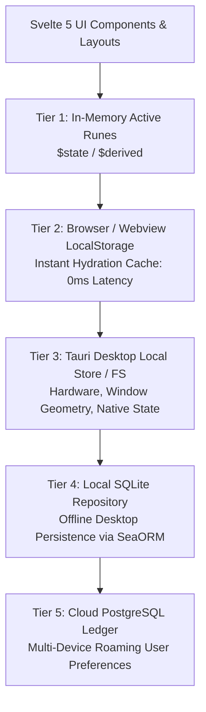
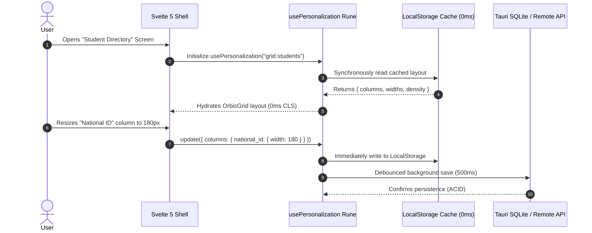

# Orbis Target User Personalization Architecture Specification

> **Document Type:** Target Technical Architecture & State Persistence Blueprint  
> **Status:** Verified Target Design Complete (`ANALYSIS_COMPLETE`)  
> **Target Framework:** Svelte 5 (Runes) + Tauri 2.0 (IPC / SQLite) + PostgreSQL  
> **Architect:** Senior Desktop Systems Architect & Lead Software Engineer  

---

## 1. Executive Summary: The 5-Tier Personalization Tiering Model

To deliver the effortless adaptability observed in enterprise desktop ERPs without introducing architectural clutter, Orbis establishes a **5-Tier Tiered Personalization Architecture**.



### Key Architectural Invariants:
1. **Zero Cold-Start Latency (0ms):** Desktop screens instantly hydrate grid layouts and filter presets from Tier 2 (Local Storage / Cache) synchronously before the first paint, eliminating layout shifts (*Cumulative Layout Shift = 0*).
2. **Deterministic Dual-Transport Sync:** In Tauri desktop mode, preferences persist to Tier 4 (SQLite). In remote web/cloud mode, preferences persist to Tier 5 (PostgreSQL) via `@orbis/sdk`.
3. **Strongly-Typed TypeScript Schemas:** No unstructured key-value dumping. All preferences conform to explicit Zod / TypeScript contracts.
4. **Tenant & User Scope Isolation:** Preferences are strictly isolated by composite keys: `tenantId:userId:scope:key`.

---

## 2. Personalization Storage Allocation Matrix

| Personalization Property | Storage Tier | Authoritative Store | Sync Scope | Local Cache | Invalidation Trigger |
|---|---|---|---|---|---|
| **Grid Column Widths & Order** | Tier 2 & Tier 4/5 | `UserPreference` | User @ Screen | LocalStorage | Manual column resize / reset |
| **Grid Hidden / Visible Columns** | Tier 2 & Tier 4/5 | `UserPreference` | User @ Screen | LocalStorage | Column toggle in selector |
| **Grid Pinned Columns** | Tier 2 & Tier 4/5 | `UserPreference` | User @ Screen | LocalStorage | Column pin / unpin action |
| **Saved Filter Presets (Views)**| Tier 4 & Tier 5 | `UserSavedView` | User / Branch | LocalStorage | Create, edit, delete preset |
| **Recent Screens & History** | Tier 2 & Tier 3 | Tauri Local Store | User @ Device | LocalStorage | Navigation route transition |
| **Pinned / Favorite Screens** | Tier 4 & Tier 5 | `UserPreference` | User Global | LocalStorage | Pin / unpin sidebar action |
| **Active Branch / OrgUnit** | Tier 2 & Tier 4/5 | `UserPreference` | User Global | LocalStorage | Branch selector dropdown |
| **Active Academic Year/Period** | Tier 2 & Tier 4/5 | `UserPreference` | User @ Branch | LocalStorage | Calendar switcher dropdown |
| **Tree Expansion States** | Tier 2 (Ephemeral)| LocalStorage | User @ Screen | LocalStorage | Node expand / collapse click |
| **Window Position & Geometry** | Tier 3 (Native) | Tauri Window State| Device Local | AppData Config | Native window move / resize |
| **Custom Hotkeys & Shortcuts** | Tier 4 & Tier 5 | `UserPreference` | User Global | LocalStorage | Hotkey settings update |
| **Theme & UI Density (Compact)**| Tier 2 & Tier 4/5 | `UserPreference` | User Global | LocalStorage | Theme toggle (Dark/Light/Dense)|

---

## 3. Strongly-Typed TypeScript Contracts & Schemas

### 3.1 Grid Preferences Contract (`GridPreferences`)
```typescript
export interface ColumnState {
  id: string;
  width: number;
  hidden: boolean;
  order: number;
  pinned?: "left" | "right" | null;
}

export interface GridPreferences {
  screenId: string;
  density: "compact" | "normal" | "comfortable";
  columns: Record<string, ColumnState>;
  defaultSort?: {
    field: string;
    direction: "asc" | "desc";
  };
  pageSize: number;
}
```

### 3.2 Saved Filter Views Contract (`SavedView`)
```typescript
export interface SavedView<TFilter = Record<string, unknown>> {
  id: string;
  name: string;
  screenId: string;
  isDefault: boolean;
  isSharedWithBranch: boolean;
  filters: TFilter;
  searchQuery?: string;
  createdBy: string;
  createdAt: string;
  updatedAt: string;
}
```

### 3.3 Navigation & Workspace Preferences Contract (`NavigationPreferences`)
```typescript
export interface NavigationPreferences {
  pinnedRoutes: Array<{
    route: string;
    title: string;
    icon?: string;
  }>;
  recentRoutes: Array<{
    route: string;
    title: string;
    lastAccessedAt: string;
  }>;
  favoriteEntityIds: Record<string, string[]>; // e.g. "students": ["uuid1", "uuid2"]
  lastActiveOrgUnitId?: string;
  lastActiveAcademicPeriodId?: string;
}
```

---

## 4. The `usePersonalization` Reactive Svelte 5 Rune

A unified, type-safe rune that provides reactive read/write access to user preferences with automated background debounced persistence:

```typescript
// Location: apps/desktop/src/lib/core/personalization/use-personalization.svelte.ts

import { getContext, setContext } from "svelte";
import { apiClient } from "$lib/api/client";
import { authStore } from "$lib/stores/auth.svelte";

export function usePersonalization<T>(
  preferenceKey: string,
  defaultValues: T,
  options: { debounceMs?: number; syncToServer?: boolean } = {}
) {
  const { debounceMs = 500, syncToServer = true } = options;
  const storageKey = $derived(
    `orbis:${authStore.tenantId}:${authStore.user?.id}:${preferenceKey}`
  );

  // 1. Synchronous Instant Hydration from Local Storage (0ms)
  let state = $state<T>(() => {
    if (typeof window === "undefined") return defaultValues;
    try {
      const cached = localStorage.getItem(storageKey);
      return cached ? { ...defaultValues, ...JSON.parse(cached) } : defaultValues;
    } catch {
      return defaultValues;
    }
  });

  let debounceTimer: ReturnType<typeof setTimeout> | null = null;

  // 2. Debounced Background Persistence
  function persist(newValues: Partial<T>) {
    state = { ...state, ...newValues };
    
    // Save to LocalStorage immediately
    if (typeof window !== "undefined") {
      try {
        localStorage.setItem(storageKey, JSON.stringify(state));
      } catch (e) {
        console.warn("Failed to persist to localStorage", e);
      }
    }

    // Debounce save to Backend / SQLite
    if (syncToServer && authStore.user) {
      if (debounceTimer) clearTimeout(debounceTimer);
      debounceTimer = setTimeout(async () => {
        try {
          await apiClient.saveUserPreference({
            key: preferenceKey,
            valueJson: JSON.stringify(state),
          });
        } catch (err) {
          console.error(`Failed to sync preference ${preferenceKey} to backend`, err);
        }
      }, debounceMs);
    }
  }

  function reset() {
    state = defaultValues;
    if (typeof window !== "undefined") {
      localStorage.removeItem(storageKey);
    }
  }

  return {
    get current() {
      return state;
    },
    update: persist,
    reset,
  };
}
```

---

## 5. Integration with Core Desktop Components



### 5.1 Direct Integration into `OrbisGrid`
`OrbisGrid` and `DataTable` are configured with a `persistenceKey` prop:
```svelte
<DataTable
  persistenceKey="students-directory-grid"
  columns={studentColumns}
  source={studentDataSource}
/>
```
When `persistenceKey` is provided, `DataTable` automatically initializes `usePersonalization<GridPreferences>`, binding column resize and reorder events with zero boilerplate code on the individual page.

---
*Verified against Orbis architecture standards. Transitioning to Competitor Gap Matrix and Master Matrix.*
