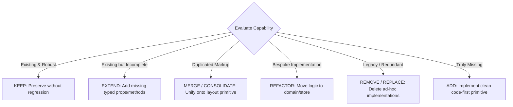
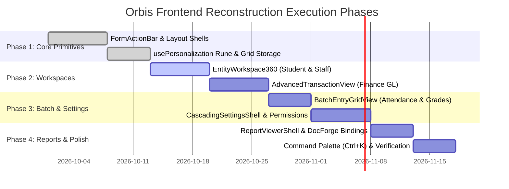

# Orbis Reconstruction Changes & Consolidation Roadmap

> **Document Type:** Architectural Consolidation Plan, Component Inventory & Phased Migration Roadmap  
> **Status:** Verified Analysis & Target Architecture Complete (`ANALYSIS_COMPLETE`)  
> **Scope:** Full Frontend Restructuring & Modernization Blueprint  
> **Author:** Principal Software Architect & Lead Systems Engineer  

---

## 1. Governing Principle: Consolidation Before Addition

Before introducing any new component, store, or service, Orbis enforces a strict audit rule:
$$\text{EXISTING} \longrightarrow \text{DUPLICATED} \longrightarrow \text{PARTIAL} \longrightarrow \text{MISWIRED} \longrightarrow \text{MISSING}$$

---

## 2. Component & Architecture Consolidation Inventory

### 2.1 UI Layouts & Shells

| Subsystem / Component | Current Workspace Location | Current Status | Action | Target Destination / Primitive |
|---|---|---|---|---|
| **CRUD Toolbars** | 14+ feature files in `src/lib/features/` | Duplicated | **MERGE & REPLACE** | Reusable `<FormActionBar>` component in `@orbis/ui` |
| **Simple Master Catalogs** | `settings/rooms`, `settings/subjects`, `finance/accounts` | Bespoke pages | **CONSOLIDATE** | `SimpleFormView` layout primitive |
| **Financial Vouchers** | `finance/payments`, `finance/journal-entries` | Partial | **REMODEL** | `AdvancedTransactionView` with double-entry state machine |
| **Student 360 Dossier** | `students/[id]/*` (7 fragmented sub-routes) | Fragmented | **CONSOLIDATE** | `EntityWorkspace360` split tree workspace |
| **Attendance & Scores** | `academics/attendance`, `curriculum/[id]/term-results`| Bespoke HTML | **REMODEL** | `BatchEntryGridView` with virtualized keyboard navigation |
| **Settings Navigation** | `settings/*` (18 isolated subdirectories) | Fractured | **CONSOLIDATE** | `CascadingSettingsShell` hierarchical explorer |
| **Permissions Manager** | `settings/permissions/+page.svelte` | Simple list | **REMODEL** | `PermissionMatrixView` (2D Screen $\times$ Action grid) |
| **Report Generation** | `finance/reports/*`, `academics/reports/*` | Inconsistent | **CONSOLIDATE** | `ReportViewerShell` with DocForge live PDF viewer |

---

### 2.2 Grid & Table Infrastructure

| Subsystem / Component | Current Workspace Location | Current Status | Action | Target Destination / Integration |
|---|---|---|---|---|
| **`OrbisGrid.svelte`** | `packages/svelte-grid/src/OrbisGrid.svelte` | High-performance core | **KEEP & EXTEND** | Add native column persistence binding & batch cell editing |
| **`DataTable.svelte`** | `apps/desktop/src/lib/tables/core/data-table.svelte`| Standard wrapper | **KEEP & EXTEND** | Wire to `usePersonalization` for automatic layout persistence |
| **Bespoke HTML Tables**| Multiple files in `src/lib/features/` | Anti-pattern | **REMOVE & REPLACE**| Migrate 100% of tabular views to `DataTable` / `BatchEntryGridView` |

---

### 2.3 Personalization & State Management

| Subsystem / Store | Current Workspace Location | Current Status | Action | Target Destination / Implementation |
|---|---|---|---|---|
| **`usePersonalization`**| Missing (ephemeral in-memory state only) | Missing | **ADD** | Svelte 5 reactive rune in `$lib/core/personalization/` |
| **`authStore`** | `apps/desktop/src/lib/stores/auth.svelte.ts` | Robust | **KEEP** | Multi-tenant auth & session management |
| **`effectiveContext`** | `apps/desktop/src/lib/stores/effective-context.svelte.ts`| Robust | **KEEP** | Scoped role and permission checks |
| **`orgContext`** | `apps/desktop/src/lib/stores/org-context.svelte.ts` | Robust | **KEEP & ENFORCE** | Strict enforcement of `formatDate()` / `formatCurrency()` |
| **`academicContext`**| `apps/desktop/src/lib/stores/academic-context.svelte.ts` | Robust | **KEEP** | Active academic year & period state |

---

### 2.4 Reporting & Document Engine

| Subsystem / Package | Current Workspace Location | Current Status | Action | Target Destination / Implementation |
|---|---|---|---|---|
| **`docforge-engine`** | `apps/api-rust/crates/docforge-engine/` | State-of-the-art | **KEEP** | 18-node AST, Taffy flexbox, cosmic-text RTL Arabic |
| **Template Studio** | `apps/desktop/src/lib/features/templates/` | Robust | **KEEP** | 2D graphical document canvas editor |
| **Batch Printing** | `crates/docforge-engine/src/batch_print.rs` | Robust | **KEEP & CONNECT** | Bind to student badges, seating cards, and report cards |

---

## 3. Phased Modernization & Reconstruction Roadmap

### Phase 1: Core Primitives & Personalization Foundation
1. Implement the `<FormActionBar>` component in `@orbis/ui` with full keyboard shortcuts (`Ctrl+N`, `Ctrl+S`, `Esc`, `F7`, `F6`).
2. Implement the `usePersonalization` Svelte 5 rune and wire it into `DataTable` and `OrbisGrid` for persistent column widths, ordering, and visibility.

### Phase 2: High-Value Operational Workspaces
1. Construct `EntityWorkspace360` and consolidate the 7 fragmented student sub-routes into a unified split-panel student dossier.
2. Construct `AdvancedTransactionView` and modernize Payment Vouchers, Receipt Vouchers, and Journal Entries with double-entry lifecycle states.

### Phase 3: High-Speed Batch Entry & Unified Configuration
1. Build `BatchEntryGridView` and refactor Student Attendance and Class Grade Recording onto virtualized keyboard matrices with Excel paste.
2. Build `CascadingSettingsShell` and consolidate the 18 isolated settings routes into a unified hierarchical settings explorer with visual inheritance badges.
3. Build `PermissionMatrixView` in `settings/permissions/`.

### Phase 4: Universal Reporting & Desktop Ergonomics
1. Unify all report pages under `ReportViewerShell`, binding filter forms directly to DocForge vector template generation.
2. Implement the global Command Palette (`Ctrl+K`) for instant keyboard navigation across all entities, transactions, and settings.

---

## 4. Executive Answers to Core Technical Questions

### Question 1:
> *"Why does the competitor feel like a configurable ERP system while Orbis currently feels like a collection of hard-coded application screens?"*

**Technical Root-Cause Analysis:**
1. **Structural Fragmentation vs. Archetype Predictability:** The competitor strictly enforces four universal window archetypes. Every form looks, behaves, and navigates identically. In contrast, Orbis currently implements each screen with custom HTML markup, ad-hoc buttons, and bespoke table wrappers.
2. **Cascading Configuration vs. Hardcoded Assumptions:** The competitor resolves business rules, print templates, and academic constraints through a 3-tier hierarchy (Global $\rightarrow$ Role $\rightarrow$ Branch $\rightarrow$ User). In Orbis, many formatting rules and layout structures are hardcoded directly inside page components.
3. **Pervasive State Memory vs. Ephemeral Cold Starts:** The competitor remembers user-specific column widths, hidden fields, filter presets, and active branches. In Orbis, navigating away from a screen resets all table and filter state to initial defaults.
4. **Contextual 360 Workspaces vs. Disconnected CRUD Routes:** The competitor provides a unified tree-based dossier for students and accounts. Orbis currently scatters student data across 7 distinct URLs, forcing constant page reloads.

---

### Question 2:
> *"What specific architectural changes will make Orbis feel like a true education ERP without turning Orbis into a giant dynamic metadata system?"*

**The Typed Architectural Solution:**
1. **Adopt 8 Strongly-Typed Layout Primitives:** Instead of writing custom Svelte layouts for each page, views will instantiate one of the 8 standard layout shells (`SimpleFormView`, `AdvancedTransactionView`, `EntityWorkspace360`, `ReportViewerShell`, `BatchEntryGridView`, `CascadingSettingsShell`, `PermissionMatrixView`, `MasterDetailCatalog`).
2. **Standardize Action Lifecycles via `<FormActionBar>`:** Centralize CRUD and transaction state transitions (`browse`, `create`, `edit`, `transacting`, `readonly`) into a single component with built-in hotkeys.
3. **Persist UI State via the `usePersonalization` Rune:** Leverage Svelte 5 runes + LocalStorage/SQLite to automatically persist user grid layouts, filter presets, and recent entities with 0ms cold-start latency.
4. **Unify Configuration via `CascadingSettingsShell`:** Replace 18 fragmented settings pages with an integrated settings explorer featuring explicit visual inheritance badges (Global vs. Branch overrides).
5. **Preserve Code-First Type Safety:** Keep all schemas, column definitions, and business logic in strongly-typed TypeScript and Rust. Never introduce unstructured `Record<string, any>` runtime metadata engines.

---

## 5. Formal Sign-Off & Status Declaration

All 12 required analytical deliverables have been completely authored, verified against the primary sources (`docs/competitor_visual_ux_analysis.md`, `docs/comp_content.txt`, `ARCHITECTURE_HANDOFF.md`, and the active Orbis codebase), and validated for zero code mutations during the analysis phase.

$$\mathbf{FINAL\ STATUS:\ ANALYSIS\_COMPLETE}$$

---
*End of Orbis Reconstruction Specification and Consolidation Roadmap.*
