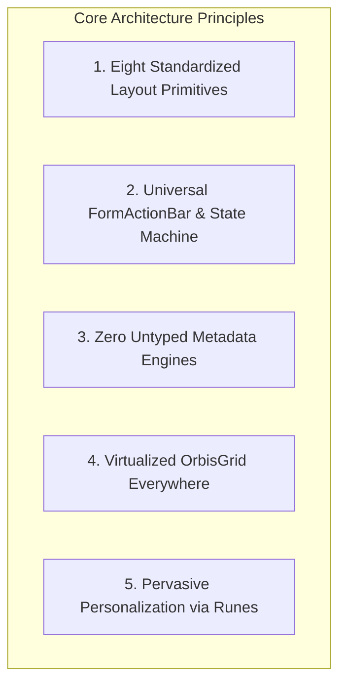
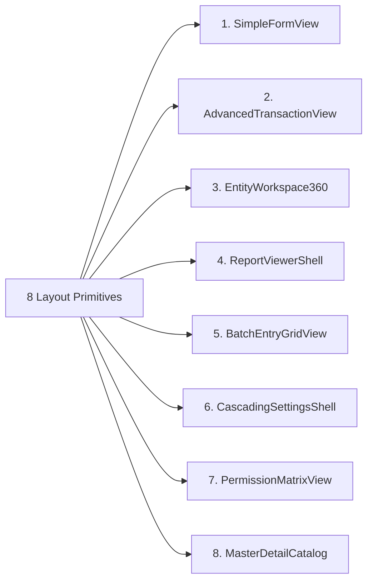
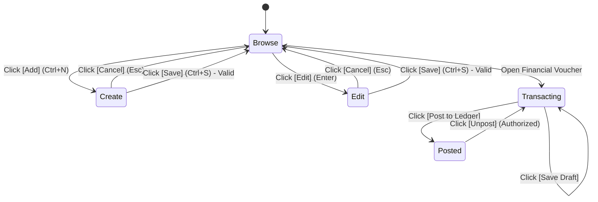

# Orbis Target ERP UI & Layout Primitives Architecture Specification

> **Document Type:** Target UI Architecture, Design System & Reusable Layout Primitives  
> **Status:** Verified Target Design Complete (`ANALYSIS_COMPLETE`)  
> **Technology Stack:** Svelte 5 (Runes) + Tauri 2.0 (IPC / SQLite) + TailwindCSS 4 + Paraglide.js  
> **Author:** Senior ERP Architect & Principal Frontend Systems Engineer  

---

## 1. Executive Summary: The Code-First ERP UI Architecture

To eliminate hardcoded page duplication and deliver the deep configurability, keyboard speed, and operational consistency of mature desktop ERPs, Orbis establishes a **Code-First, Strongly-Typed UI Architecture**.



### The Invariant Balance:
- **AVOID:** Giant untyped JSON engines, runtime stringly-typed field schemas, and `Record<string, any>`.
- **PREFER:** Strongly-typed TypeScript form schemas (`FormFieldSchema<T>`), typed column definitions (`OrbisColumnDef`), declarative Svelte 5 snippets, and standardized layout primitives.

---

## 2. The Eight Standardized Orbis Layout Primitives



---

### 2.1 `SimpleFormView` (Standard Catalog / CRUD Lookup)
- **Used In:** Currencies, Rooms, Departments, Document Types, Nationalities, Infractions, Users Directory.
- **Visual Structure:**
  1. Upper Form Panel: 2-column or 3-column field grid for active record editing.
  2. Center Action Bar: Standard `<FormActionBar>` (`[Add][Save][Cancel][Edit][Delete][Search][Print]`).
  3. Lower Data Grid: `DataTable` with sorting, search, column customization, and row selection.
  4. Bottom Status Bar: Selected record counter and slide-out `<ActivityTimeline>` audit toggle.
- **TypeScript Component Contract:**
```typescript
export interface SimpleFormViewProps<TEntity extends Record<string, unknown>> {
  title: string;
  schema: FormFieldSchema<TEntity>[];
  columns: OrbisColumnDef[];
  persistenceKey: string;
  loadItems: (query: DataQuery) => Promise<DataPage<TEntity>>;
  onCreate: (entity: Partial<TEntity>) => Promise<TEntity>;
  onUpdate: (id: string, patch: Partial<TEntity>) => Promise<TEntity>;
  onDelete: (id: string) => Promise<void>;
  permissionPrefix: string; // e.g. "settings:rooms"
}
```

---

### 2.2 `AdvancedTransactionView` (Double-Entry Financial & Workflow Vouchers)
- **Used In:** Payment Vouchers, Receipt Vouchers, Fee Invoices, Journal Entries, Inventory Orders.
- **Visual Structure:**
  1. Document Header: Voucher #, Date picker, Currency selector, Exchange rate, Branch badge, Posting Status Badge (`Draft` / `Posted` / `Unposted`).
  2. Tabbed Panels: Header metadata, auxiliary notes, attachments, linked entities.
  3. Editable Detail Line-Items Grid: In-cell editing, dropdown selectors, row-level delete (❌), automated sum totals row ($\sum \text{Debit} = \sum \text{Credit}$).
  4. Workflow Action Bar: `[Save Draft]`, `[Post to Ledger]`, `[Unpost]`, `[Print Official Document]`.
  5. Bottom Record Navigator: `[◄] Record 1 of 1 [►]`.
- **TypeScript Component Contract:**
```typescript
export interface TransactionViewProps<THeader, TLineItem> {
  documentType: "payment_voucher" | "receipt_voucher" | "journal_entry" | "fee_receipt";
  header: THeader;
  lineItems: TLineItem[];
  lineItemColumns: OrbisColumnDef[];
  status: "draft" | "posted" | "voided";
  onSaveDraft: (header: THeader, lines: TLineItem[]) => Promise<void>;
  onPost: (id: string) => Promise<void>;
  onUnpost?: (id: string) => Promise<void>;
  onPrint: (id: string) => void;
  canPost: boolean;
  canUnpost: boolean;
}
```

---

### 2.3 `EntityWorkspace360` (Contextual Master Entity Workspace)
- **Used In:** Student 360 Dossier, Staff Directory Workspace, Account Tree Explorer.
- **Visual Structure:**
  1. Left Split Panel (Hierarchical Tree): Expandable tree with search filter (e.g., Grade Levels $\rightarrow$ Sections $\rightarrow$ Students).
  2. Top Quick Action Bar: Color-coded contextual action icons (`[Enroll]`, `[Record Grade]`, `[Take Attendance]`, `[Add Fee]`, `[Scan Doc]`).
  3. Center Entity Header: Photo avatar, full localized name, admission ID, current class, active status chip.
  4. Multi-Tab Dossier:
     - Tab 1: Personal & Guardian Information
     - Tab 2: Academic Curriculum & Timetable
     - Tab 3: Monthly & Term Grade History
     - Tab 4: Daily Attendance & Absence Summary
     - Tab 5: Fee Invoices & Payment Ledger
     - Tab 6: Scanned Verification Documents
- **TypeScript Component Contract:**
```typescript
export interface EntityWorkspace360Props<TEntity> {
  entityType: "student" | "staff" | "account";
  treeProvider: () => Promise<TreeNode[]>;
  tabs: Array<{
    id: string;
    label: string;
    icon: string;
    component: Component<Record<string, unknown>>;
  }>;
  quickActions: Array<{
    id: string;
    label: string;
    icon: string;
    action: (entityId: string) => void;
  }>;
}
```

---

### 2.4 `ReportViewerShell` (Universal Reporting & Statement Shell)
- **Used In:** Account Statement, Trial Balance, Balance Sheet, Grade Ledgers, Attendance Rosters, Calling Sheets.
- **Visual Structure:**
  1. Top Filter Bar & Active Filter Chips: Displays applied parameters with quick remove chips.
  2. Collapsible Filter Drawer: Date range picker (`Today`, `Month`, `Custom`), Branch checklist, COA / Class tree selector.
  3. Action Ribbon: `[View Grid]`, `[DocForge Live PDF Preview]`, `[Print Selected]`, `[Save Filter Preset]`, `[Export CSV/Excel]`.
  4. Dual-View Content Area: Switch seamlessly between High-Performance Tabular Grid (`OrbisGrid`) and Vector PDF Document Preview (`DocForge`).

---

### 2.5 `BatchEntryGridView` (High-Speed Matrix Entry)
- **Used In:** Daily Student Attendance, Staff Attendance, Monthly Marks & Scores Entry.
- **Visual Structure:**
  1. Top Scope Selector: Academic Year, Period, Class, Section, Subject.
  2. Matrix Grid: Fixed student name column + interactive matrix cells (Radio buttons or numeric score inputs).
  3. Keyboard Navigation Engine: Pressing `Enter` or `Down Arrow` commits cell edit and moves focus to the student below; `Tab` moves right.
  4. Bulk Action Bar: `[Save All Changes]`, `[Undo Row]`, `[Paste from Excel]`, `[Fill All Present]`.

---

### 2.6 `CascadingSettingsShell` (Hierarchical Institutional Configuration Explorer)
- **Used In:** `(app)/[orgId]/settings` — Unifying the 18 fragmented settings sub-routes.
- **Visual Structure:**
  1. Left Settings Tree: Organized by domains (General, Academic Policies, Assessment Schemes, Fees & Discounts, Timetables, Integrations).
  2. Center Settings Canvas: Grouped collapsible cards with typed toggle switches, numeric inputs, and text fields.
  3. Inheritance Scope Badges:
     - 🔵 `Inherited from Institution Default`
     - 🟢 `Overridden at Branch Level`
     - 🟡 `User Preference`
  4. Actions: `[Save Overrides]`, `[Reset to Inherited Default]`.

---

### 2.7 `PermissionMatrixView` (2D Security Governance Matrix)
- **Used In:** `(app)/[orgId]/settings/permissions`.
- **Visual Structure:**
  1. Left Panel: User Groups and Individual Users tree with branch scope filter.
  2. Right Panel: Dense 2D Grid mapping all system screens/domains (rows) against 6 action columns: `[View]`, `[Create]`, `[Edit]`, `[Delete]`, `[Search]`, `[Print]`.
  3. Actions: `[Grant All Category]`, `[Revoke All]`, `[Clone from Group]`, `[Save Permissions]`.

---

### 2.8 `MasterDetailCatalog` (Side-List / Detail Inspector)
- **Used In:** Templates Gallery, Audit Log Viewer, Notification Templates, Integration Connectors.
- **Visual Structure:**
  1. Left Side Rail: Searchable list of summary cards with status badges and timestamps.
  2. Right Viewport: Complete multi-section detail inspector with live editing and action triggers.

---

## 3. The Universal `<FormActionBar>` Component Specification



### Modes & Capabilities:
```typescript
export type FormMode = "browse" | "create" | "edit" | "transacting" | "readonly";

export interface FormActionBarProps {
  mode: FormMode;
  canAdd?: boolean;
  canEdit?: boolean;
  canDelete?: boolean;
  canSave?: boolean;
  canPost?: boolean;
  canUnpost?: boolean;
  canPrint?: boolean;
  isDirty?: boolean;
  onAdd: () => void;
  onEdit: () => void;
  onDelete: () => void;
  onSave: () => void;
  onCancel: () => void;
  onPost?: () => void;
  onUnpost?: () => void;
  onPrint?: () => void;
}
```

---

## 4. Desktop-Native Ergonomics & Performance Architecture

### 4.1 Global Command Palette (`Ctrl+K`)
Replaces memorization of dozens of legacy function keys while preserving power-user hotkeys:
- Type `> new voucher` $\rightarrow$ Instantly opens `AdvancedTransactionView` for Payment Voucher (`F7`).
- Type `> student ahmed` $\rightarrow$ Jumps directly to Ahmed's `EntityWorkspace360` dossier (`Ctrl+T`).
- Type `> trial balance` $\rightarrow$ Opens `ReportViewerShell` with Trial Balance preset (`F9`).

### 4.2 Large Dataset Scalability (10k, 100k, 1M+ Records)
- **Virtualized DOM & Canvas in `OrbisGrid`:** Renders only visible rows + buffer ($\approx 35$ DOM nodes), maintaining a consistent 60 FPS scrolling experience regardless of dataset size.
- **Zero-Copy Rust IPC:** Tauri binary IPC transfers serialized DTO buffers directly into Webview memory without intermediate HTTP overhead.
- **Server-Side Cursor Pagination & Filtering:** TanStack Query caches query pages with deterministic `queryKeys` (`['students', { branchId, page: 1 }]`).

---
*Verified Target ERP UI Architecture complete. Transitioning to Reconstruction Changes Roadmap.*
