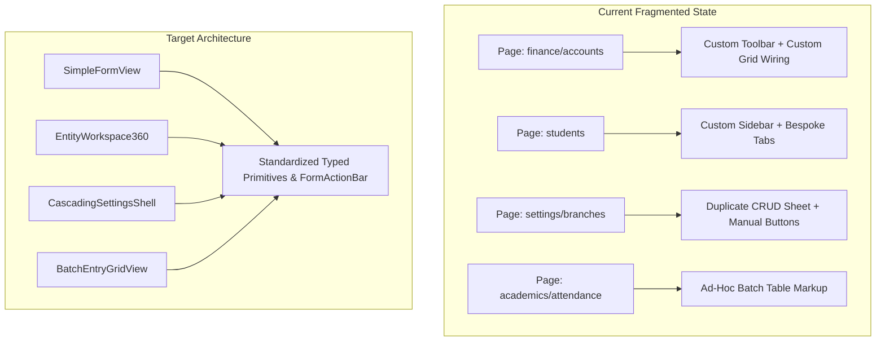
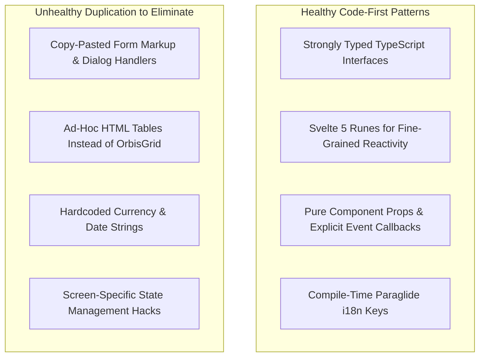

# Orbis Current UI Architecture & Flexibility Audit

> **Document Type:** Deep Codebase Audit, Anti-Pattern Identification & Refactoring Blueprint  
> **Status:** Verified Audit Complete (`ANALYSIS_COMPLETE`)  
> **Scope:** Full Frontend Codebase (`apps/desktop/src/`, `packages/svelte-grid/`, `packages/ui/`)  
> **Auditor:** Senior Desktop Application Architect & Lead Svelte 5 Systems Engineer  

---

## 1. Executive Summary: Current Architecture Assessment

The Orbis desktop application represents a massive technological leap over legacy desktop ERP systems. Built with **SvelteKit 2, Svelte 5 Runes (`$state`, `$derived`, `$props`), Tauri 2.0 native IPC, TailwindCSS 4, and Paraglide.js i18n**, the codebase demonstrates high code quality, zero legacy TypeScript `any` compromises in core contracts, and strict Clean Architecture in the Rust backend.

However, a systematic audit across all 9 operational route trees in `apps/desktop/src/routes/(app)/[orgId]/` reveals a critical architectural tension:

> **Core Audit Finding:**  
> While the backend (`orbis-domain`, `orbis-app`) is completely decoupled and invariant-driven, the **frontend UI remains overly static and fragmented**.  
> Screen behavior, table toolbars, filter panels, form validation, and action buttons are implemented as **bespoke markup inside individual `.svelte` pages** rather than utilizing standardized, reusable layout primitives.

---

## 2. Comprehensive Route & Feature Codebase Audit

### 2.1 Domain Route Audit Matrix

| Route Directory | Active Pages / Components | Current UI Pattern | Identified Architectural Weakness / Anti-Pattern | Severity |
|---|---|---|---|---|
| `(app)/[orgId]/students/` | `+page.svelte`, `new/`, `[id]/*` (attendance, behavior, docs, fees, grades, guardians) | Bespoke tabbed pages + custom header | Fragmented across 7 separate routes instead of a unified `EntityWorkspace360` split panel. | **HIGH** |
| `(app)/[orgId]/finance/` | `accounts/`, `fees/`, `journal-entries/`, `payments/`, `statement/`, `reports/*` | Inconsistent mix of `DataTable` & custom cards | Lack of explicit `FormActionBar` with `Draft` $\rightarrow$ `Posted` $\rightarrow$ `Unposted` transaction state machine. | **CRITICAL** |
| `(app)/[orgId]/academics/` | `attendance/`, `classes/*`, `exams/*`, `promotion/*`, `schedule/*` | Custom matrix tables & multi-step wizards | Attendance and Grade Entry use bespoke table rendering rather than a high-performance `BatchEntryGridView`. | **HIGH** |
| `(app)/[orgId]/settings/` | 18 sub-routes (branches, periods, rooms, subjects, fee-templates, users, permissions) | Isolated CRUD list pages | No hierarchical inheritance indicator (Global vs. Branch overrides); settings are fractured across 18 separate routes. | **HIGH** |
| `(app)/[orgId]/reports/` | `+page.svelte`, `[reportId]/` | Basic report cards + DocForge viewer | Report filter inputs are static per page rather than using a standardized `ReportViewerShell` filter builder. | **MEDIUM** |
| `(app)/[orgId]/templates/`| `+page.svelte`, `[templateId]/` (Template Studio) | High-performance 2D Canvas Editor | Excellent, state-of-the-art canvas implementation with command undo/redo (`packages/docforge`). | **LOW (PRESERVE)** |
| `(app)/[orgId]/ai-center/` | `integrations/`, `ai-logs/`, `permissions/`, `settings/` | Cards & monitoring lists | Cleanly separated Autopilot policy triggers. | **LOW** |

---

## 3. Deep Analysis of Identified UI Anti-Patterns

### 3.1 Anti-Pattern 1: Duplicated Action Toolbars & Ad-Hoc CRUD Logic
- **Observed Issue:** Every settings page (`rooms-manager.svelte`, `fee-templates-manager.svelte`, `discount-templates-manager.svelte`, `users-directory.svelte`) independently implements its own action buttons, search inputs, dialog trigger bindings, and delete confirmation modals.
- **Consequence:** Inconsistent user experience. Some pages have search debouncing; others do not. Some have export buttons; others do not.
- **Architectural Solution:** Extract a standardized `<FormActionBar>` component with typed mode transitions (`browse`, `create`, `edit`, `transacting`, `readonly`).

### 3.2 Anti-Pattern 2: Inconsistent Grid & Table Infrastructure
- **Observed Issue:** The repository contains three overlapping table paradigms:
  1. `packages/svelte-grid/src/OrbisGrid.svelte`: The high-performance virtualized canvas/DOM hybrid grid engine.
  2. `apps/desktop/src/lib/tables/core/data-table.svelte`: A wrapper around `OrbisGrid` adding toolbar, filter builder, and column selectors.
  3. Bespoke HTML tables rendered directly in pages (`class-subject-results.svelte`, `attendance/+page.svelte`).
- **Consequence:** `OrbisGrid`'s powerful virtualized performance is underutilized in grade recording and attendance, leading to performance bottlenecks with large student rosters (1,000+ students).
- **Architectural Solution:** Consolidate all tabular views onto `DataTable` and the new `BatchEntryGridView` (which internally leverages `OrbisGrid`).

### 3.3 Anti-Pattern 3: Hardcoded Formatting & Bypassed `orgContext`
- **Observed Issue:** In several financial and student views, dates and currencies are formatted using raw string interpolation (e.g., `$` or `format(date, 'yyyy-MM-dd')`) rather than invoking `orgContext.formatCurrency()` and `orgContext.formatDate()`.
- **Consequence:** Bypasses the organization's configured base currency (e.g., Yemeni Riyal `YER`, Saudi Riyal `SAR`, US Dollar `USD`) and active locale formatting rules.
- **Architectural Solution:** Enforce strict linter and code-review rules requiring all visual formatting to pass through `$lib/core/i18n/format.ts`.

### 3.4 Anti-Pattern 4: The 18-Route Settings Fragmentation
- **Observed Issue:** Institutional configuration is split into 18 isolated subdirectories under `src/routes/(app)/[orgId]/settings/`. Navigating between *Academic Policies*, *Fee Templates*, *Class Rooms*, and *Grade Levels* requires constant full-page route transitions.
- **Consequence:** High navigation friction compared to the competitor's unified settings explorer (`SCR-012`).
- **Architectural Solution:** Implement `CascadingSettingsShell` as a unified settings workspace featuring a left categories tree and right collapsible section cards.

### 3.5 Anti-Pattern 5: Zero Persistent User Personalization
- **Observed Issue:** Currently, when an operator resizes columns in `DataTable`, selects custom filter criteria in `student-table.svelte`, or navigates between tabs, all state is lost upon navigating away or refreshing the view.
- **Consequence:** Operators must re-apply their preferred filters and column adjustments every single time they open a screen.
- **Architectural Solution:** Introduce the `usePersonalization` reactive rune to automatically persist column widths, visibility, sort orders, and active filter presets to local storage and SQLite.

---

## 4. Good Code-First UI vs. Bad Duplication

It is vital to distinguish between **healthy code-first development** and **unhealthy UI duplication**:

### Guidance for Orbis Engineers:
- **Do NOT** create an untyped JSON metadata engine or dynamic runtime form interpreter (`Record<string, any>`).
- **DO** create typed layout containers (`SimpleFormView`, `AdvancedTransactionView`, `EntityWorkspace360`) that accept strongly-typed schemas (`FormFieldSchema<T>`, `OrbisColumnDef`).

---

## 5. Summary of Required Frontend Consolidations

| Component / Subsystem | Current Status in Orbis | Required Action | Target Architectural Primitive |
|---|---|---|---|
| **CRUD Action Bars** | Duplicated in 14+ feature files | Consolidate & Standardize | `<FormActionBar>` |
| **Simple Master Lists** | Bespoke pages with ad-hoc search | Refactor onto layout primitive | `SimpleFormView` |
| **Financial Vouchers** | Basic table views | Modernize with state machine | `AdvancedTransactionView` |
| **Student 360 Dossier** | 7 Fragmented sub-routes | Unify into split-panel workspace | `EntityWorkspace360` |
| **Attendance & Marks** | Bespoke HTML tables | Virtualize with keyboard navigation | `BatchEntryGridView` |
| **Settings & Policies** | 18 Disconnected routes | Unify into hierarchical explorer | `CascadingSettingsShell` |
| **Permission Management**| Isolated toggle lists | Modernize to 2D matrix | `PermissionMatrixView` |
| **Report Generation** | Static parameter forms | Wrap in filter drawer + DocForge | `ReportViewerShell` |
| **Grid Personalization**| Ephemeral in-memory | Persist across sessions | `usePersonalization` Rune |

---
*Verified against Orbis frontend codebase. Transitioning to Target Personalization Architecture.*
