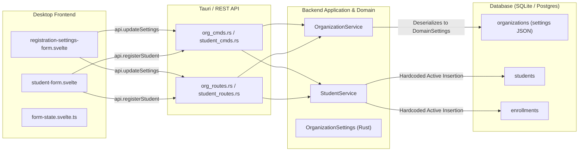
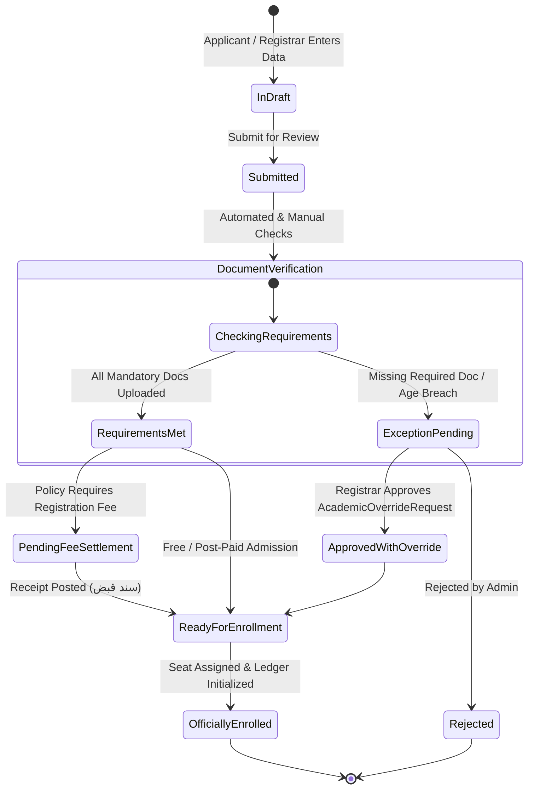
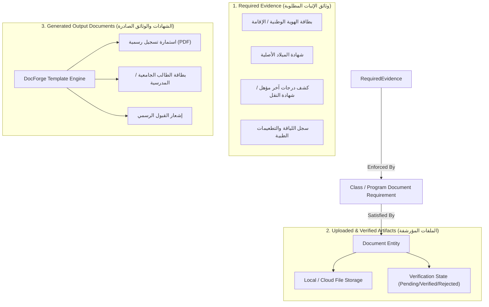
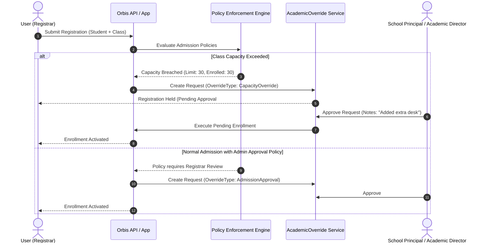
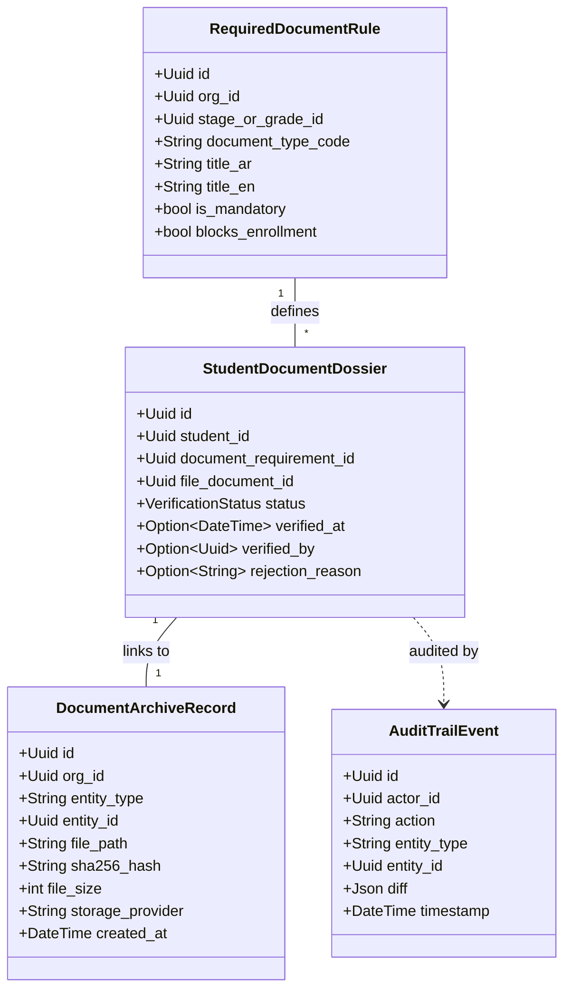
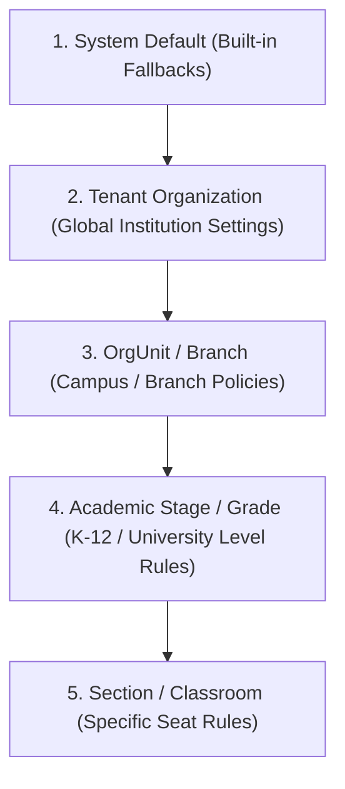
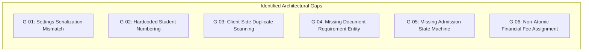
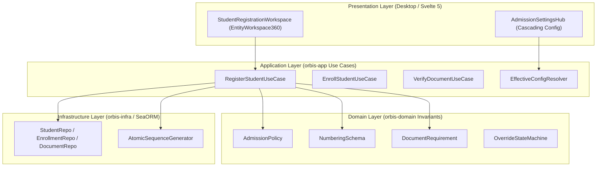
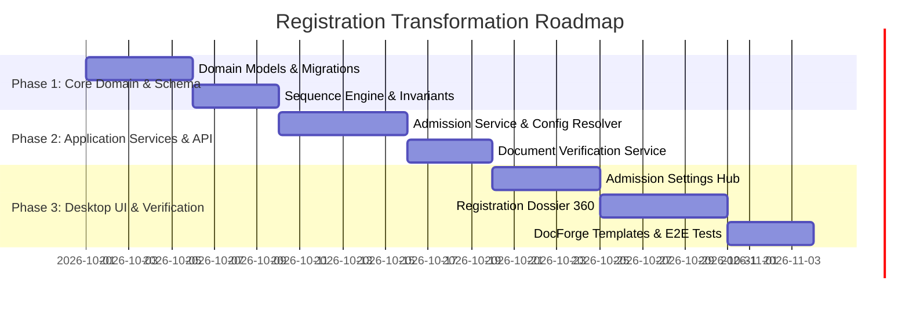

# Orbis ERP Registration Architecture — Deep Analysis & Master Solution Plan

> **Document Status:** Verified Architectural Plan (`REGISTRATION_ARCHITECTURE_PLAN_READY`)  
> **Workspace Root:** `d:/projects/Orbis`  
> **Target Scope:** Core Registration, Admission, Student Lifecycle, Documents & Configuration Engine  
> **Execution Constraint:** Strictly Analysis & Planning Only — No Code/Database Implementation  

---

## 1. Executive Summary

This document presents a comprehensive, production-grade architectural analysis and transformation plan for the **Registration and Admission Subsystem** in **Orbis OS**.

The current registration implementation in Orbis operates as an isolated, form-centric utility with significant hardcoding, structural mismatches between backend domain entities and frontend configurations, client-side data leaks, and disjointed lifecycle transitions. 

By conducting an exhaustive audit of:
1. The **Competitor ERP System** (`Ebda'a Soft Schools System`, 104 screens, 4 UI archetypes),
2. The **Active Rust Backend** (`orbis-domain`, `orbis-app`, `orbis-infra`, `orbis-server`),
3. The **Desktop Svelte 5 / Tauri 2.0 Frontend** (`apps/desktop`),
4. The **Database Migrations and SeaORM Schemas**,

this document establishes an authoritative architectural blueprint. It defines the boundary between **Typed Configuration**, **Business Rules**, **Policy Governance**, **Workflow Chains**, **Document Requirements**, and **Audit Logs** to transform Orbis Registration into a multi-tenant, hierarchical, ERP-grade educational operating system.

```mermaid
graph TD
    subgraph "Current State: Form-Centric / Disconnected"
        UI_Old["Desktop Form State"] -->|Saves Untyped JSON| Org_JSON["org.settings.registration (Dropped)"]
        UI_Old -->|Direct Unchecked Call| Svc_Old["StudentService::register_student"]
        Svc_Old -->|Hardcoded Active| DB_Student["Student & Enrollment Created (No Approval)"]
    end

    subgraph "Target State: Governed ERP Lifecycle"
        Applicant["Application / Dossier"] --> PolicyCheck["Policy & Prerequisite Engine"]
        PolicyCheck -->|Pass| DocCheck["Document Requirements Engine"]
        PolicyCheck -->|Violation| OverrideReq["Academic Override / Approval Chain"]
        DocCheck --> FeeGen["Automated Fee & Schedule Generator"]
        FeeGen --> Enrolled["Official Enrollment & Ledger Posting"]
        Enrolled --> DocForge["DocForge Certificate / Registration Card"]
    end
```



---

## 2. Problem Definition

### 2.1 The Core Architectural Defect
The fundamental problem in Orbis's current registration module is **architectural impedance mismatch**:
- The UI exposes advanced ERP configuration toggles (e.g. approval requirements, document lists, student numbering patterns, duplicate detection rules, class capacity caps).
- The Backend possesses rigorous domain foundations (Rust Clean Architecture, IAM RBAC, SeaORM transactions, EventBus).
- **However, they are disconnected:** The configuration is saved under mismatched keys, never parsed or enforced in backend use cases, and registration executes as a flat, unvalidated write into `Student` and `Enrollment` tables with hardcoded statuses.

### 2.2 Symptoms in the Active Codebase
1. **Ghost Settings:** The desktop UI saves admission rules into `settings.registration`, whereas the backend domain model expects `settings.enrollment` with different property names. The configuration is silently dropped on deserialization.
2. **Hardcoded Domain Logic:** Student numbering uses hardcoded Rust formatting (`STD-YYYY-XXXXXX`), student status is hardcoded to `Active`, and enrollment is hardcoded to `Active` regardless of administrative approval flags.
3. **Client-Side Security Leaks:** Duplicate national ID and contact detection fetches all system users to the client (`api.listUsers()`) and scans them locally in the browser memory.
4. **Disjointed Document Evidence:** Student documents are uploaded as generic unlinked records with string-containment heuristic checks (`includes("birth_certificate")`) rather than structured verification against grade-level document requirements.
5. **Lack of Lifecycle Separation:** No distinction exists between an **Applicant** (in admission review), an **Enrolled Student** (holding an active seat in a period), and a **Historical Student Record**.

---

## 3. Current-State Architecture Audit



### End-to-End Trace of Current Registration:
1. **Settings Definition:** Admin opens `Settings -> Registration`. Edits prefix `STU`, min capacity `30`, require approval `true`. Clicks Save.
   - Frontend serializes payload as `{ registration: { ... } }`.
   - Backend `OrganizationService::update_settings` deserializes into `OrganizationSettings { enrollment: EnrollmentSettings }`. Rust serde defaults `enrollment` because key `registration` is unknown. Configuration is lost.
2. **Student Entry:** Registrar opens `Students -> Register Student`. Enters data, selects "Submit for Review" (`pending_review`). Clicks Save.
   - `form-state.svelte.ts` ignores the review state and invokes `api.registerStudent`.
   - `StudentService::register_student` executes:
     - Generates student number via hardcoded Rust logic: `STD-{YYYY}-{Random 6}`.
     - Creates `Person` record.
     - Creates `Student` record with `status: StudentStatus::Active` (hardcoded).
     - Creates `Enrollment` record with `status: EnrollmentStatus::Active` (hardcoded).
     - Emits `StudentRegistered` event.
   - No check against `registration_enabled`, `require_admin_approval`, `max_class_size_default`, or `allow_late_enrollment`.

---

## 4. Registration Lifecycle Analysis

An enterprise educational ERP requires a structured 6-phase state machine rather than an atomic single-step form:



### Complete ERP Lifecycle Phases:
1. **Inquiry & Pre-Admission (استعلام واستمارة أولية):** Prospect data capture, sibling lookup, identity validation.
2. **Dossier & Application (ملف التقديم والوثائق):** Submission of personal, guardian, academic history, and mandatory document proofs.
3. **Administrative & Academic Review (المراجعة والاعتماد الأكاديمي):** Age validation, prerequisite check, capacity verification. Exceptions trigger `AcademicOverrideRequest`.
4. **Financial Inception (التسوية المالية والرسوم):** Automatic mapping of tuition fee templates, discounts, installment schedules, and initial fee receipt.
5. **Class & Section Allocation (التسكين والتوزيع على الشعب):** Section capacity enforcement, teacher/homeroom assignment.
6. **Official Enrollment & Credential Issuance (القيد الرسمي وإصدار الوثائق):** Student number generation according to institution sequence pattern, card/certificate generation via DocForge, permanent archive indexing.

---

## 5. Registration Settings Audit

| Setting | Current Location | Database Location | Backend Owner | Read? | Enforced? | Tested? | Scope | Business Meaning | Problem | Recommended Treatment |
|---|---|---|---|---|---|---|---|---|---|---|
| `registration_enabled` | `EnrollmentSettings` | `organizations.settings` | `OrganizationService` | Yes | **NO** | No | OrgUnit / Year | Master switch for new registrations | Not checked in `StudentService` | **MAKE POLICY-DRIVEN** & enforce in `register_student` |
| `require_admin_approval` | `EnrollmentSettings` | `organizations.settings` | `OrganizationService` | Yes | **NO** | No | OrgUnit / Grade | Enforces pending review state | Backend creates `Active` directly | **MAKE WORKFLOW-DRIVEN** (Route to Approvals) |
| `allow_waitlist` | `EnrollmentSettings` | `organizations.settings` | `OrganizationService` | Yes | **NO** | No | Class / Section | Queue applicants when capacity full | No waitlist entity or queue logic | **REMODEL** into Enrollment Queue |
| `sibling_priority_enabled` | `EnrollmentSettings` | `organizations.settings` | `OrganizationService` | Yes | **NO** | No | Org | Priority queueing for siblings | No ranking or logic exists | **MAKE POLICY-DRIVEN** |
| `max_class_size_default` | `EnrollmentSettings` | `organizations.settings` | `OrganizationService` | Yes | **NO** | No | Grade / Room | Capacity limit per section | Never checked on enrollment | **ENFORCE** in `enroll_student` with Override trigger |
| `allow_late_enrollment` | `EnrollmentSettings` | `organizations.settings` | `OrganizationService` | Yes | **NO** | No | Period / Stage | Allow registration after period cutoff | Never checked against calendar | **MAKE POLICY-DRIVEN** (Requires `LateEnrollment` override) |
| `student_number_pattern` | UI Only (`reg-form`) | UI Transient / Dropped | None | No | **NO** | No | Org / Stage | Format schema (`STU-YYYY-SEQ`) | Hardcoded in Rust `student_service.rs` | **MAKE CONFIGURABLE** & move to `NumberingPolicy` |
| `allow_no_guardian` | UI Only (`reg-form`) | UI Transient / Dropped | None | No | **NO** | No | Stage / Program | Allow independent adult registration | Guardian creation hardcoded in UI | **MAKE POLICY-DRIVEN** based on student age / stage |
| `allow_duplicate_national_id` | UI Only (`reg-form`) | UI Transient / Dropped | None | No | **NO** | No | Org | Strict identity deduplication | Scanned in frontend memory | **MOVE** to Database Unique Constraint / Backend validator |
| `auto_assign_fees` | UI Only (`reg-form`) | UI Transient / Dropped | None | No | **NO** | No | Stage / Grade | Generate fees on enrollment | Handled in client UI loop | **CONSOLIDATE** into `FinanceService` event handler |
| `required_documents_list` | UI Only (`reg-form`) | UI Transient / Dropped | None | No | **NO** | No | Grade / Stage | Mandatory documents for admission | Hardcoded string checks in UI | **REMODEL** into `document_requirements` entity |
| `form_fields_list` | UI Only (`reg-form`) | UI Transient / Dropped | None | No | **NO** | No | OrgUnit | Toggle visibility/requirement of fields | Hardcoded in frontend form | **MAKE CONFIGURABLE** via UI Field Policy |

---

## 6. Hardcoded Behavior Audit

| # | Hardcoded Item | Location | Current Hardcoded Value | Category | Severity | Target Architecture Solution |
|---|---|---|---|---|---|---|
| 1 | **Student Number Pattern** | `student_service.rs:110` | `format!("STD-{}-{}", YYYY, random_6)` | Logic | **CRITICAL** | Sequence Generator Engine driven by `NumberingSchema` |
| 2 | **Initial Student Status** | `student_service.rs:168` | `StudentStatus::Active` | Lifecycle | **HIGH** | Set to `PendingApproval` or `Draft` based on org policy |
| 3 | **Initial Enrollment Status** | `student_service.rs:194` | `EnrollmentStatus::Active` | Lifecycle | **HIGH** | Set to `PendingApproval` if approval required or missing docs |
| 4 | **Required Document Strings** | `document-info.svelte.ts:38` | `["birth_certificate", "national_id", ...]` | Metadata | **HIGH** | Load from relational `DocumentRequirement` entity |
| 5 | **Duplicate Check Mechanism** | `form-state.svelte.ts:161` | `api.listUsers().find(...)` | Security | **CRITICAL** | Backend dedicated endpoint `POST /api/v1/students/check-duplicate` |
| 6 | **Default Guardian Email** | `form-state.svelte.ts:355` | `parent.${Date.now()}@orbis.local` | Logic | **MEDIUM** | Real guardian identity linking without fake dummy emails |
| 7 | **Study Mode Default** | `student_service.rs:186` | `StudyMode::Regular` | Domain | **LOW** | Configurable default per program |
| 8 | **Passing Threshold** | `academic_policy.rs:227` | `50%` passing, `85%` honors | Policy | **MEDIUM** | Scoped `AcademicPolicy` resolved per Grade Level |
| 9 | **Registration Status Tabs** | `student-form.svelte:203` | Hardcoded string items in dropdown | UI | **MEDIUM** | Governed by State Machine transition capabilities |
| 10| **Registration Fee Logic** | `form-state.svelte.ts:379` | Client-side iterative fee posting | Finance | **HIGH** | Transactional Backend Fee Schedule mapping |

---

## 7. Document, Certificate & Text Model Analysis

### 7.1 Competitor Behavior vs Orbis Gap
In the competitor system:
- **`1.3.1.6 دليل أنواع الوثائق`**: Master catalog of all document categories.
- **`1.3.3.6 إسناد وثائق الصفوف`**: Explicit mapping binding mandatory documents to each grade level (e.g. Primary requires vaccination card; Secondary requires previous transcript).
- **`1.4.2.4 وثائق الطالب`**: A unified verification matrix where the registrar checks off verified documents and scans physical papers directly.

In current Orbis:
- Documents are generic files uploaded to `documents` table.
- No binding exists between grade levels and required documents.
- Verification status (Verified / Rejected / Pending / Expired) does not exist.

### 7.2 Target Document Taxonomy



---

## 8. Workflow & Approval Analysis

### 8.1 Approval Request Model Integration
Registration is not always a linear pass. It must seamlessly trigger **Approval & Override Chains** when business policies are violated:



### 8.2 Autopilot Integration
When Autopilot is enabled:
- **Auto-Open / Auto-Close:** Registration windows open and close automatically based on `AcademicPeriod` dates.
- **Auto-Fee Generation:** As soon as an applicant transitions from `PendingApproval` to `Active`, Autopilot triggers fee schedule assignment.
- **Capacity Alerts:** Automatically notifies academic supervisors when a section reaches 95% capacity.

---

## 9. Archive, Document & Audit Boundaries



---

## 10. Student Lifecycle & Ownership Architecture

To prevent duplicate states and concept bleed, boundaries are strictly delineated:

| Entity | Core Responsibility | Lifecycle States | What It MUST NOT Contain |
|---|---|---|---|
| **`Person`** | Physical identity & biometric profile | Persistent master record | School affiliations, fee records, student numbers |
| **`Student`** | Academic persona within an Organization | `Active`, `OnLeave`, `Suspended`, `Withdrawn`, `TransferredOut`, `Graduated`, `Expelled` | Term-specific grades, term fee balances, specific classroom seats |
| **`Enrollment`** | Placement in a specific Academic Period & Class | `Draft`, `PendingApproval`, `Active`, `Withdrawn`, `Transferred`, `Completed` | Permanent identity attributes (National ID, Passport) |
| **`StudentGuardian`** | Legal relationship & emergency contacts | Active linkage | User login authentication credentials |
| **`StudentFee`** | Financial obligation tied to an Enrollment | `Pending`, `PartiallyPaid`, `Paid`, `Overdue`, `Cancelled`, `Refunded` | Academic attendance or grading logic |

---

## 11. Configuration Hierarchy Analysis

Configuration in Orbis follows a deterministic 5-tier inheritance tree:



### Inheritance Resolution Algorithm:
$$\text{EffectiveValue}(K, \text{Target}) = \text{FirstNonNull}\big(\text{Value}(K, \text{Section}), \text{Value}(K, \text{Grade}), \text{Value}(K, \text{Branch}), \text{Value}(K, \text{Org}), \text{Default}(K)\big)$$

- **No Overrides:** If a Branch does not specify a student number pattern, it inherits from the Organization.
- **Auditability:** Every resolved configuration indicates its origin level (`source: "branch" | "organization" | "default"`).

---

## 12. Permission & Scope Analysis

Following the competitor's proven **Screen $\times$ Action $\times$ Scope** matrix:

| Functional Area | Permission Key | Required Scope | Description |
|---|---|---|---|
| **Registration Form** | `student:create` | Branch / OrgUnit | Ability to open registration dossier and submit applicant |
| **Admission Approval** | `admission:approve` | Branch / Org | Ability to transition applicant from `PendingApproval` to `Active` |
| **Capacity Override** | `override:capacity` | OrgUnit | Ability to bypass section maximum capacity limits |
| **Age / Prerequisite Override** | `override:prerequisite` | Academic Stage | Ability to enroll student despite age or course prerequisite failure |
| **Fee Customization** | `finance:discount_apply`| Financial Unit | Ability to attach non-standard discounts during registration |
| **Document Verification** | `document:verify` | Branch | Ability to verify or reject uploaded applicant documents |

---

## 13. Backend / DB / API / SDK / Tauri / Desktop Gap Matrix



| Gap ID | Layer | Symptom | Impact | Solution |
|---|---|---|---|---|
| **G-01** | Full Stack | Settings saved under `registration` key; backend expects `enrollment` | Settings silently dropped | Consolidate into typed `AdmissionConfiguration` |
| **G-02** | Backend Domain | Student number generator uses hardcoded `STD-{YYYY}-{RAND}` | Cannot customize numbering per school | Introduce `NumberingPatternEngine` |
| **G-03** | Frontend / API | Duplicate detection downloads entire user database | Security vulnerability & slow performance | Dedicated backend query `check_duplicate` |
| **G-04** | Database / Domain | Document requirements stored as transient strings in UI | Cannot enforce required documents per grade | Add `DocumentRequirement` entity & SeaORM model |
| **G-05** | Domain / App | Direct `Active` creation bypassing review workflow | Bypass administrative approval | Introduce `EnrollmentStatus::PendingApproval` workflow |
| **G-06** | App / Finance | Fees iterated manually on client side | Risk of partial failures and discrepancies | Atomic backend fee mapping in `StudentService` |

---

## 14. Competitor-Derived Business Patterns

| Competitor Behavior | Business Purpose | Orbis Equivalent | Gap in Orbis | Why It Matters | Target Architectural Implication |
|---|---|---|---|---|---|
| **1.3.3.6 إسناد وثائق الصفوف** | Enforce specific admission documents per grade level | None (hardcoded UI string list) | No grade-level document rules in DB | Different grades require different legal documents | Create `ClassDocumentRule` relational entity |
| **1.4.1.2 تسجيل طالب جديد** | Multi-tab comprehensive admission dossier | `student-form.svelte` | Lacks validation state machine and auto-fee link | Reduces registrar friction and errors | Rebuild form with reactive validation & stepper |
| **1.4.1.1 استمارة فارغة** | Blank printable admission form for paper collection | Document Template preview | No standard default admission form template | Schools frequently collect paper applications first | Bundle default DocForge admission application AST |
| **1.1.4.1 إعدادات النظام** | 3-tier settings cascade (Global $\to$ Branch $\to$ User) | Single flat JSON in Organization | No OrgUnit override resolution | Multi-campus schools need branch-specific rules | Implement scoped configuration resolver |
| **1.4.2.1 شجرة بيانات الطلاب** | 360° student workspace with tree navigation | `student-details.svelte` | Lacks tree navigation and quick actions | Fast navigation between enrollment history & fees | Modern `EntityWorkspace360` with OrbisGrid |

---

## 15. Consolidation Opportunities

In accordance with **Consolidation Before Addition**:

1. **Consolidate Settings:** Merge the divergent `EnrollmentSettings` (Rust) and `registration_config` (Frontend) into a unified `AdmissionPolicy` and `NumberingPolicy`.
2. **Reuse `AcademicOverrideRequest`:** Do not create a separate approval entity for registration. Extend `OverrideType` to include `CapacityOverride`, `LateEnrollment`, and `AdmissionApproval`.
3. **Reuse `Document` Entity:** Attach document verification metadata (`status`, `verified_by`, `requirement_id`) directly to the document domain rather than creating a separate document system.
4. **Reuse `DocForge` Engine:** Use the existing 18-node AST vector reporting engine for registration cards and blank applications rather than HTML-based ad-hoc printing.

---

## 16. Architectural Risks

1. **Breaking Existing Enrollment Records:** Modifying the enrollment lifecycle state machine must preserve existing active enrollments without regression.
2. **Multi-Tenant Configuration Leakage:** Ensuring scoped configuration resolution strictly enforces tenant and OrgUnit boundaries.
3. **Performance on Batch Registration:** Auto-assigning fees and checking document rules during bulk Excel import must operate inside an efficient batched database transaction.

---

## 17. Open Questions & Architectural Decisions

| # | Question / Decision Point | Options Considered | Recommended Decision | Rationale |
|---|---|---|---|---|
| **Q1** | Should `Admission` be a separate database table from `Enrollment`? | A) Create new `admissions` table<br>B) Use `Enrollment` with `PendingApproval` / `Draft` states | **Option B: Consolidate into `Enrollment`** | Prevents duplicate lifecycle entities and aligns with existing clean architecture. |
| **Q2** | Where should student number sequence counters be stored? | A) Global atomic counter table<br>B) Calculated via `COUNT(*)` in DB | **Option A: `sequence_counters` table** | Guarantees gapless, concurrency-safe numbering under heavy registration load. |
| **Q3** | How should conditional document requirements be configured? | A) Complex JSON rule engine<br>B) Structured columns (Stage, Nationality, Gender, StudyMode) | **Option B: Structured relational model** | Type-safe, queryable, and easily validated in Rust and UI. |

---

## 18. Target Conceptual Architecture



---

## 19. Proposed Domain Boundaries

### 19.1 Entities & Value Objects

```rust
// In orbis-domain/src/entities/admission.rs

#[derive(Debug, Clone, Serialize, Deserialize)]
pub struct NumberingSchema {
    pub prefix: String,
    pub include_year: bool,
    pub year_format: YearFormat, // TwoDigit (26), FourDigit (2026)
    pub sequence_digits: u8,     // 4 -> 0001
    pub separator: String,       // "-"
}

#[derive(Debug, Clone, Serialize, Deserialize)]
pub struct DocumentRequirement {
    pub id: Uuid,
    pub org_id: Uuid,
    pub target_type: RequirementTargetType, // Stage, GradeLevel, Program
    pub target_id: Option<Uuid>,
    pub code: String,
    pub name_ar: String,
    pub name_en: String,
    pub is_mandatory: bool,
    pub blocks_enrollment: bool,
    pub condition: Option<DocumentCondition>, // e.g. NonNationalOnly, TransferOnly
}
```

---

## 20. Proposed Configuration Boundaries

1. **Typed Configuration (`AdmissionConfiguration`):**
   - Numbering pattern, max class capacity, duplicate check rules.
2. **Business Rules (Domain Invariants in Rust):**
   - Cannot enroll in a closed period without `LateEnrollment` override.
   - Cannot exceed class capacity without `CapacityOverride`.
3. **Workflow Chains:**
   - Multi-step approval routing based on `require_admin_approval` setting.
4. **Templates (DocForge AST):**
   - Blank application form template, official student card, registration confirmation letter.

---

## 21. Proposed Workflow Boundaries

- **State: `Draft`:** Application partially filled; no seat reserved.
- **State: `PendingApproval`:** Data verified; seat tentatively reserved; waiting for supervisor approval in Approvals Hub.
- **State: `Active`:** Approved; student number assigned; seat secured; financial invoices generated.
- **State: `Rejected`:** Rejected by admin with recorded reason; seat released.

---

## 22. Proposed Document & Archive Boundaries

- **Document Requirement:** Master rule defined at Stage/Grade level.
- **Student Document:** The concrete file uploaded against a specific requirement.
- **Document Status:** `PendingReview` $\to$ `Verified` $\to$ `Rejected` $\to$ `Archived`.
- **Permanent Archive:** On graduation or withdrawal, all verified documents and generated report cards are permanently indexed in the immutable document archive.

---

## 23. Proposed UI / UX Structure

Adhering to the **4 Universal Archetypes**:

1. **`EntityWorkspace360` (Student Registration & Dossier):**
   - Header with student photo, dynamic numbering preview, and lifecycle status badge.
   - Stepper / Tabs: Personal Info $\to$ Guardian Link $\to$ Academic Placement $\to$ Document Checklist $\to$ Fees & Discounts.
2. **`FormGridView` (Document Requirements Manager):**
   - Upper form: Add/Edit Document Rule (Title, Stage, Mandatory toggle, Conditions).
   - CRUD Toolbar: `[إضافة] [تعديل] [حذف] [تحديث] [بحث] [طباعة]`.
   - Lower grid: All active document requirements with stage filtering.
3. **`SettingsPage` (Admission Policy Hub):**
   - Cascading tree on left (Org $\to$ Branch $\to$ Stage).
   - Visual inheritance indicators showing inherited vs overridden values.
   - Live ID preview badge updating reactively as prefix/year format changes.

---

## 24. Migration & Compatibility Considerations

- Existing organizations will automatically receive default `AdmissionPolicy` and `NumberingSchema` migrated from existing data.
- Existing students will maintain their current student numbers without recalculation.
- New sequence engine will seed its initial counter from `MAX(student_number)` to prevent collisions.

---

## 25. Actionable Multi-Phase Implementation Plan



### Phase 1: Domain Modeling & Database Normalization
- **Goal:** Establish typed domain entities for Admission, Numbering, and Document Requirements.
- **Scope:** `orbis-domain`, `orbis-infra` migrations and SeaORM models.
- **Affected Layers:** Domain, Infrastructure.
- **Existing Code to Refactor:** `orbis-domain/src/entities/settings.rs`, `student.rs`, `enrollment.rs`.
- **Potential New Code:** `orbis-domain/src/entities/admission.rs`, `document_requirement.rs`.
- **Database Impact:** New tables `document_requirements`, `sequence_counters`; migration to normalize `organizations.settings`.
- **Tests:** Domain unit tests for sequence generation, validation invariants, and policy checks.
- **Acceptance Criteria:** `cargo test -p orbis-domain` passes with 100% invariant coverage.

### Phase 2: Application Use Cases, Policy Enforcement & IPC
- **Goal:** Enforce business rules, duplicate detection, approval routing, and fee assignment in the backend.
- **Scope:** `orbis-app`, `orbis-server`, `apps/desktop/src-tauri`.
- **Existing Code to Refactor:** `student_service.rs`, `organization_service.rs`, `student_cmds.rs`, `org_cmds.rs`.
- **API Impact:** New routes `/api/v1/students/check-duplicate`, `/api/v1/document-requirements`.
- **Tests:** Integration tests verifying that registration respects capacity limits, approval flags, and duplicate detection.
- **Acceptance Criteria:** Attempting to register when class is full returns `CapacityOverrideRequired` error.

### Phase 3: Desktop UI Modernization & DocForge Integration
- **Goal:** Deliver a modern `EntityWorkspace360` registration flow and cascading settings manager.
- **Scope:** `apps/desktop/src/lib/features/students/`, `settings/`.
- **Existing Code to Refactor:** `student-form.svelte`, `form-state.svelte.ts`, `registration-settings-form.svelte`.
- **Existing Code to Remove:** Client-side `api.listUsers()` duplicate scan, hardcoded document string checks.
- **Tests:** Svelte component testing, form validation checks, Arabic RTL layout verification.
- **Acceptance Criteria:** Registrar can configure custom numbering, enforce documents, submit review dossiers, and print official application forms via DocForge.

---

## 26. Testing Strategy

1. **Unit Tests (Rust):**
   - Numbering generator formatting across leap years, custom prefixes, and padding digits.
   - Inheritance resolver correctly evaluating Section $\to$ Grade $\to$ Branch $\to$ Org priority.
2. **Integration Tests (SeaORM / SQLite):**
   - Atomic student registration + enrollment + fee generation inside a single transaction.
   - Concurrency tests ensuring no duplicate student numbers are generated under simultaneous registrations.
3. **E2E / UI Tests:**
   - Registration flow from Draft $\to$ Document Upload $\to$ Admin Approval $\to$ Official Enrollment.
   - Validation that duplicate National IDs are rejected with localized error toasts.

---

## 27. Data Migration Strategy

1. **Schema Migration:** Add `document_requirements` and `sequence_counters` via SeaORM migrations.
2. **Settings Backfill:** Parse existing untyped `organizations.settings` JSON and migrate `registration` or `enrollment` keys into the canonical `AdmissionPolicy` structure.
3. **Counter Seeding:** Populate `sequence_counters` by inspecting current max numeric IDs in `students.student_number`.

---

## 28. Performance Considerations

- **Deduplication:** Fast $O(1)$ database indexed queries on `person.national_id` and `student.student_number` replacing $O(N)$ client-side scans.
- **Batch Processing:** Bulk Excel student imports executed via batched `INSERT INTO` statements with pre-allocated sequence blocks.
- **Document Storage:** Offload file binary streams directly to disk or S3-compatible storage with lightweight database metadata indexing.

---

## 29. Security & Authorization Considerations

- **Strict Tenant Isolation:** All duplicate checks and document queries enforce `WHERE org_id = ?`.
- **RBAC Enforcement:** Document verification and override approvals require explicit permissions (`document:verify`, `override:approve`).
- **PII Protection:** National ID, medical notes, and passport data protected behind appropriate access scopes.

---

## 30. Final Architectural Decision Matrix

| Dimension | Legacy / Current State | Target Architecture | Decision Justification |
|---|---|---|---|
| **Configuration Model** | Untyped JSON with mismatched keys | Strongly-typed `AdmissionPolicy` with 5-tier inheritance | Eliminates dropped settings and guarantees type safety |
| **Numbering Generation** | Hardcoded Rust string format | Configurable pattern-driven sequence generator | Empowers institutions to match national/internal standards |
| **Document Rules** | Hardcoded string list in frontend | Relational `DocumentRequirement` entity with stage binding | Enables compliance with grade-specific legal requirements |
| **Registration Flow** | Immediate unapproved direct write | Governed state machine with `AcademicOverrideRequest` | Guarantees administrative oversight and capacity control |
| **Duplicate Detection** | Insecure frontend memory scan | Indexed backend lookup endpoint | Protects user privacy and scales to large student bodies |
| **Document Generation** | Ad-hoc HTML preview | Pure vector RTL DocForge AST engine | Generates crisp, printable certificates and application forms |

---

> **Plan Verification Complete:** `REGISTRATION_ARCHITECTURE_PLAN_READY`  
> Ready for phased execution following approval of this architectural plan.
